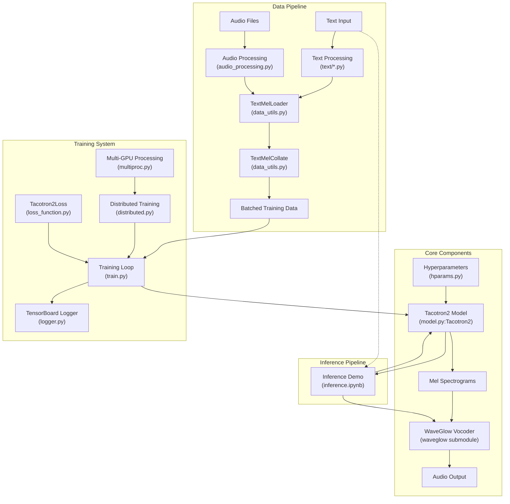
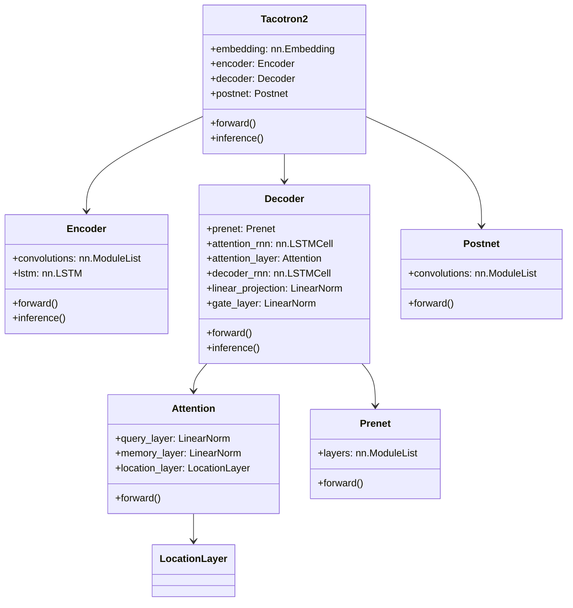
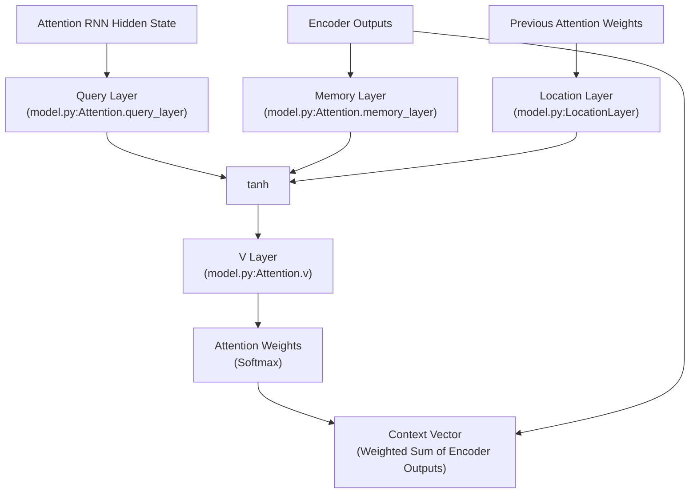
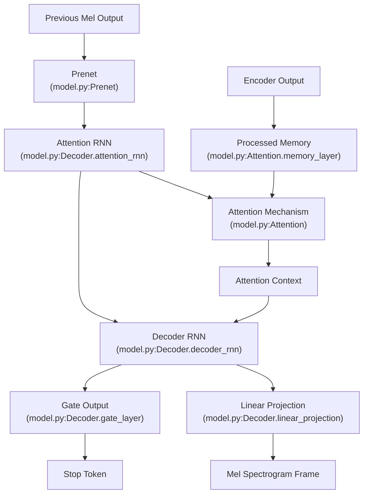
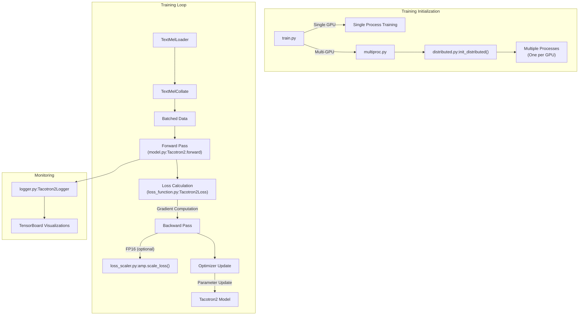
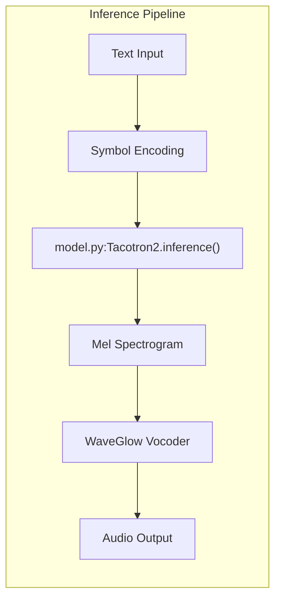

<!-- source: DeepWiki mcp.deepwiki.com · repo NVIDIA/tacotron2 · page 3 System Architecture · fetched 2026-10-26 -->

# System Architecture

<details>
<summary>Relevant source files</summary>

The following files were used as context for generating this wiki page:

- [.gitmodules](.gitmodules)
- [LICENSE](LICENSE)
- [README.md](README.md)
- [model.py](model.py)

</details>


## Purpose and Scope

This document provides a detailed overview of the NVIDIA Tacotron2 system architecture. It describes the core components, their interactions, and how they work together to implement the text-to-speech synthesis system outlined in the paper [Natural TTS Synthesis By Conditioning Wavenet On Mel Spectrogram Predictions](https://arxiv.org/pdf/1712.05884.pdf). 

This page focuses on the overall system architecture and component interactions. For details about specific components, see:
- For detailed Tacotron2 model architecture, see [Tacotron2 Model](#3.1)
- For WaveGlow vocoder integration, see [WaveGlow Integration](#3.2)
- For training process details, see [Training](#4)
- For inference functionality, see [Inference](#5)

## High-Level System Architecture

The following diagram illustrates the high-level architecture of the NVIDIA Tacotron2 system:



Sources: [README.md:1-81](), [model.py:457-530](), [.gitmodules:1-5]()

## Core Components

The Tacotron2 implementation consists of several key components that work together to convert text to speech:

1. **Tacotron2 Model**: The core sequence-to-sequence model that converts text to mel spectrograms
2. **WaveGlow Vocoder**: A flow-based generative network that converts mel spectrograms to audio waveforms
3. **Data Processing Pipeline**: Components for processing text and audio data
4. **Training System**: Manages the training process, including distributed training and logging

### Tacotron2 Model Structure

The Tacotron2 model is defined in `model.py` and consists of several submodules:



Sources: [model.py:10-530]()

## Data Flow Pipeline

The following diagram illustrates the flow of data through the Tacotron2 system, from input text to output audio:

```mermaid
flowchart LR
    subgraph "Input Processing"
        Text["Text Input"] --> TextSymbols["Symbol Encoding<br>(text/symbols.py)"]
        TextSymbols --> TextEmbedding["Text Embedding<br>(model.py:Tacotron2.embedding)"]
    end

    subgraph "Tacotron2 Model"
        TextEmbedding --> T2Encoder["Encoder<br>(model.py:Encoder)"]
        T2Encoder --> T2Decoder["Decoder<br>(model.py:Decoder)"]
        T2Decoder --> MelOut["Mel Outputs"]
        MelOut --> T2Postnet["Postnet<br>(model.py:Postnet)"]
        T2Postnet --> RefinedMelOut["Refined Mel Outputs"]
    end

    subgraph "Vocoder"
        RefinedMelOut --> WGVocoder["WaveGlow Vocoder<br>(waveglow submodule)"]
        WGVocoder --> AudioOut["Audio Output"]
    end
```



Sources: [model.py:149-529]()

## Component Descriptions

### Text Embedding and Encoder

The text processing pipeline begins with converting input text into a sequence of symbols, which are then embedded into a continuous vector space by the embedding layer. The encoder processes these embeddings to create a representation that captures the text content.

The encoder consists of:
- A series of convolutional layers (usually 3) with ReLU activations and dropout
- A bidirectional LSTM that processes the outputs of the convolutional layers

```
Text Input → Symbol Encoding → Embedding → Convolutional Layers → Bidirectional LSTM → Encoder Outputs
```

Sources: [model.py:149-201](), [model.py:457-505]()

### Attention Mechanism

The attention mechanism is a critical component that allows the decoder to focus on relevant parts of the encoder output when generating each frame of the mel spectrogram. It implements location-sensitive attention:



Sources: [model.py:10-86]()

### Decoder Structure

The decoder generates mel spectrogram frames autoregressively, using an attention mechanism to focus on relevant parts of the encoder output:



Sources: [model.py:204-454]()

### Postnet Refinement

The Postnet refines the mel spectrogram outputs from the decoder, improving their quality:

```
Decoder Mel Outputs → 5 Convolutional Layers → Residual Connection → Refined Mel Outputs
```

The Postnet consists of 5 convolutional layers with tanh activation functions and dropout. The output of the Postnet is added to the original decoder output (residual connection).

Sources: [model.py:103-146](), [model.py:510-511]()

## Training System Architecture

The training system supports both single-GPU and distributed multi-GPU training:



Sources: [README.md:32-44]()

## Inference Process

During inference, the system takes input text and produces audio output:



The inference process is implemented in `inference.ipynb` and uses the trained Tacotron2 model and WaveGlow vocoder to generate speech from text.

Sources: [model.py:517-529](), [README.md:46-54]()

## Integration with WaveGlow

The Tacotron2 system integrates with the WaveGlow neural vocoder, which is included as a Git submodule. WaveGlow is responsible for converting the mel spectrograms generated by Tacotron2 into audio waveforms.

The integration is fairly simple:
1. Tacotron2 generates mel spectrograms
2. These mel spectrograms are passed to WaveGlow
3. WaveGlow converts the mel spectrograms to audio waveforms

For detailed information about WaveGlow, see [WaveGlow Integration](#3.2).

Sources: [.gitmodules:1-5](), [README.md:11-12]()

## System Requirements and Dependencies

The Tacotron2 implementation has the following requirements:

- NVIDIA GPU with CUDA and cuDNN
- PyTorch 1.0 or later
- Apex for distributed training and automatic mixed precision
- LJSpeech dataset for training

For detailed installation instructions, see [Installation & Requirements](#2).

Sources: [README.md:17-30]()

---

