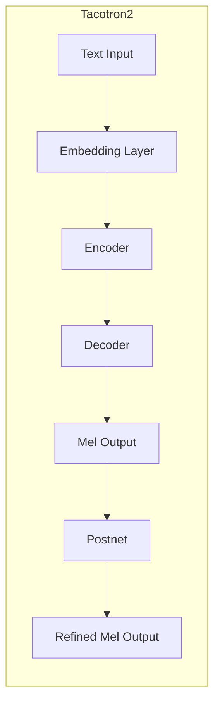
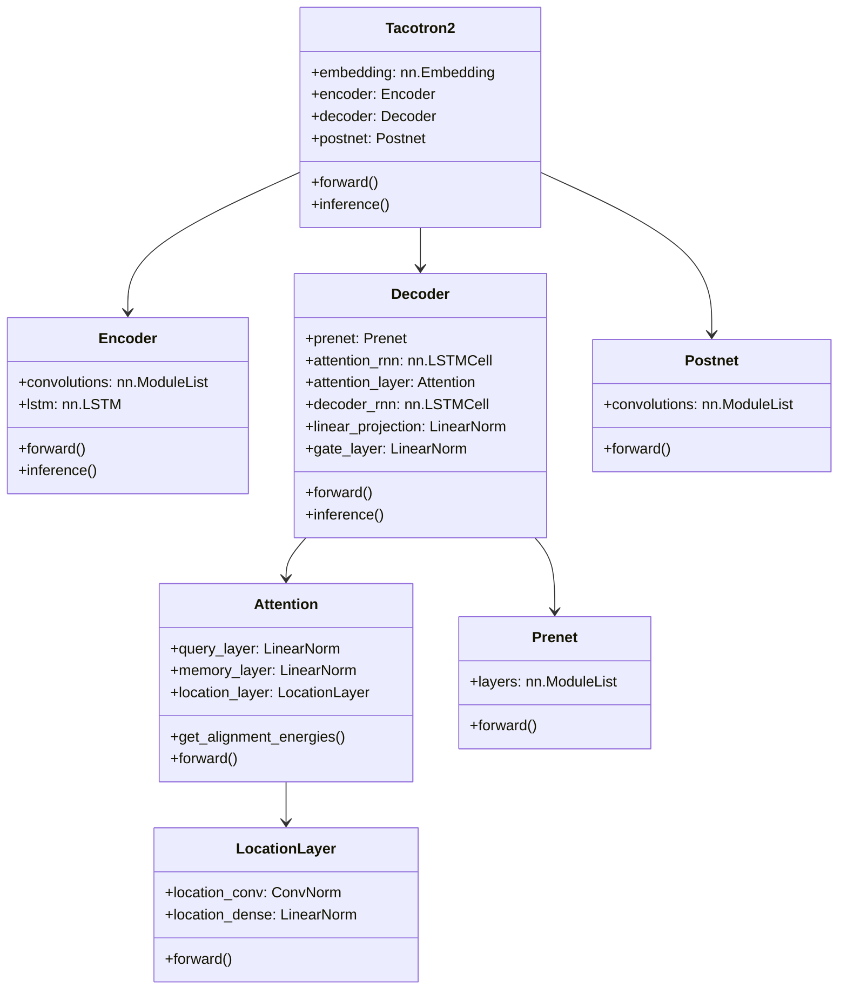
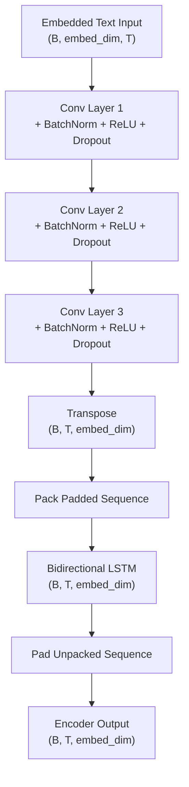
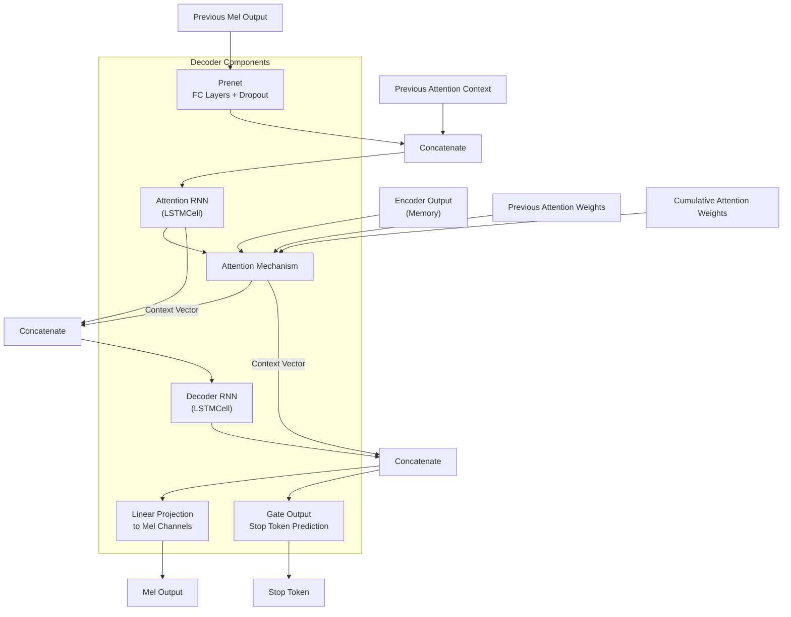
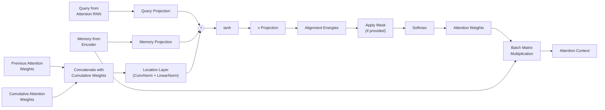
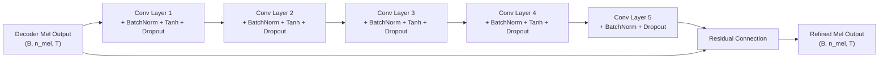
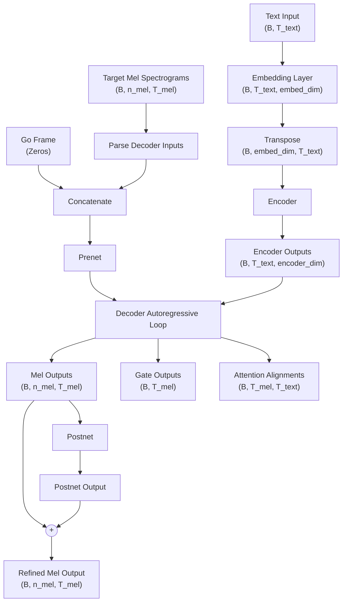
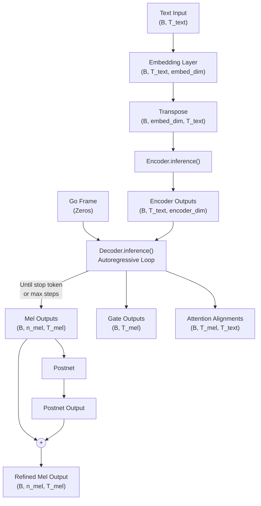
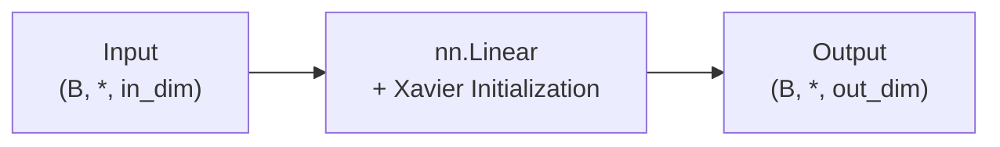
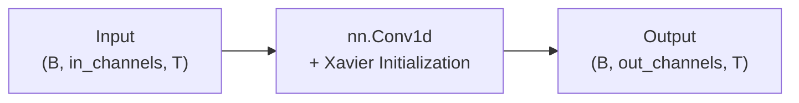

<!-- source: DeepWiki mcp.deepwiki.com · repo NVIDIA/tacotron2 · page 3.1 Tacotron2 Model · fetched 2026-10-26 -->

# Tacotron2 Model

Relevant source files

The following files were used as context for generating this wiki page:

- [layers.py](layers.py)
- [model.py](model.py)

This document provides a detailed technical explanation of the Tacotron2 model implemented in NVIDIA's repository. It covers the model architecture, components, data flow, and operation modes. For information about the WaveGlow vocoder that converts the mel spectrograms to audio waveforms, see [WaveGlow Integration](#3.2).

## 1. Model Overview

Tacotron2 is a neural text-to-speech model that generates mel spectrograms from text input. It implements a sequence-to-sequence architecture with attention, consisting of an encoder that processes text embeddings, an attention-based decoder that generates mel spectrogram frames, and a postnet that refines the generated mel spectrograms.

Sources: [model.py:457-529]()

## 2. Model Components

The Tacotron2 model consists of several key components, each implemented as separate classes in the codebase:

Sources: [model.py:10-529]()

## 3. Detailed Architecture

### 3.1. Encoder

The encoder transforms input text embeddings into a sequence of hidden features. It consists of convolutional layers followed by a bidirectional LSTM.

The encoder processes character embeddings through:
1. Multiple 1D convolutional layers (`hparams.encoder_n_convolutions`) with ReLU activation, batch normalization, and dropout
2. A bidirectional LSTM that captures sequential information

Sources: [model.py:149-201]()

### 3.2. Decoder

The decoder generates mel spectrogram frames using an autoregressive approach with attention.

The decoder's key components are:

1. **Prenet**: A bottleneck of fully connected layers with dropout applied during both training and inference
2. **Attention RNN**: A unidirectional LSTM cell that processes the prenet output and previous attention context
3. **Attention Mechanism**: A location-sensitive attention that focuses on relevant parts of the encoder output
4. **Decoder RNN**: A unidirectional LSTM cell that processes the attention RNN output and attention context
5. **Linear Projection**: Maps decoder RNN output to mel spectrogram frames
6. **Gate Layer**: Predicts the stop token to determine when to end generation

Sources: [model.py:204-454]()

### 3.3. Attention Mechanism

The attention mechanism implements location-sensitive attention:
1. Processes the query from the attention RNN
2. Processes the memory from the encoder
3. Processes the previous and cumulative attention weights through a location layer
4. Combines these processed features to calculate alignment energies
5. Converts alignment energies to attention weights using softmax
6. Uses attention weights to compute a weighted sum of encoder outputs (context)

Sources: [model.py:29-86](), [model.py:10-26]()

### 3.4. Postnet

The postnet consists of 5 convolutional layers with batch normalization and dropout:
1. First 4 layers use tanh activation
2. The final layer has no activation
3. The output is added to the original decoder output (residual connection)

Sources: [model.py:103-146]()

## 4. Data Flow

### 4.1. Training Flow

During training:
1. Text inputs are embedded and passed through the encoder
2. Target mel spectrograms are processed to create teacher-forced decoder inputs
3. The decoder generates mel outputs autoregressively, but using teacher forcing
4. The postnet refines the decoder's mel outputs
5. The model outputs include:
   - Initial mel outputs
   - Refined mel outputs (after postnet)
   - Gate outputs (stop token predictions)
   - Attention alignments

Sources: [model.py:499-515]()

### 4.2. Inference Flow

During inference:
1. Text inputs are embedded and passed through the encoder
2. The decoder generates mel outputs autoregressively, using previous outputs as inputs
3. Generation stops when the gate output exceeds the threshold or maximum steps are reached
4. The postnet refines the decoder's mel outputs
5. The model outputs include:
   - Initial mel outputs
   - Refined mel outputs (after postnet)
   - Gate outputs (stop token predictions)
   - Attention alignments

Sources: [model.py:517-529](), [model.py:418-454]()

## 5. Key Parameters and Hyperparameters

The Tacotron2 model behavior is controlled by various hyperparameters that are passed to its constructor.

| Component | Parameter | Description |
|-----------|-----------|-------------|
| Embedding | `n_symbols` | Size of the character vocabulary |
| Embedding | `symbols_embedding_dim` | Dimension of character embeddings |
| Encoder | `encoder_embedding_dim` | Dimension of encoder outputs |
| Encoder | `encoder_n_convolutions` | Number of encoder convolution layers |
| Encoder | `encoder_kernel_size` | Kernel size for encoder convolutions |
| Decoder | `n_frames_per_step` | Number of frames to generate per decoder step |
| Decoder | `attention_rnn_dim` | Dimension of attention RNN |
| Decoder | `decoder_rnn_dim` | Dimension of decoder RNN |
| Decoder | `prenet_dim` | Dimension of prenet layers |
| Decoder | `max_decoder_steps` | Maximum number of decoder steps during inference |
| Decoder | `gate_threshold` | Threshold for stopping generation |
| Attention | `attention_dim` | Dimension of attention system |
| Attention | `attention_location_n_filters` | Number of filters in location layer |
| Attention | `attention_location_kernel_size` | Kernel size for location layer |
| Postnet | `postnet_embedding_dim` | Dimension of postnet layers |
| Postnet | `postnet_kernel_size` | Kernel size for postnet convolutions |
| Postnet | `postnet_n_convolutions` | Number of postnet convolution layers |
| General | `n_mel_channels` | Number of mel spectrogram channels |
| General | `mask_padding` | Whether to mask padding in loss calculation |
| General | `fp16_run` | Whether to use FP16 precision |

Sources: [model.py:457-471]()

## 6. Core Building Blocks

Tacotron2 uses several custom neural network building blocks:

### 6.1. LinearNorm

A linear layer with Xavier uniform initialization, used throughout the model.

Sources: [layers.py:8-18]()

### 6.2. ConvNorm

A 1D convolutional layer with Xavier uniform initialization, used in encoder and postnet.

Sources: [layers.py:21-39]()

## 7. Forward and Inference Modes

The Tacotron2 model operates in two modes:

### 7.1 Forward Mode (Training)

This mode is used during training with teacher forcing:
1. Text inputs are embedded and encoded
2. Target mel spectrograms guide the decoder (teacher forcing)
3. A "go" frame of zeros initiates the sequence
4. Loss is computed based on the difference between generated and target mel spectrograms

Sources: [model.py:499-515]()

### 7.2 Inference Mode

This mode is used for generation:
1. Text inputs are embedded and encoded
2. A "go" frame of zeros initiates the sequence
3. The decoder autoregressively generates mel frames
4. Generation stops when the gate output exceeds the threshold or maximum steps are reached

Sources: [model.py:517-529](), [model.py:418-454]()

## 8. Summary

The NVIDIA Tacotron2 implementation follows the architecture described in the "Natural TTS Synthesis by Conditioning WaveNet on Mel Spectrogram Predictions" paper, with an encoder-decoder architecture using location-sensitive attention. The model generates mel spectrograms from text input, which can then be converted to audio using the WaveGlow vocoder (covered in [WaveGlow Integration](#3.2)). The implementation supports both training and inference modes, with various hyperparameters to control model behavior and performance.

---

