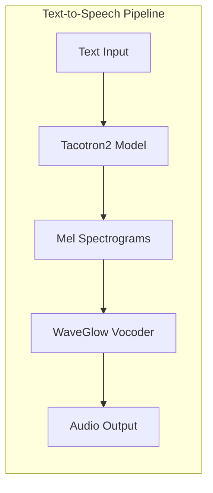
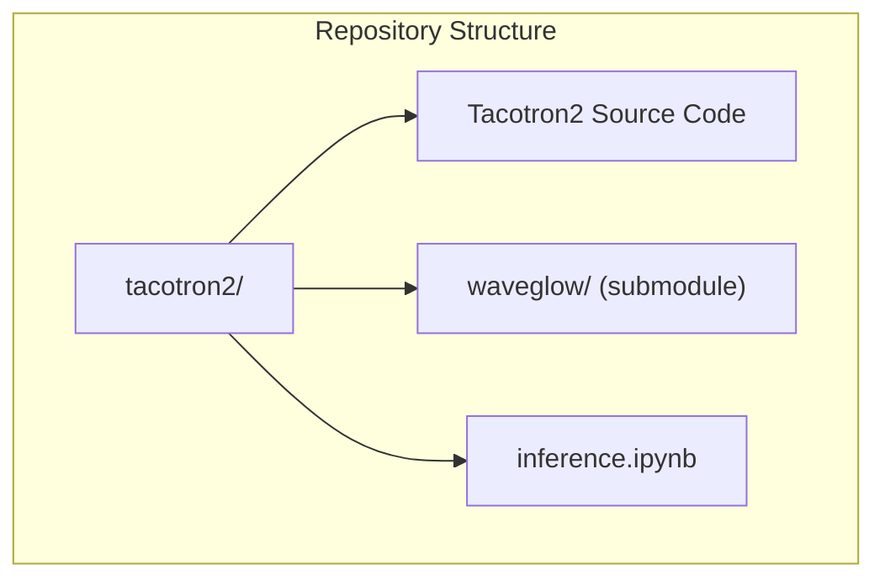
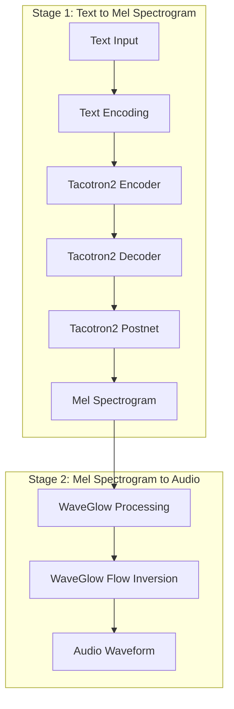
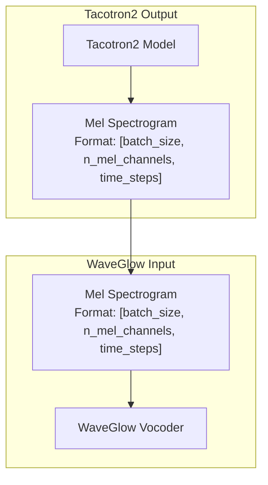

<!-- source: DeepWiki mcp.deepwiki.com · repo NVIDIA/tacotron2 · page 3.2 WaveGlow Integration · fetched 2026-10-26 -->

# WaveGlow Integration

<details>
<summary>Relevant source files</summary>

The following files were used as context for generating this wiki page:

- [.gitmodules](.gitmodules)
- [LICENSE](LICENSE)
- [README.md](README.md)

</details>


## Purpose and Scope

This document explains how the WaveGlow neural vocoder is integrated into the Tacotron2 text-to-speech system. It covers the role of WaveGlow in the overall architecture, how to set up and use WaveGlow with Tacotron2, and how data flows between these components. For information about the Tacotron2 model itself, see [Tacotron2 Model](#3.1). For details on audio processing techniques used in the system, see [Audio Processing](#3.3).

## Introduction to WaveGlow

WaveGlow is a flow-based generative network for speech synthesis developed by NVIDIA. In the Tacotron2 system, WaveGlow serves as the vocoder component that transforms mel spectrograms (produced by the Tacotron2 model) into high-quality audio waveforms.



Sources: [README.md:3-4](), [README.md:57-58]()

## Repository Structure and Setup

WaveGlow is included in the Tacotron2 repository as a git submodule:



To set up WaveGlow after cloning the Tacotron2 repository:

1. Initialize and update the submodule:
   ```
   git submodule init
   git submodule update
   ```

2. Download the pre-trained WaveGlow model mentioned in the README.

Sources: [.gitmodules:1-4](), [README.md:24]()

## Integration Architecture

The integration between Tacotron2 and WaveGlow forms a two-stage pipeline:



This two-stage approach separates text-to-spectrogram conversion from spectrogram-to-audio synthesis, allowing each component to be optimized independently.

Sources: [README.md:3-4](), [README.md:52-53]()

## Data Flow Between Components

The primary data interface between Tacotron2 and WaveGlow is the mel spectrogram format:



**Critical compatibility note**: As stated in the README, "When performing Mel-Spectrogram to Audio synthesis, make sure Tacotron2 and the Mel decoder were trained on the same mel-spectrogram representation." This means the mel spectrogram parameters (such as number of mel bands, frequency range, etc.) must be consistent between both models.

Sources: [README.md:52-53]()

## Using WaveGlow for Inference

The primary use of WaveGlow with Tacotron2 is during inference. The repository provides an inference Jupyter notebook for this purpose:

1. Download the pre-trained Tacotron2 model
2. Download the pre-trained WaveGlow model
3. Run the inference notebook:
   ```
   jupyter notebook --ip=127.0.0.1 --port=31337
   ```
4. Load `inference.ipynb`

The inference notebook demonstrates the complete pipeline from text input to audio output, using both Tacotron2 and WaveGlow models.

| Component | Input | Output | Pre-trained Model Link |
|-----------|-------|--------|------------------------|
| Tacotron2 | Text | Mel Spectrogram | [Tacotron 2 Model](https://drive.google.com/file/d/1c5ZTuT7J08wLUoVZ2KkUs_VdZuJ86ZqA/view?usp=sharing) |
| WaveGlow | Mel Spectrogram | Audio Waveform | [WaveGlow Model](https://drive.google.com/open?id=1rpK8CzAAirq9sWZhe9nlfvxMF1dRgFbF) |

Sources: [README.md:47-50](), [README.md:75-76]()

## Summary

WaveGlow serves as the vocoder component in the Tacotron2 text-to-speech pipeline, converting mel spectrograms into high-quality audio waveforms. It's integrated as a git submodule and primarily used during inference through the provided Jupyter notebook. When using these components together, ensuring compatibility in the mel spectrogram representation is essential for successful integration.

---

