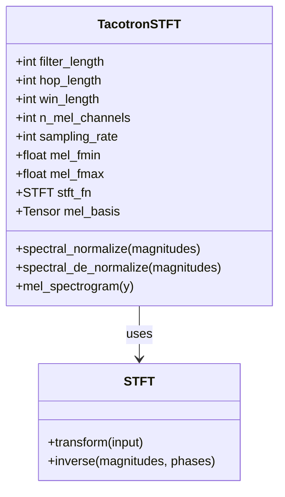
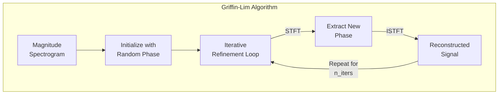
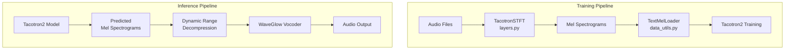

<!-- source: DeepWiki mcp.deepwiki.com · repo NVIDIA/tacotron2 · page 3.3 Audio Processing · fetched 2026-10-26 -->

# Audio Processing

<details>
<summary>Relevant source files</summary>

The following files were used as context for generating this wiki page:

- [audio_processing.py](audio_processing.py)
- [layers.py](layers.py)

</details>


This document describes the audio processing subsystem in Tacotron2, which handles the conversion between raw audio waveforms and mel spectrograms. Audio processing is a critical component of the overall text-to-speech pipeline, working primarily during data preparation for training and during the final synthesis step when converting generated spectrograms back to audio. For text processing components, see [Text Processing](#3.4).

## Overview and Purpose

The audio processing subsystem serves two main purposes in the Tacotron2 architecture:

1. **For Training**: Converts input audio waveforms into mel spectrograms that serve as target outputs for the Tacotron2 model
2. **For Inference**: Enables transformation of the predicted mel spectrograms back into audio waveforms

```mermaid
flowchart LR
    subgraph "Audio Processing Pipeline"
        direction LR
        Audio["Raw Audio\nWaveform"] --> STFT["Short-Time\nFourier Transform\n(STFT)"]
        STFT --> Magnitudes["Magnitude\nSpectrogram"]
        Magnitudes --> MelFilter["Mel Filter Bank\nApplication"]
        MelFilter --> MelSpec["Mel\nSpectrogram"]
        MelSpec --> DRC["Dynamic Range\nCompression"]
        DRC --> NormalizedMel["Normalized\nMel Spectrogram"]
        
        NormalizedMel -.-> DRD["Dynamic Range\nDecompression"]
        DRD -.-> DecompressedMel["Decompressed\nMel Spectrogram"]
        DecompressedMel -.-> GriffinLim["Griffin-Lim\nAlgorithm"]
        GriffinLim -.-> AudioOut["Reconstructed\nAudio"]
        
        classDef mainPath fill:#fff,stroke:#000
        classDef optionalPath fill:#fff,stroke:#000,stroke-dasharray: 5 5
        class Audio,STFT,Magnitudes,MelFilter,MelSpec,DRC,NormalizedMel mainPath
        class DRD,DecompressedMel,GriffinLim,AudioOut optionalPath
    end
```



Sources: [audio_processing.py:1-94](), [layers.py:42-80]()

## Key Components

### TacotronSTFT

The central class for audio processing is `TacotronSTFT`, which encapsulates the functionality for converting between audio waveforms and mel spectrograms.



Sources: [layers.py:42-80]()

The `TacotronSTFT` class is initialized with the following parameters:

| Parameter | Default | Description |
|-----------|---------|-------------|
| filter_length | 1024 | Number of FFT points |
| hop_length | 256 | Number of audio samples between adjacent STFT columns |
| win_length | 1024 | Length of the windowed signal |
| n_mel_channels | 80 | Number of mel bands |
| sampling_rate | 22050 | Audio sampling rate in Hz |
| mel_fmin | 0.0 | Lowest frequency (in Hz) |
| mel_fmax | 8000.0 | Highest frequency (in Hz) |

Sources: [layers.py:42-53]()

## Audio Processing Pipeline

### 1. Short-Time Fourier Transform (STFT)

The STFT is the first step in the audio processing pipeline. It transforms the time-domain audio signal into time-frequency domain representation.

```python
magnitudes, phases = self.stft_fn.transform(y)
```

The implementation uses the `STFT` class which performs:
- Windowing of the signal
- FFT computation
- Magnitude and phase extraction

Sources: [layers.py:76]()

### 2. Mel Filter Bank Application

After obtaining the magnitude spectrogram from STFT, the system applies a mel filter bank to convert the linear frequency scale to the mel scale, which better approximates human auditory perception.

```python
mel_output = torch.matmul(self.mel_basis, magnitudes)
```

The mel basis is created during initialization using Librosa's `mel` function:

```python
mel_basis = librosa_mel_fn(
    sampling_rate, filter_length, n_mel_channels, mel_fmin, mel_fmax)
```

Sources: [layers.py:50-53](), [layers.py:78]()

### 3. Dynamic Range Compression

The mel spectrogram is then compressed using logarithmic compression to reduce the dynamic range:

```python
mel_output = self.spectral_normalize(mel_output)
```

The spectral normalization function calls `dynamic_range_compression`:

```python
def dynamic_range_compression(x, C=1, clip_val=1e-5):
    return torch.log(torch.clamp(x, min=clip_val) * C)
```

This logarithmic compression makes the spectrograms more suitable for neural network training.

Sources: [layers.py:55-57](), [layers.py:79](), [audio_processing.py:78-84]()

### 4. Griffin-Lim Algorithm (for Audio Reconstruction)

For converting spectrograms back to audio (used during inference or for evaluation), the system employs the Griffin-Lim algorithm for phase reconstruction.



The Griffin-Lim algorithm iteratively refines the phase information to reconstruct a signal whose magnitude spectrogram closely matches the input:

1. Initialize with random phase
2. Reconstruct signal using inverse STFT
3. Compute STFT of the reconstructed signal
4. Replace magnitude with the target magnitude, keep the new phase
5. Repeat steps 2-4 for a fixed number of iterations

Sources: [audio_processing.py:59-75]()

## Audio Processing Utility Functions

### Dynamic Range Compression and Decompression

These functions handle the logarithmic compression and decompression of spectrograms:

```python
def dynamic_range_compression(x, C=1, clip_val=1e-5):
    return torch.log(torch.clamp(x, min=clip_val) * C)

def dynamic_range_decompression(x, C=1):
    return torch.exp(x) / C
```

The compression factor `C` can be adjusted to control the amount of compression.

Sources: [audio_processing.py:78-93]()

### Window Sum-Square

This utility function computes the sum-square envelope of a window function at a given hop length, which is used to estimate modulation effects induced by windowing in STFTs:

```python
def window_sumsquare(window, n_frames, hop_length=200, win_length=800,
                     n_fft=800, dtype=np.float32, norm=None):
    # Implementation details...
```

Sources: [audio_processing.py:7-56]()

## Integration with the Tacotron2 System

The audio processing subsystem integrates with the rest of Tacotron2 in the following ways:



Sources: [layers.py:42-80](), [audio_processing.py:87-93]()

During training:
1. Raw audio files are processed into mel spectrograms using `TacotronSTFT`
2. The spectrograms are fed to the data loader as targets
3. The Tacotron2 model learns to predict these spectrograms from text input

During inference:
1. The Tacotron2 model generates mel spectrograms from text
2. The spectrograms are decompressed using `dynamic_range_decompression`
3. The WaveGlow vocoder (or alternatively Griffin-Lim) converts the spectrograms back to audio

## Common Parameters and Configuration

The audio processing parameters can significantly impact the quality of the generated audio and the training of the model. Here are the key parameters:

| Parameter | Purpose | Typical Value | Impact |
|-----------|---------|---------------|--------|
| filter_length | FFT size | 1024 | Controls frequency resolution |
| hop_length | Frame shift | 256 | Affects time resolution and overlap |
| win_length | Window size | 1024 | Controls the trade-off between time and frequency resolution |
| n_mel_channels | Number of mel bands | 80 | Determines spectrogram dimensionality |
| sampling_rate | Audio sample rate | 22050 Hz | Affects frequency range |
| mel_fmin | Minimum frequency | 0 Hz | Filters out low frequencies |
| mel_fmax | Maximum frequency | 8000 Hz | Filters out high frequencies |

Sources: [layers.py:42-53]()

## Conclusion

The audio processing subsystem in Tacotron2 provides the critical functionality of converting between audio waveforms and mel spectrograms. It uses techniques like STFT, mel filtering, and dynamic range compression to create representations suitable for neural network training. For inference, it can employ the Griffin-Lim algorithm for phase reconstruction, although the Tacotron2 system typically uses the WaveGlow vocoder for higher-quality audio synthesis (see [WaveGlow Integration](#3.2) for details).

---

