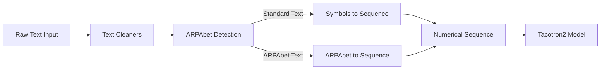
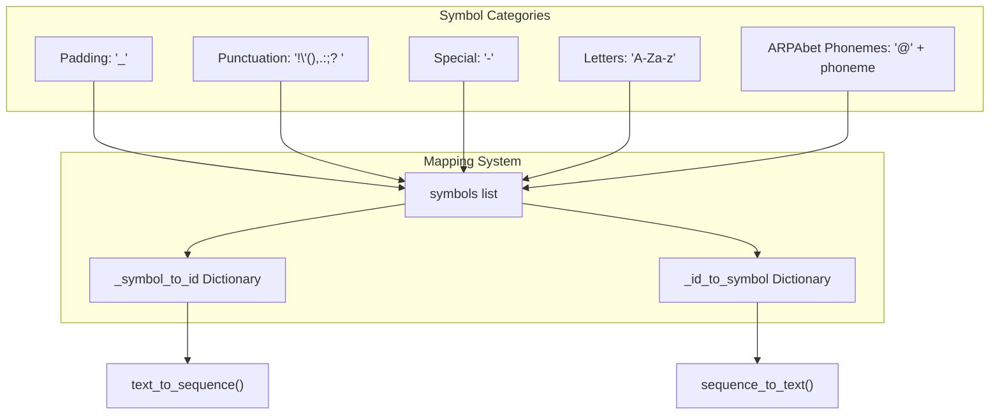
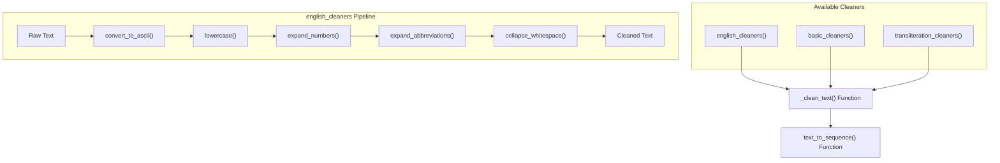
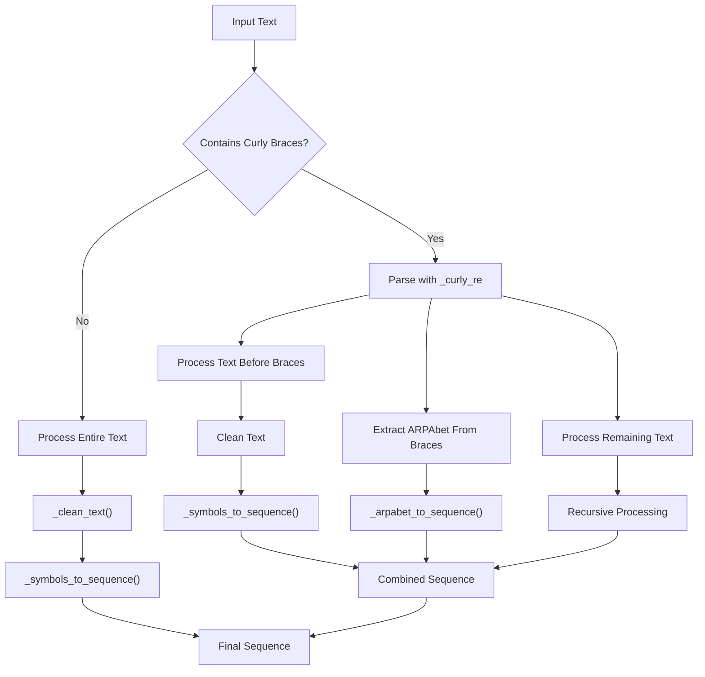
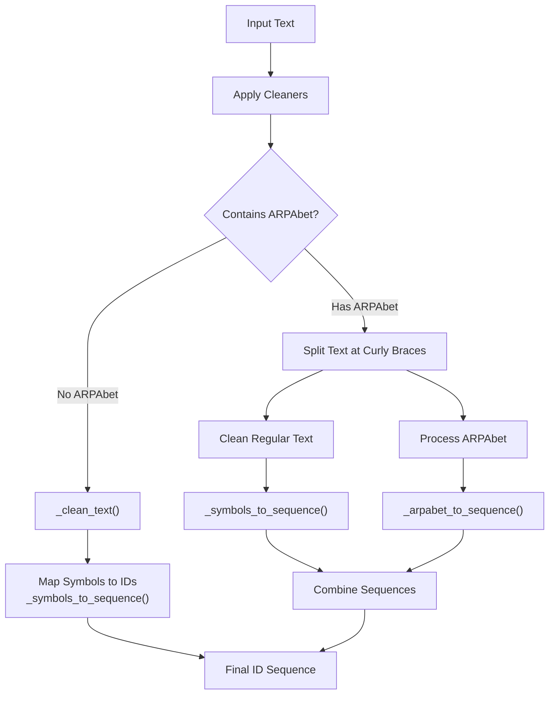

<!-- source: DeepWiki mcp.deepwiki.com · repo NVIDIA/tacotron2 · page 3.4 Text Processing · fetched 2026-10-26 -->

# Text Processing

<details>
<summary>Relevant source files</summary>

The following files were used as context for generating this wiki page:

- [text/__init__.py](text/__init__.py)
- [text/cleaners.py](text/cleaners.py)
- [text/cmudict.py](text/cmudict.py)
- [text/numbers.py](text/numbers.py)
- [text/symbols.py](text/symbols.py)

</details>


## Purpose and Scope

This document provides a detailed explanation of the text processing system in NVIDIA's Tacotron2 implementation. The text processing pipeline converts raw text input into numerical sequences that can be fed into the neural network model. This is a critical component that bridges human-readable text with the numerical representations required by the Tacotron2 model.

For information about how audio data is processed in the system, please see [Audio Processing](#3.3).

## Text Processing Pipeline Overview

The text processing system transforms natural language text into sequences of numerical IDs that represent symbols the model recognizes. This process handles text normalization, cleaning, pronunciation control, and symbol-to-ID conversion.



Sources: [text/__init__.py:15-40]()

## Symbol System

Tacotron2 operates on a defined set of symbols that the model can process. These symbols are organized into categories and mapped to numerical IDs for model input.



The symbol system consists of:
- A padding symbol (`_`)
- Punctuation marks (`!\'(),.:;? `)
- Special characters (`-`)
- Standard English letters (`A-Z`, `a-z`)
- ARPAbet phonetic symbols (prefixed with `@` for uniqueness)

These symbols are defined in [text/symbols.py:9-18]() and two dictionaries handle the mapping between symbols and their numerical IDs:
- `_symbol_to_id`: Maps symbols to numerical IDs [text/__init__.py:8]()
- `_id_to_symbol`: Maps numerical IDs back to symbols [text/__init__.py:9]()

Sources: [text/symbols.py:1-19](), [text/__init__.py:7-9]()

## Text Cleaning and Normalization

The system provides several text cleaner functions to preprocess and normalize input text. These are defined in [text/cleaners.py]() and are selected by passing cleaner names to the `text_to_sequence` function.



The system includes three main cleaner pipelines:

1. **basic_cleaners**: Simple pipeline that lowercases text and normalizes whitespace
2. **transliteration_cleaners**: For non-English text that needs transliteration to ASCII
3. **english_cleaners**: Most comprehensive pipeline for English text that includes:
   - Converting to ASCII using `unidecode`
   - Lowercasing all text
   - Expanding numbers (e.g., "123" → "one hundred twenty-three")
   - Expanding abbreviations (e.g., "Dr." → "doctor")
   - Normalizing whitespace

Number expansion is handled by a set of functions in [text/numbers.py]() which use regular expressions to identify different number formats and the `inflect` library to convert them to words.

Sources: [text/cleaners.py:1-90](), [text/numbers.py:1-71]()

## Pronunciation Handling with ARPAbet

Tacotron2 supports precise pronunciation control through ARPAbet, a phonetic notation system used in the CMU Pronouncing Dictionary.



Key features of the ARPAbet handling system:

1. **Embedded Pronunciation**: Users can embed specific pronunciations in text by enclosing ARPAbet symbols in curly braces:
   ```
   Turn left on {HH AW1 S S T AH0 N} Street.
   ```

2. **Detection and Processing**: The system uses a regular expression (`_curly_re`) defined in [text/__init__.py:12]() to detect and extract text within curly braces.

3. **Symbol Prefixing**: ARPAbet symbols are prefixed with `@` in the internal representation to avoid conflicts with regular text symbols [text/symbols.py:15]().

4. **CMU Dictionary Integration**: The system includes a wrapper for the CMU Pronouncing Dictionary in [text/cmudict.py]() which defines valid ARPAbet symbols and provides dictionary lookups.

Sources: [text/__init__.py:11-40](), [text/cmudict.py:1-65]()

## Text-to-Sequence Conversion Process

The main function for converting text to sequences is `text_to_sequence()` in [text/__init__.py:15-40](). Here's a detailed look at the conversion process:



The conversion process follows these key steps:

1. The input text is analyzed for ARPAbet pronunciations enclosed in curly braces
2. Text without ARPAbet is cleaned using the specified cleaner functions
3. Text with ARPAbet is split, with parts before/after curly braces processed normally and the ARPAbet sections converted to their corresponding IDs
4. Regular text symbols are converted to IDs using `_symbols_to_sequence()` [text/__init__.py:65-66]()
5. ARPAbet symbols are converted to IDs using `_arpabet_to_sequence()` [text/__init__.py:69-70]()
6. All sequences are combined into the final numerical sequence

For debugging purposes, the system also provides `sequence_to_text()` [text/__init__.py:43-53]() which converts numerical sequences back to human-readable text.

Sources: [text/__init__.py:15-74]()

## Integration with the Tacotron2 System

The text processing pipeline integrates with the rest of the Tacotron2 system in both training and inference workflows.

```mermaid
graph TD
    subgraph "Training Flow"
        TrainText["Training Text"] --> TxtProc1["text_to_sequence()"]
        TxtProc1 --> Seq1["Symbol ID Sequence"]
        Seq1 --> DataLoader["TextMelLoader"]
        DataLoader --> Collate["TextMelCollate"]
        Collate --> Batch["Batched Data"]
        Batch --> TrainLoop["Training Loop"]
    end
    
    subgraph "Inference Flow"
        UserText["User Input Text"] --> TxtProc2["text_to_sequence()"]
        TxtProc2 --> Seq2["Symbol ID Sequence"]
        Seq2 --> Model["Tacotron2 Model"]
        Model --> MelSpec["Mel Spectrogram"]
        MelSpec --> Vocoder["WaveGlow Vocoder"]
        Vocoder --> Audio["Audio Output"]
    end
```



Important integration aspects:

1. **Consistent Processing**: The same text processing pipeline is used in both training and inference to ensure consistency.

2. **Training Integration**: During training, the `TextMelLoader` class processes text from the dataset files using the text processing functions.

3. **Inference Integration**: During inference (as shown in the inference notebook), user-provided text is processed through the same pipeline before being fed to the model.

4. **Symbol Handling**: The symbol set defined in [text/symbols.py]() must remain consistent between training and inference to ensure the model can correctly interpret the input sequences.

Sources: [text/__init__.py:15-53]()

## Conclusion

The text processing system in Tacotron2 serves as a critical bridge between natural language text and the numerical representations required by the neural network model. By providing consistent text normalization, cleaning, and symbol-to-ID conversion, it enables the model to learn effective mappings between text and speech. The inclusion of ARPAbet support allows for precise pronunciation control when needed, making the system flexible for various text-to-speech applications.

---

