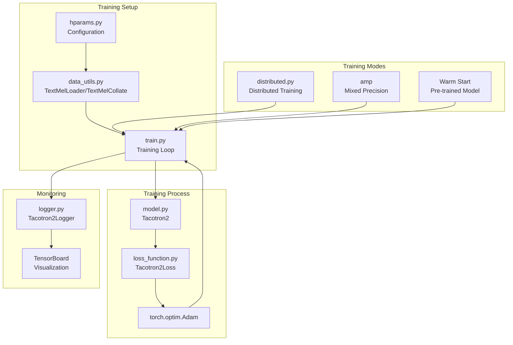
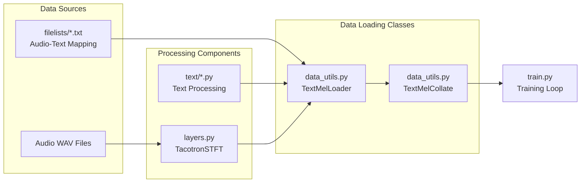
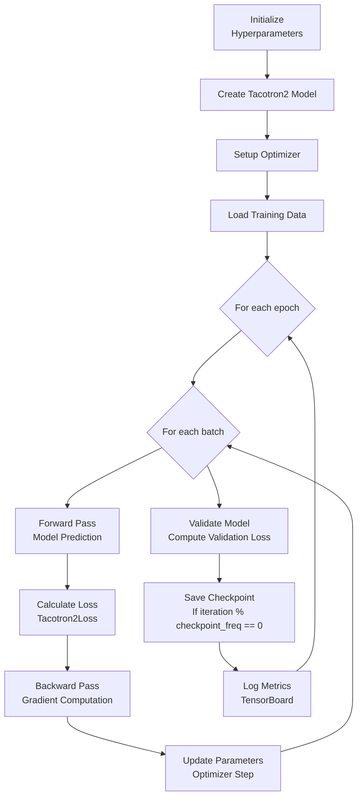
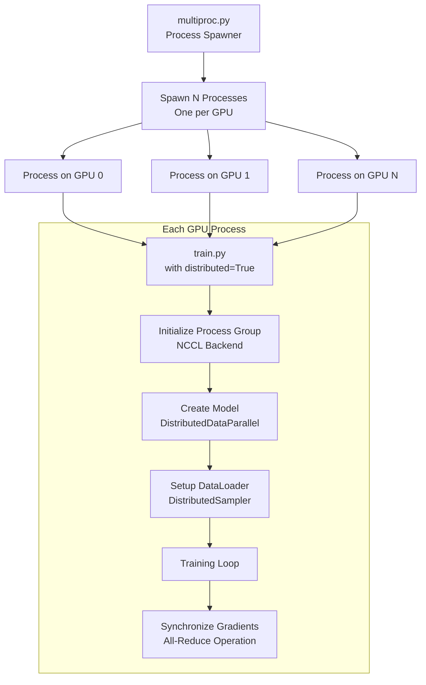
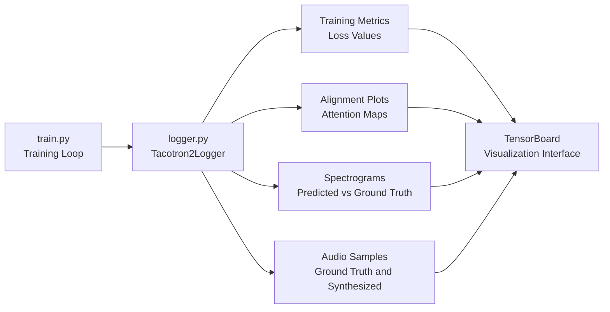

<!-- source: DeepWiki mcp.deepwiki.com · repo NVIDIA/tacotron2 · page 4 Training · fetched 2026-10-26 -->

# Training

<details>
<summary>Relevant source files</summary>

The following files were used as context for generating this wiki page:

- [LICENSE](LICENSE)
- [README.md](README.md)
- [hparams.py](hparams.py)

</details>


This document provides a comprehensive explanation of the training process for NVIDIA's Tacotron2 implementation. It covers data preparation, single-GPU and multi-GPU training workflows, hyperparameter configuration, and training monitoring. For information about inference using a trained model, see [Inference](#5), and for details about the model architecture itself, see [Tacotron2 Model](#3.1).

## Training Overview

Tacotron2 training is managed by the `train.py` script, which handles the training loop, loss calculation, gradient updates, checkpointing, and logging. The implementation supports both single-GPU and distributed multi-GPU training, as well as mixed precision training for improved performance.



Sources: [train.py](), [hparams.py](), [model.py](), [loss_function.py](), [distributed.py]()

## Training Configuration

Training is configured through the hyperparameters defined in `hparams.py`. These parameters control all aspects of the training process and model architecture.

Key hyperparameter categories include:

| Category | Description | Examples |
|----------|-------------|----------|
| Experiment Parameters | Control training process | epochs, checkpointing, seed |
| Data Parameters | Specify training data | file paths, text cleaners |
| Audio Parameters | Configure audio processing | sampling rate, mel specs settings |
| Model Parameters | Define model architecture | embedding dims, RNN sizes |
| Optimization Parameters | Control optimization | learning rate, batch size |

You can override default hyperparameters by passing them as command-line arguments when starting training.

Sources: [hparams.py:4-95]()

## Data Preparation and Loading

Before training, the LJSpeech dataset must be downloaded and preprocessed. The training scripts expect a file list in a specific format that maps audio file paths to their transcriptions.



The `TextMelLoader` class:
- Loads text and audio pairs from the filelist
- Processes text using the specified text cleaners
- Either loads pre-computed mel spectrograms or computes them on-the-fly
- Returns text and mel spectrogram pairs for training

The `TextMelCollate` class:
- Collects individual samples into batches
- Handles variable-length sequences through padding
- Creates input and target tensors for the model

Sources: [data_utils.py](), [layers.py](), [hparams.py:24-30]()

## Basic Training Flow

The standard training process follows these steps:

1. Parse command-line arguments and initialize hyperparameters
2. Set up the model, optimizer, and learning rate scheduler
3. Load training and validation data
4. For each epoch:
   - Process batches of data
   - Compute model outputs
   - Calculate loss
   - Update model parameters
   - Log metrics and examples
   - Save checkpoints periodically



Sources: [train.py](), [model.py](), [loss_function.py]()

## Distributed Training

Tacotron2 supports distributed training across multiple GPUs using PyTorch's DistributedDataParallel. This is handled by `multiproc.py` which spawns multiple processes, each training on a subset of the data.



To enable distributed training, set the `distributed_run` parameter to `True` and use `multiproc.py` to launch the training script:

```bash
python -m multiproc train.py --output_directory=outdir --log_directory=logdir --hparams=distributed_run=True
```

The distributed training setup:
- Divides the dataset among available GPUs
- Each process trains with its portion of data
- Gradients are synchronized across processes
- All models stay in sync with identical parameters

Sources: [multiproc.py](), [distributed.py](), [train.py](), [hparams.py:17-19]()

## Mixed Precision Training

Tacotron2 supports Automatic Mixed Precision (AMP) training, which uses a mix of FP16 (half-precision) and FP32 (single-precision) computations to speed up training without sacrificing accuracy.

To enable mixed precision training, set the `fp16_run` parameter to `True`:

```bash
python train.py --output_directory=outdir --log_directory=logdir --hparams=fp16_run=True
```

The implementation uses NVIDIA's Apex library for AMP, which:
- Automatically casts parts of the model to FP16 for faster computation
- Keeps a master copy of weights in FP32 for numerical stability
- Uses dynamic loss scaling to prevent underflow in gradients

Combined with distributed training:

```bash
python -m multiproc train.py --output_directory=outdir --log_directory=logdir --hparams=distributed_run=True,fp16_run=True
```

Sources: [train.py](), [hparams.py:15-16](), [loss_scaler.py]()

## Training Monitoring and Visualization

Training progress is monitored using the `Tacotron2Logger` class, which logs metrics and visualizations to TensorBoard:



The logger tracks:
- Training and validation loss values
- Alignment maps (attention weights)
- Mel spectrograms (predicted vs. ground truth)
- Audio samples (when available)

To start TensorBoard during training:

```bash
tensorboard --logdir=outdir/logdir
```

Visualization helps monitor:
- Whether the model is converging
- If alignments are being learned correctly
- Quality of predicted spectrograms
- Overall training progress

Sources: [logger.py](), [train.py](), [README.md:32-34]()

## Training with Pre-trained Models (Warm Start)

Tacotron2 supports training from a pre-trained model, which can lead to faster convergence. By default, the text embedding layers are ignored during warm start to accommodate different datasets.

To train using a pre-trained model:

```bash
python train.py --output_directory=outdir --log_directory=logdir -c tacotron2_statedict.pt --warm_start
```

The warm start process:
1. Loads the state dict from the checkpoint
2. Ignores specified layers (by default, the embedding layer)
3. Initializes the rest of the model with pre-trained weights
4. Continues training from this starting point

This is particularly useful when:
- Fine-tuning for a new speaker
- Adapting to a different dataset
- Continuing interrupted training

Sources: [train.py](), [hparams.py:22](), [README.md:36-41]()

## Command-Line Examples

Here are common training scenarios with their command-line invocations:

### Basic Single-GPU Training
```bash
python train.py --output_directory=outdir --log_directory=logdir
```

### Multi-GPU Distributed Training
```bash
python -m multiproc train.py --output_directory=outdir --log_directory=logdir --hparams=distributed_run=True
```

### Mixed Precision Training
```bash
python train.py --output_directory=outdir --log_directory=logdir --hparams=fp16_run=True
```

### Combined Distributed and Mixed Precision
```bash
python -m multiproc train.py --output_directory=outdir --log_directory=logdir --hparams=distributed_run=True,fp16_run=True
```

### Training with Custom Hyperparameters
```bash
python train.py --output_directory=outdir --log_directory=logdir --hparams=batch_size=32,learning_rate=1e-4
```

### Training from a Pre-trained Model
```bash
python train.py --output_directory=outdir --log_directory=logdir -c tacotron2_statedict.pt --warm_start
```

Sources: [README.md:32-44](), [train.py]()

---

