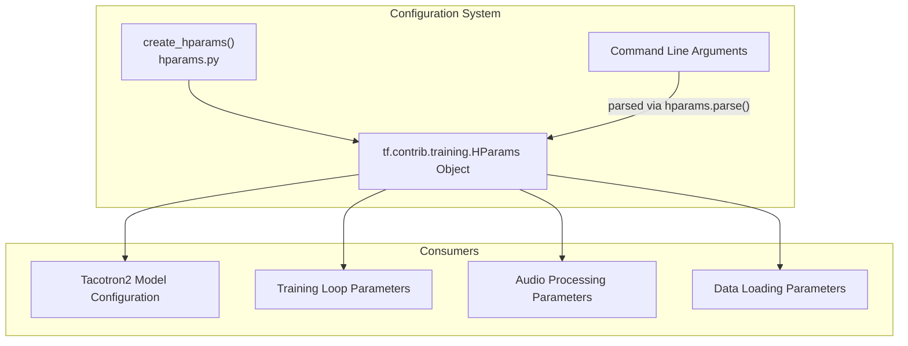
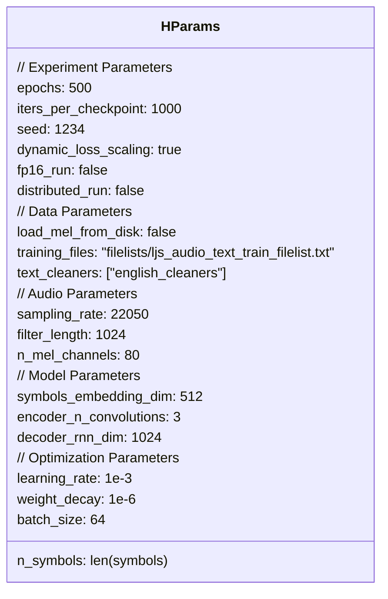
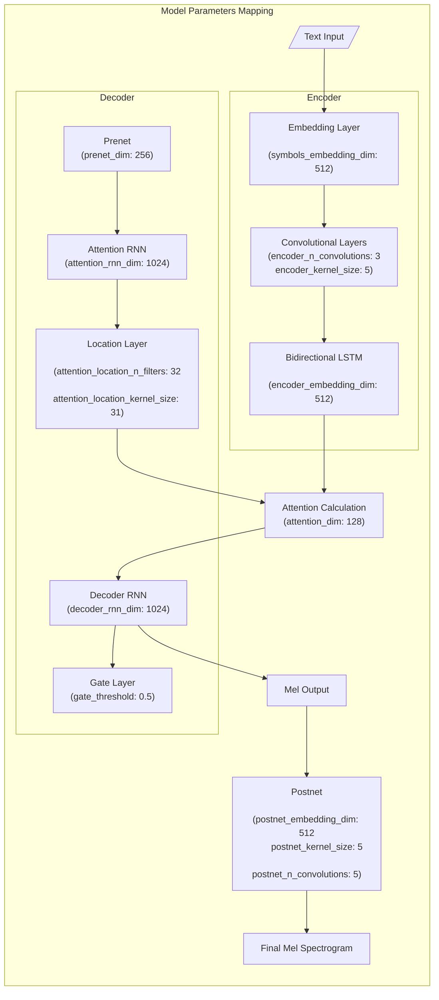
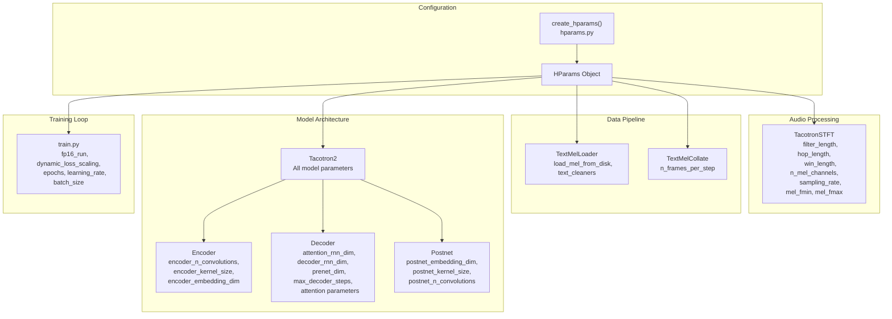

<!-- source: DeepWiki mcp.deepwiki.com · repo NVIDIA/tacotron2 · page 4.1 Configuration & Hyperparameters · fetched 2026-10-26 -->

# Configuration & Hyperparameters

<details>
<summary>Relevant source files</summary>

The following files were used as context for generating this wiki page:

- [hparams.py](hparams.py)

</details>


This document explains the configuration system and hyperparameters used in the NVIDIA Tacotron2 implementation. It covers how hyperparameters are defined, organized, and passed to different components of the system. For information about training procedures, see [Training](#4), and for details on data loading, see [Data Loading & Processing](#4.2).

## Configuration System Overview

The Tacotron2 implementation uses a centralized hyperparameter management system through TensorFlow's `HParams` class. All model, training, and audio processing parameters are defined in a single location, making it easy to configure and experiment with different settings.



**Diagram: Hyperparameter Configuration Flow**

Sources: [hparams.py:5-95]()

## Hyperparameter Definition

All hyperparameters are defined in the `create_hparams` function in `hparams.py`. This function creates a TensorFlow `HParams` object with default values for all parameters. The function also accepts an optional `hparams_string` parameter that allows overriding defaults via command-line arguments.



**Diagram: Main Hyperparameter Categories**

Sources: [hparams.py:8-86]()

## Hyperparameter Categories

The hyperparameters are organized into logical categories, each controlling a specific aspect of the Tacotron2 system.

### Experiment Parameters

These parameters control the overall training experiment and execution environment.

| Parameter | Default | Description |
|-----------|---------|-------------|
| `epochs` | 500 | Total number of training epochs |
| `iters_per_checkpoint` | 1000 | Iterations between model checkpoints |
| `seed` | 1234 | Random seed for reproducibility |
| `dynamic_loss_scaling` | True | Whether to use dynamic loss scaling for mixed precision training |
| `fp16_run` | False | Whether to use 16-bit floating point precision |
| `distributed_run` | False | Whether to use distributed training |
| `dist_backend` | "nccl" | Backend for distributed training |
| `dist_url` | "tcp://localhost:54321" | URL for distributed training |
| `cudnn_enabled` | True | Whether to use cuDNN for GPU acceleration |
| `cudnn_benchmark` | False | Whether to use cuDNN benchmarking |
| `ignore_layers` | ['embedding.weight'] | Layers to ignore when loading checkpoints |

Sources: [hparams.py:8-22]()

### Data Parameters

These parameters control data loading and processing.

| Parameter | Default | Description |
|-----------|---------|-------------|
| `load_mel_from_disk` | False | Whether to load pre-computed mel spectrograms |
| `training_files` | 'filelists/ljs_audio_text_train_filelist.txt' | Path to training filelist |
| `validation_files` | 'filelists/ljs_audio_text_val_filelist.txt' | Path to validation filelist |
| `text_cleaners` | ['english_cleaners'] | Text cleaning functions to apply |

Sources: [hparams.py:24-30]()

### Audio Parameters

These parameters control audio processing, including mel spectrogram extraction.

| Parameter | Default | Description |
|-----------|---------|-------------|
| `max_wav_value` | 32768.0 | Maximum WAV amplitude value |
| `sampling_rate` | 22050 | Audio sampling rate in Hz |
| `filter_length` | 1024 | STFT filter length |
| `hop_length` | 256 | STFT hop length |
| `win_length` | 1024 | STFT window length |
| `n_mel_channels` | 80 | Number of mel channels |
| `mel_fmin` | 0.0 | Minimum frequency for mel filter |
| `mel_fmax` | 8000.0 | Maximum frequency for mel filter |

Sources: [hparams.py:32-42]()

### Model Parameters

These parameters define the architecture of the Tacotron2 model.



**Diagram: Model Parameter Integration with Tacotron2 Architecture**

Sources: [hparams.py:44-75]()

#### General Model Parameters

| Parameter | Default | Description |
|-----------|---------|-------------|
| `n_symbols` | len(symbols) | Number of text symbols |
| `symbols_embedding_dim` | 512 | Dimension of symbol embeddings |
| `n_frames_per_step` | 1 | Frames per decoder step (only 1 is supported) |

#### Encoder Parameters

| Parameter | Default | Description |
|-----------|---------|-------------|
| `encoder_kernel_size` | 5 | Kernel size of encoder convolutions |
| `encoder_n_convolutions` | 3 | Number of encoder convolutions |
| `encoder_embedding_dim` | 512 | Dimension of encoder embedding |

#### Decoder Parameters

| Parameter | Default | Description |
|-----------|---------|-------------|
| `decoder_rnn_dim` | 1024 | Dimension of decoder RNN |
| `prenet_dim` | 256 | Dimension of prenet layers |
| `max_decoder_steps` | 1000 | Maximum number of decoder steps |
| `gate_threshold` | 0.5 | Threshold for decoder gate output |
| `p_attention_dropout` | 0.1 | Attention dropout probability |
| `p_decoder_dropout` | 0.1 | Decoder dropout probability |

#### Attention Parameters

| Parameter | Default | Description |
|-----------|---------|-------------|
| `attention_rnn_dim` | 1024 | Dimension of attention RNN |
| `attention_dim` | 128 | Dimension of attention |
| `attention_location_n_filters` | 32 | Number of location-sensitive attention filters |
| `attention_location_kernel_size` | 31 | Kernel size of location-sensitive attention |

#### Postnet Parameters

| Parameter | Default | Description |
|-----------|---------|-------------|
| `postnet_embedding_dim` | 512 | Dimension of postnet embeddings |
| `postnet_kernel_size` | 5 | Kernel size of postnet convolutions |
| `postnet_n_convolutions` | 5 | Number of postnet convolutions |

Sources: [hparams.py:44-75]()

### Optimization Hyperparameters

These parameters control the optimization process during training.

| Parameter | Default | Description |
|-----------|---------|-------------|
| `use_saved_learning_rate` | False | Whether to use saved learning rate from checkpoint |
| `learning_rate` | 1e-3 | Initial learning rate |
| `weight_decay` | 1e-6 | Weight decay coefficient |
| `grad_clip_thresh` | 1.0 | Gradient clipping threshold |
| `batch_size` | 64 | Batch size for training |
| `mask_padding` | True | Whether to mask padded values in loss calculation |

Sources: [hparams.py:77-85]()

## Using Hyperparameters in the System

The hyperparameters are passed to various components of the system, controlling their behavior. Here's how they flow through the system:



**Diagram: Hyperparameter Flow Through the System**

Sources: [hparams.py:5-95]()

## Modifying Hyperparameters

Hyperparameters can be modified in two ways:

1. **Edit the defaults in `hparams.py`**: This is useful for permanent changes.
2. **Command-line overrides**: Pass a string of comma-separated key-value pairs to `create_hparams()` via the `hparams_string` parameter. This is processed by the `parse()` method of the `HParams` object.

Example command-line override:
```
--hparams="batch_size=32,learning_rate=0.0005"
```

This would set the batch size to 32 and the learning rate to 0.0005, overriding the defaults.

Sources: [hparams.py:88-93]()

## Recommended Hyperparameter Values

The default hyperparameter values provided in `hparams.py` have been tuned for the LJ Speech dataset and generally produce good results. However, depending on your specific use case, you might want to adjust certain parameters:

- For different datasets, you may need to adjust `text_cleaners`, `sampling_rate`, and `mel_fmax`.
- For training on GPUs with less memory, reducing `batch_size` or `decoder_rnn_dim` can help.
- For faster convergence, you can experiment with different `learning_rate` values.

## Hyperparameter Impact on Model Performance

Different hyperparameters affect different aspects of model performance:

- **Model Size and Capacity**: `encoder_embedding_dim`, `decoder_rnn_dim`, `attention_rnn_dim`, and `postnet_embedding_dim` control the capacity of the model. Larger values may improve quality but increase memory usage.
- **Training Speed**: `batch_size`, `fp16_run`, and `distributed_run` affect training speed and resource utilization.
- **Audio Quality**: `n_mel_channels`, `filter_length`, and various model dimensions impact audio quality.
- **Convergence**: `learning_rate`, `weight_decay`, and `grad_clip_thresh` affect how quickly and stably the model converges.

Sources: [hparams.py:8-86]()

---

