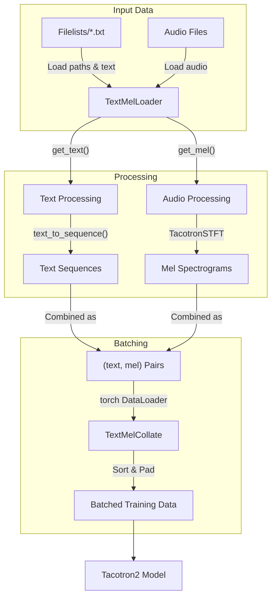
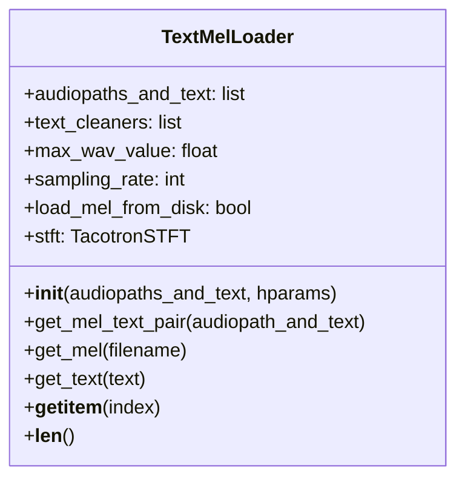
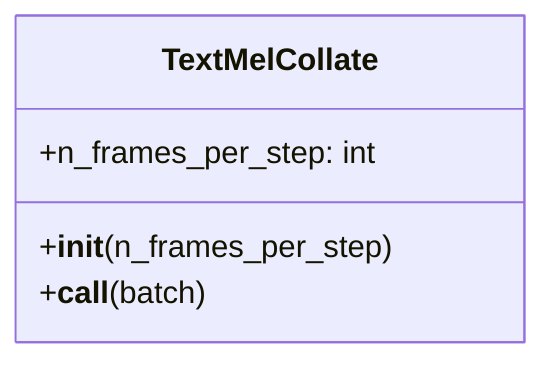
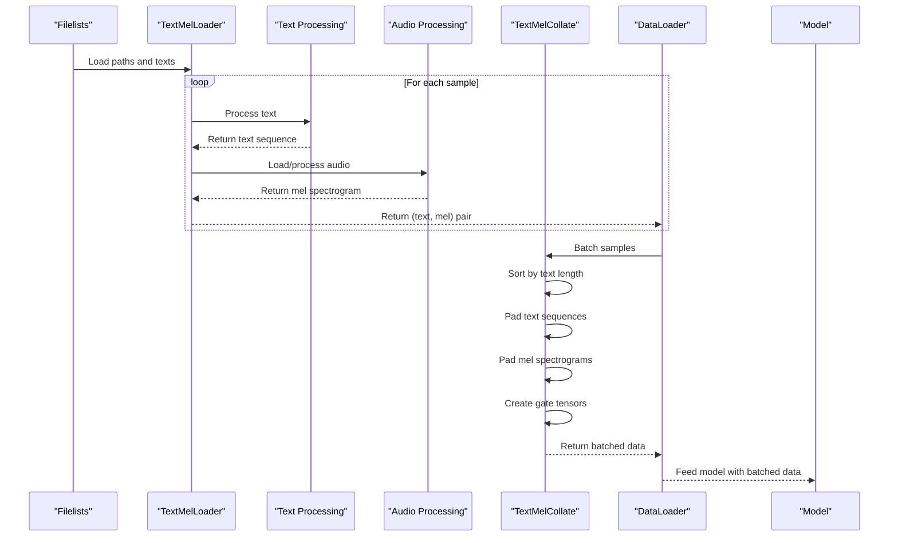

<!-- source: DeepWiki mcp.deepwiki.com · repo NVIDIA/tacotron2 · page 4.2 Data Loading & Processing · fetched 2026-10-26 -->

# Data Loading & Processing

<details>
<summary>Relevant source files</summary>

The following files were used as context for generating this wiki page:

- [data_utils.py](data_utils.py)
- [filelists/ljs_audio_text_test_filelist.txt](filelists/ljs_audio_text_test_filelist.txt)
- [filelists/ljs_audio_text_train_filelist.txt](filelists/ljs_audio_text_train_filelist.txt)
- [filelists/ljs_audio_text_val_filelist.txt](filelists/ljs_audio_text_val_filelist.txt)

</details>


## Purpose and Scope

This page documents the data loading and processing system in the Tacotron2 repository. The system is responsible for loading text-audio pairs from disk, processing text into sequences of tokens, computing or loading mel spectrograms from audio files, and batching data efficiently for training. 

For information about audio processing techniques used for spectrograms, see [Audio Processing](#3.3). For details on text processing and tokenization, see [Text Processing](#3.4).

Sources: [data_utils.py:1-5]()

## Data Flow Overview

The Tacotron2 data pipeline transforms raw text and audio files into batched tensor data suitable for training the neural network model.



Sources: [data_utils.py:11-64](), [filelists/ljs_audio_text_train_filelist.txt:1-100]()

## Data Sources and File Format

The repository uses plain text files to specify audio paths and their corresponding transcriptions. Each line in these files follows this format:

```
path/to/audio.wav|The transcription text for this audio file
```

Three separate filelists are provided for training, validation, and testing:
- `ljs_audio_text_train_filelist.txt`: Training data
- `ljs_audio_text_val_filelist.txt`: Validation data
- `ljs_audio_text_test_filelist.txt`: Test data

Sources: [filelists/ljs_audio_text_train_filelist.txt:1-10](), [filelists/ljs_audio_text_val_filelist.txt:1-10](), [filelists/ljs_audio_text_test_filelist.txt:1-10]()

## TextMelLoader: The Dataset Implementation

`TextMelLoader` is a PyTorch Dataset class that handles loading and processing of individual text-audio pairs.



### Initialization

When initialized, `TextMelLoader`:
1. Loads the file paths and text from the provided filelist using `load_filepaths_and_text`
2. Sets up text cleaning functions from `hparams.text_cleaners`
3. Configures audio normalization with `hparams.max_wav_value`
4. Creates a `TacotronSTFT` instance for audio processing
5. Shuffles the dataset with a fixed seed for reproducibility

Sources: [data_utils.py:17-28]()

### Text Processing

The `get_text` method converts raw text to sequences of integers:

1. Takes a raw text string as input
2. Passes it through `text_to_sequence` with the configured text cleaners
3. Returns the result as a PyTorch `IntTensor`

Sources: [data_utils.py:56-58]()

### Mel Spectrogram Processing

The `get_mel` method has two operating modes controlled by the `load_mel_from_disk` parameter:

1. **Compute from audio** (`load_mel_from_disk=False`):
   - Loads audio using `load_wav_to_torch`
   - Verifies the sampling rate
   - Normalizes audio by dividing by `max_wav_value`
   - Computes mel spectrogram using `TacotronSTFT.mel_spectrogram`

2. **Load from disk** (`load_mel_from_disk=True`):
   - Loads a pre-computed mel spectrogram from a NumPy file
   - Verifies the mel dimension matches the expected value

Sources: [data_utils.py:37-53]()

### Dataset Interface

The class implements the standard PyTorch Dataset interface:
- `__getitem__(index)`: Returns a (text, mel) pair for the requested index
- `__len__()`: Returns the number of samples in the dataset

Sources: [data_utils.py:60-64]()

## TextMelCollate: Batching and Padding

The `TextMelCollate` class creates batches of samples by padding variable-length sequences to the same length within a batch.



### Batching Process

The batching process in `__call__` follows these steps:

1. Determine the longest text sequence in the batch
2. Sort samples by text length in descending order
3. Pad text sequences to the maximum length
4. Find the longest mel spectrogram in the batch
5. Pad mel spectrograms to the maximum length (ensuring it's a multiple of `n_frames_per_step`)
6. Create gate tensors with 1s after the end of each mel spectrogram (used as stop tokens)
7. Return a tuple of (text_padded, input_lengths, mel_padded, gate_padded, output_lengths)

Sources: [data_utils.py:67-111]()

## Sequence of Operations

The complete data loading and processing sequence:



Sources: [data_utils.py:11-111]()

## Configuration Parameters

The data loading and processing system is configured through hyperparameters defined in `hparams.py`:

| Parameter | Description | Used By |
|-----------|-------------|---------|
| `text_cleaners` | Text normalization functions | `TextMelLoader.get_text` |
| `max_wav_value` | Audio normalization factor | `TextMelLoader.get_mel` |
| `sampling_rate` | Expected audio sample rate | `TextMelLoader.get_mel` |
| `load_mel_from_disk` | Whether to load pre-computed mels | `TextMelLoader.get_mel` |
| `filter_length` | STFT window length | `TacotronSTFT` |
| `hop_length` | STFT hop length | `TacotronSTFT` |
| `win_length` | STFT window size | `TacotronSTFT` |
| `n_mel_channels` | Number of mel channels | `TacotronSTFT` |
| `mel_fmin` | Minimum mel filter frequency | `TacotronSTFT` |
| `mel_fmax` | Maximum mel filter frequency | `TacotronSTFT` |
| `n_frames_per_step` | Frames per decoder step | `TextMelCollate` |

Sources: [data_utils.py:17-28](), [data_utils.py:70-71]()

## Integration with Training Loop

During training, the data loading components are used as follows:

1. Create a `TextMelLoader` instance with the training filelist and hyperparameters
2. Create a `TextMelCollate` instance with `n_frames_per_step`
3. Create a PyTorch `DataLoader` with the dataset and collate function
4. Iterate through batches of the DataLoader in the training loop
5. Feed batched data to the model and compute the loss

The use of PyTorch's data loading infrastructure enables efficient multi-process data loading with automatic batching and shuffling.

Sources: [data_utils.py:11-111]()

---

