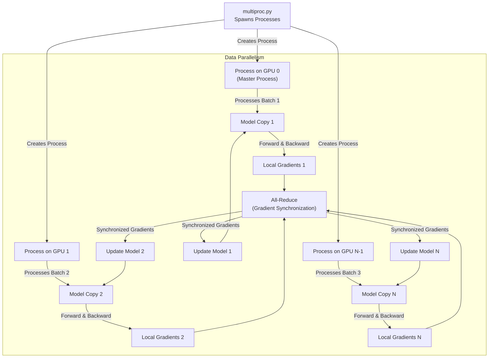
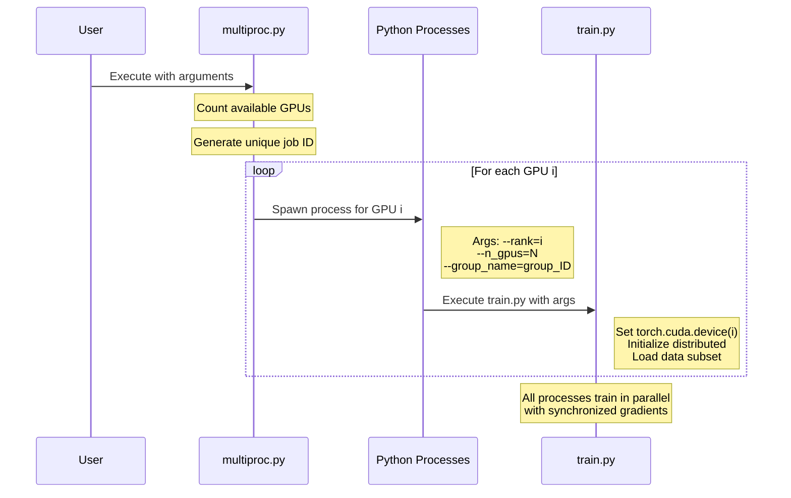
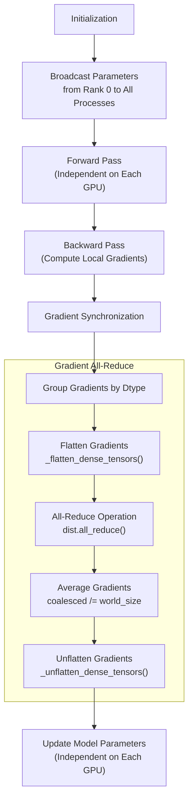
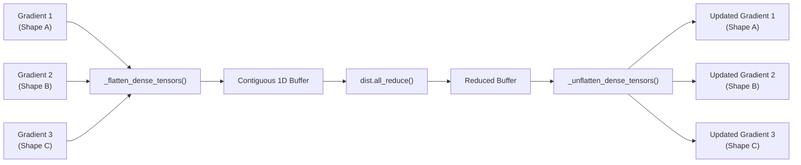

<!-- source: DeepWiki mcp.deepwiki.com · repo NVIDIA/tacotron2 · page 4.3 Distributed Training · fetched 2026-10-26 -->

# Distributed Training

<details>
<summary>Relevant source files</summary>

The following files were used as context for generating this wiki page:

- [distributed.py](distributed.py)
- [multiproc.py](multiproc.py)

</details>


## Purpose and Scope

This document details the distributed training system in NVIDIA's Tacotron2 implementation. It covers how the codebase leverages multiple GPUs to accelerate training through data parallelism. This page explains the internal architecture of the distributed training system, how processes are spawned across multiple GPUs, and how gradient synchronization is implemented.

For information about the overall training process, see [Training](#4). For details about data loading within the training process, see [Data Loading & Processing](#4.2).

## Distributed Training Architecture

The distributed training system in Tacotron2 follows a data-parallel approach where:
- The same model is replicated across multiple GPUs
- Each GPU processes a different batch of data
- Gradients are synchronized across all GPUs before model updates



**Diagram 1: Distributed Training Architecture**

Sources: [distributed.py:41-50](), [multiproc.py:1-24]()

## Process Spawning with multiproc.py

The distributed training process begins with `multiproc.py`, which:
1. Detects the number of available GPUs using `torch.cuda.device_count()`
2. Creates a unique job ID based on the current timestamp
3. Spawns a separate Python process for each GPU
4. Passes rank information and other parameters to each process
5. Sets up logging for each process (except rank 0, which outputs to stdout)



**Diagram 2: Process Spawning Workflow**

Sources: [multiproc.py:6-23]()

## Distributed Training Implementation

### DistributedDataParallel

The core of distributed training is implemented in `distributed.py` through the `DistributedDataParallel` class or the `apply_gradient_allreduce` function. They provide two approaches to the same functionality:

1. `DistributedDataParallel`: A module wrapper that handles gradient synchronization
2. `apply_gradient_allreduce`: Modifies an existing model to perform gradient all-reduce without changing its class

Both approaches follow these steps:
1. **Parameter Broadcast**: Parameters from rank 0 (master process) are broadcast to all other processes during initialization to ensure models start with identical weights
2. **Forward Pass**: Each process performs a forward pass with its own batch of data
3. **Backward Pass**: Local gradients are computed independently
4. **Gradient All-Reduce**: Gradients are synchronized across all processes
5. **Model Update**: Each process updates its model using the synchronized gradients



**Diagram 3: Gradient Synchronization Process**

Sources: [distributed.py:51-103](), [distributed.py:126-173]()

### Parameter Synchronization

When the distributed model is initialized, parameters from the rank 0 process (master) are broadcast to all other processes to ensure all model copies start with identical weights:

```python
# Initial parameter synchronization
for p in self.module.state_dict().values():
    if not torch.is_tensor(p):
        continue
    dist.broadcast(p, 0)  # Broadcast from rank 0 to all processes
```

Sources: [distributed.py:63-66](), [distributed.py:132-135]()

### Gradient All-Reduce

The key to distributed training is the synchronization of gradients across all processes. This is implemented through an all-reduce operation that:

1. Groups parameters by data type (to optimize communication)
2. Flattens gradient tensors into a contiguous buffer
3. Performs an all-reduce operation (sum gradients across processes)
4. Averages the gradients by dividing by the world size
5. Unflattens the buffer back to original gradient shapes

| Step | Purpose | Implementation |
|------|---------|----------------|
| Grouping | Optimize communication by type | Create buckets of parameters by dtype |
| Flattening | Create contiguous buffer | `_flatten_dense_tensors()` |
| All-reduce | Sum gradients across processes | `dist.all_reduce(coalesced)` |
| Averaging | Get mean gradient | `coalesced /= dist.get_world_size()` |
| Unflattening | Restore original shapes | `_unflatten_dense_tensors()` |

Sources: [distributed.py:68-92](), [distributed.py:137-161]()

## Usage Guide

To use distributed training with Tacotron2, follow these steps:

1. **Run training using multiproc.py**:
   ```bash
   python multiproc.py train.py --output_directory=outdir --log_directory=logdir [other training arguments]
   ```

2. **In train.py, initialize distributed training**:
   ```python
   # Example from train.py (not actual code)
   if args.distributed_run:
       torch.cuda.set_device(args.rank)
       torch.distributed.init_process_group(
           backend='nccl',
           init_method='tcp://localhost:54321',
           world_size=args.n_gpus,
           rank=args.rank,
           group_name=args.group_name)
   ```

3. **Prepare the model for distributed training**:
   ```python
   # Using DistributedDataParallel
   if args.distributed_run:
       model = DistributedDataParallel(model)
   
   # Or using apply_gradient_allreduce
   if args.distributed_run:
       model = apply_gradient_allreduce(model)
   ```

4. **Use DistributedSampler for data loading**:
   ```python
   if args.distributed_run:
       train_sampler = DistributedSampler(trainset)
       shuffle = False
   else:
       train_sampler = None
       shuffle = True
   
   train_loader = DataLoader(
       trainset, sampler=train_sampler, shuffle=shuffle,
       batch_size=args.batch_size, ...)
   ```

Sources: [distributed.py:42-50](), [multiproc.py:1-24]()

## Performance Considerations

### Backend Selection

The distributed training implementation supports different communication backends:

- **NCCL**: Recommended for GPU-to-GPU communication, especially for half-precision (FP16) training
- **GLOO**: More compatible but significantly slower for half-precision parameters

The code warns users when using GLOO with half-precision parameters:

```python
if module.warn_on_half:
    if torch.cuda.HalfTensor in buckets:
        print("WARNING: gloo dist backend for half parameters may be extremely slow." +
              " It is recommended to use the NCCL backend in this case.")
        module.warn_on_half = False
```

Sources: [distributed.py:77-83](), [distributed.py:147-152]()

### Tensor Flattening and Coalescing

To optimize communication performance, gradient tensors are flattened into contiguous buffers before all-reduce operations:



**Diagram 4: Tensor Flattening for Efficient Communication**

Sources: [distributed.py:6-39](), [distributed.py:85-92](), [distributed.py:154-161]()

## Summary

The distributed training system in Tacotron2 enables efficient multi-GPU training through:

1. **Process spawning**: Using `multiproc.py` to create a separate process for each GPU
2. **Data parallelism**: Each GPU processes different batches of data
3. **Parameter synchronization**: Initial parameters are broadcast from the master process
4. **Gradient all-reduce**: Gradients are synchronized across all processes
5. **Optimized communication**: Tensors are flattened and grouped by data type for efficient communication

This approach allows the Tacotron2 model to scale training across multiple GPUs with near-linear speedup, significantly reducing training time for this computationally intensive text-to-speech model.

---

