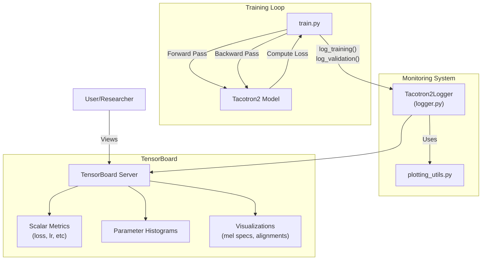
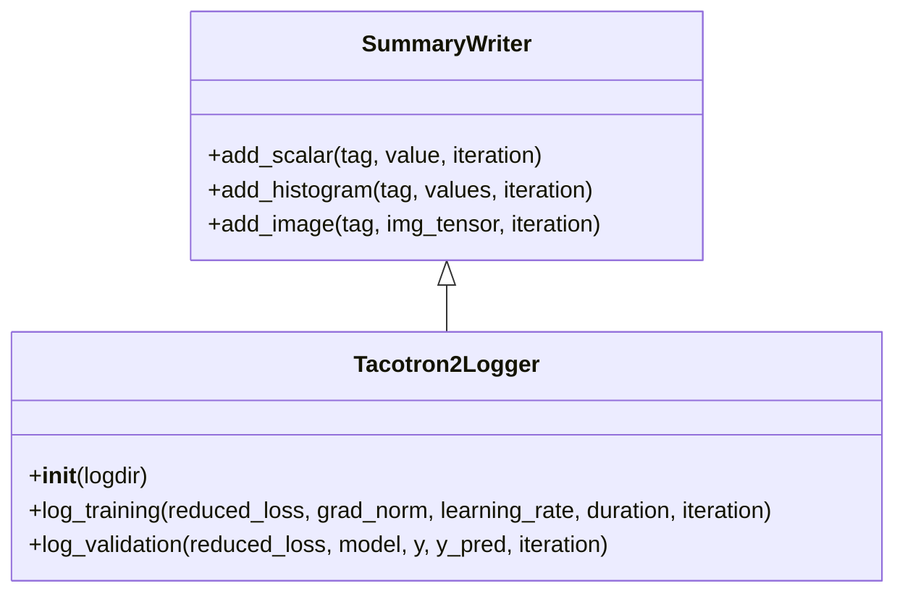
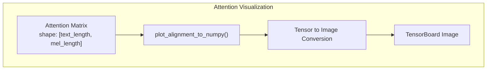
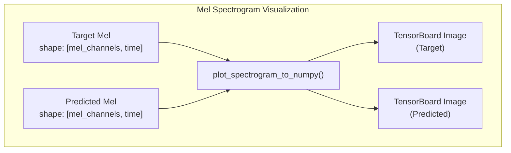
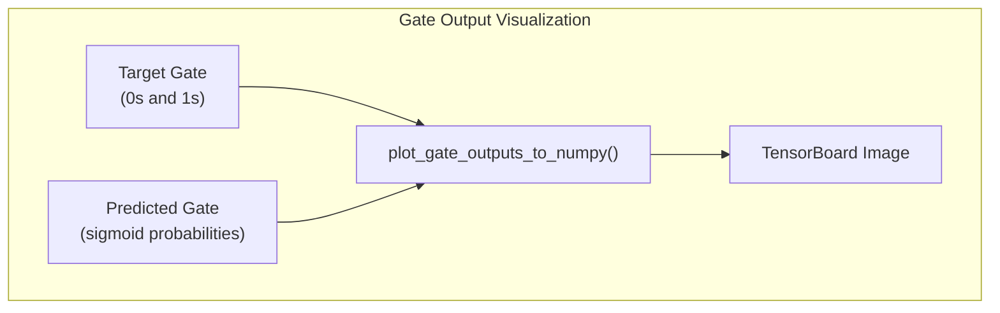

<!-- source: DeepWiki mcp.deepwiki.com · repo NVIDIA/tacotron2 · page 4.4 Training Monitoring & Visualization · fetched 2026-10-26 -->

# Training Monitoring & Visualization

<details>
<summary>Relevant source files</summary>

The following files were used as context for generating this wiki page:

- [logger.py](logger.py)

</details>


This page documents the monitoring and visualization system used for tracking Tacotron2 training progress. It covers how the system logs training metrics, model parameters, and generates visual representations of model outputs via TensorBoard integration. For information about the training process itself, see [Training](#4), and for details on loss functions used during training, see [Loss Functions & Optimization](#4.5).

## Monitoring System Overview

The Tacotron2 system implements a custom logging infrastructure that extends TensorBoard's functionality to provide specific visualizations relevant to speech synthesis. This allows researchers and practitioners to effectively monitor the training progress and diagnose potential issues with model performance.



Sources: [logger.py:8-48]()

## Tacotron2Logger Class

The `Tacotron2Logger` class extends TensorBoard's `SummaryWriter` to provide specialized logging functionality for Tacotron2 training. It implements methods for logging both training and validation metrics, as well as visualizing model outputs.



Sources: [logger.py:8-11]()

## Types of Monitored Data

The monitoring system captures several types of data during training, each providing different insights into the model's performance and behavior.

### Training Metrics

During training, the system logs the following scalar metrics at each logged iteration:

| Metric | Description | Logging Method |
|--------|-------------|---------------|
| Training Loss | The reduced (average) loss value for the current batch | `add_scalar("training.loss", reduced_loss, iteration)` |
| Gradient Norm | The norm of the gradient, which helps monitor training stability | `add_scalar("grad.norm", grad_norm, iteration)` |
| Learning Rate | The current learning rate, useful for tracking learning rate schedules | `add_scalar("learning.rate", learning_rate, iteration)` |
| Duration | Time taken for the current iteration | `add_scalar("duration", duration, iteration)` |

Sources: [logger.py:12-17]()

### Validation Metrics and Visualizations

During validation, more comprehensive data is logged:

1. **Validation Loss**: The average loss computed on the validation set
2. **Parameter Distributions**: Histograms of all model parameters
3. **Visual Representations**: 
   - Attention alignments
   - Target mel spectrograms
   - Predicted mel spectrograms
   - Gate outputs (stop token predictions)

The system automatically selects a random sample from the batch for generating visualizations, ensuring that different examples are visualized over time.

Sources: [logger.py:19-48]()

## Visual Representations

The logger generates several important visualizations that are critical for monitoring Tacotron2 training:

### Attention Alignments

Attention alignments visualize how the model's attention mechanism focuses on different parts of the input text when generating each frame of the output mel spectrogram. A good alignment typically shows a clear diagonal pattern, indicating that the model is properly advancing through the text as it generates the audio.



Sources: [logger.py:30-34]()

### Mel Spectrograms

Both target (ground truth) and predicted mel spectrograms are visualized, allowing for direct comparison between what the model should produce and what it actually produces.



Sources: [logger.py:35-42]()

### Gate Outputs

Gate outputs indicate when the model predicts it should stop generating mel frames. The visualization shows both the target gate values (binary) and the predicted gate probabilities (after sigmoid activation).



Sources: [logger.py:43-48]()

## Using TensorBoard to View Training Progress

To view the logged data, you'll need to start a TensorBoard server pointing to the logging directory used when initializing the `Tacotron2Logger`:

```bash
tensorboard --logdir=<path_to_log_directory>
```

Once the server is running, you can access TensorBoard through a web browser, typically at `http://localhost:6006`.

### TensorBoard Dashboards

TensorBoard organizes the logged data into several dashboards:

1. **Scalars**: Shows training and validation loss curves, learning rate, and other scalar metrics over time
2. **Images**: Displays the mel spectrograms, attention alignments, and gate outputs
3. **Distributions** and **Histograms**: Show how model parameter distributions evolve during training

### Interpreting Visualizations

Here are some key patterns to look for in the visualizations:

#### Attention Alignments

- **Good alignment**: Clear diagonal pattern from top-left to bottom-right
- **Problems to watch for**:
  - Vertical lines (attention stuck on one character)
  - Horizontal lines (repeating the same sound)
  - Multiple diagonal lines (repeating text)
  - Scattered patterns (chaotic attention)

#### Mel Spectrograms

- As training progresses, the predicted mel spectrograms should increasingly resemble the target spectrograms
- Watch for:
  - Sharp formant structures appearing (indicating clear speech)
  - Reduction in noise or unwanted artifacts
  - Accurate representation of silences between phonemes

#### Gate Outputs

- The predicted gate outputs should align with the target gate outputs
- Watch for:
  - False positives (prematurely ending generation)
  - False negatives (continuing generation too long)

## Best Practices for Monitoring

1. **Regular monitoring**: Check TensorBoard visualizations periodically during training
2. **Compare checkpoints**: Save visualizations from different checkpoints to track improvement
3. **Attention debugging**: If synthesis quality is poor, attention alignments often reveal the underlying issue
4. **Loss correlation**: Correlate visual improvements with changes in loss values

Sources: [logger.py:8-48]()

## Implementation Notes

The visualization functionality relies on utility functions in `plotting_utils.py` that convert model tensors to NumPy arrays formatted for visualization. The logger randomly selects samples from each batch to visualize, ensuring variety in the monitored examples.

The logger is integrated into the training loop and automatically logs data at specified intervals (configured in the training script). This ensures consistent monitoring throughout the training process without manual intervention.

---

