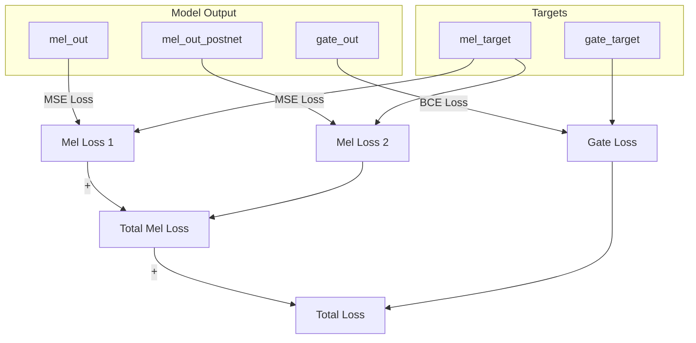
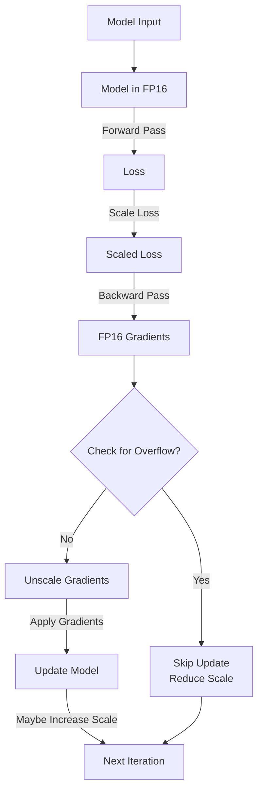
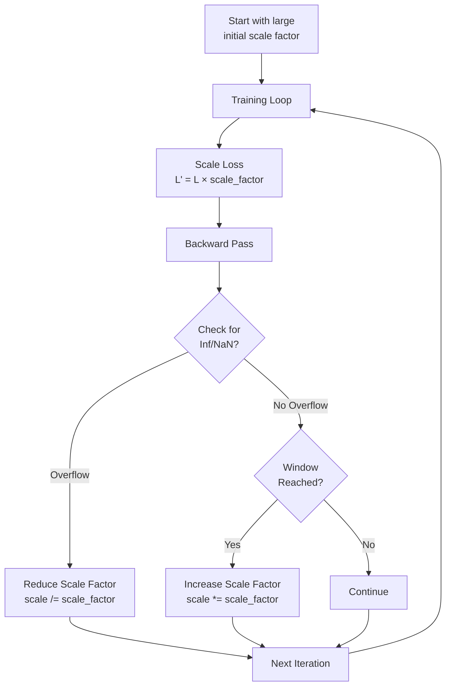
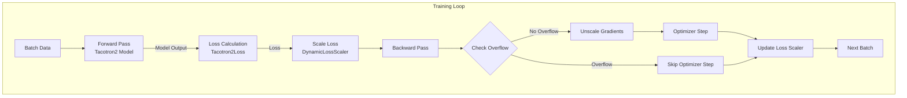

<!-- source: DeepWiki mcp.deepwiki.com · repo NVIDIA/tacotron2 · page 4.5 Loss Functions & Optimization · fetched 2026-10-26 -->

# Loss Functions & Optimization

<details>
<summary>Relevant source files</summary>

The following files were used as context for generating this wiki page:

- [loss_function.py](loss_function.py)
- [loss_scaler.py](loss_scaler.py)

</details>


This page explains the loss functions, optimization strategy, and mixed-precision training techniques used in the NVIDIA Tacotron2 implementation. We'll cover how the model calculates loss during training and how the system handles numerical stability issues when using mixed-precision training. For information about the training process itself, see [Training](#4) and for details on training monitoring, see [Training Monitoring & Visualization](#4.4).

## Loss Function

Tacotron2 uses a combination of losses to optimize both the mel-spectrogram prediction and the stop token prediction. This is implemented in the `Tacotron2Loss` class.



The loss function consists of two main components:

1. **Mel-Spectrogram Loss**: Mean Squared Error (MSE) between:
   - The initial mel output (`mel_out`) and the target mel-spectrogram
   - The post-processed mel output (`mel_out_postnet`) and the target mel-spectrogram

2. **Gate Loss**: Binary Cross-Entropy (BCE) loss between:
   - The predicted stop tokens (`gate_out`)
   - The target stop tokens (`gate_target`)

The final loss is the sum of the mel-spectrogram loss and the gate loss.

Sources: [loss_function.py:1-19]()

### Implementation Details

The `Tacotron2Loss` class is defined in `loss_function.py`:

```python
class Tacotron2Loss(nn.Module):
    def __init__(self):
        super(Tacotron2Loss, self).__init__()

    def forward(self, model_output, targets):
        mel_target, gate_target = targets[0], targets[1]
        mel_target.requires_grad = False
        gate_target.requires_grad = False
        gate_target = gate_target.view(-1, 1)

        mel_out, mel_out_postnet, gate_out, _ = model_output
        gate_out = gate_out.view(-1, 1)
        mel_loss = nn.MSELoss()(mel_out, mel_target) + \
            nn.MSELoss()(mel_out_postnet, mel_target)
        gate_loss = nn.BCEWithLogitsLoss()(gate_out, gate_target)
        return mel_loss + gate_loss
```

Key features of the implementation:
- The target tensors are detached from the computation graph with `requires_grad = False`
- Gate outputs and targets are reshaped to match the expected shape for the BCE loss
- The total loss is a simple sum of the mel and gate losses, with no weighting parameters

Sources: [loss_function.py:4-19]()

## Mixed-Precision Training

The repository includes support for mixed-precision training, which combines FP16 (half-precision) and FP32 (single-precision) operations to improve performance while maintaining numerical stability. This is implemented through loss scaling techniques.



### Loss Scaling

Loss scaling is a technique to prevent underflow in gradient calculations when using FP16 arithmetic. By scaling the loss value up before backpropagation and scaling the gradients back down before the optimizer step, the system prevents small gradient values from becoming zeros.

The repository implements two scaling approaches:

1. **Static Loss Scaling** (`LossScaler`): Uses a fixed scaling factor
2. **Dynamic Loss Scaling** (`DynamicLossScaler`): Automatically adjusts the scaling factor during training

Sources: [loss_scaler.py:3-30]()

### Dynamic Loss Scaler

The dynamic loss scaler adjusts the scaling factor based on whether gradient overflow occurs:



Key features of the `DynamicLossScaler`:

- **Initial scale**: Starts with a large value (default: 2^32)
- **Scale factor**: Factor to increase/decrease scale (default: 2.0)
- **Scale window**: Number of iterations before increasing scale (default: 1000)
- **Overflow detection**: Checks for infinities or NaNs in gradients
- **Adaptation**: Reduces scale after overflow, increases scale after successful window

Sources: [loss_scaler.py:31-80]()

### Implementation Details

The `DynamicLossScaler` class provides methods for scaling the loss, checking for gradient overflow, and updating the scale factor:

1. **Initialization**: Sets up the initial scale and tracking variables
   ```python
   def __init__(self, init_scale=2**32, scale_factor=2., scale_window=1000):
       self.cur_scale = init_scale
       self.cur_iter = 0
       self.last_overflow_iter = -1
       self.scale_factor = scale_factor
       self.scale_window = scale_window
   ```

2. **Overflow Detection**: Checks gradients for Inf/NaN values
   ```python
   def has_overflow(self, params):
       for p in params:
           if p.grad is not None and DynamicLossScaler._has_inf_or_nan(p.grad.data):
               return True
       return False
   ```

3. **Scale Update**: Adjusts the scale factor based on overflow status
   ```python
   def update_scale(self, overflow):
       if overflow:
           self.cur_scale = max(self.cur_scale/self.scale_factor, 1)
           self.last_overflow_iter = self.cur_iter
       else:
           if (self.cur_iter - self.last_overflow_iter) % self.scale_window == 0:
               self.cur_scale *= self.scale_factor
       self.cur_iter += 1
   ```

4. **Backward Pass**: Scales the loss before backpropagation
   ```python
   def backward(self, loss):
       scaled_loss = loss*self.loss_scale
       scaled_loss.backward()
   ```

Sources: [loss_scaler.py:31-80](), [loss_scaler.py:85-130]()

## Integration with Training Loop

Below is a conceptual diagram showing how loss calculation and optimization integrate with the training loop:



The integration involves:

1. Calculate the model loss using `Tacotron2Loss`
2. Scale the loss using the loss scaler
3. Perform backpropagation
4. Check for gradient overflow
5. If no overflow:
   - Unscale the gradients
   - Update the model parameters with the optimizer
6. Update the loss scaler
7. Continue to the next batch

Sources: [loss_scaler.py:85-130](), [loss_function.py:1-19]()

## Summary

Tacotron2's training uses:

1. A composite loss function combining:
   - MSE loss for mel-spectrogram prediction
   - BCE loss for stop token prediction

2. Mixed-precision training with dynamic loss scaling to:
   - Improve computational efficiency with FP16 operations
   - Maintain numerical stability with dynamic adjustment of scaling factors
   - Handle gradient overflow by skipping problematic updates

These components work together to enable efficient and effective training of the Tacotron2 model on modern GPUs.

---

