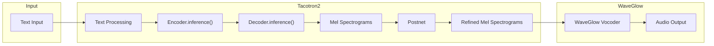
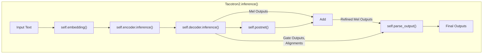
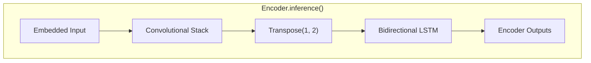
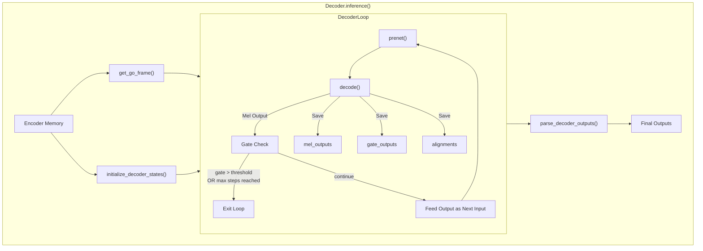
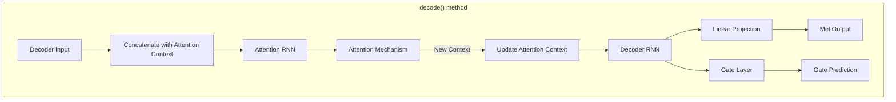
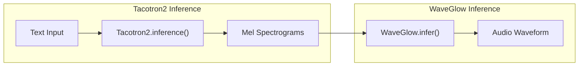

<!-- source: DeepWiki mcp.deepwiki.com · repo NVIDIA/tacotron2 · page 5 Inference · fetched 2026-10-26 -->

# Inference

<details>
<summary>Relevant source files</summary>

The following files were used as context for generating this wiki page:

- [.gitmodules](.gitmodules)
- [LICENSE](LICENSE)
- [README.md](README.md)
- [model.py](model.py)

</details>


This document explains how to use the Tacotron 2 model for inference - generating speech from text input. The inference system converts text to mel spectrograms using the trained Tacotron 2 model, which are then converted to audio using the WaveGlow vocoder.

## Inference Process Overview

The inference process in Tacotron 2 involves converting text input into speech through a series of steps:



Sources: [model.py:517-529](), [README.md:46-50]()

## Inference Components

### Text Processing and Embedding

Before the inference process begins, text input is converted to a numerical representation:


The text is first encoded into a sequence of integers. These integers are then passed through an embedding layer which converts them to dense vector representations suitable for processing by the encoder.

Sources: [model.py:517-518]()

### Tacotron2 Model Inference

The Tacotron2 model's inference process consists of three main components:



The inference method handles the entire process from text to mel spectrograms:

1. Embedding: Converts text indices to dense vectors
2. Encoder: Processes embedded text through convolutional layers and LSTM 
3. Decoder: Generates mel spectrograms autogressively
4. Postnet: Refines the mel spectrograms for better quality

Sources: [model.py:517-529]()

### Encoder Inference

The encoder processes the embedded text to create a sequence of context vectors:



The encoder consists of:
- A stack of convolutional layers with ReLU activations and dropout
- A bidirectional LSTM that captures contextual information

Sources: [model.py:192-201]()

### Decoder Inference

The decoder generates mel spectrograms frame by frame in an autoregressive manner:



Key points about the decoder inference:
- It starts with a "go frame" (all zeros) as the initial input
- It initializes all decoder states (attention weights, RNN states, etc.)
- It loops until a stopping condition is met (gate prediction exceeds threshold or maximum steps reached)
- In each step, it runs the current frame through the prenet, processes it with the attention mechanism, and generates the next frame
- The generated frame is fed back as input for the next step
- Finally, it parses all the accumulated outputs into the proper format

Sources: [model.py:418-454]()

## Using the Inference System

### Setup for Inference

To use the Tacotron 2 model for inference, follow these steps:

1. Download the pre-trained models:
   - Tacotron 2 model
   - WaveGlow model

2. Use the inference notebook:

```
jupyter notebook --ip=127.0.0.1 --port=31337
```

3. Open the `inference.ipynb` notebook

Sources: [README.md:46-50]()

### Inference Parameters

The inference process is controlled by several parameters defined in the model:

| Parameter | Description | Location |
|-----------|-------------|----------|
| `max_decoder_steps` | Maximum number of mel frames to generate | [model.py:213]() |
| `gate_threshold` | Threshold to stop generation when gate output exceeds it | [model.py:214]() |
| `n_frames_per_step` | Number of frames generated in each decoder step | [model.py:208]() |
| `n_mel_channels` | Number of mel spectrogram channels | [model.py:207]() |

Sources: [model.py:207-214]()

## Implementation Details

### Inference Method in Tacotron2

The main inference method in the Tacotron2 class:

```python
def inference(self, inputs):
    embedded_inputs = self.embedding(inputs).transpose(1, 2)
    encoder_outputs = self.encoder.inference(embedded_inputs)
    mel_outputs, gate_outputs, alignments = self.decoder.inference(
        encoder_outputs)

    mel_outputs_postnet = self.postnet(mel_outputs)
    mel_outputs_postnet = mel_outputs + mel_outputs_postnet

    outputs = self.parse_output(
        [mel_outputs, mel_outputs_postnet, gate_outputs, alignments])

    return outputs
```

This method performs the following steps:
1. Embeds the input text and transposes the result
2. Passes the embedded inputs to the encoder's inference method
3. Passes the encoder outputs to the decoder's inference method
4. Processes the mel outputs through the postnet and adds the result to the original mel outputs
5. Parses and returns the outputs

Sources: [model.py:517-529]()

### Decoder Inference Process

The decoder inference process is particularly important as it generates mel spectrograms frame by frame:



In each decoding step:
1. The current input (previous output or go frame) is processed by the prenet
2. The prenet output and attention context are fed to the attention RNN
3. The attention mechanism calculates attention weights over encoder outputs
4. The attention context is computed as a weighted sum of encoder outputs
5. The decoder RNN generates features for the current step
6. The linear projection layer converts these features to mel spectrogram frames
7. The gate layer predicts whether to stop generation

Sources: [model.py:340-379](), [model.py:418-454]()

## Performance Considerations

When running inference with Tacotron 2, consider the following:

1. **Batch Processing**: The model is designed to handle batched inputs for efficient processing. Even when generating a single utterance, the input is processed as a batch of size 1.

2. **GPU Memory**: Inference requires less memory than training but still benefits from GPU acceleration.

3. **Generation Speed**: The autoregressive nature of the decoder means that generation happens one frame at a time, which can be slower than parallel processing.

4. **Model Size**: The complete system (Tacotron 2 + WaveGlow) requires significant memory. Ensure your system has adequate resources.

5. **Maximum Decoder Steps**: By default, the model has a maximum limit on the number of decoder steps to prevent excessively long generations. This is controlled by the `max_decoder_steps` parameter.

Sources: [model.py:213-214](), [model.py:418-454]()

## Integration with WaveGlow

While Tacotron 2 generates mel spectrograms, WaveGlow is needed to convert these to actual audio:



The WaveGlow model is included as a submodule in the repository. After generating mel spectrograms with Tacotron 2, they are passed to WaveGlow for conversion to audio waveforms.

Sources: [.gitmodules:1-4](), [README.md:46-50]()