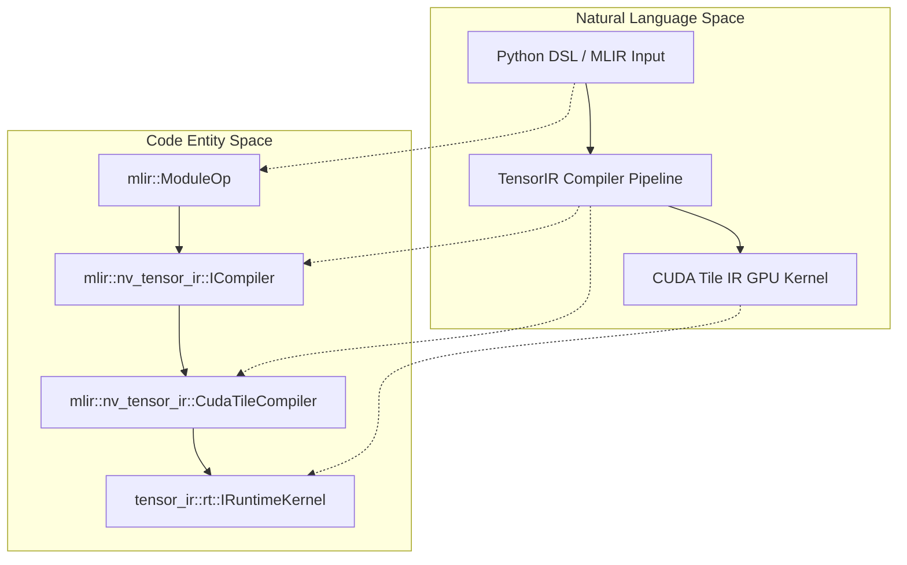

<!-- source: DeepWiki mcp.deepwiki.com · repo NVIDIA/tensor-ir · page 1 Overview · fetched 2026-10-26 -->

# Overview

Relevant source files

The following files were used as context for generating this wiki page:

- [CMakeLists.txt](CMakeLists.txt)
- [README.md](README.md)
- [include/tensor_ir/Compiler/Compiler.h](include/tensor_ir/Compiler/Compiler.h)

TensorIR Compiler is an MLIR-based framework designed to lower high-level tensor graphs into NVIDIA CUDA Tile IR GPU kernels [README.md:1-2](), [CMakeLists.txt:1-8](). By leveraging MLIR dialects, custom transformation passes, and the CUDA Tile IR code generation backend, TensorIR bridges high-level domain-specific languages (such as the Python DSL) with high-performance NVIDIA GPU execution [README.md:94-95]().

This parent page introduces the high-level architecture, repository layout, and core compilation workflow. 

*Diagram 1: Bridging Natural Language Concepts to Code Entities in TensorIR.*
Sources: [README.md:1-2](), [include/tensor_ir/Compiler/Compiler.h:26-50](), [CMakeLists.txt:1-8]()

---

## 1.1. Getting Started and Build System

The TensorIR build system is structured around CMake and relies heavily on LLVM, MLIR, and the pinned NVIDIA CUDA Tile project [README.md:45-53](). Configuration options allow developers to control whether LLVM is downloaded automatically via `TENSOR_IR_DOWNLOAD_LLVM` [CMakeLists.txt:21-23](), whether Python bindings are built using `TENSOR_IR_ENABLE_BINDINGS_PYTHON` [CMakeLists.txt:13](), and whether test suites are generated via `TENSOR_IR_INCLUDE_TESTS` [CMakeLists.txt:14](). 

The project incorporates helper scripts under the `cmake/` directory to locate MLIR packages, configure compatibility policies, and fetch external dependencies like DLPack and CUDA Tile IR [CMakeLists.txt:72-106](). Installation rules are configured to export binary executables and Python packages cleanly [README.md:97-105]().

For details, see Getting Started and Build System.

Sources: [CMakeLists.txt:1-194](), [README.md:16-106]()

---

## 1.2. Compilation Pipeline End-to-End

The compilation pipeline takes an input `mlir::ModuleOp` (originating either from MLIR text files or the Python DSL tracing infrastructure) and transforms it through a series of analysis and optimization passes [include/tensor_ir/Compiler/Compiler.h:26-27](). These passes handle tasks such as layout propagation annotation, tile analysis, iteration space discovery, and graph splitting.

Once optimized, the intermediate representation is lowered via the conversion layer (such as the layout-propagation or affine-map strategy) into CUDA Tile dialect structures. The compiler backend then compiles the lowered representation into Tile IR bytecode or binary cubin artifacts, which are encapsulated into runtime kernel objects (`IRuntimeKernel`) ready for execution on targeted NVIDIA GPUs [README.md:148-167](), [include/tensor_ir/Compiler/Compiler.h:37-41]().

For details, see Compilation Pipeline End-to-End.

Sources: [README.md:114-167](), [include/tensor_ir/Compiler/Compiler.h:26-50]()

---

## 1.3. Command Line Tools

TensorIR provides standalone command-line executables—`tensor_ir-compiler` and `tensor_ir-opt`—to inspect, transform, compile, and execute tensor kernels directly from the shell [README.md:83-84](). These tools accept a wide array of command-line flags controlling target SM architectures (e.g., `--target-sm`), custom tile sizes (`--tile-size`), dynamic shapes (`--dynamic-dims`), and code generation strategies (`--codegen-strategy`) [README.md:138-167]().

Additionally, the tools support built-in reference verification modes (`--verify`) that compare the generated GPU kernel execution results against a reference interpreter implementation, as well as debugging options like per-pass IR dumping via `--print-ir-after-all` [README.md:109-120](), [README.md:159-164]().

For details, see Command Line Tools.

Sources: [README.md:83-85](), [README.md:107-174]()

---

