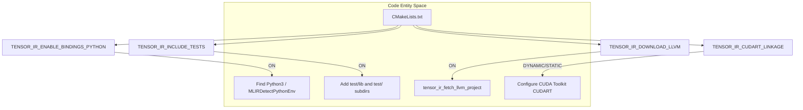
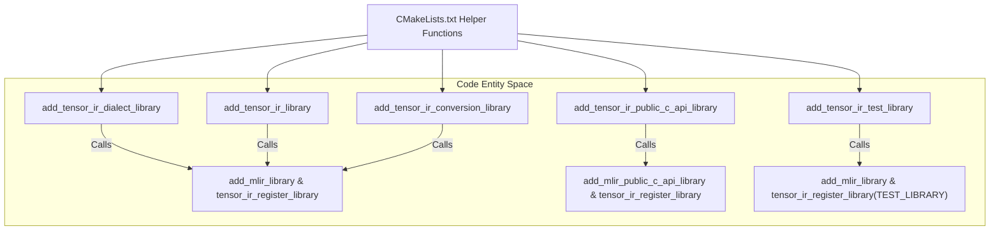

<!-- source: DeepWiki mcp.deepwiki.com · repo NVIDIA/tensor-ir · page 1.1 Getting Started and Build System · fetched 2026-10-26 -->

# Getting Started and Build System

Relevant source files

The following files were used as context for generating this wiki page:

- [CMakeLists.txt](CMakeLists.txt)
- [README.md](README.md)

## Purpose and Scope
This page details the CMake-based build system, configuration options, external dependency management (LLVM/MLIR, CUDA Tile, and DLPack), helper build functions, and installation targets for the TensorIR Compiler. It provides instructions and architectural insights into how the project configures its build environment, interfaces with the CUDA Toolkit, and produces binaries like `tensor_ir-compiler` and `tensor_ir-opt`, as well as Python bindings.

Sources: `CMakeLists.txt:1-205]`, `[README.md:1-175]()`

---

## Project Configuration and Options

The TensorIR build system is driven by root configuration defined in `[CMakeLists.txt:7-30]()`. It establishes project metadata (`TensorIRCompiler`, version `0.1.2`), sets C++17 requirements (`[CMakeLists.txt:35-36]()`), and configures visibility controls (`[CMakeLists.txt:42-43]()`).

Key options exposed by the build system include:
* `TENSOR_IR_ENABLE_BINDINGS_PYTHON`: Controls whether Python bindings and the runtime module are built (default: `ON`) `[CMakeLists.txt:13-13]()`. Requires MLIR Python bindings `[CMakeLists.txt:113-119]()`.
* `TENSOR_IR_INCLUDE_TESTS`: Generates test-only targets, helper libraries, and configures the `lit` test suite (default: `ON`) `[CMakeLists.txt:14-14]`, `[CMakeLists.txt:186-188]`, `[CMakeLists.txt:193-194]()`.
* `TENSOR_IR_DOWNLOAD_LLVM`: Automatically downloads and builds the pinned LLVM project revision required by CUDA Tile (default: `ON` for top-level builds, `OFF` otherwise) `[CMakeLists.txt:16-24]()`.
* `TENSOR_IR_CUDART_LINKAGE`: Determines CUDA Runtime linkage, accepting either `DYNAMIC` or `STATIC` (default: `DYNAMIC`) `[CMakeLists.txt:26-28]()`.

Sources: `[CMakeLists.txt:7-30]`, `[CMakeLists.txt:113-123]`, `[CMakeLists.txt:186-194]()`

---

## Dependency Fetching and Integration

TensorIR relies heavily on external LLVM/MLIR infrastructure and NVIDIA CUDA Tile IR. The build system manages these dependencies through dedicated CMake helper modules located in the `cmake/` directory.

### LLVM and MLIR
When `TENSOR_IR_DOWNLOAD_LLVM` is enabled, the helper function `tensor_ir_fetch_llvm_project` retrieves the pinned LLVM project source tree `[CMakeLists.txt:78-80]()`. Otherwise, LLVM and MLIR are located via standard CMake config packages (`find_package(MLIR CONFIG)` and `find_package(LLVM CONFIG)`), where `MLIR_DIR` can be explicitly provided `[README.md:48-53]()`. Common policies and ABI compatibility rules are then applied via `tensor_ir_configure_llvm_cmake_compatibility_policies()` and `tensor_ir_configure_cxx_llvm_abi_compatibility()` (`[CMakeLists.txt:88-89]()`, `[CMakeLists.txt:72-72]()`).

### CUDA Tile IR
CUDA Tile IR is fetched via `tensor_ir_fetch_cuda_tile()`, utilizing `CUDA_TILE_USE_LLVM_INSTALL_DIR` to coordinate the LLVM installation directory shared between TensorIR and CUDA Tile `[CMakeLists.txt:95-107]()`. Testing and Python bindings are explicitly disabled for the fetched CUDA Tile subproject (`[CMakeLists.txt:104-105]()`).

### DLPack Interoperability
When Python bindings are enabled (`TENSOR_IR_ENABLE_BINDINGS_PYTHON`), the build system fetches DLPack via `tensor_ir_fetch_dlpack()` to support zero-copy tensor interop with PyTorch and other frameworks (`[CMakeLists.txt:169-172]()`).

Sources: `[CMakeLists.txt:70-123]`, `[CMakeLists.txt:169-172]`, `[README.md:47-53]()`

---

## CMake Helper Scripts and Library Definitions

To maintain consistency across MLIR dialects, conversion passes, and runtime components, `[CMakeLists.txt:131-155]()` defines custom CMake wrapper functions around upstream MLIR/LLVM functions. These functions automatically register libraries with internal tracking scripts via `tensor_ir_register_library`:

* `add_tensor_ir_dialect_library(name)`: Wraps `add_mlir_library` for dialect components `[CMakeLists.txt:131-134]()`.
* `add_tensor_ir_library(name)`: Wraps general core and runtime libraries `[CMakeLists.txt:136-139]()`.
* `add_tensor_ir_public_c_api_library(name)`: Wraps `add_mlir_public_c_api_library` for C bindings `[CMakeLists.txt:141-144]()`.
* `add_tensor_ir_conversion_library(name)`: Registers lowering and conversion pass libraries `[CMakeLists.txt:146-149]()`.
* `add_tensor_ir_test_library(name)`: Registers test-only utility passes and libraries with the `TEST_LIBRARY` flag `[CMakeLists.txt:151-154]()`.

Sources: `[CMakeLists.txt:129-155]()`

---

## Build Targets and Installation

Once configured, targets are compiled using Ninja or Make. The primary compilation targets include:
* `tensor_ir-compiler`: The primary ahead-of-time and JIT compiler binary `[README.md:57]`, `[README.md:83]()`.
* `tensor_ir-opt`: The MLIR diagnostic and transformation pass tool `[README.md:57]`, `[README.md:84]()`.
* `tensor_ir_python_bindings`: Nanobind-based Python extension module and associated Python packages (`nv_tensor_ir`) `[README.md:57]`, `[README.md:85]()`.

### Installation Targets
Executing `cmake --install build` copies built binaries and Python wrappers into the designated prefix path `[README.md:97-105]`:
* `bin/tensor_ir-compiler` `[README.md:99]()`
* `bin/tensor_ir-opt` `[README.md:100]()`
* `python_packages/nv_tensor_ir` `[README.md:101]()`

To use Python bindings directly from the build tree without installation, users export `PYTHONPATH` pointing to `build/python_packages` `[README.md:87-92]()`.

Sources: `[README.md:55-106]()`

---

