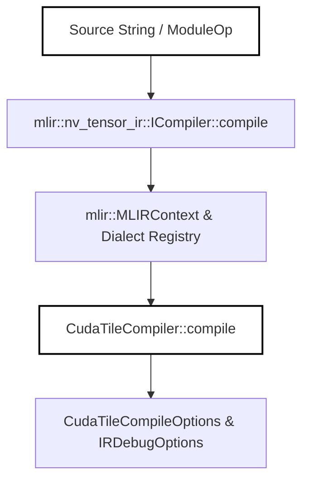
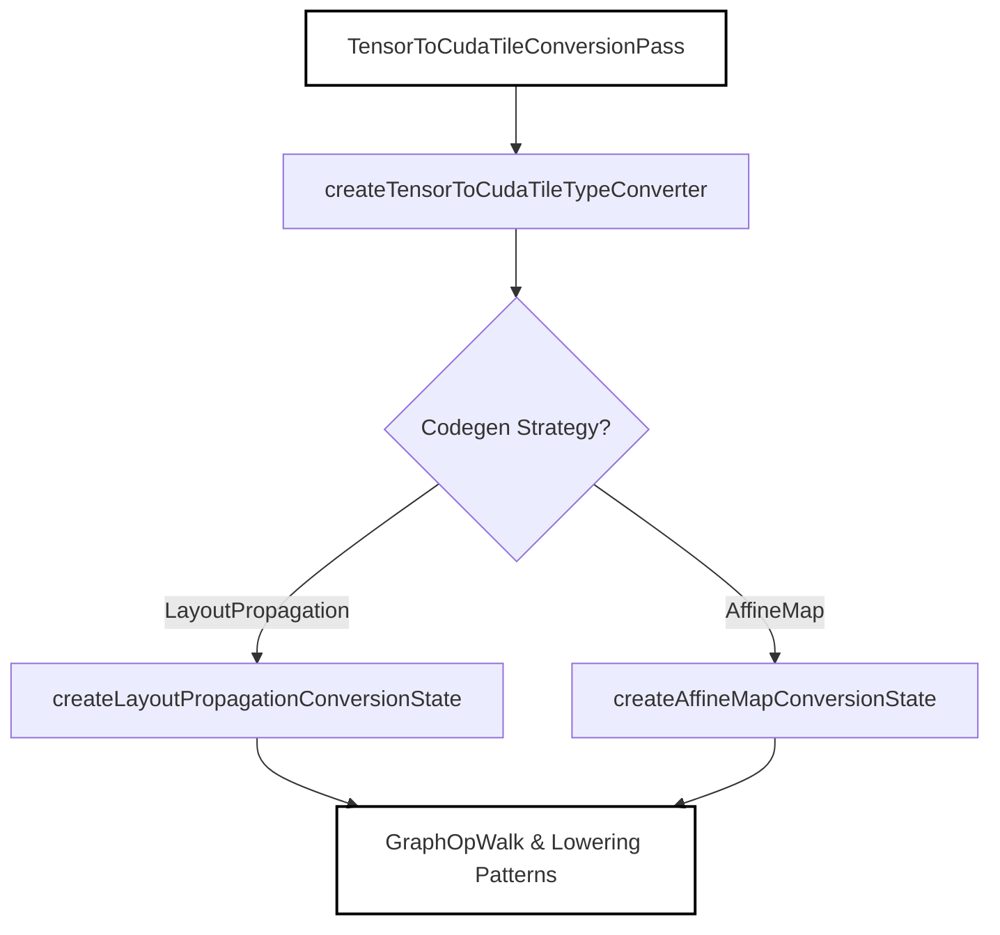

<!-- source: DeepWiki mcp.deepwiki.com · repo NVIDIA/tensor-ir · page 1.2 Compilation Pipeline End-to-End · fetched 2026-10-26 -->

# Compilation Pipeline End-to-End

Relevant source files

The following files were used as context for generating this wiki page:

- [lib/Compiler/Compiler.cpp](lib/Compiler/Compiler.cpp)
- [lib/Compiler/CudaTile/CudaTileCompiler.cpp](lib/Compiler/CudaTile/CudaTileCompiler.cpp)
- [lib/Conversion/TensorToCudaTile/TensorToCudaTile.cpp](lib/Conversion/TensorToCudaTile/TensorToCudaTile.cpp)

## Purpose and Scope

This section provides a complete technical walkthrough of the TensorIR compilation pipeline. It traces a kernel from its initial MLIR module representation (or Python DSL trace) through analysis and transformation passes, the `TensorToCudaTile` conversion layer, TileIR bytecode emission, compilation to a `cubin`, and finally instantiation into a runtime kernel ready for GPU execution.

---

## 1. Input Parsing and Frontend Entry

Compilation begins when an MLIR source string or an in-memory `mlir::ModuleOp` is passed to the compiler interface. The base class `mlir::nv_tensor_ir::ICompiler` handles dialect registration and parses source text into an MLIR module via `mlir::parseSourceString` [lib/Compiler/Compiler.cpp:80-97]().

Once parsed, the compilation request is dispatched to the selected backend. For CUDA GPUs, `mlir::nv_tensor_ir::backend::cuda_tile::CudaTileCompiler` acts as the primary orchestrator [lib/Compiler/CudaTile/CudaTileCompiler.cpp:160-182]().

*Diagram 1: Compiler Frontend Entry and Context Initialization*
Sources: `lib/Compiler/Compiler.cpp:80-97`, `lib/Compiler/CudaTile/CudaTileCompiler.cpp:160-182`

---

## 2. Transform and Analysis Pipeline

Before lowering to the `cuda_tile` dialect, the high-level `nv_tensor_ir` operations undergo a sequence of canonicalization, layout propagation annotation, tile analysis, and graph splitting passes. 

1. **Layout Propagation Annotation & Normalization**: Derives carrier shapes and resolves multi-output graph structures.
2. **Tile Analysis and Selection**: Enumerates tile candidates and validates tile size attributes against hardware limits.
3. **Graph Splitting**: Discovers iteration space identifiers and breaks large tensor graphs into manageable block-level structures.

Sources: `lib/Compiler/CudaTile/CudaTileCompiler.cpp:170-182`

---

## 3. TensorToCudaTile Conversion Layer

The core lowering logic resides in `TensorToCudaTileConversionPass`, defined in `lib/Conversion/TensorToCudaTile/TensorToCudaTile.cpp`. 

### Type Conversion
The pass initializes a `TensorToCudaTileTypeConverter` which maps `nv_tensor_ir::TensorType`, scalar floats, and signed/unsigned integers into signless `cuda_tile::TileType` 0-D or multi-dimensional representations [lib/Conversion/TensorToCudaTile/TensorToCudaTile.cpp:29-57]().

### Conversion Strategies
Depending on pass options, the compiler selects between two distinct lowering strategies via `ConversionState`:
* **Layout Propagation Strategy**: Utilizes optimization hints, carrier shapes, and explicit iteration space discovery (`createLayoutPropagationConversionState`).
* **Affine Map Strategy**: Uses traditional affine map indexing (`createAffineMapConversionState`).

*Diagram 2: Conversion State Initialization and Strategy Dispatch*
Sources: `lib/Conversion/TensorToCudaTile/TensorToCudaTile.cpp:66-134`

---

## 4. Bytecode and Cubin Emission

After the `cuda_tile` dialect constructs are fully generated, the pipeline serializes the module into TileIR bytecode using `BytecodeWriter` routines. 

The generated bytecode or assembly (`TileIRAssembly`) is then compiled down to a GPU-executable `cubin` binary matching the target `SmTarget` compute capability [lib/Compiler/CudaTile/CudaTileCompiler.cpp:160-182]().

Sources: `lib/Compiler/CudaTile/CudaTileCompiler.cpp:160-182`

---

## 5. Runtime Kernel Instantiation

Once emission completes, the compiler wraps the resulting binary and metadata inside a `CudaTileRuntimeKernel` instance adhering to the `IRuntimeKernel` interface. 

Kernel argument layouts (`KernelArgLayout`) and argument packers prepare host-side tensors for uniform signature dispatch, managing streams, workspaces, and grid configurations during execution [lib/Compiler/CudaTile/CudaTileCompiler.cpp:159-182]().

Sources: `lib/Compiler/CudaTile/CudaTileCompiler.cpp:159-182`

---

