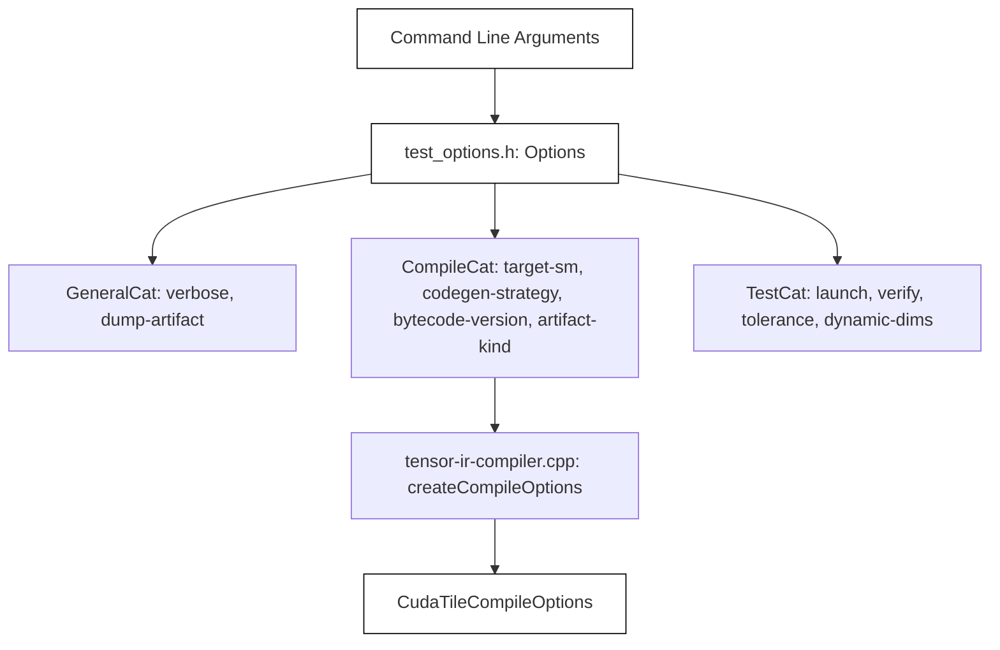
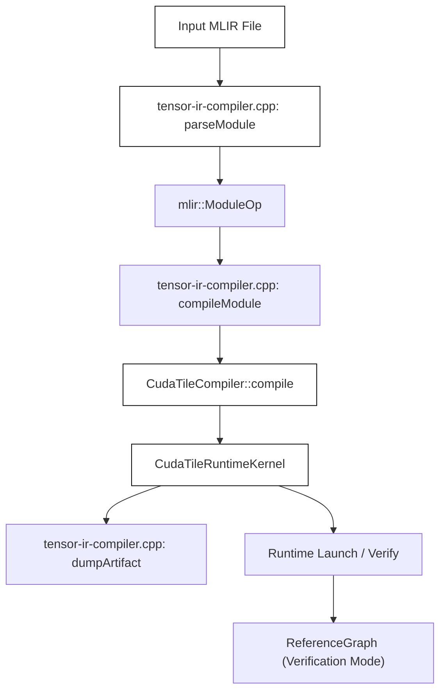
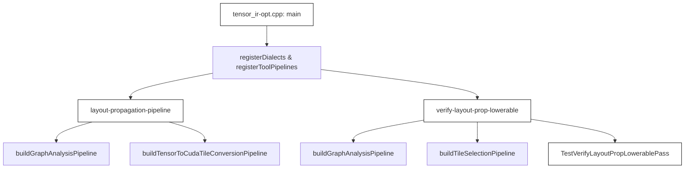

<!-- source: DeepWiki mcp.deepwiki.com · repo NVIDIA/tensor-ir · page 1.3 Command Line Tools · fetched 2026-10-26 -->

# Command Line Tools

Relevant source files

The following files were used as context for generating this wiki page:

- [tools/tensor_ir-compiler/tensor_ir-compiler.cpp](tools/tensor_ir-compiler/tensor_ir-compiler.cpp)
- [tools/tensor_ir-compiler/test_options.h](tools/tensor_ir-compiler/test_options.h)
- [tools/tensor_ir-opt/CMakeLists.txt](tools/tensor_ir-opt/CMakeLists.txt)
- [tools/tensor_ir-opt/tensor_ir-opt.cpp](tools/tensor_ir-opt/tensor_ir-opt.cpp)

## Purpose and Scope
This page details the implementation, configuration, and execution flows of the TensorIR command-line tools: `tensor_ir-compiler` and `tensor_ir-opt`. These utilities provide end-to-end compilation, JIT execution, numerical verification, and fine-grained MLIR pass debugging. The core option schemas, parsing logic, and pass pipelines exposed through these binaries are analyzed below.

---

## 1. `tensor_ir-compiler` Options and Architecture (`test_options.h`)

The `tensor_ir-compiler` utility relies on `test_options.h` to declare its command-line interface via LLVM's `llvm::cl` option parsing library. Options are structured into three distinct categories: `GeneralCat`, `CompileCat`, and `TestCat` [tools/tensor_ir-compiler/test_options.h:38-44]().

### Option Categories and Flags
* **General Options (`GeneralCat`)**: Controls verbosity and file output. Key flags include `verbose` and `dump-artifact`, which serializes compiled device code and a corresponding `.meta` descriptor file [tools/tensor_ir-compiler/test_options.h:49-58]().
* **Compilation Options (`CompileCat`)**: Configures lowering targets and diagnostics. Key flags include:
  * `target-sm`: Specifies the target SM version (default: `sm_100f`) [tools/tensor_ir-compiler/test_options.h:69-73]().
  * `codegen-strategy`: Selects between `layout-propagation` and `affine-map` lowering paths [tools/tensor_ir-compiler/test_options.h:75-79]().
  * `bytecode-version`: Targets TileIR bytecode versions (`default`, `current`, `compatibility`) [tools/tensor_ir-compiler/test_options.h:81-92]().
  * `artifact-kind`: Requests either `tileir` bytecode or an eagerly assembled `cubin` [tools/tensor_ir-compiler/test_options.h:94-103]().
  * Diagnostic and timing flags: `timing`, `print-ir-after-all`, and `print-ir-tree-dir` [tools/tensor_ir-compiler/test_options.h:106-128]().
* **Test Options (`TestCat`)**: Controls execution and verification:
  * `launch` and `verify`: Triggers GPU execution and numerical reference checks [tools/tensor_ir-compiler/test_options.h:134-140]().
  * `seed`, `iterations`, and `tolerance`: Configures test data generation and comparison bounds [tools/tensor_ir-compiler/test_options.h:142-153]().
  * `dynamic-dims`: Passes runtime integer values for dynamic `?` shape dimensions [tools/tensor_ir-compiler/test_options.h:154-158]().

*Sources: [tools/tensor_ir-compiler/test_options.h:31-158](), [tools/tensor_ir-compiler/tensor_ir-compiler.cpp:101-123]()*

---

## 2. Compiler Pipeline and Verification Execution (`tensor_ir-compiler.cpp`)

The core execution driver in `tensor_ir-compiler.cpp` loads input MLIR modules, configures compilation passes, compiles to runtime kernels, and optionally executes or verifies them against a reference interpreter.

### Compilation and Artifact Emission Flow
1. **Module Parsing**: `parseModule()` loads the input file, registers TensorIR dialects into an `mlir::MLIRContext`, and parses the source string into an `mlir::ModuleOp` [tools/tensor_ir-compiler/tensor_ir-compiler.cpp:75-99]().
2. **Strategy Parsing**: `parseCodegenStrategy()` translates string identifiers (`layout-propagation` / `affine-map`) into `mlir::nv_tensor_ir::CudaTileCodegenStrategy` enums [tools/tensor_ir-compiler/tensor_ir-compiler.cpp:51-64]().
3. **Compile Options Setup**: `createCompileOptions()` builds a `backend::cuda_tile::CudaTileCompileOptions` struct, forwarding target SM parameters, tile sizes, uniformity flags, and debugging environment variable overrides [tools/tensor_ir-compiler/tensor_ir-compiler.cpp:101-123]().
4. **Compilation**: `compileModule()` invokes the `ICompiler::compile` interface to yield an `IRuntimeKernelPtr` [tools/tensor_ir-compiler/tensor_ir-compiler.cpp:125-137]().
5. **Artifact Dumping**: `dumpArtifact()` extracts raw device code from `CudaTileRuntimeKernel` and writes both the binary stream and its accompanying `.meta` descriptor [tools/tensor_ir-compiler/tensor_ir-compiler.cpp:139-173]().

### Dynamic Shapes and Verification Mode
* **Dynamic Dimensions**: The `--dynamic-dims` option accepts comma-separated runtime values that bind to dynamic `?` dimensions during kernel argument layout analysis and host-side buffer allocation.
* **Verification**: When `--verify` is active, the driver executes both the compiled CudaTile runtime kernel and the reference interpreter (`ReferenceGraph`), comparing output tensors within the configured `--tolerance` threshold.

*Sources: [tools/tensor_ir-compiler/tensor_ir-compiler.cpp:51-173]()*

---

## 3. `tensor_ir-opt` Optimizer and Testing Driver (`tensor_ir-opt.cpp`)

`tensor_ir-opt` serves as the MLIR-based test driver for TensorIR, mirroring `mlir-opt` but pre-loaded with TensorIR dialects, transform passes, and custom pass pipelines [tools/tensor_ir-opt/tensor_ir-opt.cpp:133-148]().

### Pipeline Command-Line Options
`tensor_ir-opt` registers `TensorToCudaTilePipelineCLOptions` to expose pipeline parameters via MLIR's `PassOptions` infrastructure [tools/tensor_ir-opt/tensor_ir-opt.cpp:26-51]():
* `tile-size`: List of integers defining iteration space tile dimensions [tools/tensor_ir-opt/tensor_ir-opt.cpp:28-30]().
* `reduction-tile-size`: Tile size assigned to contracting axes [tools/tensor_ir-opt/tensor_ir-opt.cpp:31-34]().
* `persistence`: Kernel persistence mode (`none` or `static`) [tools/tensor_ir-opt/tensor_ir-opt.cpp:35-42]().
* `sm-count` and `occupancy`: Hardware sizing parameters for persistent kernels [tools/tensor_ir-opt/tensor_ir-opt.cpp:43-50]().

### Registered Tool Pipelines
The optimizer registers two primary pass pipelines for testing and debugging [tools/tensor_ir-opt/tensor_ir-opt.cpp:107-131]():
1. `layout-propagation-pipeline`: Executes layout annotation, normalization, tile analysis, tile selection, graph splitting, and final lowering to the `CudaTile` dialect [tools/tensor_ir-opt/tensor_ir-opt.cpp:109-122]().
2. `verify-layout-prop-lowerable`: Runs the complete graph analysis and tile selection phases, followed by `TestVerifyLayoutPropLowerablePass` to validate lowerability without emitting device code [tools/tensor_ir-opt/tensor_ir-opt.cpp:73-128]().

*Sources: [tools/tensor_ir-opt/tensor_ir-opt.cpp:26-148]()*

---

