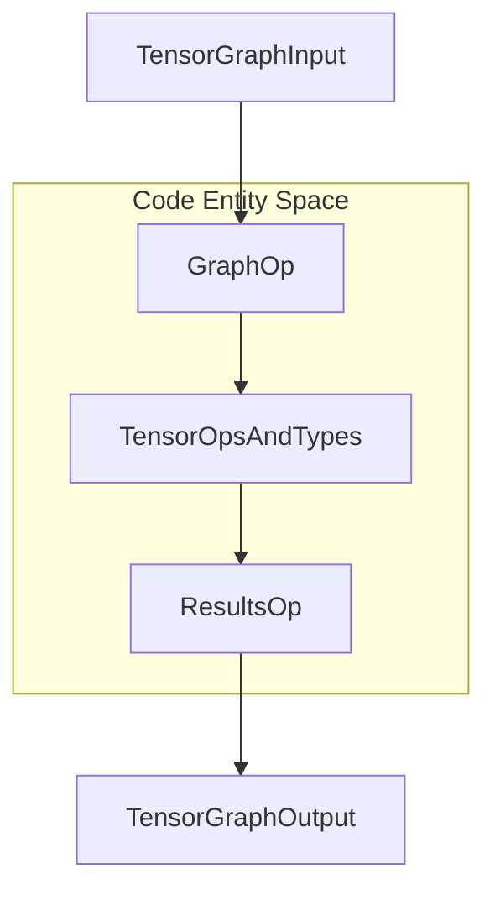
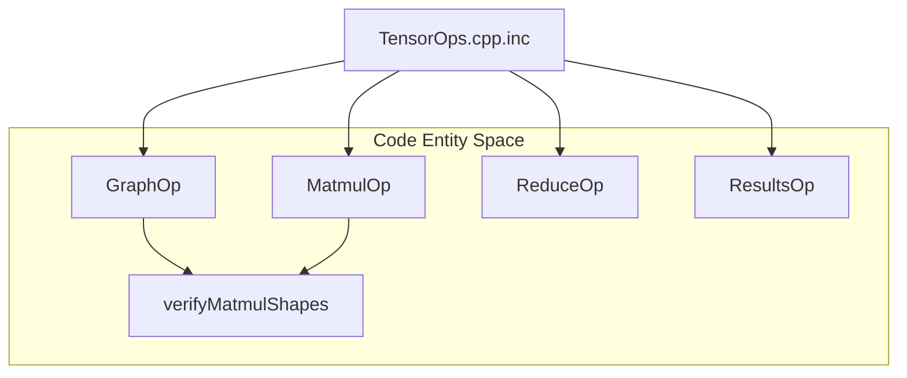

<!-- source: DeepWiki mcp.deepwiki.com · repo NVIDIA/tensor-ir · page 2 The nv_tensor_ir Dialect · fetched 2026-10-26 -->

# The nv_tensor_ir Dialect

Relevant source files

The following files were used as context for generating this wiki page:

- [include/tensor_ir/Dialect/TensorDialect.td](include/tensor_ir/Dialect/TensorDialect.td)
- [lib/Dialect/TensorOps.cpp](lib/Dialect/TensorOps.cpp)

## Purpose and Scope

The `nv_tensor_ir` dialect is the core MLIR-based intermediate representation for modeling high-level tensor operation graphs, designed after cuDNN graph representations [include/tensor_ir/Dialect/TensorDialect.td:16-19](). It abstracts tensor computations—such as matrix multiplications, reductions, pointwise operations, and structural transformations—into a unified dependency graph. Shape relationships within the dialect are governed by three named policies: *inherited* extents, *equal merge* between operand extents, and *broadcast merge* allowing unit extents to expand [include/tensor_ir/Dialect/TensorDialect.td:21-27]().

This page provides a high-level overview of the dialect's operations, types, attributes, and registration interfaces. For detailed technical specifications, refer to the child pages linked throughout.

*Figure 1: High-level graph container structure of the nv_tensor_ir dialect mapping input tensors to results via `GraphOp` and `ResultsOp`.*

Sources: `include/tensor_ir/Dialect/TensorDialect.td:9-28`

---

## 2.1 Operations and Types

The `nv_tensor_ir` dialect defines a rich set of operations representing tensor math and structural manipulation. At the root of every graph lies `GraphOp`, which establishes a region containing the computation graph and defines its block arguments [lib/Dialect/TensorOps.cpp:27-32](). The execution terminal is marked by `ResultsOp`, collecting output values. Core compute primitives include `MatmulOp`, `ReduceOp`, `ReduceUDOp`, and various pointwise operations, alongside layout and shape operators like `ConcatenateOp`, `IotaOp`, `ReshapeOp`, `BroadcastOp`, `TransposeOp`, and `SliceOp`.

Operations enforce strict validation logic during construction and verification, including dynamic dimension verification via `DynamicDimsOpInterface` [lib/Dialect/TensorOps.cpp:123-141]() and shape matching for complex operations like matrix multiplication [lib/Dialect/TensorOps.cpp:74-120](). 

For full details on TableGen definitions, verification routines, and individual operator semantics, see [Operations and Types](#2.1).

*Figure 2: Operation verification and lowering foundation in `TensorOps.cpp`.*

Sources: `include/tensor_ir/Dialect/TensorDialect.td:9-100`, `lib/Dialect/TensorOps.cpp:27-196`

---

## 2.2 Attributes and Layout Source Interfaces

To support lowering, hardware-specific mapping, and tile-based transformations, the `nv_tensor_ir` dialect introduces specialized attributes and interfaces. Attributes such as `alignment`, `stride`, `cost`, `allow_tma`, `iter_space_map`, `iter_space_id`, `tile_size`, and `tile_candidates` decorate operations and values with metadata essential for optimization passes [include/tensor_ir/Dialect/TensorDialect.td:31-93]().

Layout derivation relies on source attribute classes including `TensorSourceAttr`, `CompositeSourceAttr`, `ConcatSourceAttr`, `ReductionSourceAttr`, and `MatmulSourceAttr`. These attributes implement the `LayoutSourceAttrInterface` to bridge high-level tensor abstractions with CuTe layout views used during lowering.

For complete documentation on attribute structures and layout interfaces, see [Attributes and Layout Source Interfaces](#2.2).

Sources: `include/tensor_ir/Dialect/TensorDialect.td:30-94`

---

## 2.3 Canonicalization and Dialect Registration

To streamline graphs before lowering and optimization, the `nv_tensor_ir` dialect defines canonicalization patterns, constant folding hooks, and simplification routines. These patterns eliminate redundant transformations, fold static shapes, and normalize layout source annotations. 

Dialect registration libraries tie the components together, exposing standard MLIR dialect registration entrypoints so that external passes and compiler tools (such as `tensor_ir-opt`) can load, parse, and verify `nv_tensor_ir` modules.

For implementation specifics on pattern application and registration libraries, see [Canonicalization and Dialect Registration](#2.3).

Sources: `include/tensor_ir/Dialect/TensorDialect.td:9-100`

---

