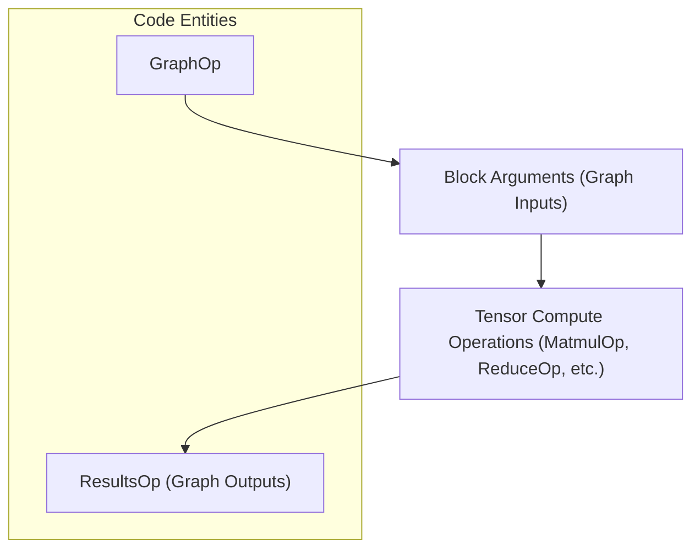
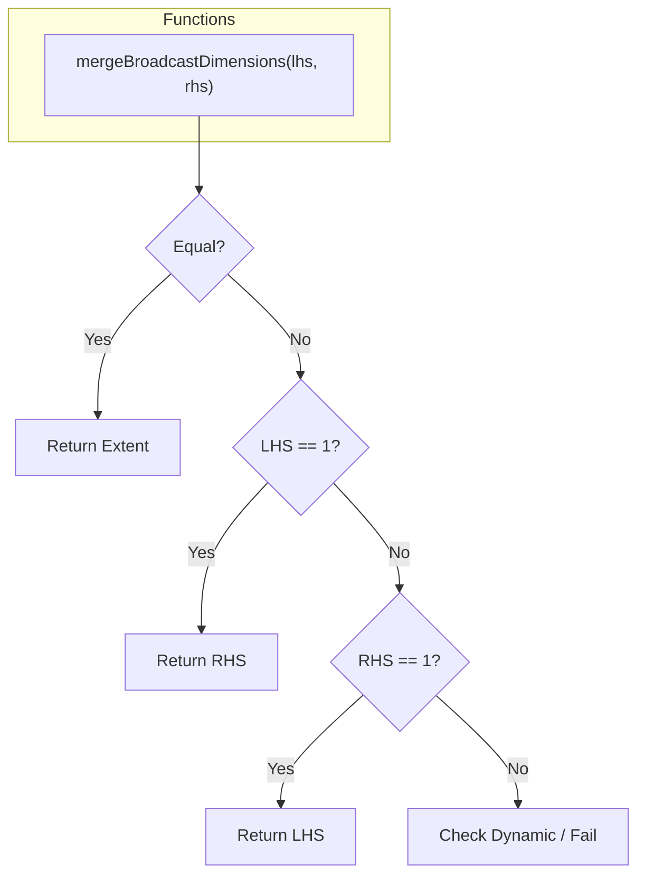

<!-- source: DeepWiki mcp.deepwiki.com · repo NVIDIA/tensor-ir · page 2.1 Operations and Types · fetched 2026-10-26 -->

# Operations and Types

Relevant source files

The following files were used as context for generating this wiki page:

- [include/tensor_ir/Dialect/TensorDialect.td](include/tensor_ir/Dialect/TensorDialect.td)
- [lib/Dialect/TensorOps.cpp](lib/Dialect/TensorOps.cpp)

## 1. Purpose and Scope
The **Operations and Types** page covers the core structural and operational building blocks of the `nv_tensor_ir` dialect (`TensorIR_Dialect`). Modeled after high-level cuDNN graph representations, the dialect provides operations for tensor manipulation, matrix multiplication, reductions, pointwise computations, and graph containerization (`GraphOp` and `ResultsOp`). This section details the TableGen definitions, shape merge policies, verification rules, and runtime/compiler interface implementations.

Sources: `include/tensor_ir/Dialect/TensorDialect.td:9-28`

---

## 2. Core Graph Container Operations (`GraphOp` & `ResultsOp`)
The `nv_tensor_ir` dialect encapsulates compute graphs using container operations:
- **`GraphOp`**: Acts as the root boundary for the tensor graph, declaring block arguments as graph inputs (`isGraphInput`) and managing region arguments.
- **`ResultsOp`**: Terminates the graph region, returning computed tensor results and linking output values (`isGraphOutput`).

*Figure 1: Graph Container Structure connecting `GraphOp` to `ResultsOp`.*

Sources: `lib/Dialect/TensorOps.cpp:27-38`, `lib/Dialect/TensorOps.cpp:157-196`

---

## 3. Shape Policies and Verification
The dialect defines shape propagation and verification policies for handling static and dynamic tensor extents:
- **Inherited**: Preserves the source extent exactly, maintaining static or dynamic status.
- **Equal Merge (`mergeEqualDimensions`)**: Accepts dynamic extents as unknowns refined by static extents; mismatched static extents fail.
- **Broadcast Merge (`mergeBroadcastDimensions`)**: Allows unit extents (`1`) to broadcast against other dimensions or dynamic symbols.

*Figure 2: Broadcast Dimension Merging Data Flow.*

Sources: `include/tensor_ir/Dialect/TensorDialect.td:21-28`, `lib/Dialect/TensorOps.cpp:40-72`

---

## 4. Operation Categories & TableGen Definitions

### MatmulOp Verification
Matrix multiplication is governed by `verifyMatmulShapes`, ensuring ranks are at least 2, batch dimensions satisfy broadcast rules, contracting dimensions match, and matrix dimensions align between operands $A$, $B$, and result $C$.

Sources: `lib/Dialect/TensorOps.cpp:74-120`

### Pointwise, Broadcast, Reshape, Transpose, and Slice
Operations in this category perform elementwise transformations or layout changes. They adhere to shape inference constraints where result extents are derived via inherited or broadcast merge policies.

Sources: `include/tensor_ir/Dialect/TensorDialect.td:21-28`, `lib/Dialect/TensorOps.cpp:40-72`

### ReduceOp and ReduceUDOp
Reductions support built-in reduction operations (`ReduceOp`) as well as user-defined reduction regions (`ReduceUDOp`) via specialized parsing and printing hooks (`parseReductionBody`).

Sources: `lib/Dialect/TensorOps.cpp:147-152`

### ConcatenateOp and IotaOp
- **`ConcatenateOp`**: Joins multiple tensors along a specified axis.
- **`IotaOp`**: Generates a tensor filled with sequential index values along a dimension.

Sources: `lib/Dialect/TensorOps.cpp:151-152`

---

## 5. Dynamic Dimensions and Interfaces
Operations implementing `DynamicDimsOpInterface` are validated via `verifyDynamicDimsOpInterface`. This checks that the number of dynamic size operands matches the total count of dynamic dimensions across all operation results.

Sources: `lib/Dialect/TensorOps.cpp:122-141`

---

