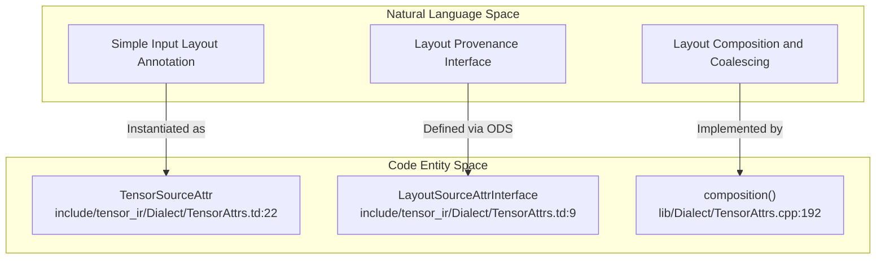
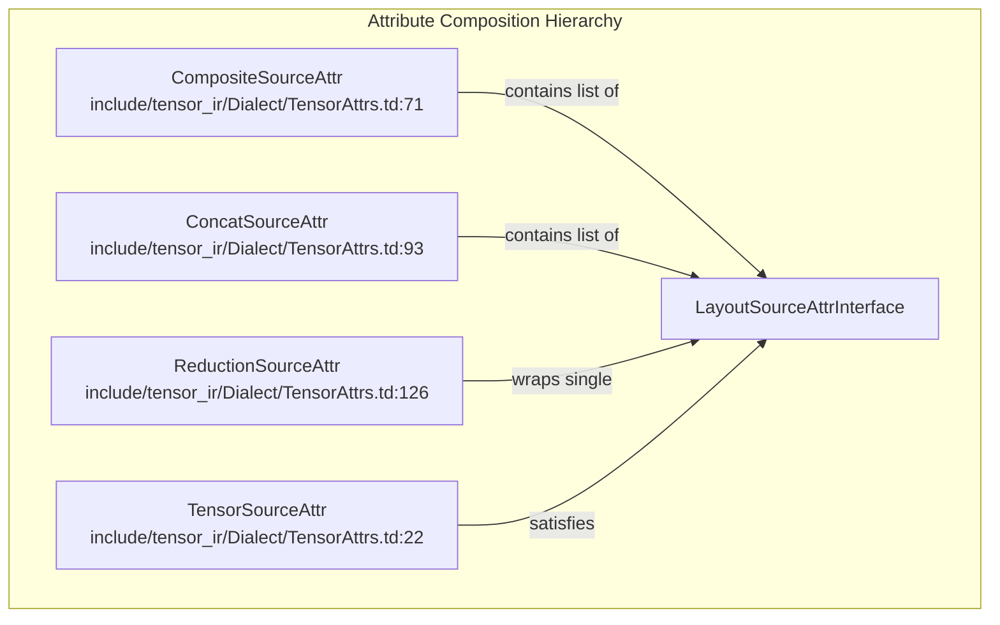

<!-- source: DeepWiki mcp.deepwiki.com · repo NVIDIA/tensor-ir · page 2.2 Attributes and Layout Source Interfaces · fetched 2026-10-26 -->

# Attributes and Layout Source Interfaces

Relevant source files

The following files were used as context for generating this wiki page:

- [include/tensor_ir/Dialect/TensorAttrs.td](include/tensor_ir/Dialect/TensorAttrs.td)
- [lib/Dialect/TensorAttrs.cpp](lib/Dialect/TensorAttrs.cpp)

## Overview and Scope

This page details the layout attribute system and layout source interfaces within the `nv_tensor_ir` MLIR dialect. TensorIR represents memory layouts, slices, broadcasts, reductions, and matrix multiplications using custom MLIR attributes. These attributes implement `LayoutSourceAttrInterface` and integrate tightly with CuTe layout views (`tcutegen::Layout`), bridging high-level tensor operations to low-level CUDA Tile IR memory structures.

Sources: `include/tensor_ir/Dialect/TensorAttrs.td` [include/tensor_ir/Dialect/TensorAttrs.td:1-69](), `lib/Dialect/TensorAttrs.cpp` [lib/Dialect/TensorAttrs.cpp:1-20]().

---

## 1. Layout Source Attribute Interface

The core abstraction for layout provenance in TensorIR is `LayoutSourceAttrInterface`. Concrete layout attributes conform to this interface to provide layout strings, dimensions, and dynamic shape mappings that guide lowering passes during tile generation.

### Natural Language to Code Entity Space Mapping

Sources: `include/tensor_ir/Dialect/TensorAttrs.td` [include/tensor_ir/Dialect/TensorAttrs.td:9-23](), `lib/Dialect/TensorAttrs.cpp` [lib/Dialect/TensorAttrs.cpp:192-203]().

---

## 2. Concrete Layout Source Attributes

TensorIR defines several concrete layout source attributes via TableGen. Each attribute models a specific graph operation or tensor memory pattern.

| Attribute Name | Mnemonic | Description / Parameters | Key Methods / Declarations |
| --- | --- | --- | --- |
| `TensorSourceAttr` | `tensor_source` | Represents an input tensor layout (`tensor_id`, `offset`, `layout`, `dynamicValueMapping`) | `getCuteLayout()` [include/tensor_ir/Dialect/TensorAttrs.td:67]() |
| `CompositeSourceAttr` | `composite_source` | Collection of layouts for a tensor (`sources`) | `size()`, `getSource(size_t)` [include/tensor_ir/Dialect/TensorAttrs.td:85-90]() |
| `ConcatSourceAttr` | `concat_source` | Concatenation of multiple layouts (`dimension`, `sources`, `argumentIndex`) | `size()`, `getSource(size_t)` [include/tensor_ir/Dialect/TensorAttrs.td:117-123]() |
| `ReductionSourceAttr` | `reduction_source` | Reduction view on an underlying source (`view`, `source`) | `getCuteLayout()`, `getReductionSize()`, `getReductionShape()` [include/tensor_ir/Dialect/TensorAttrs.td:142-149]() |
| `MatmulSourceAttr` | `matmul_source` | Matrix multiplication layout (`lhs`, `rhs`, `view`) | Defined in `TensorAttrs.td` [include/tensor_ir/Dialect/TensorAttrs.td:152-160]() |

### Attribute Composition and Hierarchy

Sources: `include/tensor_ir/Dialect/TensorAttrs.td` [include/tensor_ir/Dialect/TensorAttrs.td:22-160]().

---

## 3. Implementation and Helper Utilities

The companion implementation file `lib/Dialect/TensorAttrs.cpp` provides shape manipulation, dynamic dimension counting, and layout composition utilities used across compilation passes.

### Key Internal Functions

*   `isValidTensorElementType(Type type)`: Validates supported integer (1, 8, 16, 32, 64-bit) and floating-point element types. [lib/Dialect/TensorAttrs.cpp:28-47]()
*   `product(ArrayRef<int64_t> values)`: Computes dimension size products or returns `kDynamic` for non-positive values. [lib/Dialect/TensorAttrs.cpp:51-57]()
*   `countDynamicSizes(const tcg::Layout &layout)`: Counts runtime-backed dynamic values in a CuTe layout, omitting logical broadcast extents (dynamic shapes with static zero stride). [lib/Dialect/TensorAttrs.cpp:62-92]()
*   `getCommonIterationSpace(...)`: Derives an iteration space compatible with multiple input shapes. [lib/Dialect/TensorAttrs.cpp:102-153]()
*   `composition(...)`: Composes a CuTe layout with a target shape in logical order. [lib/Dialect/TensorAttrs.cpp:192-203]()

Sources: `lib/Dialect/TensorAttrs.cpp` [lib/Dialect/TensorAttrs.cpp:28-203]().

---

