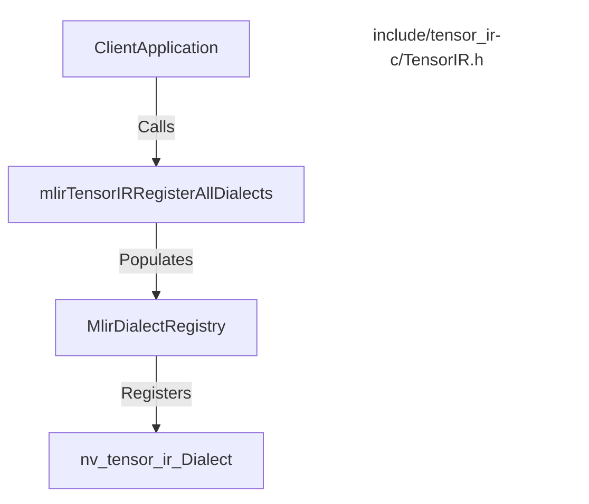
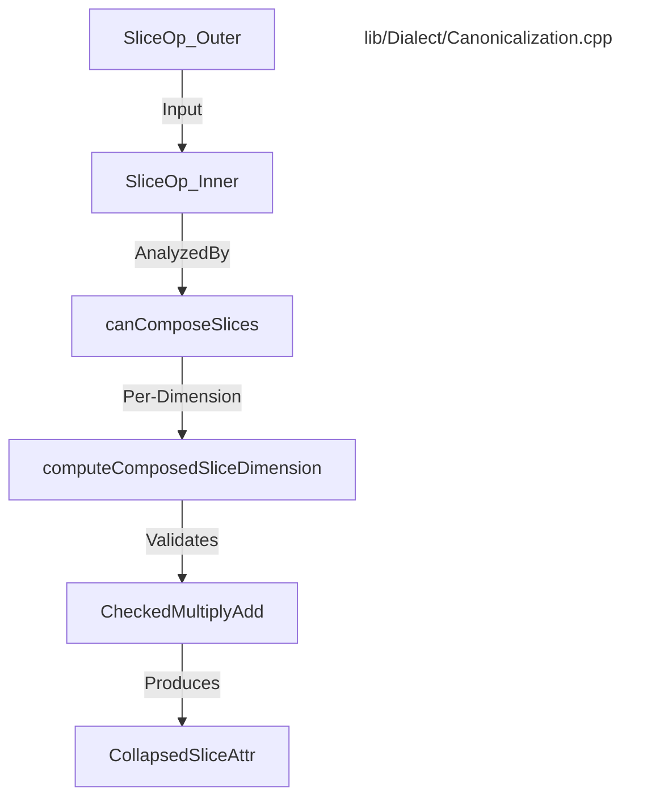

<!-- source: DeepWiki mcp.deepwiki.com · repo NVIDIA/tensor-ir · page 2.3 Canonicalization and Dialect Registration · fetched 2026-10-26 -->

# Canonicalization and Dialect Registration

Relevant source files

The following files were used as context for generating this wiki page:

- [include/tensor_ir-c/TensorIR.h](include/tensor_ir-c/TensorIR.h)
- [lib/Dialect/Canonicalization.cpp](lib/Dialect/Canonicalization.cpp)

## Purpose and Scope
This section details the canonicalization patterns, folding logic, and registration libraries implemented for the `nv_tensor_ir` dialect. It covers how MLIR dialects and pass registration entrypoints are exposed via the C API [include/tensor_ir-c/TensorIR.h:20-29](), and how graph-level optimizations, shape checks, type conversion checks, and slice/permutation compositions are realized in the rewriting infrastructure [lib/Dialect/Canonicalization.cpp:1-174]().

---

## 1. Dialect and C-API Registration

The TensorIR framework exposes C API hooks to register its dialects and passes into MLIR execution contexts and registries [include/tensor_ir-c/TensorIR.h:20-29](). 

The core registration entrypoints include:
- `MLIR_DECLARE_CAPI_DIALECT_REGISTRATION`: Declares the registration symbol for the `nv_tensor_ir` dialect [include/tensor_ir-c/TensorIR.h:23-24]().
- `mlirTensorIRRegisterAllDialects`: Populates an `MlirDialectRegistry` instance with all requisite dialects used by TensorIR [include/tensor_ir-c/TensorIR.h:26-28]().

*Diagram 1: Dialect Registration Flow in Code Entity Space*

Sources: `include/tensor_ir-c/TensorIR.h`

---

## 2. Canonicalization Infrastructure and Helper Functions

Canonicalization patterns simplify operations, eliminate redundant casts, and compose nested operations (such as slices and permutations) prior to lowering [lib/Dialect/Canonicalization.cpp:1-174](). 

### Static Shape and Layout Queries
The file `lib/Dialect/Canonicalization.cpp` defines static utility functions to inspect values and operations before applying rewrites:
- `hasStaticShape(Value value)`: Checks whether a given `Value` is a `RankedTensorType` with completely static dimensions [lib/Dialect/Canonicalization.cpp:15-18]().
- `hasLayoutAnnotation(Operation *op)`: Verifies if an operation possesses the TensorIR layout attribute name via `TensorIRDialect::getLayoutAttrName()` [lib/Dialect/Canonicalization.cpp:20-22]().

### Lossless Conversion Checks
Type promotion and downcasting optimizations rely on lossless conversion verifications for integers and floats:
- `isUnsignedIntegerType`: Identifies 1-bit widths or explicitly unsigned integer types [lib/Dialect/Canonicalization.cpp:24-26]().
- `isLosslessIntegerConvert`: Validates bit width constraints between source and target integer types [lib/Dialect/Canonicalization.cpp:28-40]().
- `isLosslessIntegerToFloatConvert`: Inspects `llvm::fltSemantics` precision and max exponents to ensure no precision loss [lib/Dialect/Canonicalization.cpp:43-51]().
- `isLosslessFloatConvert`: Compares precision, max exponent, and min exponent across floating-point semantics [lib/Dialect/Canonicalization.cpp:53-62]().
- `isLosslessConvert`: Combines the above logic to determine if a tensor element-type conversion can be safely removed [lib/Dialect/Canonicalization.cpp:64-86]().

Sources: `lib/Dialect/Canonicalization.cpp`

---

## 3. Slice and Permutation Composition

TensorIR canonicalization optimizes nested data movement operators like transposes and slices.

### Permutation Composition
`composePermutations` combines two adjacent transpose or permutation attributes (`innerPermutation` and `outerPermutation`) into a single unified `DenseI64ArrayAttr` to reduce traversal overhead [lib/Dialect/Canonicalization.cpp:93-103]().

### Slice Composition
Sequential slice operations are analyzed to determine if they can be collapsed into a single `SliceOp`:
- `computeComposedSliceDimension`: Computes the combined start, limit, and stride for a single dimension given nested slice parameters, guarding against arithmetic overflow using `llvm::MulOverflow` and `llvm::AddOverflow` [lib/Dialect/Canonicalization.cpp:105-138]().
- `canComposeSlices`: Iterates through all rank dimensions of a nested `SliceOp` chain to guarantee that the composition is valid across every axis [lib/Dialect/Canonicalization.cpp:140-172]().

*Diagram 2: Slice Composition Logic in Code Entity Space*

Sources: `lib/Dialect/Canonicalization.cpp`

---

## 4. Folding and Constant Attributes

Constant and splat construction helpers assist in folding operations during pattern matching:
- `buildSplatElementsAttr`: Constructs a `DenseElementsAttr` splat tensor of the output type using a provided scalar `Attribute` value [lib/Dialect/Canonicalization.cpp:88-91]().

Sources: `lib/Dialect/Canonicalization.cpp`

---

