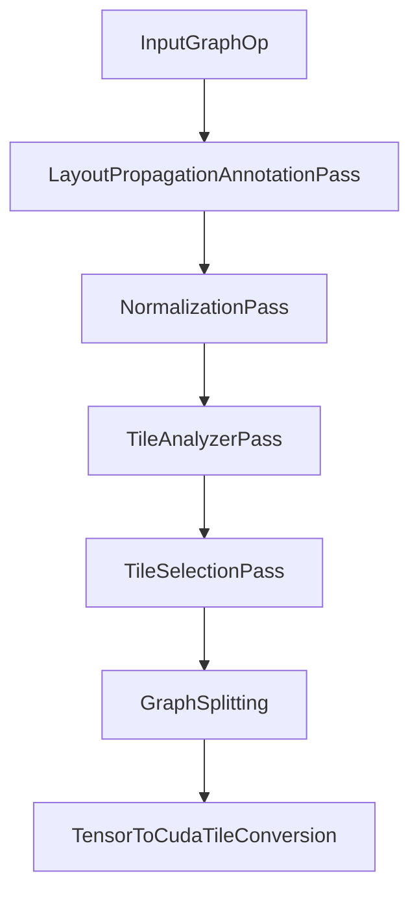
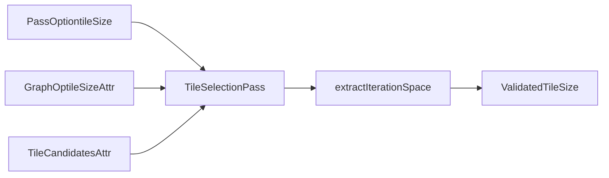

<!-- source: DeepWiki mcp.deepwiki.com · repo NVIDIA/tensor-ir · page 3 Transform Passes · fetched 2026-10-26 -->

# Transform Passes

Relevant source files

The following files were used as context for generating this wiki page:

- [lib/Transform/LayoutAnnotation.cpp](lib/Transform/LayoutAnnotation.cpp)
- [lib/Transform/TileSelectionPass.cpp](lib/Transform/TileSelectionPass.cpp)

## Purpose and Scope

The transform pass pipeline in TensorIR is responsible for preparing high-level tensor dataflow graphs (`GraphOp`) for downstream lowering into CUDA Tile IR GPU kernels. Operating within the MLIR framework, these passes perform key structural analyses, layout annotations, tile candidate evaluations, iteration space discoveries, and graph transformations. 

The pipeline bridges the gap between abstract tensor operations and the hardware-aware execution requirements of Tensor Core architecture by establishing explicit carrier shapes, validating block and tile configurations, and normalizing multi-output or reduction patterns.

Sources: [lib/Transform/LayoutAnnotation.cpp:1-31](), [lib/Transform/TileSelectionPass.cpp:1-51]()

---

## Pass Pipeline Architecture

The transform passes execute sequentially on the `GraphOp` construct, progressively enriching the graph with layout data, tile hints, and iteration space metadata required by the conversion layer.

*Figure 1: Transform pass pipeline progression from raw graph input to lowering-ready operations.*

Sources: [lib/Transform/LayoutAnnotation.cpp:25-31](), [lib/Transform/TileSelectionPass.cpp:8-11]()

---

## 3.1 Layout Propagation Annotation and Normalization

The layout annotation and normalization passes assign physical layouts and carrier shapes to tensor values within the graph. `LayoutPropagationAnnotationPass` derives carrier shapes, traces backward SSA ancestries, and handles rank expansions or dimension lifts (`liftLayoutToCarrier`). Following annotation, the normalization phase handles multi-output results, resolves physical output layouts via `buildPhysicalResultSource`, and applies necessary reduction fixups.

For details, see [Layout Propagation Annotation and Normalization](#3.1).

Sources: [lib/Transform/LayoutAnnotation.cpp:32-191]()

---

## 3.2 Tile Analysis and Tile Selection

Tile analysis and selection determine the optimal compute tile shape for execution. The `TileAnalyzerPass` evaluates iteration spaces and generates ranked tile candidates. Subsequently, `TileSelectionPass` resolves tile hints across multiple priority tiers: explicit pass options, `tile_size` attributes on `GraphOp`, or the best-scored entry from `tile_candidates`. It then validates the chosen tile against the graph's iteration space metadata.

*Figure 2: Tile resolution hierarchy and validation sequence inside `TileSelectionPass`.*

For details, see [Tile Analysis and Tile Selection](#3.2).

Sources: [lib/Transform/TileSelectionPass.cpp:74-160]()

---

## 3.3 Graph Splitting and Iteration Space Discovery

Complex or multi-iteration-space graphs require structural decomposition before lowering. The `GraphSplitting` pass and `DiscoverIterationSpaceInfo` utility analyze multi-dimensional iteration spaces, assign unique iteration space identifiers (`iterSpaceId`), and partition graphs to ensure that loops and memory accesses map cleanly onto target hardware execution models.

For details, see [Graph Splitting and Iteration Space Discovery](#3.3).

Sources: [lib/Transform/LayoutAnnotation.cpp:25-31](), [lib/Transform/TileSelectionPass.cpp:78-92]()

---

