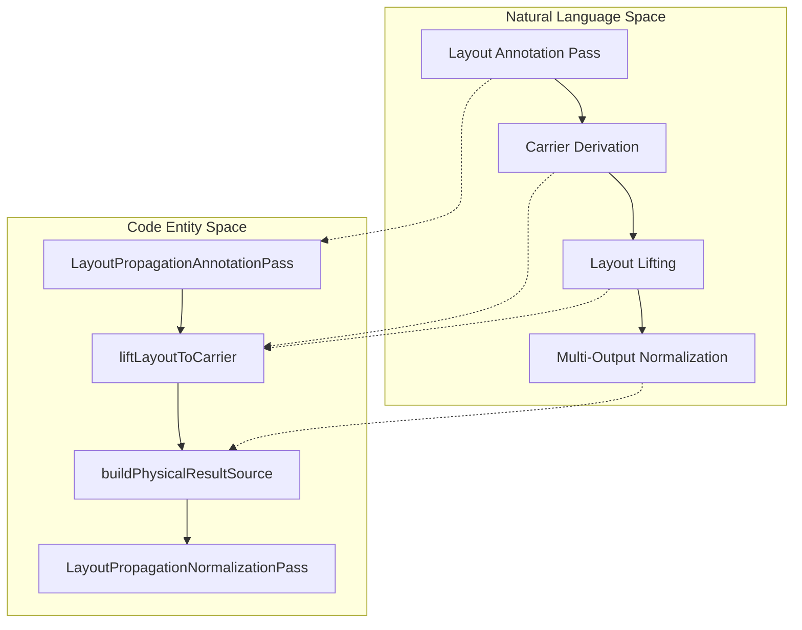
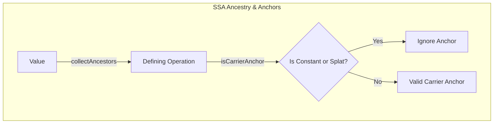
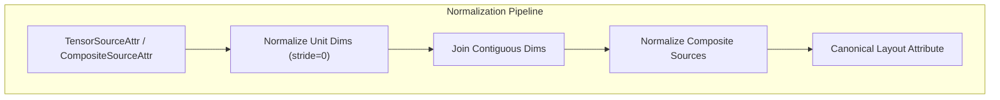

<!-- source: DeepWiki mcp.deepwiki.com · repo NVIDIA/tensor-ir · page 3.1 Layout Propagation Annotation and Normalization · fetched 2026-10-26 -->

# Layout Propagation Annotation and Normalization

<details>
<summary>Relevant source files</summary>

The following files were used as context for generating this wiki page:

- [lib/Transform/LayoutAnnotation.cpp](lib/Transform/LayoutAnnotation.cpp)
- [test/Transform/layout-propagation-annotation.mlir](test/Transform/layout-propagation-annotation.mlir)
- [test/Transform/layout-propagation-normalize.mlir](test/Transform/layout-propagation-normalize.mlir)

</details>


## Purpose and Scope

This section covers the layout propagation and normalization transform passes within the TensorIR compiler pipeline: `LayoutPropagationAnnotationPass` and `LayoutPropagationNormalizationPass`. These passes operate on the `nv_tensor_ir` dialect to attach explicit physical layout metadata (`TensorSourceAttr`, `CompositeSourceAttr`) to tensor operations, derive carrier shapes for complex data flow, handle multi-output graph results, and perform normalization and reduction layout fixups prior to lowering.

Sources: [lib/Transform/LayoutAnnotation.cpp:25-90]()

---

## 1. Pass Architecture and Core Passes

The layout annotation pipeline transforms high-level tensor operations by propagating physical memory layouts, strides, and offsets backward and forward through the Data Flow Graph (DFG). 

The two primary passes implemented in the transformation framework are:
1. **`LayoutPropagationAnnotationPass`**: Traverses operations (`ReshapeOp`, `BroadcastOp`, `TransposeOp`, pointwise ops) and propagates layout attributes (`LayoutSourceAttrInterface`) through SSA value chains [lib/Transform/LayoutAnnotation.cpp:39-154]().
2. **`LayoutPropagationNormalizationPass`**: Consolidates and normalizes layout representations (such as joining contiguous dimensions, handling zero-stride broadcast axes, and simplifying `CompositeSourceAttr` structures) [test/Transform/layout-propagation-normalize.mlir:5-132]().


*Diagram 1: Bridging layout propagation concepts to code entities.*

Sources: [lib/Transform/LayoutAnnotation.cpp:25-90](), [test/Transform/layout-propagation-normalize.mlir:1-132]()

---

## 2. Carrier Derivation and Layout Lifting

TensorIR operations frequently encounter situations where intermediate tensors have shapes that do not directly align with downstream consumer or upstream producer carrier registers. The process of **layout lifting** adjusts layouts to fit a target **carrier shape**.

### Layout Lifting (`liftLayoutToCarrier`)

The function `liftLayoutToCarrier` attempts to express a given layout within a target `carrierShape`. Beyond standard reshaping and broadcasting, it supports **rank expansion** by inserting unit dimensions before broadcasting them:

```cpp
static FailureOr<LayoutSourceAttrInterface>
liftLayoutToCarrier(LayoutSourceAttrInterface layout,
                    ArrayRef<int64_t> carrierShape);
```
- If the layout's shape already matches `carrierShape`, it returns the layout unchanged [lib/Transform/LayoutAnnotation.cpp:95-97]().
- If a direct `broadcast` or `reshape` succeeds, those layout views are returned [lib/Transform/LayoutAnnotation.cpp:98-103]().
- For rank expansion, it enumerates compatible dimension alignments, verifying that unmatched dimensions are strictly of size `1` or dynamic [lib/Transform/LayoutAnnotation.cpp:110-154]().

### Carrier Anchors and SSA Ancestry

To determine valid carriers, the pass traverses the backward SSA ancestry of terminal values using `collectAncestors` and identifies structural reference points via `isCarrierAnchor`:
- Operations like `ConstantOp` and `SplatOp` are excluded as anchor points because they do not dictate physical memory layouts [lib/Transform/LayoutAnnotation.cpp:160-180]().
- Tensor operands with ranks greater than zero serve as carrier anchors for layout propagation [lib/Transform/LayoutAnnotation.cpp:171-180]().


*Diagram 2: Carrier anchor evaluation flow.*

Sources: [lib/Transform/LayoutAnnotation.cpp:93-191]()

---

## 3. Multi-Output Normalization and Results

For operations and graphs producing multiple output tensors, physical output layouts must be constructed and registered so that the codegen backend can map return values to kernel arguments or workspace memory.

### Physical Result Source Construction (`buildPhysicalResultSource`)

The helper function `buildPhysicalResultSource` builds the physical output layout for a specific `resultIndex` on a `GraphOp`:
- Output tensor IDs are assigned sequentially following graph inputs in the converted kernel signature [lib/Transform/LayoutAnnotation.cpp:51-85]().
- Stride attributes are extracted from result dictionaries if present (via `TensorIRDialect::getStrideAttrName()`) [lib/Transform/LayoutAnnotation.cpp:64-75]().
- A `TensorSourceAttr` is instantiated combining the tensor ID, zero offset, physical layout string representation, and dynamic value mapping [lib/Transform/LayoutAnnotation.cpp:80-85]().

```cpp
static FailureOr<TensorSourceAttr>
buildPhysicalResultSource(GraphOp graphOp, size_t resultIndex);
```

Sources: [lib/Transform/LayoutAnnotation.cpp:51-85]()

---

## 4. Normalization and Reduction Fixups

The normalization pass processes layout sources attached to graph results and intermediate operations to ensure canonical forms:
- **Unit Dimensions with Zero Stride**: Normalizes unit-extent dimensions to explicit zero strides (e.g., `(1) -> (1):(0)`) [test/Transform/layout-propagation-normalize.mlir:9-15]().
- **Contiguous Dimension Joining**: Coalesces adjacent contiguous dimensions to simplify index calculations (e.g., `(2, 4) -> (8):(1)`) [test/Transform/layout-propagation-normalize.mlir:19-35]().
- **Composite Source Normalization**: Aligns multiple input sources in `CompositeSourceAttr` (such as those entering binary operations like `add`) so their layouts share compatible shapes and strides [test/Transform/layout-propagation-normalize.mlir:83-128]().


*Diagram 3: Normalization pipeline transformations.*

Sources: [test/Transform/layout-propagation-normalize.mlir:1-132]()

---

