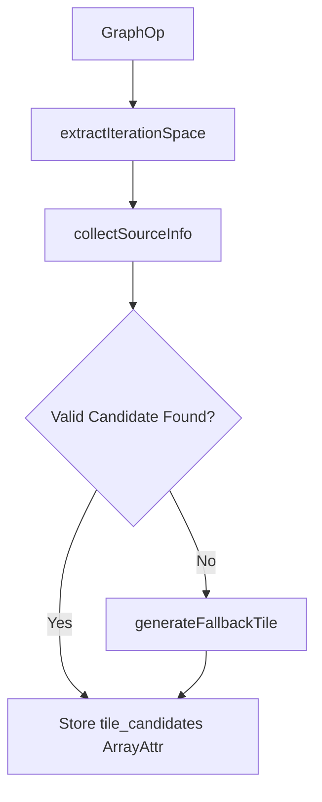
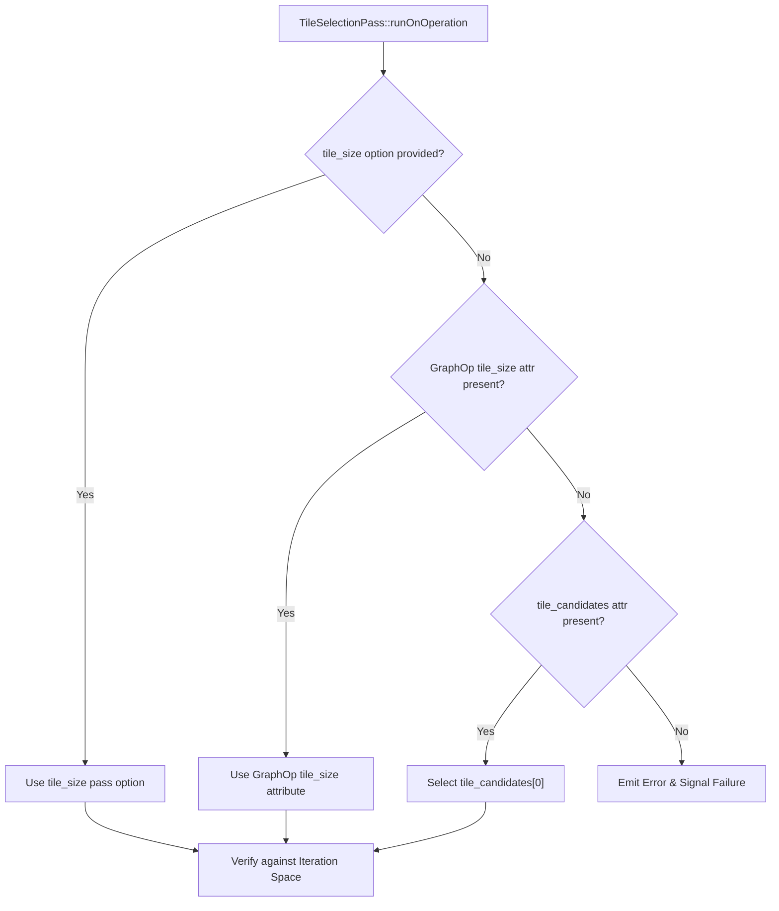

<!-- source: DeepWiki mcp.deepwiki.com · repo NVIDIA/tensor-ir · page 3.2 Tile Analysis and Tile Selection · fetched 2026-10-26 -->

# Tile Analysis and Tile Selection

<details>
<summary>Relevant source files</summary>

The following files were used as context for generating this wiki page:

- [lib/Transform/TileAnalyzerPass.cpp](lib/Transform/TileAnalyzerPass.cpp)
- [lib/Transform/TileSelectionPass.cpp](lib/Transform/TileSelectionPass.cpp)
- [test/Transform/multi-output-tile-selection.mlir](test/Transform/multi-output-tile-selection.mlir)
- [test/Transform/tile-selection-metadata-invalid.mlir](test/Transform/tile-selection-metadata-invalid.mlir)

</details>


## Purpose and Scope
This section covers the mechanics of `TileAnalyzerPass` and `TileSelectionPass` within the TensorIR transformation pipeline. These passes analyze tensor iteration spaces, evaluate and enumerate valid tile candidates using backend heuristics, resolve explicit or heuristic tile choices, and validate tile dimensions against layout attributes before handing off execution state to backend lowering passes.

```
LayoutPropagationAnnotationPass
       │
       ▼
LayoutPropagationNormalizationPass
       │
       ▼
   TileAnalyzerPass  ──► (Generates "tile_candidates" & fallback tiles)
       │
       ▼
  TileSelectionPass  ──► (Resolves and validates final "tile_size")
       │
       ▼
TensorToCudaTileConversionPass
```

Sources: `lib/Transform/TileAnalyzerPass.cpp:1-11()`, `lib/Transform/TileSelectionPass.cpp:8-11()`

---

## Tile Analysis Pipeline and TileAnalyzerPass

`TileAnalyzerPass` runs after layout normalization to inspect the graph's iteration space and produce ranked tile size candidates. It extracts shape and stride configurations from layout source attributes and interfaces with the underlying cutegen tile candidate generator (`mlir::nv_tensor_ir::tcutegen`).

### Iteration Space Extraction and Source Collection
The analyzer inspects the graph terminator (the results operation) for an `iteration_space` attribute (`lib/Transform/TileAnalyzerPass.cpp:170-171()`). It recursively walks the layout source tree using `collectSourceInfo` to identify leaf `TensorSourceAttr` instances and fixed-tile dimensions (such as reduction or concatenation axes requiring specific alignment like dimension `1`) (`lib/Transform/TileAnalyzerPass.cpp:144-157()`):

* `TensorSourceAttr`: Represents a concrete tensor input/output layout mapped to the iteration space.
* `ConcatSourceAttr`: Forces fixed tiling constraints (e.g., setting concatenated dimensions to a fixed stride/tile size of `1`) (`lib/Transform/TileAnalyzerPass.cpp:147-151()`).
* `CompositeSourceAttr`: Groups multiple layout sources together (`lib/Transform/TileAnalyzerPass.cpp:152-156()`).

Element sizes in bytes are determined via `getElementSizeBytesForSource`, inspecting the `GraphOp` argument or result types (`lib/Transform/TileAnalyzerPass.cpp:82-111()`). Layout shapes and strides are extracted using `extractShapeAndStridesFromLayout` (`lib/Transform/TileAnalyzerPass.cpp:115-138()`).

### Fallback Tile Generation
When the candidate generator cannot produce valid candidates due to awkward shapes, dynamic dimensions, or small iteration spaces, `TileAnalyzerPass` invokes a conservative fallback routine `generateFallbackTile` (`lib/Transform/TileAnalyzerPass.cpp:45-65()`):
* **Dynamic Dimensions (`<= 0`)**: Assigned `kDefaultDynamicTileSize` (`128`) (`lib/Transform/TileAnalyzerPass.cpp:38`, `51-52()` ).
* **Static Dimensions**: Clamped using `llvm::bit_floor` and bounded by `kMaxFallbackTileSize` (`128`) (`lib/Transform/TileAnalyzerPass.cpp:39`, `56-59()`).
* **Fixed Dimensions**: Overridden by entries in `fixedTileDims` (`lib/Transform/TileAnalyzerPass.cpp:61-63()`).


Sources: `lib/Transform/TileAnalyzerPass.cpp:35-171()`

---

## Tile Selection Priority and TileSelectionPass

`TileSelectionPass` consumes tile hints from multiple sources, establishes a single validated `tile_size` attribute on the `GraphOp`, and cleans up temporary analysis attributes (`lib/Transform/TileSelectionPass.cpp:5-44()`).

### Resolution Priority Order
The pass checks three potential sources for tile shapes in strict priority order (`lib/Transform/TileSelectionPass.cpp:108-152()`):
1. **Pass Option (`tile_size`)**: Explicitly passed via compilation or command-line flags, overriding all graph-level settings (`lib/Transform/TileSelectionPass.cpp:111-117()`).
2. **`tile_size` Attribute**: An existing `DenseI32ArrayAttr` directly attached to the `GraphOp` (`lib/Transform/TileSelectionPass.cpp:119-126()`).
3. **`tile_candidates` Attribute**: Generated by `TileAnalyzerPass`, where the pass selects the highest-scoring candidate (`tile_candidates[0]`) (`lib/Transform/TileSelectionPass.cpp:127-144()`).

If none of these sources are available, the pass reports an error and signals pass failure (`lib/Transform/TileSelectionPass.cpp:145-152()`).


Sources: `lib/Transform/TileSelectionPass.cpp:108-160()`

---

## Tile Candidates, Attributes, and Metadata Validation

Once a tile shape is resolved, `TileSelectionPass` validates it against the graph's iteration space metadata (`lib/Transform/TileSelectionPass.cpp:154-160()`).

### Validation Rules and Error Boundaries
* **Rank Matching**: The selected tile's rank must match the iteration space rank (`test/Transform/tile-selection-metadata-invalid.mlir:9-18()`). Mismatches emit diagnostics such as `result_views rank X does not match iteration space rank Y`.
* **Dimension Validity**: Individual tile dimensions are checked for power-of-2 compliance and boundary constraints relative to static iteration space extents.
* **Cleanup**: Upon successful selection and validation, temporary attributes like `tile_candidates` are removed from the `GraphOp`, leaving a finalized `tile_size` array attribute for downstream conversion passes (`lib/Transform/TileSelectionPass.cpp:36-43()`).

### Example: Multi-Output RMSNorm Auto-Tiling
In multi-output patterns like RMSNorm, tile analysis projects carrier dimensions to ensure proper CTA (Cooperative Thread Array) ownership over computed statistics (`test/Transform/multi-output-tile-selection.mlir:5-22()`):
```mlir
nv_tensor_ir.graph @rmsnorm_auto_tile(
    %x: tensor<64x16xf32> {nv_tensor_ir.stride = "(16,1)"}
    ) -> (tensor<64x16xf32> {nv_tensor_ir.stride = "(16,1)"},
          tensor<64x1xf32> {nv_tensor_ir.stride = "(1,1)"}) {
  %sq = mul %x, %x : tensor<64x16xf32>
  %sum = reduce(%sq)<dimensions = [1], reduction_mode = <add>>
      : tensor<64x16xf32> -> tensor<64x1xf32>
  %wide = broadcast %sum : tensor<64x1xf32> -> tensor<64x16xf32>
  %y = mul %x, %wide : tensor<64x16xf32>
  results %y, %sum : tensor<64x16xf32>, tensor<64x1xf32>
}
```
The resulting `tile_size` attribute is injected directly into the graph attributes (e.g., `attributes {tile_size = array<i32: 2, 16>}`) prior to lowering (`test/Transform/multi-output-tile-selection.mlir:8()`).

Sources: `lib/Transform/TileSelectionPass.cpp:30-50()`, `test/Transform/multi-output-tile-selection.mlir:1-40()`, `test/Transform/tile-selection-metadata-invalid.mlir:1-18()`

---

