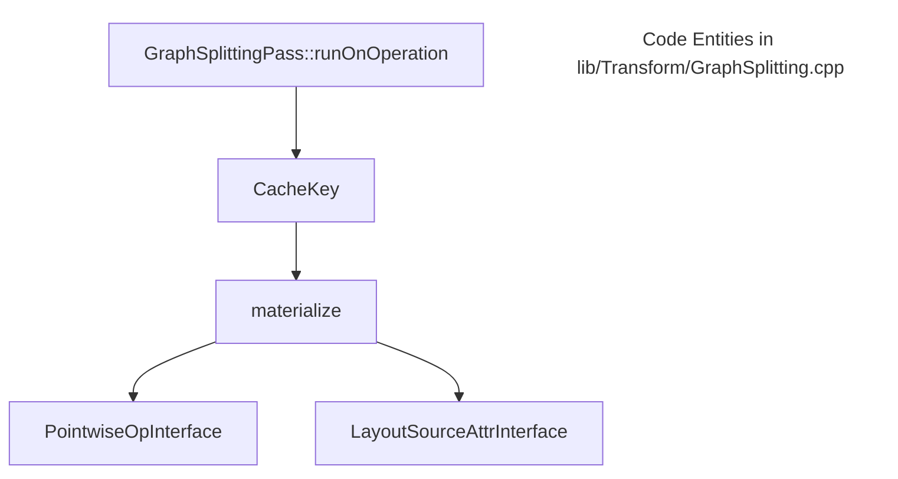
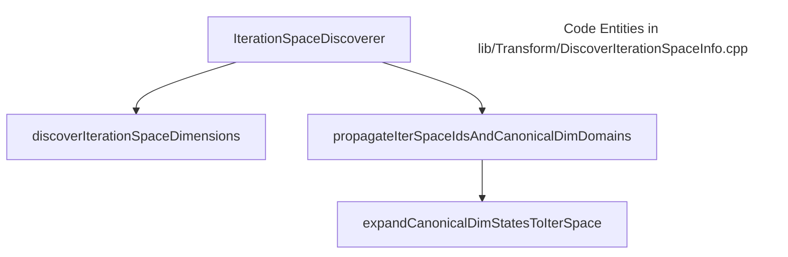

<!-- source: DeepWiki mcp.deepwiki.com · repo NVIDIA/tensor-ir · page 3.3 Graph Splitting and Iteration Space Discovery · fetched 2026-10-26 -->

# Graph Splitting and Iteration Space Discovery

<details>
<summary>Relevant source files</summary>

The following files were used as context for generating this wiki page:

- [lib/Transform/DiscoverIterationSpaceInfo.cpp](lib/Transform/DiscoverIterationSpaceInfo.cpp)
- [lib/Transform/GraphSplitting.cpp](lib/Transform/GraphSplitting.cpp)
- [test/Transform/discover-iteration-space-info-multi-iter-space.mlir](test/Transform/discover-iteration-space-info-multi-iter-space.mlir)

</details>


## Purpose and Scope
This page covers section 3.3 of the TensorIR compiler wiki, detailing the `GraphSplitting` pass and the `DiscoverIterationSpaceInfo` pass (`DiscoverIterationSpaceInfoPass` and `RemoveIterationSpaceMapsPass`). These transform passes prepare graphs for lowering by converting reconvergent directed acyclic graphs (DAGs) into trees via layout-aware cloning, and by analyzing iteration space topologies, dimensions, and transition boundaries.

Sources: `lib/Transform/GraphSplitting.cpp:21-28` [], `lib/Transform/DiscoverIterationSpaceInfo.cpp:4-9` []

---

## 1. Graph Splitting Pass (`GraphSplittingPass`)

### Algorithmic Overview
The `GraphSplitting` pass converts reconvergent DAGs into trees [lib/Transform/GraphSplitting.cpp:24-27](). When an SSA value is consumed by multiple paths that require conflicting layouts (distinct strides or offsets), the pass clones the defining operation of that value—producing one copy per unique layout [lib/Transform/GraphSplitting.cpp:24-27]().

### Key Data Structures and Functions
- **`CacheKey`**: A caching structure containing the defining `Operation *`, an `iterSpaceId` integer, and a layout `Attribute` [lib/Transform/GraphSplitting.cpp:36-45](). It is specialized in `llvm::DenseMapInfo` to memoize cloned values [lib/Transform/GraphSplitting.cpp:50-66]().
- **`GraphSplittingPass`**: Inherits from `impl::GraphSplittingPassBase<GraphSplittingPass>` [lib/Transform/GraphSplitting.cpp:71-72](). Its `runOnOperation()` driver extracts the terminator `ResultsOp`, instantiates an `OpBuilder`, and allocates a cache and an `iterSpaceCounter` [lib/Transform/GraphSplitting.cpp:74-85]().
- **`materialize` Lambda**: A recursive helper inside `runOnOperation()` that checks if a `Value` is a block argument or looks up/inserts into the `cache` using the `CacheKey` [lib/Transform/GraphSplitting.cpp:88-120](). It handles operand layout inference for pointwise operations and layout modifications [lib/Transform/GraphSplitting.cpp:122-177]().


Sources: `lib/Transform/GraphSplitting.cpp:21-120` []

---

## 2. Iteration Space Discovery (`DiscoverIterationSpaceInfoPass`)

### Algorithmic Overview
The `DiscoverIterationSpaceInfo` pass discovers the global iteration space rank, computes dimension domains, assigns `iterSpaceId` attributes, and identifies multi-iteration-space boundaries (such as transitions caused by reductions followed by broadcasts) [lib/Transform/DiscoverIterationSpaceInfo.cpp:46-84]().

### Key Classes and Functions
- **`IterationSpaceDiscoverer`**: The core analyzer class instantiated with a `GraphOp` [lib/Transform/DiscoverIterationSpaceInfo.cpp:48-50](). It tracks `iterSpaceRank`, `currentIterSpaceId`, and coordinates discovery and propagation phases [lib/Transform/DiscoverIterationSpaceInfo.cpp:66-84]().
- **`discoverIterationSpaceDimensions()`**: Walks the graph, queries operations implementing `IterationSpaceInfoInterface`, and determines the maximum iteration space rank across the graph [lib/Transform/DiscoverIterationSpaceInfo.cpp:86-107]().
- **`expandCanonicalDimStatesToIterSpace()`**: Expands canonical dimension domain states (based on operation output rank) up to the global iteration space rank using an `AffineMap` [lib/Transform/DiscoverIterationSpaceInfo.cpp:110-127]().
- **`propagateIterSpaceIdsAndCanonicalDimDomains()`**: Maps SSA values to iteration space IDs and dimension states, establishing initial graph input states and walking the IR to join operand domains [lib/Transform/DiscoverIterationSpaceInfo.cpp:129-177]().


Sources: `lib/Transform/DiscoverIterationSpaceInfo.cpp:46-177` []

---

## 3. Multi-Iteration-Space Graphs and Transitions

### Transition Mechanics
When operations expand unit dimensions or change domain states from `Def` to `Undef` and back (for instance, a reduction followed by a non-unit broadcast expansion), the discovery pass increments the `iterSpaceId` to partition the graph into distinct iteration spaces [test/Transform/discover-iteration-space-info-multi-iter-space.mlir:38-71]().

Consider a reduction followed by a broadcast, which creates a new iteration space transition [test/Transform/discover-iteration-space-info-multi-iter-space.mlir:45-71]():

```mlir
// Example structure generated during discovery
%reduced = reduce(%input) <dimensions = [1], reduction_mode = <add>>
    : tensor<16x32x64xf32> -> tensor<16x1x64xf32>

// Triggers an iteration space transition due to domain redefinition
%broadcast = broadcast %reduced : tensor<16x1x64xf32> -> tensor<16x48x64xf32>
```

Sources: `test/Transform/discover-iteration-space-info-multi-iter-space.mlir:38-71` []

---

