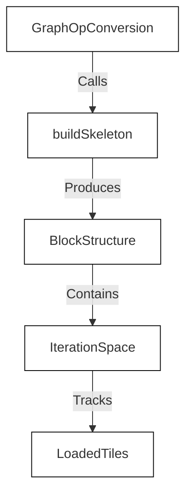
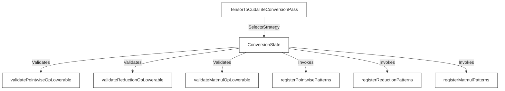

<!-- source: DeepWiki mcp.deepwiki.com · repo NVIDIA/tensor-ir · page 4 TensorToCudaTile Conversion · fetched 2026-10-26 -->

# TensorToCudaTile Conversion

Relevant source files

The following files were used as context for generating this wiki page:

- [include/tensor_ir/Conversion/TensorToCudaTile/TensorToCudaTile.h](include/tensor_ir/Conversion/TensorToCudaTile/TensorToCudaTile.h)
- [include/tensor_ir/Conversion/TensorToCudaTile/TensorToCudaTileInternal.h](include/tensor_ir/Conversion/TensorToCudaTile/TensorToCudaTileInternal.h)
- [lib/Conversion/TensorToCudaTile/TensorToCudaTile.cpp](lib/Conversion/TensorToCudaTile/TensorToCudaTile.cpp)

The TensorToCudaTile conversion layer transforms high-level TensorIR graphs (`GraphOp`) into the `cuda_tile` dialect. This subsystem is driven by the `TensorToCudaTileConversionPass` defined in `lib/Conversion/TensorToCudaTile/TensorToCudaTile.cpp:66-162`, which orchestrates type conversion, validation, and lowering strategies. 

The compiler supports two primary codegen strategies: **Layout Propagation** and **Affine Map**. It utilizes a shared `ConversionState` interface (`include/tensor_ir/Conversion/TensorToCudaTile/TensorToCudaTile.h:38-67`) and internal plumbing headers (`include/tensor_ir/Conversion/TensorToCudaTile/TensorToCudaTileInternal.h:1-136`) to manage iteration spaces, tile descriptors, and operation-specific pattern matching.

---

## 4.1 Layout Propagation Strategy

The layout propagation strategy acts as the default and primary lowering path. It relies on layout source attributes, carrier shapes, and multi-output graph analyses to propagate tile dimensions through the computation graph. The core driver implements `ConversionStateImpl`, manages `GraphOpConversion` and `ResultsOpConversion`, constructs tensor descriptors, and handles static persistence along with function signature conversion.

For deep technical details, implementation specifics, and structural layouts, see [Layout Propagation Strategy](#4.1).

Sources:
- `include/tensor_ir/Conversion/TensorToCudaTile/TensorToCudaTile.h:138-142`
- `include/tensor_ir/Conversion/TensorToCudaTile/TensorToCudaTileInternal.h:81-118`
- `lib/Conversion/TensorToCudaTile/TensorToCudaTile.cpp:121-133`

---

## 4.2 Affine Map Strategy

The affine map strategy provides an alternative lowering path implemented via `AffineMapImpl`. It computes tensor coordinate transformations using explicit `AffineMap` expressions rather than relying on global layout propagation attributes. This path includes distinct diagnostic handlers and handles scenarios where layout attributes are absent or irregular.

For details on this alternative lowering path, diagnostics, and structural differences, see [Affine Map Strategy](#4.2).

Sources:
- `include/tensor_ir/Conversion/TensorToCudaTile/TensorToCudaTile.h:127-134`
- `lib/Conversion/TensorToCudaTile/TensorToCudaTile.cpp:131-133`

---

## 4.3 Structure Building and Iteration Spaces

To emit valid loop nests and block structures for reductions, matmuls, and concatenated operations, the conversion layer builds a skeletal representation using helper routines such as `buildSkeleton` and `buildBlockStructure`. This tracks `IterationSpace` instances, handles `BlockStructure` metadata, manages `IfOp` chains for concatenations, and coordinates multidimensional iteration spaces.

*Figure 4.1: Iteration space structure building pipeline bridging graph ops to block structures.*

Sources:
- `include/tensor_ir/Conversion/TensorToCudaTile/TensorToCudaTile.h:81-125`
- `include/tensor_ir/Conversion/TensorToCudaTile/TensorToCudaTileInternal.h:119-136`

For full details on skeleton construction and iteration spaces, see [Structure Building and Iteration Spaces](#4.3).

Sources:
- `include/tensor_ir/Conversion/TensorToCudaTile/TensorToCudaTile.h:81-125`
- `include/tensor_ir/Conversion/TensorToCudaTile/TensorToCudaTileInternal.h:119-136`

---

## 4.4 Operation Lowering Patterns

Per-operation lowering is broken into dedicated pattern families (pointwise, reduction, and matmul) supported by validation functions and shared emission helpers. Pre-flight checks guarantee that operations are valid prior to IR modification.

*Figure 4.2: Mapping natural language conversion tasks to code entities and validation functions.*

Sources:
- `include/tensor_ir/Conversion/TensorToCudaTile/TensorToCudaTileInternal.h:24-78`
- `lib/Conversion/TensorToCudaTile/TensorToCudaTile.cpp:66-162`

For details on specific pattern groups, consult the child sections:
- For matrix multiplication lowerings, see [Matmul Lowering](#4.4.1).
- For reduction mode emission and identities, see [Reduction Lowering](#4.4.2).
- For pointwise, broadcast, and multi-output graphs, see [Pointwise, Broadcast and Multi-Output Lowering](#4.4.3).

Sources:
- `include/tensor_ir/Conversion/TensorToCudaTile/TensorToCudaTileInternal.h:24-78`
- `lib/Conversion/TensorToCudaTile/TensorToCudaTile.cpp:66-162`

---

