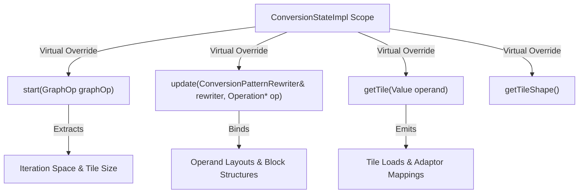
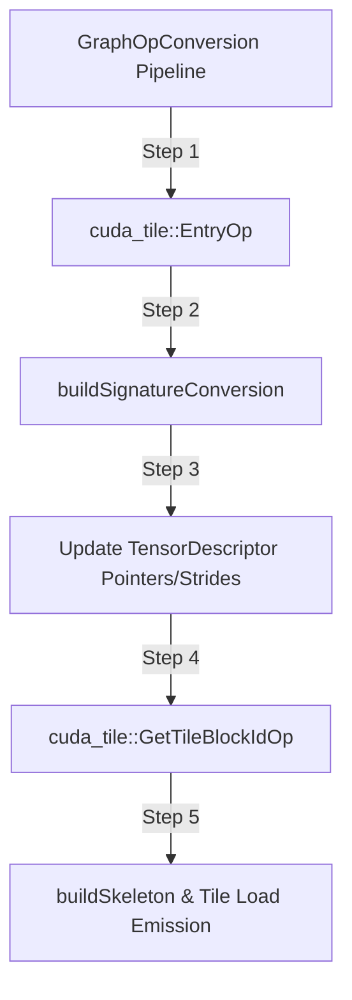
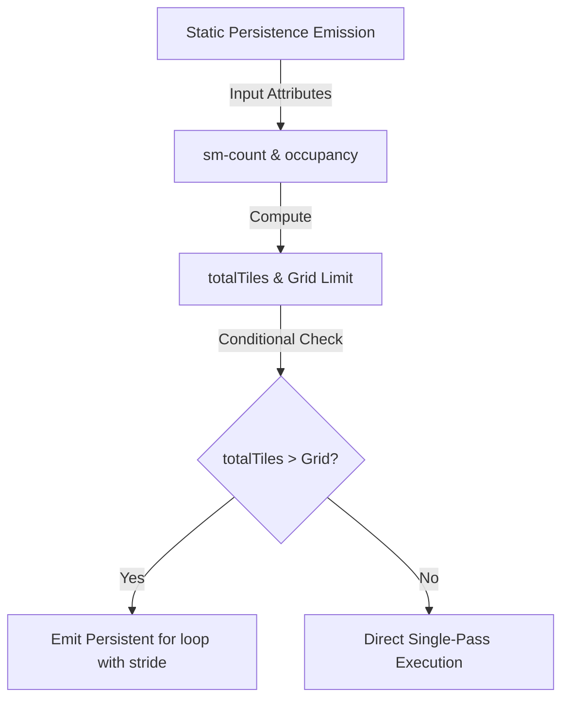

<!-- source: DeepWiki mcp.deepwiki.com · repo NVIDIA/tensor-ir · page 4.1 Layout Propagation Strategy · fetched 2026-10-26 -->

# Layout Propagation Strategy

Relevant source files

The following files were used as context for generating this wiki page:

- [lib/Conversion/TensorToCudaTile/LayoutPropagationImpl.cpp](lib/Conversion/TensorToCudaTile/LayoutPropagationImpl.cpp)
- [test/Conversion/TensorToCudaTile/static_persistent_layout_prop.mlir](test/Conversion/TensorToCudaTile/static_persistent_layout_prop.mlir)
- [test/Conversion/TensorToCudaTile/static_persistent_layout_prop_dynamic.mlir](test/Conversion/TensorToCudaTile/static_persistent_layout_prop_dynamic.mlir)

## Purpose and Scope

This page covers the implementation details of the layout propagation lowering strategy in the `TensorToCudaTile` conversion pass. The layout propagation framework converts high-level `nv_tensor_ir` graphs into `cuda_tile` dialect operations by driving code generation using explicit iteration spaces, layout attributes, and tensor descriptors. Key components include `ConversionStateImpl`, `GraphOpConversion`, `ResultsOpConversion`, tensor descriptors, static persistence management, and signature conversions.

Sources:
- `lib/Conversion/TensorToCudaTile/LayoutPropagationImpl.cpp:1-162`
- `test/Conversion/TensorToCudaTile/static_persistent_layout_prop.mlir:1-50`

---

## 1. ConversionStateImpl and State Lifecycle

The core state engine for layout-propagation-based lowering is encapsulated by `ConversionStateImpl`, which inherits from the base `ConversionState` interface [lib/Conversion/TensorToCudaTile/LayoutPropagationImpl.cpp:57](). The state is instantiated with compilation options, target contexts, and optimization hints, and it is reset per graph conversion [lib/Conversion/TensorToCudaTile/LayoutPropagationImpl.cpp:21-25].

During a graph conversion, `ConversionStateImpl` manages:
- **`normalizedLayout`**: The root-carrier layout shared by graph results (`LayoutSourceAttrInterface`) [lib/Conversion/TensorToCudaTile/LayoutPropagationImpl.cpp:125]().
- **`inputDescriptors` / `outputDescriptors`**: Collections of `TensorDescriptor` structs tracking pointers, dynamic sizes, and strides for graph arguments and results [lib/Conversion/TensorToCudaTile/LayoutPropagationImpl.cpp:128-129].
- **`blockStructures` and `iterationSpaces`**: Mappings tracking block control flow and iteration space dimensions [lib/Conversion/TensorToCudaTile/LayoutPropagationImpl.cpp:137-140].
- **Static Persistence Parameters**: Variables governing persistent thread block execution (`staticPersistenceActive`, `staticPersistenceGridSize`, `staticPersistenceTotalTiles`) [lib/Conversion/TensorToCudaTile/LayoutPropagationImpl.cpp:119-123].

Sources:
- `lib/Conversion/TensorToCudaTile/LayoutPropagationImpl.cpp:57-145`

---

## 2. GraphOpConversion and ResultsOpConversion

The lowering of graph boundaries (`GraphOp` and `ResultsOp`) orchestrates the transition from tensor-level operations to `cuda_tile` kernels. 

### Graph Lowering Sequence
1. **Entry Creation**: A `cuda_tile::EntryOp` is created, and the graph region is moved inside it.
2. **Signature Conversion**: `buildSignatureConversion` is called to transform tensor function arguments into low-level pointer and metadata parameters.
3. **Descriptor Initialization**: SSA values for block arguments update the `TensorDescriptor` structures (setting tensor base pointers, dynamic shape sizes, and stride values). Row-major defaults are computed if explicit strides are absent [lib/Conversion/TensorToCudaTile/LayoutPropagationImpl.cpp:30-37].
4. **Block ID Resolution**: A `cuda_tile::GetTileBlockIdOp` is emitted, mapping linear block indices to multidimensional iteration space coordinates [lib/Conversion/TensorToCudaTile/LayoutPropagationImpl.cpp:38-39].
5. **Skeleton Building**: `buildSkeleton` establishes structural block loops for operations modifying iteration spaces (such as reductions, matmuls, or concatenations) [lib/Conversion/TensorToCudaTile/LayoutPropagationImpl.cpp:40-41].

Sources:
- `lib/Conversion/TensorToCudaTile/LayoutPropagationImpl.cpp:30-49`

---

## 3. Tensor Descriptors and Signature Conversion

To support dynamic shapes and non-contiguous layouts, `ConversionStateImpl` builds a uniform or specialized signature for the compiled kernel function [lib/Conversion/TensorToCudaTile/LayoutPropagationImpl.cpp:153-157].

- **Tensor Arguments**: Each tensor parameter translates to a base pointer argument.
- **Dynamic Sizes and Strides**: Depending on whether `uniformSignature` is active (`options.uniformSignature`), dynamic or all dimensions supply size and stride parameters following each tensor pointer [lib/Conversion/TensorToCudaTile/LayoutPropagationImpl.cpp:113-115, 153-157].
- **`TensorDescriptor` Structure**: Bundles the lowered pointer value alongside runtime shape and stride dimensions to facilitate `load_view_tko` and `store_view_tko` generation.

Sources:
- `lib/Conversion/TensorToCudaTile/LayoutPropagationImpl.cpp:113-115, 127-129, 153-157`

---

## 4. Static Persistence

When static persistence is enabled via pipeline attributes (`persistence=static`), the code generator wraps tile processing in a persistent grid loop. This pattern allows a fixed number of thread blocks (governed by SM count and occupancy constraints) to dynamically iterate over the total tile space [test/Conversion/TensorToCudaTile/static_persistent_layout_prop.mlir:1-19].

### Mechanics of Static Persistence
- **Total Tile Calculation**: Computes aggregate tiles from tensor dimensions and tile shapes (e.g., total tiles = `3200 * 4 * 1 = 12800`) [test/Conversion/TensorToCudaTile/static_persistent_layout_prop.mlir:3-4].
- **Persistent Grid Mapping**: Multiplies streaming multiprocessor counts (`sm-count`) by target occupancy to derive the grid stride [test/Conversion/TensorToCudaTile/static_persistent_layout_prop.mlir:1-4].
- **Control Flow Emission**: Emits a `for` loop over iteration spaces using `get_tile_block_id` as the base offset and total tile count as the upper bound [test/Conversion/TensorToCudaTile/static_persistent_layout_prop.mlir:8-19]. For dynamic shapes, runtime calculations use `muli`, `mini`, and `maxi` operators [test/Conversion/TensorToCudaTile/static_persistent_layout_prop_dynamic.mlir:9-15].

Sources:
- `test/Conversion/TensorToCudaTile/static_persistent_layout_prop.mlir:1-27`
- `test/Conversion/TensorToCudaTile/static_persistent_layout_prop_dynamic.mlir:1-29`

---

