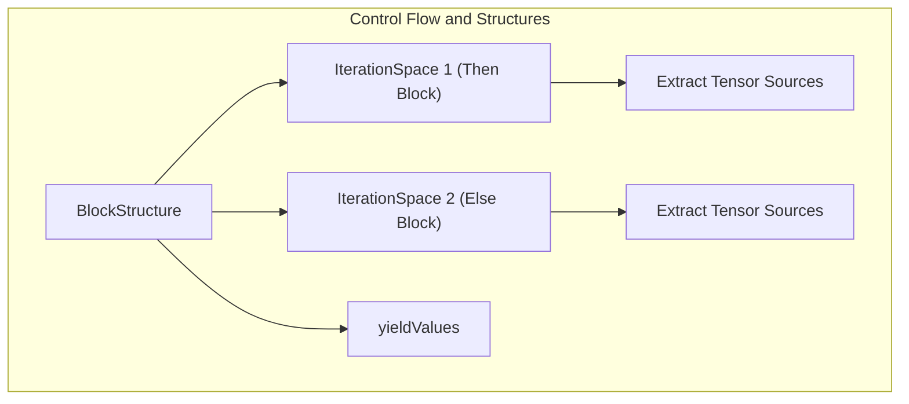
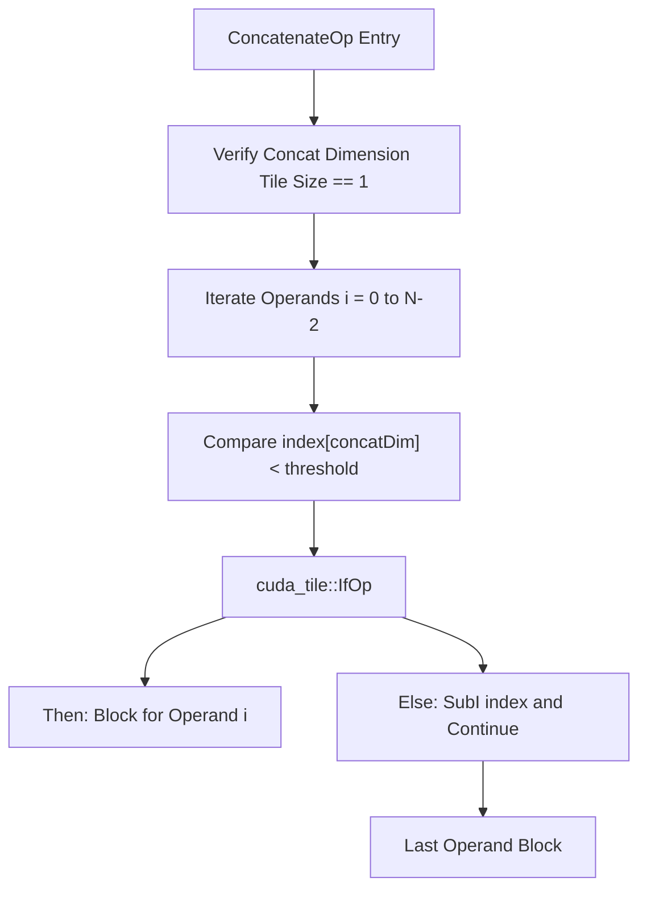
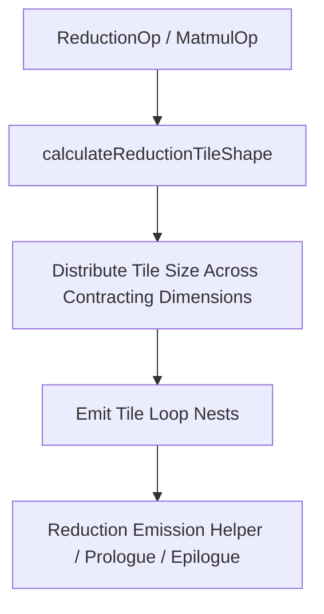

<!-- source: DeepWiki mcp.deepwiki.com · repo NVIDIA/tensor-ir · page 4.3 Structure Building and Iteration Spaces · fetched 2026-10-26 -->

# Structure Building and Iteration Spaces

<details>
<summary>Relevant source files</summary>

The following files were used as context for generating this wiki page:

- [lib/Conversion/TensorToCudaTile/StructureBuilder.cpp](lib/Conversion/TensorToCudaTile/StructureBuilder.cpp)
- [test/Conversion/TensorToCudaTile/iterspace_concat.mlir](test/Conversion/TensorToCudaTile/iterspace_concat.mlir)
- [test/Conversion/TensorToCudaTile/multi_iter_space.mlir](test/Conversion/TensorToCudaTile/multi_iter_space.mlir)

</details>


## Purpose and Scope

The structure building and iteration space layer handles the translation of high-level TensorIR graph structures, multi-output layouts, and partitioned tensor regions into explicit CUDA Tile IR control flow, block structures, and loop nests. Within the `TensorToCudaTile` conversion pipeline, functions such as `buildSkeleton` and `buildBlockStructure` orchestrate how blocks, conditional branches (`cuda_tile::IfOp`), and reduction/matmul loop iterations are formed. 

This page details the implementation of `IterationSpace`, `BlockStructure`, the generation of chained `IfOp` statements for tensor concatenations (`buildConcatBlockStructure`), and the handling of reduction and matrix multiplication loop nests.

Sources: `lib/Conversion/TensorToCudaTile/StructureBuilder.cpp:1-171](), `test/Conversion/TensorToCudaTile/iterspace_concat.mlir:1-163](), `test/Conversion/TensorToCudaTile/multi_iter_space.mlir:1-157]()

---

## Core Data Structures: `IterationSpace` and `BlockStructure`

During lowering, operations that alter control flow or require partitioning across tile dimensions are organized using two primary internal data structures:

- **`IterationSpace`**: Represents a localized iteration space bound to a specific block, tile shape, index values, and extracted tensor sources.
- **`BlockStructure`**: Encapsulates a collection of nested or sequential `IterationSpace` entries along with any yielded return values resulting from conditional blocks or loops.


*Diagram 1: BlockStructure and IterationSpace relationships*

Sources: `lib/Conversion/TensorToCudaTile/StructureBuilder.cpp:78-155]()

---

## Concatenation and `IfOp` Chain Generation

Concatenating tensors along a dimension requires mapping the active tile index to the corresponding input operand. This is implemented via `buildConcatBlockStructure` in `lib/Conversion/TensorToCudaTile/StructureBuilder.cpp`. 

### Implementation Details

When a `ConcatenateOp` is encountered, the conversion verifies that the layout attribute is a `ConcatSourceAttr` [lib/Conversion/TensorToCudaTile/StructureBuilder.cpp:83-88]() and that the tile size in the concatenated dimension is equal to `1` [lib/Conversion/TensorToCudaTile/StructureBuilder.cpp:91-97](). 

For $N$ operands, the builder generates a chain of $N-1$ conditional `cuda_tile::IfOp` statements:
1. The index variable along `concatDim` is compared against the threshold shape of the current operand using `cuda_tile::CmpIOp` (unsigned less-than) [lib/Conversion/TensorToCudaTile/StructureBuilder.cpp:115-125]().
2. The *then* branch handles the active operand's tile load and computation.
3. The *else* branch adjusts the index via `cuda_tile::SubIOp` and either nests another `IfOp` or falls through to the final operand [lib/Conversion/TensorToCudaTile/StructureBuilder.cpp:127-148]().


*Diagram 2: Control flow graph for multi-way concatenation building*

### MLIR Lowering Example

In test cases such as `@test_concat_across_columns`, a 2-way concatenation along dimension 0 produces a single `cuda_tile::IfOp` checking if the block index is less than the threshold `2`:

```mlir
%[[CMP:.*]] = cmpi less_than %[[BLOCK:.*]], %[[TWO]], unsigned
%[[RESULT:.*]] = if %[[CMP]] -> (tile<1x512xf32>) {
  %[[ARG0:.*]], %{{.*}} = load_view_tko weak %{{.*}}[%[[BLOCK]], %[[ZERO]]]
  yield %[[ARG0]]
} else {
  %[[IDX:.*]] = subi %[[BLOCK]], %[[TWO]]
  %[[ARG1:.*]], %{{.*}} = load_view_tko weak %{{.*}}[%[[IDX]], %[[ZERO]]]
  yield %[[ARG1]]
}
```

For 3-way or nested concatenations, inner `IfOp` chains are recursively generated [test/Conversion/TensorToCudaTile/iterspace_concat.mlir:74-141]().

Sources: `lib/Conversion/TensorToCudaTile/StructureBuilder.cpp:78-155](), `test/Conversion/TensorToCudaTile/iterspace_concat.mlir:18-141]()

---

## Reduction and Matmul Loop Nests

Reductions and matrix multiplications require partitioning contracting dimensions into tiled loops to match hardware execution constraints on NVIDIA GPUs.

### Reduction Tile Shape Calculation

Reductions distribute the reduction tile size evenly across contracting dimensions via `calculateReductionTileShape` [lib/Conversion/TensorToCudaTile/StructureBuilder.cpp:161-171](). The helper validates that dimension sizes are positive and evenly divisible by the requested tile configuration.


*Diagram 3: Reduction and Matmul structure building flow*

Sources: `lib/Conversion/TensorToCudaTile/StructureBuilder.cpp:161-171](), `test/Conversion/TensorToCudaTile/multi_iter_space.mlir:1-157]()

---

