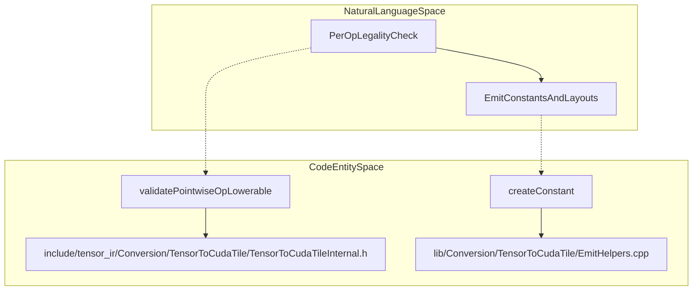
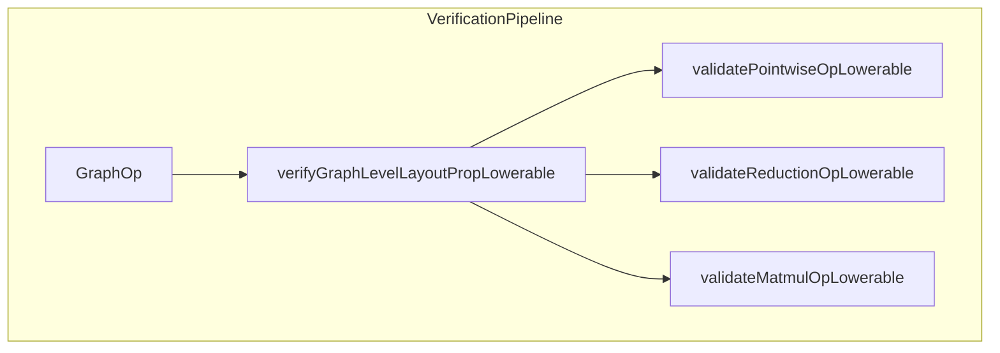

<!-- source: DeepWiki mcp.deepwiki.com · repo NVIDIA/tensor-ir · page 4.4 Operation Lowering Patterns · fetched 2026-10-26 -->

# Operation Lowering Patterns

Relevant source files

The following files were used as context for generating this wiki page:

- [include/tensor_ir/Conversion/TensorToCudaTile/TensorToCudaTileInternal.h](include/tensor_ir/Conversion/TensorToCudaTile/TensorToCudaTileInternal.h)
- [lib/Conversion/TensorToCudaTile/EmitHelpers.cpp](lib/Conversion/TensorToCudaTile/EmitHelpers.cpp)

The TensorIR compiler conversion layer translates high-level TensorIR operations into target-specific CUDA Tile IR operations. This parent page provides an overview of the per-op pattern families, shared emission helpers, and legality checking frameworks that power the translation. Detailed technical breakdowns for specific operation categories are covered in the child sections below.

---

## 1. Shared Infrastructure and Verification Framework

The TensorToCudaTile conversion layer relies on shared internal plumbing headers and emission utility files to ensure consistency between pre-flight feasibility checks and actual code generation [include/tensor_ir/Conversion/TensorToCudaTile/TensorToCudaTileInternal.h:26-33](). Legality check functions, such as `validatePointwiseOpLowerable`, `validateReductionOpLowerable`, and `validateMatmulOpLowerable`, act as pure predicates that inspect element types, attributes, and shapes without mutating the rewriter state [include/tensor_ir/Conversion/TensorToCudaTile/TensorToCudaTileInternal.h:34-74]().

Emission helpers handle common tasks such as constant generation, layout transformation, and loop structuring [lib/Conversion/TensorToCudaTile/EmitHelpers.cpp:16-27](). For example, `createConstant` builds `cuda_tile::ConstantOp` nodes for both integer and floating-point scalar configurations [lib/Conversion/TensorToCudaTile/EmitHelpers.cpp:75-90](), while `applyLayout` updates tensor descriptors with dynamic sizes and strides derived from layout attributes [lib/Conversion/TensorToCudaTile/EmitHelpers.cpp:108-118]().

Sources:
- `include/tensor_ir/Conversion/TensorToCudaTile/TensorToCudaTileInternal.h` [include/tensor_ir/Conversion/TensorToCudaTile/TensorToCudaTileInternal.h:1-136]()
- `lib/Conversion/TensorToCudaTile/EmitHelpers.cpp` [lib/Conversion/TensorToCudaTile/EmitHelpers.cpp:1-118]()

---

## 2. Matmul Lowering Overview

Matrix multiplication operations in TensorIR are lowered through specialized conversion patterns that classify tensor dimensions, determine appropriate tile sizes, and emit optimized matrix multiplication primitives (`MmaF` and `MmaI`) [include/tensor_ir/Conversion/TensorToCudaTile/TensorToCudaTileInternal.h:70-77](). Output normalization ensures that accumulation results map correctly back to standard tile structures.

For deep technical details, dimension classification strategies, and tile shape selection algorithms, see [Matmul Lowering](#4.4.1).

Sources:
- `include/tensor_ir/Conversion/TensorToCudaTile/TensorToCudaTileInternal.h` [include/tensor_ir/Conversion/TensorToCudaTile/TensorToCudaTileInternal.h:68-78]()

---

## 3. Reduction Lowering Overview

Reduction operations process input tensors across contracting dimensions using dedicated reduction pattern families [include/tensor_ir/Conversion/TensorToCudaTile/TensorToCudaTileInternal.h:53-67](). The `ReductionEmissionHelper` coordinates identity value selection, prologue generation, the core reduction loop, and epilogue formatting across various reduction modes [lib/Conversion/TensorToCudaTile/EmitHelpers.cpp:25-27]().

For detailed information on reduction identities, emission helper routines, and reduction mode handling, see [Reduction Lowering](#4.4.2).

Sources:
- `include/tensor_ir/Conversion/TensorToCudaTile/TensorToCudaTileInternal.h` [include/tensor_ir/Conversion/TensorToCudaTile/TensorToCudaTileInternal.h:51-67]()
- `lib/Conversion/TensorToCudaTile/EmitHelpers.cpp` [lib/Conversion/TensorToCudaTile/EmitHelpers.cpp:25-27]()

---

## 4. Pointwise, Broadcast and Multi-Output Lowering Overview

Pointwise and constant operations rely on strict validation routines like `validatePointwiseOpLowerable` and `validateConstantOpLowerable` to ensure elements map directly to CUDA Tile intrinsics [include/tensor_ir/Conversion/TensorToCudaTile/TensorToCudaTileInternal.h:34-43](). Broadcasts interpret zero-stride layout extents [lib/Conversion/TensorToCudaTile/EmitHelpers.cpp:146-150](), while multi-output graphs coordinate complex result mappings and data persistence.

For comprehensive coverage of pointwise validation, broadcast layouts, and multi-output graph lowering patterns, see [Pointwise, Broadcast and Multi-Output Lowering](#4.4.3).

Sources:
- `include/tensor_ir/Conversion/TensorToCudaTile/TensorToCudaTileInternal.h` [include/tensor_ir/Conversion/TensorToCudaTile/TensorToCudaTileInternal.h:34-78]()
- `lib/Conversion/TensorToCudaTile/EmitHelpers.cpp` [lib/Conversion/TensorToCudaTile/EmitHelpers.cpp:146-150]()

---

