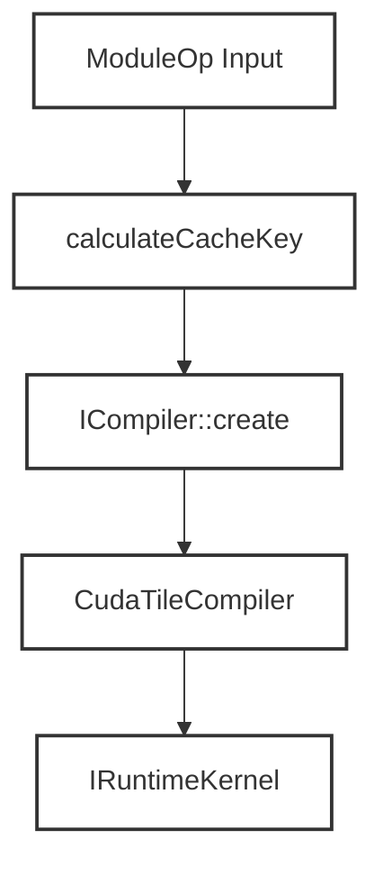
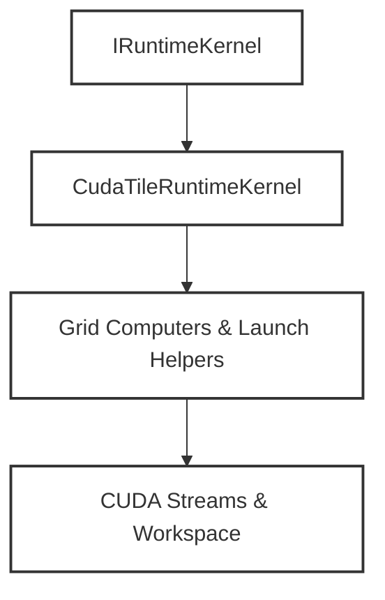

<!-- source: DeepWiki mcp.deepwiki.com · repo NVIDIA/tensor-ir · page 5 Compiler Backend and Runtime · fetched 2026-10-26 -->

# Compiler Backend and Runtime

Relevant source files

The following files were used as context for generating this wiki page:

- [include/tensor_ir/Compiler/Compiler.h](include/tensor_ir/Compiler/Compiler.h)
- [lib/Compiler/Compiler.cpp](lib/Compiler/Compiler.cpp)

## Purpose and Scope

This page provides a high-level overview of the TensorIR compiler backend infrastructure, the concrete NVIDIA CUDA Tile backend, and the runtime kernel execution machinery. The TensorIR compiler abstracts lowering targets via the `ICompiler` interface, routing high-level MLIR modules through cache key generation [include/tensor_ir/Compiler/Compiler.h:26-27]() and backend-specific compilation paths [include/tensor_ir/Compiler/Compiler.h:33-50](). 

The backend produces executable runtime kernel abstractions (`IRuntimeKernel`) that manage argument packing, grid computation, device streams, and host-device coordination. For detailed specifications, algorithms, and implementation mechanics, refer to the child pages linked below.

- [CudaTile Compiler and Compile Options](#5.1)
- [Kernel Argument Layout](#5.2)
- [Runtime Kernel Execution](#5.3)
- [Reference Interpreter](#5.4)

---

## Architecture Overview

The backend and runtime subsystems bridge abstract tensor graph operations to physical GPU execution. The compilation pipeline handles module parsing, option validation [lib/Compiler/Compiler.cpp:61](), cache-key generation [lib/Compiler/Compiler.cpp:32-48](), and backend delegation [lib/Compiler/Compiler.cpp:99-109]().

*Figure 1: Compiler Backend Code Entity Mapping.*

Sources:
- `include/tensor_ir/Compiler/Compiler.h`
- `lib/Compiler/Compiler.cpp`

---

## 5.1. CudaTile Compiler and Compile Options

The core compilation interface is defined by `ICompiler` [include/tensor_ir/Compiler/Compiler.h:33-50](), which provides methods for compiling an MLIR `ModuleOp` or a raw string source into executable runtime kernels, as well as verifying compilation capability via `canCompile`. The factory method `ICompiler::create` initializes backend instances, defaulting to `CudaTileCompiler` when `CompilerBackend::Auto` or `CompilerBackend::CudaTile` is selected [lib/Compiler/Compiler.cpp:99-109]().

Compilation configuration is governed by `CompileOptions`, which handles target compute capabilities, backend-specific flags, and deterministic unique string generation for caching [lib/Compiler/Compiler.cpp:61-78](). Cache keys are constructed by normalizing graph symbol names and printing the generic MLIR operation form to ensure semantic equivalence independent of arbitrary SSA names [lib/Compiler/Compiler.cpp:22-48]().

For details, see [CudaTile Compiler and Compile Options](#5.1).

Sources:
- `include/tensor_ir/Compiler/Compiler.h`
- `lib/Compiler/Compiler.cpp`

---

## 5.2. Kernel Argument Layout

Once a kernel is compiled, interacting with it requires precise mapping of tensor dimensions, strides, and memory buffers to the kernel signature. The kernel argument layout subsystem analyzes tensor parameters to construct uniform signatures that accommodate dynamic shapes and strides without requiring recompilation for varying batch sizes or input dimensions.

Argument packers serialize host-side tensors and scalar parameters into the flat byte buffers expected by CUDA kernel launch APIs, translating high-level multidimensional representations into low-level driver arguments.

For details, see [Kernel Argument Layout](#5.2).

---

## 5.3. Runtime Kernel Execution

The execution layer abstracts raw CUDA driver interactions behind the `IRuntimeKernel` interface. Concrete implementations such as `CudaTileRuntimeKernel` manage resource allocation, workspace queries, and kernel grid configurations via grid computers. 

Launch helpers coordinate asynchronous execution across user-provided or internal device streams, handling parameter binding and execution status propagation back to the host environment.

*Figure 2: Runtime Execution Component Flow.*

For details, see [Runtime Kernel Execution](#5.3).

Sources:
- `include/tensor_ir/Compiler/Compiler.h`
- `lib/Compiler/Compiler.cpp`

---

## 5.4. Reference Interpreter

To validate compiler optimizations and backend code generation, TensorIR includes a reference interpreter. The interpreter evaluates tensor graphs and individual nodes directly using simplified data structures (`SimplifiedTensor` and `TensorMemory`) rather than launching GPU kernels.

This execution path serves as an oracle for numerical verification, ensuring that layout transformations, pointwise operations, reductions, and matrix multiplications preserve mathematical correctness during end-to-end testing.

For details, see [Reference Interpreter](#5.4).

---

