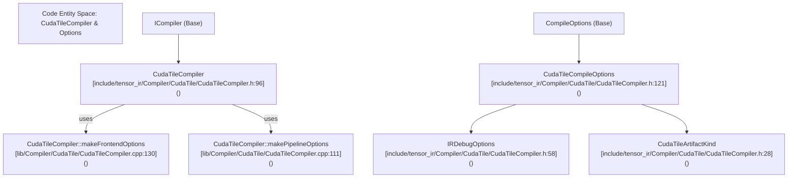
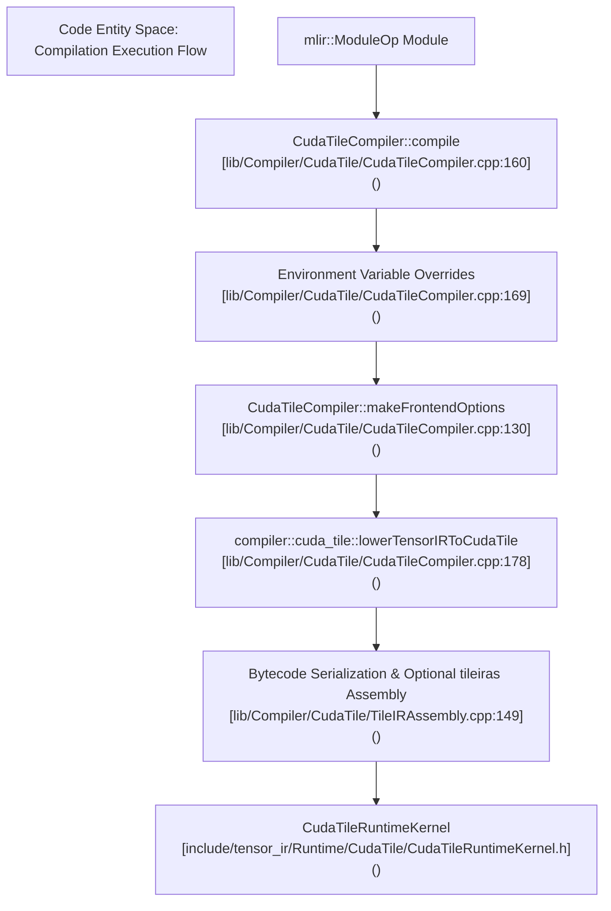

<!-- source: DeepWiki mcp.deepwiki.com · repo NVIDIA/tensor-ir · page 5.1 CudaTile Compiler and Compile Options · fetched 2026-10-26 -->

# CudaTile Compiler and Compile Options

Relevant source files

The following files were used as context for generating this wiki page:

- [include/tensor_ir/Compiler/CudaTile/CudaTileCompiler.h](include/tensor_ir/Compiler/CudaTile/CudaTileCompiler.h)
- [lib/Compiler/CudaTile/CudaTileCompiler.cpp](lib/Compiler/CudaTile/CudaTileCompiler.cpp)
- [lib/Compiler/CudaTile/CudaTileFrontend.cpp](lib/Compiler/CudaTile/CudaTileFrontend.cpp)
- [lib/Compiler/CudaTile/TileIRAssembly.cpp](lib/Compiler/CudaTile/TileIRAssembly.cpp)

The CudaTile compiler backend (`CudaTileCompiler`) is responsible for taking an optimized `mlir::ModuleOp` containing TensorIR operations, lowering it through the frontend and conversion pipelines, emitting Tile IR bytecode, and optionally assembling it into an NVIDIA GPU `cubin` artifact using the external `tileiras` tool. It encapsulates options, environment variable overrides, and runtime kernel generation.

---

## 1. Core Compiler Classes

The compilation subsystem centers around `CudaTileCompiler`, which implements the generic `ICompiler` interface to process TensorIR modules into executable runtime kernels (`::tensor_ir::rt::IRuntimeKernelPtr`).

### `CudaTileCompiler`
`CudaTileCompiler` is defined in `include/tensor_ir/Compiler/CudaTile/CudaTileCompiler.h:96-107()` and implemented in `lib/Compiler/CudaTile/CudaTileCompiler.cpp:145-182()`. It provides two primary methods:
* `canCompile(mlir::ModuleOp module, const CompileOptions &options) const`: Validates whether the provided module and compile options are supported by the frontend.
* `compile(mlir::ModuleOp module, const CompileOptions &options)`: Lowers the module, runs pipeline passes, serializes Tile IR bytecode, and produces a `CudaTileRuntimeKernel`.

### `CudaTileCompileOptions`
Configuration parameters for the CudaTile backend are captured in `CudaTileCompileOptions` (inheriting from `CompileOptions`), defined in `include/tensor_ir/Compiler/CudaTile/CudaTileCompiler.h:121-160()`. Key fields include:
* `ctaCount`: Number of cooperative thread arrays (CTAs / blocks) per grid.
* `warpCount`: Number of warps per CTA.
* `tileSize`: Tile sizes per dimension (e.g., `{128, 128}`). Required for dynamic shape support and grid sizing.
* `uniformSignature`: Enforces that the kernel signature always includes arguments for all tensor sizes and strides.
* `codegenStrategy`: Selects between `LayoutPropagation` and `AffineMap` lowering strategies.
* `bytecodeVersion`: Target TileIR bytecode version, defaulting to `max(kCurrentCompatibilityVersion, 13.3)` via `getDefaultBytecodeVersion()` (`[include/tensor_ir/Compiler/CudaTile/CudaTileCompiler.h:41-52]()`).
* `artifactKind`: Selects whether to emit `TileIR` bytecode or compile further to `Cubin` via `tileiras`.

### `IRDebugOptions`
Debug controls for capturing intermediate MLIR dumps, bytecode snapshots, and pass timing are managed by `IRDebugOptions` (`[include/tensor_ir/Compiler/CudaTile/CudaTileCompiler.h:58-86]()`).

*Sources: [include/tensor_ir/Compiler/CudaTile/CudaTileCompiler.h:28-160](), [lib/Compiler/CudaTile/CudaTileCompiler.cpp:111-143]()*

---

## 2. Environment Variable Overrides

To facilitate rapid experimentation and debugging without modifying frontend driver code, `CudaTileCompiler` checks process environment variables during `compile()` and `canCompile()`. These overrides take precedence over or augment programmatically supplied options.

| Environment Variable | Target Option / Behavior | Parsing / Handling Function |
| :--- | :--- | :--- |
| `TENSOR_IR_CODEGEN_STRATEGY` | Overrides `codegenStrategy` (`layout-propagation` vs `affine-map`) | `getCodegenStrategy()` (`[lib/Compiler/CudaTile/CudaTileCompiler.cpp:80-95]`) |
| `TENSOR_IR_MAX_TILE_CANDIDATES` | Overrides `maxTileCandidates` integer limit | `getMaxTileCandidatesFromEnvOrDefault()` (`[lib/Compiler/CudaTile/CudaTileCompiler.cpp:97-105]`) |
| `TENSOR_IR_DUMP_IR` | Path to dump lowered CudaTile dialect MLIR | `applyPathEnvVar()` (`[lib/Compiler/CudaTile/CudaTileCompiler.cpp:59-78]`) |
| `TENSOR_IR_DUMP_TILEIR_BC` | Path to dump generated Tile IR bytecode | `applyPathEnvVar()` (`[lib/Compiler/CudaTile/CudaTileCompiler.cpp:59-78]`) |
| `TENSOR_IR_LOAD_TILEIR_BC` | Path to load external Tile IR bytecode, bypassing code generation | `applyPathEnvVar()` (`[lib/Compiler/CudaTile/CudaTileCompiler.cpp:59-78]`) |
| `TENSOR_IR_PRINT_IR_AFTER_ALL` | Enables printing IR after every pass manager pass | `applyBoolEnvVar()` (`[lib/Compiler/CudaTile/CudaTileCompiler.cpp:38-57]`) |
| `TENSOR_IR_PRINT_IR_TREE_DIR` | Directory to write per-pass IR snapshot files | `applyPathEnvVar()` (`[lib/Compiler/CudaTile/CudaTileCompiler.cpp:59-78]`) |
| `TENSOR_IR_TIMING` | Enables pass execution timing reports to stderr | `applyBoolEnvVar()` (`[lib/Compiler/CudaTile/CudaTileCompiler.cpp:38-57]`) |

*Sources: [lib/Compiler/CudaTile/CudaTileCompiler.cpp:26-107]*

---

## 3. Compilation Data Flow and Frontend Lowering

When `CudaTileCompiler::compile` is invoked, it converts compile options into pipeline and frontend options, triggers lowering via `lowerTensorIRToCudaTile`, and constructs runtime kernel objects.

*Sources: [lib/Compiler/CudaTile/CudaTileCompiler.cpp:160-182](), [lib/Compiler/CudaTile/TileIRAssembly.cpp:149-160]()*

---

## 4. TileIR Assembly to Cubin (`tileiras`)

If `CudaTileCompileOptions::artifactKind` is set to `CudaTileArtifactKind::Cubin`, the compiler attempts to translate raw Tile IR bytecode into an NVIDIA GPU binary (`cubin`) using the `tileiras` assembler executable found in the system `PATH`.

The assembly process is implemented in `lib/Compiler/CudaTile/TileIRAssembly.cpp:149-160()` via `assembleTileIRToCubin`:
1. **Executable Discovery**: Searches for `tileiras` using `llvm::sys::findProgramByName` (`[lib/Compiler/CudaTile/TileIRAssembly.cpp:81]()`).
2. **Version Compatibility Check**: Queries `tileiras --list-versions` and verifies that the requested `BytecodeVersion` is supported by the installed tool (`[lib/Compiler/CudaTile/TileIRAssembly.cpp:88-105]()`).
3. **Temporary File Management**: Writes bytecode to a temporary `.tilebc` file and invokes `tileiras` with appropriate `--gpu-name=sm_XX` and `--output-file` arguments (`[lib/Compiler/CudaTile/TileIRAssembly.cpp:107-130]()`).
4. **Fallback Handling**: If `tileiras` is missing or unsupported (`isUnavailable`), assembly gracefully falls back to returning empty optional buffers, allowing execution to proceed with TileIR bytecode (`[lib/Compiler/CudaTile/TileIRAssembly.cpp:141-160]()`).

*Sources: [lib/Compiler/CudaTile/TileIRAssembly.cpp:23-160]*

---

