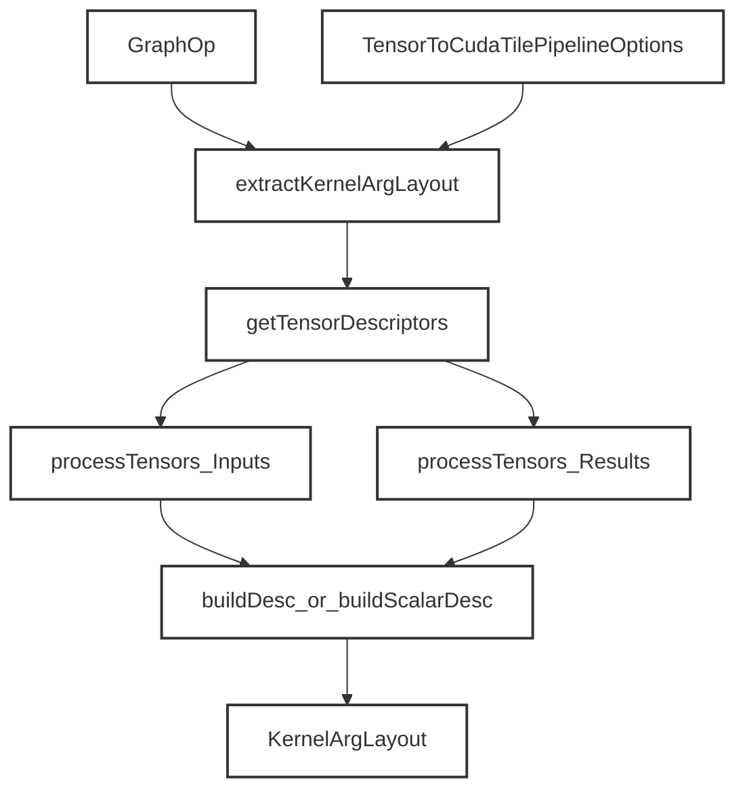
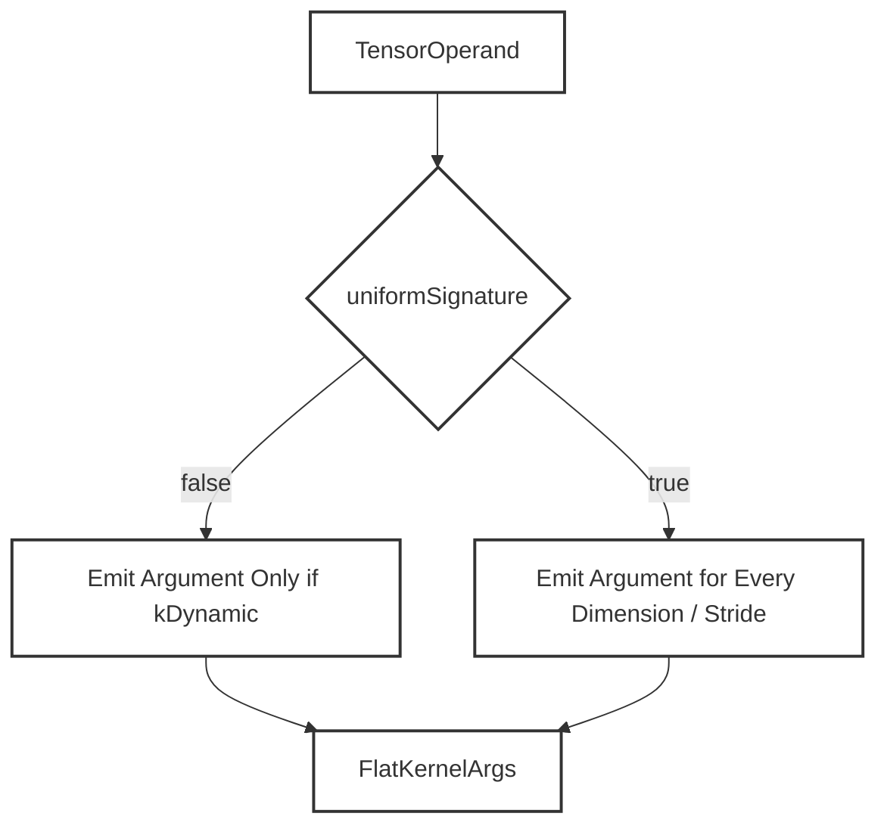

<!-- source: DeepWiki mcp.deepwiki.com · repo NVIDIA/tensor-ir · page 5.2 Kernel Argument Layout · fetched 2026-10-26 -->

# Kernel Argument Layout

Relevant source files

The following files were used as context for generating this wiki page:

- [include/tensor_ir/Compiler/CudaTile/KernelArgLayout.h](include/tensor_ir/Compiler/CudaTile/KernelArgLayout.h)
- [include/tensor_ir/Runtime/CudaTile/KernelArgLayout.h](include/tensor_ir/Runtime/CudaTile/KernelArgLayout.h)
- [lib/Analysis/KernelArgLayout.cpp](lib/Analysis/KernelArgLayout.cpp)

## Purpose and Scope

The `KernelArgLayout` infrastructure defines how TensorIR graphs map their high-level MLIR operands (tensors and scalar parameters) into a flat kernel argument ABI list. It bridges the compiler backend and the runtime execution engine by producing metadata that dictates argument flattening, dynamic dimension/stride parameterization, uniform signature handling, and grid computation dispatch.

This page details the core data structures (`TensorArgDesc` and `KernelArgLayout`), the layout extraction logic (`extractKernelArgLayout`), and how dynamic dimensions, strides, and scalars are packed into kernel invocations.

Sources:
- `include/tensor_ir/Compiler/CudaTile/KernelArgLayout.h:20-25`
- `include/tensor_ir/Runtime/CudaTile/KernelArgLayout.h:5-10`

---

## Data Structures for Kernel Argument ABI

The runtime representation of argument layout relies on two primary structures defined in `include/tensor_ir/Runtime/CudaTile/KernelArgLayout.h`: `TensorArgDesc` and `KernelArgLayout`.

### TensorArgDesc

`TensorArgDesc` describes how a single graph operand (either a tensor or a scalar) maps to flat kernel arguments. For tensor operands, the signature is expanded into a base pointer followed by dynamic sizes and dynamic strides. For scalar operands, it is passed by value.

- `rank`: The tensor rank (`int32_t`) [include/tensor_ir/Runtime/CudaTile/KernelArgLayout.h:37-37].
- `staticShape`: Concrete values for known dimensions, with `kDynamic` (`std::numeric_limits<int64_t>::min()`) representing runtime-determined dimensions [include/tensor_ir/Runtime/CudaTile/KernelArgLayout.h:33-40].
- `staticStrides`: Concrete strides or `kDynamic`. Empty if strides are computed automatically [include/tensor_ir/Runtime/CudaTile/KernelArgLayout.h:41-44].
- `numDynSizes` / `numDynStrides`: Counts of dynamic size and stride parameters emitted into the flat argument list [include/tensor_ir/Runtime/CudaTile/KernelArgLayout.h:46-47].
- `isScalar` / `scalarSizeInBytes`: Indicates whether an operand is a scalar passed by value and records its width in bytes for `memcpy` operations by the runtime argument packer [include/tensor_ir/Runtime/CudaTile/KernelArgLayout.h:50-56].
- `totalArgs()`: Computes the total flat kernel arguments consumed by the operand (1 for scalar; `1 + numDynSizes + numDynStrides` for tensors) [include/tensor_ir/Runtime/CudaTile/KernelArgLayout.h:61-63].

### KernelArgLayout

`KernelArgLayout` aggregates all operand descriptors and global execution metadata for a compiled kernel:
- `tensorDescs`: A vector containing `TensorArgDesc` for each valid input and output tensor/scalar [include/tensor_ir/Runtime/CudaTile/KernelArgLayout.h:68-68].
- `tileSizes`: Tile dimensions copied from conversion options [include/tensor_ir/Runtime/CudaTile/KernelArgLayout.h:69-69].
- `numInputs`: Number of valid input arguments [include/tensor_ir/Runtime/CudaTile/KernelArgLayout.h:70-70].
- `totalKernelArgs`: Total number of flat kernel arguments [include/tensor_ir/Runtime/CudaTile/KernelArgLayout.h:71-71].
- `uniformSignature`: Boolean flag indicating whether all sizes and strides are emitted as arguments regardless of static-ness [include/tensor_ir/Runtime/CudaTile/KernelArgLayout.h:92-94].
- `gridShapeTensorIdx` & `gridShape`: Identifies which tensor's shape (or normalized iteration space) drives runtime grid dimension calculations [include/tensor_ir/Runtime/CudaTile/KernelArgLayout.h:73-86].

Sources:
- `include/tensor_ir/Runtime/CudaTile/KernelArgLayout.h:34-122`

---

## Layout Extraction Implementation

The function `extractKernelArgLayout` constructs a `KernelArgLayout` instance by inspecting a TensorIR `GraphOp`, its function type, argument attributes, and pipeline conversion options.

*Figure 1: Natural Language Space to Code Entity Space mapping for argument layout extraction.*

### Core Extraction Logic

The extraction process follows these steps:
1. Copies pipeline options such as `uniformSignature`, `persistence`, `smCount`, and `occupancy` into the layout struct [lib/Analysis/KernelArgLayout.cpp:28-34].
2. Retrieves tensor descriptors for inputs and results using `mlir::nv_tensor_ir::getTensorDescriptors` [lib/Analysis/KernelArgLayout.cpp:44-51].
3. Iterates over input and output types, processing scalars and tensors while skipping rank-0 tensors (which require no dynamic shapes or strides) [lib/Analysis/KernelArgLayout.cpp:97-124].
4. Determines grid tensor selection using `mlir::nv_tensor_ir::useOutputTensorShapeForGrid` to align runtime grid calculations with compile-time tile analysis [lib/Analysis/KernelArgLayout.cpp:146-170].

Sources:
- `include/tensor_ir/Compiler/CudaTile/KernelArgLayout.h:20-25`
- `lib/Analysis/KernelArgLayout.cpp:25-172`

---

## Uniform Signatures and Dynamic Dims/Strides

The argument layout engine supports two signature generation modes controlled by `uniformSignature`:

1. **Dynamic-Only Mode (`uniformSignature = false`)**:
   - Only dimensions and strides evaluated as dynamic (`kDynamic`) produce explicit kernel arguments. Statically-known shapes and strides are embedded directly into the generated CUDA Tile IR constants.
2. **Uniform Signature Mode (`uniformSignature = true`)**:
   - Every tensor dimension and explicit stride produces a kernel argument parameter, even when statically known. This provides a uniform kernel signature across inputs with varying static shapes, simplifying dynamic dispatch and runtime argument packaging.

*Figure 2: Data flow for uniform versus dynamic-only argument flattening.*

Sources:
- `include/tensor_ir/Runtime/CudaTile/KernelArgLayout.h:92-94`
- `lib/Analysis/KernelArgLayout.cpp:54-76`

---

## Argument Packers and ABI Integration

Once `KernelArgLayout` is generated by the compiler backend, the runtime execution engine (`tensor_ir::rt`) uses the layout descriptor to:
- Allocate space for the flat argument buffer.
- Copy scalar values by value based on `scalarSizeInBytes` [include/tensor_ir/Runtime/CudaTile/KernelArgLayout.h:50-56].
- Assign pointers and dynamic size/stride parameters to tensor operands sequentially using `getArgOffset` [include/tensor_ir/Runtime/CudaTile/KernelArgLayout.h:115-121].
- Compute dynamic grid dimensions using `gridShape` and `gridShapeTensorIdx` [include/tensor_ir/Runtime/CudaTile/KernelArgLayout.h:73-86].

Sources:
- `include/tensor_ir/Runtime/CudaTile/KernelArgLayout.h:5-10`, `include/tensor_ir/Runtime/CudaTile/KernelArgLayout.h:115-121`

---

