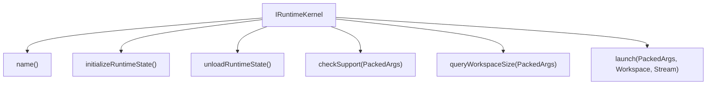
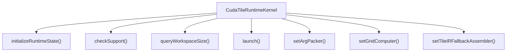
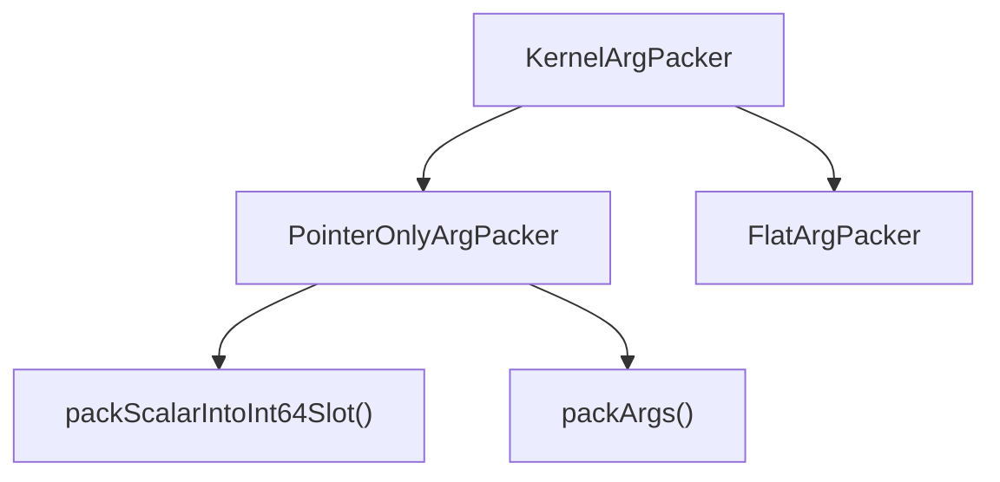
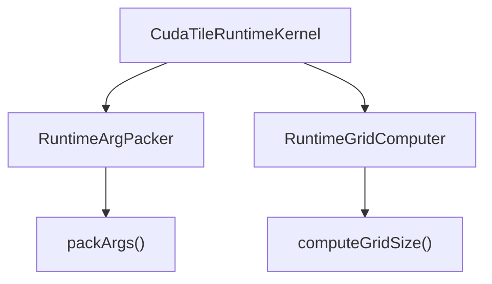

<!-- source: DeepWiki mcp.deepwiki.com · repo NVIDIA/tensor-ir · page 5.3 Runtime Kernel Execution · fetched 2026-10-26 -->

# Runtime Kernel Execution

Relevant source files

The following files were used as context for generating this wiki page:

- [include/tensor_ir/Runtime/CudaTile/CudaTileRuntimeKernel.h](include/tensor_ir/Runtime/CudaTile/CudaTileRuntimeKernel.h)
- [include/tensor_ir/Runtime/CudaTile/KernelLaunchHelpers.h](include/tensor_ir/Runtime/CudaTile/KernelLaunchHelpers.h)
- [include/tensor_ir/Runtime/IRuntimeKernel.h](include/tensor_ir/Runtime/IRuntimeKernel.h)

## Purpose and Scope

This page details the runtime execution layer for compiled NVIDIA CUDA Tile IR kernels within the TensorIR framework. It covers the core `IRuntimeKernel` abstraction [include/tensor_ir/Runtime/IRuntimeKernel.h:24-66](), the concrete `CudaTileRuntimeKernel` implementation [include/tensor_ir/Runtime/CudaTile/CudaTileRuntimeKernel.h:65-139](), argument packing strategies via `KernelArgPacker` and `PointerOnlyArgPacker` [include/tensor_ir/Runtime/CudaTile/KernelLaunchHelpers.h:85-172](), grid size computation, workspace queries, and driver version compatibility handling.

---

## 1. The IRuntimeKernel Interface

The abstract base class `IRuntimeKernel` defines the pure virtual interface for all compiled GPU kernels [include/tensor_ir/Runtime/IRuntimeKernel.h:24-66](). It follows a TVM-style FFI calling convention using `PackedArgs`.

Key virtual functions provided by `IRuntimeKernel`:
- `name()`: Returns a debugging/logging name for the runtime kernel [include/tensor_ir/Runtime/IRuntimeKernel.h:28-29]().
- `initializeRuntimeState()`: Triggers lazy loading of CUDA modules in the current CUDA context [include/tensor_ir/Runtime/IRuntimeKernel.h:35-39]().
- `unloadRuntimeState()`: Performs optional cleanup of runtime state [include/tensor_ir/Runtime/IRuntimeKernel.h:41-42]().
- `checkSupport(PackedArgs args)`: Validates argument shapes, dtypes, and alignment before execution [include/tensor_ir/Runtime/IRuntimeKernel.h:48-50]().
- `queryWorkspaceSize(PackedArgs args)`: Queries the temporary workspace memory size required for the given arguments [include/tensor_ir/Runtime/IRuntimeKernel.h:56-57]().
- `launch(PackedArgs args, Workspace workspace, Stream stream)`: Dispatches the kernel execution on a specified CUDA stream [include/tensor_ir/Runtime/IRuntimeKernel.h:63-65]().

Sources: `include/tensor_ir/Runtime/IRuntimeKernel.h:24-66`

---

## 2. CudaTileRuntimeKernel Implementation

`CudaTileRuntimeKernel` is the concrete implementation of `IRuntimeKernel` tailored for the `CudaTile` backend [include/tensor_ir/Runtime/CudaTile/CudaTileRuntimeKernel.h:65-139](). It manages compiled device code (`cubin` or TileIR bytecode), CUDA module handles (`CUlibrary lib_`), and execution handles (`CUkernel kernel_`).

### 2.1 Driver Version Compatibility

Before execution, the runtime verifies that the active CUDA driver version satisfies the requirements of the compiled bytecode version using helper functions:
- `requiredCudaDriverApiVersionForBytecode()` calculates the minimum required driver version [include/tensor_ir/Runtime/CudaTile/CudaTileRuntimeKernel.h:27-33]().
- `getBytecodeDriverCompatibilityMessage()` generates diagnostics if the driver is older than the bytecode target [include/tensor_ir/Runtime/CudaTile/CudaTileRuntimeKernel.h:41-57]().

Sources: `include/tensor_ir/Runtime/CudaTile/CudaTileRuntimeKernel.h:27-139`

---

## 3. Kernel Argument Packing Strategies

Kernel launch arguments are assembled using strategies derived from the `KernelArgPacker` class template [include/tensor_ir/Runtime/CudaTile/KernelLaunchHelpers.h:85-111]().

### 3.1 PointerOnlyArgPacker

`PointerOnlyArgPacker` is optimized for static shapes where only data pointers and immediate scalars are passed to the kernel [include/tensor_ir/Runtime/CudaTile/KernelLaunchHelpers.h:121-172]().
- **Tensor Operands**: Writes the raw memory pointer (`reinterpret_cast<int64_t>(ptr)`) into the argument slot [include/tensor_ir/Runtime/CudaTile/KernelLaunchHelpers.h:142]().
- **Scalar Operands**: Copies scalar bytes into the low-order bytes of the `int64_t` slot via `detail::packScalarIntoInt64Slot()` [include/tensor_ir/Runtime/CudaTile/KernelLaunchHelpers.h:131-139](). Scalars exceeding `sizeof(int64_t)` (such as 16-byte complex types) are rejected to prevent buffer overflow [include/tensor_ir/Runtime/CudaTile/KernelLaunchHelpers.h:62-73]().

Sources: `include/tensor_ir/Runtime/CudaTile/KernelLaunchHelpers.h:62-172`

---

## 4. Grid Computers and Execution Management

`CudaTileRuntimeKernel` delegates grid dimension calculations and argument transformations to composable helper strategies:
- **`RuntimeArgPacker`**: Instantiated using `KernelArgPacker<RuntimeOperandAccessor>` [include/tensor_ir/Runtime/CudaTile/CudaTileRuntimeKernel.h:60-61]().
- **`RuntimeGridComputer`**: Instantiated using `GridSizeComputer<RuntimeOperandAccessor>` to compute grid configurations dynamically at launch time [include/tensor_ir/Runtime/CudaTile/CudaTileRuntimeKernel.h:62-63]().

The actual execution flow invokes `launch()` with packed arguments, workspace allocations, and an asynchronous CUDA stream [include/tensor_ir/Runtime/CudaTile/CudaTileRuntimeKernel.h:88-89]().

Sources: `include/tensor_ir/Runtime/CudaTile/CudaTileRuntimeKernel.h:60-64`, `include/tensor_ir/Runtime/CudaTile/CudaTileRuntimeKernel.h:88-89`

---

