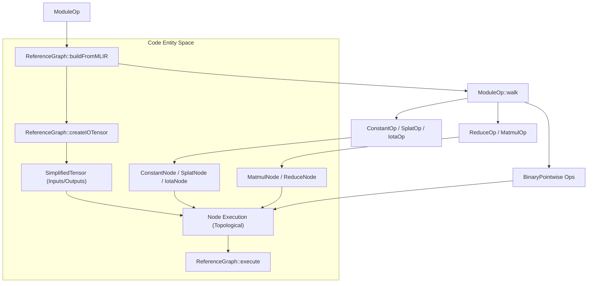
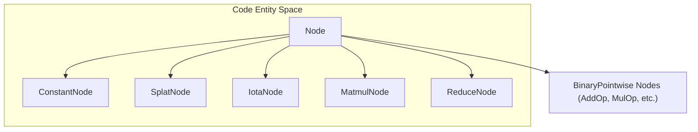
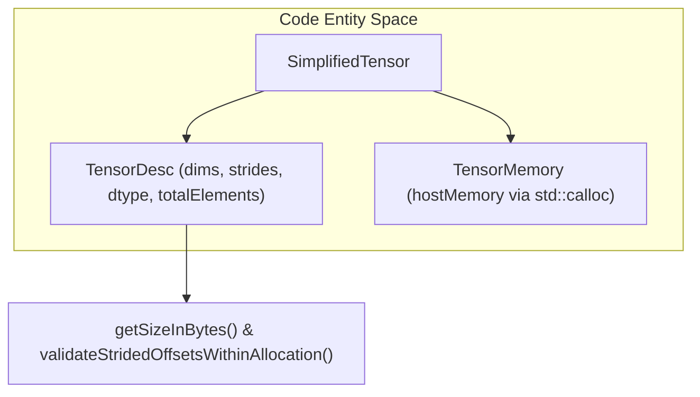

<!-- source: DeepWiki mcp.deepwiki.com · repo NVIDIA/tensor-ir · page 5.4 Reference Interpreter · fetched 2026-10-26 -->

# Reference Interpreter

Relevant source files

The following files were used as context for generating this wiki page:

- [include/tensor_ir/Reference/ReferenceGraph.h](include/tensor_ir/Reference/ReferenceGraph.h)
- [include/tensor_ir/Reference/ReferenceNode.h](include/tensor_ir/Reference/ReferenceNode.h)
- [include/tensor_ir/Reference/SimplifiedTensor.h](include/tensor_ir/Reference/SimplifiedTensor.h)
- [include/tensor_ir/Reference/TensorMemory.h](include/tensor_ir/Reference/TensorMemory.h)
- [lib/Reference/CMakeLists.txt](lib/Reference/CMakeLists.txt)
- [lib/Reference/ConstantUtils.h](lib/Reference/ConstantUtils.h)
- [lib/Reference/ReferenceGraph.cpp](lib/Reference/ReferenceGraph.cpp)
- [lib/Reference/ReferenceNode.cpp](lib/Reference/ReferenceNode.cpp)
- [lib/Reference/SimplifiedTensor.cpp](lib/Reference/SimplifiedTensor.cpp)
- [lib/Reference/TensorMemory.cpp](lib/Reference/TensorMemory.cpp)

## Purpose and Scope

The Reference Interpreter provides an independent, host-based execution engine for TensorIR computational graphs (`mlir::ModuleOp`). Its primary purpose is numerical verification: by executing an MLIR module through standard C++ operations on host memory (`SimplifiedTensor`), the reference interpreter generates ground-truth outputs to validate CUDA tile IR GPU kernels. 

The reference interpreter subsystem consists of:
- **`ReferenceGraph`**: Parses MLIR modules, discovers inputs and outputs, and builds a directed acyclic execution graph [include/tensor_ir/Reference/ReferenceGraph.h:28-44]().
- **`Node` & Operation Subclasses**: Encapsulate individual operations (e.g., `ConstantNode`, `MatmulNode`, binary pointwise nodes) providing input validation and host-side floating-point/integer compute routines [include/tensor_ir/Reference/ReferenceNode.h:30-72]().
- **`SimplifiedTensor` & `TensorDesc`**: Manages tensor metadata (dimensions, strides, data types) and multi-dimensional index translation [include/tensor_ir/Reference/SimplifiedTensor.h:50-86]().
- **`TensorMemory`, `DeviceBuffer`, & `DeviceRun`**: Handles host buffer allocation (`TensorMemory`) and device buffer lifecycle management for comparison runs [include/tensor_ir/Reference/TensorMemory.h:26-111]().
- **Constant Utilities (`ConstantUtils.h`)**: Provides bounds checking and range validation for literal-to-integer conversion [lib/Reference/ConstantUtils.h:16-37]().

---

## 1. Reference Graph Construction and Execution

The `ReferenceGraph` class is responsible for ingesting an MLIR module, mapping SSA values to reference tensors, and topologically evaluating the graph [include/tensor_ir/Reference/ReferenceGraph.h:29-37]().

*Figure 1: Architectural mapping of `ReferenceGraph` graph construction and execution flow.*

### Dynamic Dimensions and Strides
Before building the graph from an MLIR module, callers can inject runtime values for dynamic dimensions (`?`) using `ReferenceGraph::setDynamicDims()` and dynamic strides using `ReferenceGraph::setDynamicStrides()` [include/tensor_ir/Reference/ReferenceGraph.h:54-68](). 

During graph building (`ReferenceGraph::buildFromMLIR`), tensor shapes and stride patterns are extracted directly from MLIR types [include/tensor_ir/Reference/ReferenceGraph.h:74-85](). If a tensor descriptor encounters dynamic dimensions, they are resolved using the pre-configured runtime values.

Sources:
- `include/tensor_ir/Reference/ReferenceGraph.h:28-86`
- `lib/Reference/ReferenceGraph.cpp:77-111`

---

## 2. Node Hierarchy and Operation Evaluation

The base class `Node` defines the common interface for all graph operations [include/tensor_ir/Reference/ReferenceNode.h:30-72](). Every node implements input validation via `validate()` and execution via `computeValidated()` [include/tensor_ir/Reference/ReferenceNode.h:46-67]().

*Figure 2: `Node` inheritance hierarchy for reference operator evaluation.*

### Key Node Classes
- **`ConstantNode`**: Stores a scalar literal and populates the output tensor's host buffer [include/tensor_ir/Reference/ReferenceNode.h:84-104](). Constant attributes (dense elements, float, or integer attributes) are extracted via helper functions like `getScalarConstantValue()` [lib/Reference/ReferenceGraph.cpp:33-62]().
- **`SplatNode`**: Fills an output tensor from a single-element scalar input [include/tensor_ir/Reference/ReferenceNode.h:113-134]().
- **`IotaNode`**: Materializes logical coordinates along a specified `iotaDimension` converted to the tensor data type [include/tensor_ir/Reference/ReferenceNode.h:146-166]().
- **`MatmulNode`**: Performs matrix multiplication ($C = A \times B$) supporting 2D `(M, K) @ (K, N) -> (M, N)` and 3D batched layouts [include/tensor_ir/Reference/ReferenceNode.h:173-195]().

Sources:
- `include/tensor_ir/Reference/ReferenceNode.h:30-104`
- `lib/Reference/ReferenceGraph.cpp:33-62`
- `lib/Reference/ReferenceNode.cpp:34-62`

---

## 3. SimplifiedTensor, TensorDesc, and TensorMemory

The reference interpreter decouples metadata description from memory allocation using `SimplifiedTensor`, `TensorDesc`, and `TensorMemory`.

*Figure 3: Memory and descriptor layout in `SimplifiedTensor`.*

### `TensorDesc` and Index Translation
`TensorDesc` tracks tensor dimensions, strides, element types, and total element counts [include/tensor_ir/Reference/SimplifiedTensor.h:50-55](). Strides are automatically calculated via `TensorDesc::computeStrides()` if explicit strides are absent [lib/Reference/SimplifiedTensor.cpp:118-135](). 

`SimplifiedTensor` provides multi-dimensional index mapping to compute host buffer offsets [include/tensor_ir/Reference/SimplifiedTensor.h:125-160]():
- `getStorageIndex(int64_t linearIndex)`
- `getStorageIndex(llvm::ArrayRef<int64_t> indices)`

### `TensorMemory` Lifecycle
`TensorMemory` owns a single CPU host buffer allocated via `std::calloc` upon construction and freed via `std::free` on destruction [include/tensor_ir/Reference/TensorMemory.h:26-51](), [lib/Reference/TensorMemory.cpp:17-25]().

Sources:
- `include/tensor_ir/Reference/SimplifiedTensor.h:50-86`
- `include/tensor_ir/Reference/TensorMemory.h:26-51`
- `lib/Reference/SimplifiedTensor.cpp:118-169`
- `lib/Reference/TensorMemory.cpp:17-25`

---

## 4. Device Execution and Constant Utilities

To support side-by-side verification between reference outputs and compiled CUDA kernels, the reference runtime provides RAII device wrappers (`DeviceBuffer`, `DeviceRun`) [include/tensor_ir/Reference/TensorMemory.h:58-111]().

### `DeviceBuffer` and `DeviceRun`
- **`DeviceBuffer`**: Encapsulates a single CUDA device allocation, supporting zero-initialization, host-to-device copies (`copyFrom`), and device-to-host copies (`copyTo`) [include/tensor_ir/Reference/TensorMemory.h:58-89](), [lib/Reference/TensorMemory.cpp:35-101]().
- **`DeviceRun`**: Manages input and output device buffers for a single kernel execution, packing them into `tensor_ir::rt::Any` arguments for invocation [include/tensor_ir/Reference/TensorMemory.h:93-111](), [lib/Reference/TensorMemory.cpp:103-169]().

### Constant Utilities
`ConstantUtils.h` provides template functions such as `convertFiniteConstantToInteger()` to safely cast floating-point constants to integer types with boundary and finiteness checks [lib/Reference/ConstantUtils.h:16-37]().

Sources:
- `include/tensor_ir/Reference/TensorMemory.h:58-111`
- `lib/Reference/ConstantUtils.h:16-37`
- `lib/Reference/TensorMemory.cpp:35-169`

---

