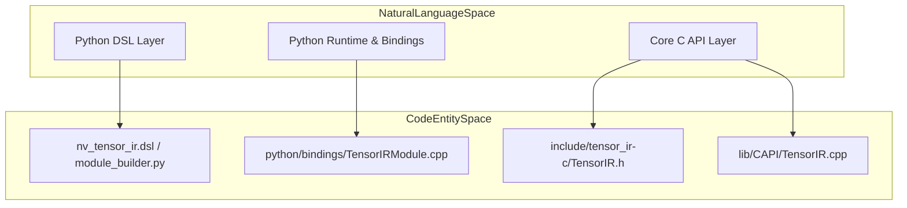
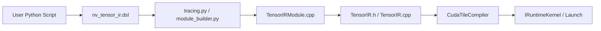

<!-- source: DeepWiki mcp.deepwiki.com · repo NVIDIA/tensor-ir · page 6 APIs and Bindings · fetched 2026-10-26 -->

# APIs and Bindings

Relevant source files

The following files were used as context for generating this wiki page:

- [include/tensor_ir-c/TensorIR.h](include/tensor_ir-c/TensorIR.h)
- [python/bindings/TensorIRModule.cpp](python/bindings/TensorIRModule.cpp)

## Purpose and Scope
This page provides a high-level overview of the integration layers that bridge user-facing abstractions with the core TensorIR compiler and runtime backend. The TensorIR project exposes its capabilities through three distinct tiers: a low-level C API (`TensorIR.h`), Python bindings backed by nanobind (`TensorIRModule.cpp`), and a high-level Python Domain-Specific Language (`nv_tensor_ir.dsl`). 

As a parent page, this section summarizes the architectural relationship between these layers. For comprehensive technical details, please refer to the respective child pages:
- [C API](#6.1)
- [Python Bindings and Runtime Module](#6.2)
- [Python DSL](#6.3)

---

## Architecture and Layering Overview

The following diagram bridges the natural language conceptual spaces of the API layers to their concrete code entities within the repository.

### API Layer Mapping to Code Entities

Sources: `python/bindings/TensorIRModule.cpp:1-186`, `include/tensor_ir-c/TensorIR.h:1-170`

---

## 6.1. C API
The C API serves as the primary foreign function interface (FFI) boundary, enabling non-Python host applications and the Python bindings to interact with the TensorIR compiler infrastructure. It defines stable C structures and functions for dialect registration, bytecode version management, compile options configuration, packed argument handling, and program execution lifecycles.

For complete technical specifications, see [C API](#6.1).

Sources: `include/tensor_ir-c/TensorIR.h:1-170`

---

## 6.2. Python Bindings and Runtime Module
The Python bindings layer bridges the C API into Python using nanobind. It exposes MLIR components under `nv_tensor_ir._mlir`, wraps configuration structs like `CompileOptions`, manages cache key calculations (`calculateCacheKey`), and provides tensor interoperability via DLPack capsules (`__dlpack__`, `DLTensor`) [python/bindings/TensorIRModule.cpp:61-186].

For complete technical specifications, see [Python Bindings and Runtime Module](#6.2).

Sources: `python/bindings/TensorIRModule.cpp:1-186`

---

## 6.3. Python DSL
The Python Domain-Specific Language (`nv_tensor_ir.dsl`) offers an ergonomic user-facing interface built around the `@tir.kernel` decorator. It manages tracing, module building, CUDA Tile backend compilation, `ProgramCache` management, and profile execution.

For complete technical specifications, see [Python DSL](#6.3).

### 6.3.1. Tracing and Module Building
Traces user-defined Python functions into `nv_tensor_ir` MLIR modules using tracing utilities and module builders.

### 6.3.2. DSL CudaTile Backend, Caching and Profiling
Handles compilation dispatch, `ProgramCache` keys, and kernel profiling via `run_profile`.

Sources: `python/bindings/TensorIRModule.cpp:136-146`, `include/tensor_ir-c/TensorIR.h:111-170`

---

## Compilation and Execution Request Flow

The following diagram illustrates how compilation and execution requests flow downward from user-written Python code through the DSL, binding layers, C API, and finally to the underlying compiler backend.

### Request Flow Architecture

Sources: `python/bindings/TensorIRModule.cpp:136-146`, `include/tensor_ir-c/TensorIR.h:111-170`

---

