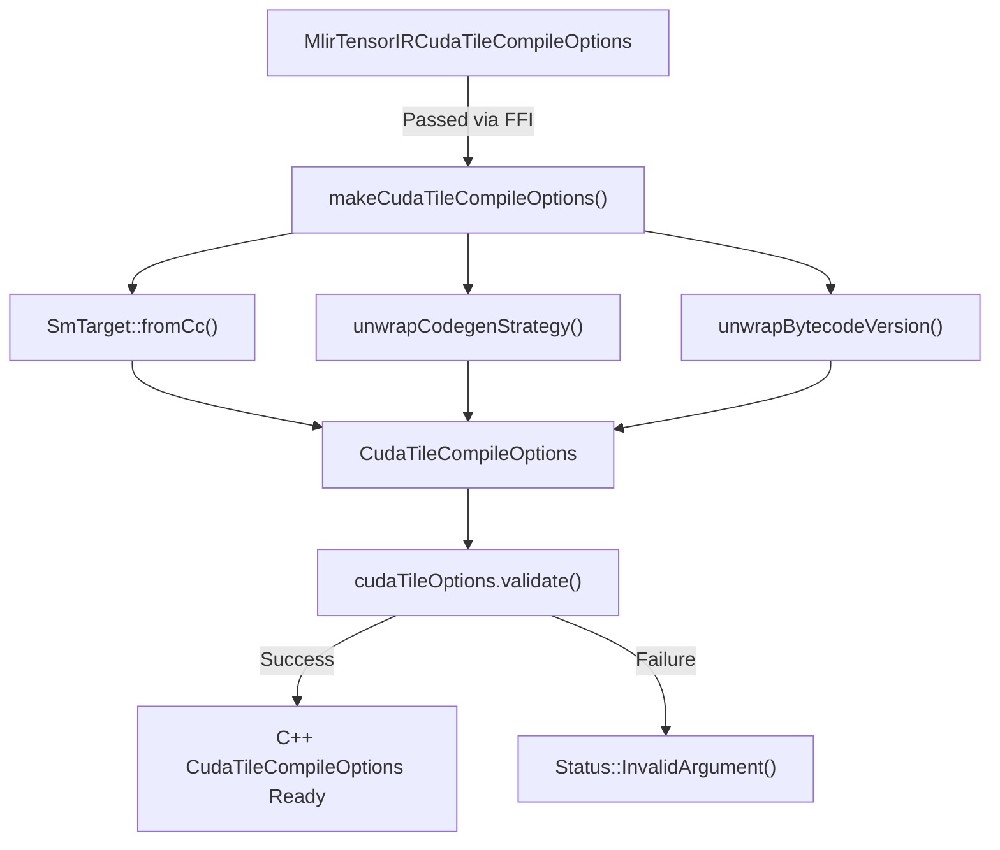
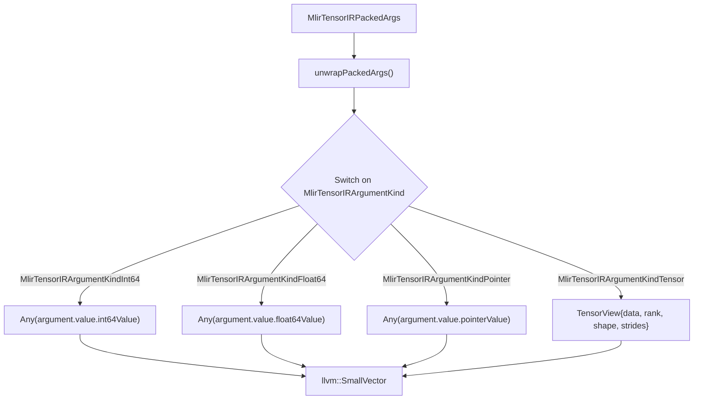

<!-- source: DeepWiki mcp.deepwiki.com · repo NVIDIA/tensor-ir · page 6.1 C API · fetched 2026-10-26 -->

# C API

Relevant source files

The following files were used as context for generating this wiki page:

- [include/tensor_ir-c/TensorIR.h](include/tensor_ir-c/TensorIR.h)
- [lib/CAPI/TensorIR.cpp](lib/CAPI/TensorIR.cpp)

## Purpose and Scope
The TensorIR C API provides a stable foreign function interface (FFI) bridging C/C++ clients—and through them, language bindings like Python (`nanobind`)—to the internal MLIR and runtime infrastructure of TensorIR. Defined in `include/tensor_ir-c/TensorIR.h` and implemented in `lib/CAPI/TensorIR.cpp`, this layer exposes dialect registration routines, CUDA Tile bytecode version controls, rich compilation options structs, runtime argument packers, and kernel program lifecycle management [include/tensor_ir-c/TensorIR.h:1-170](), [lib/CAPI/TensorIR.cpp:1-185]().

Sources: `include/tensor_ir-c/TensorIR.h`, `lib/CAPI/TensorIR.cpp`

---

## Dialect and Pass Registration
To make the `nv_tensor_ir` dialect available within MLIR contexts created across language boundaries, the C API exports explicit registration macros and hooks. The registration maps the string name `nv_tensor_ir` to `mlir::nv_tensor_ir::TensorIRDialect` [lib/CAPI/TensorIR.cpp:26-28]().

Key registration symbols exposed by the header include:
* `MLIR_DECLARE_CAPI_DIALECT_REGISTRATION(nv_tensor_ir, nv_tensor_ir)`: Declares standard MLIR C API registration entrypoints for the dialect [include/tensor_ir-c/TensorIR.h:23-24]().
* `mlirTensorIRRegisterAllDialects(MlirDialectRegistry registry)`: Adds all necessary dialects utilized by TensorIR compilation pipelines into a provided `MlirDialectRegistry` [include/tensor_ir-c/TensorIR.h:26-28]().

Sources: `include/tensor_ir-c/TensorIR.h`, `lib/CAPI/TensorIR.cpp`

---

## Bytecode Version API
CUDA Tile bytecode formats evolve alongside hardware architectures and compiler features. The C API manages version compatibility via the `MlirTensorIRBytecodeVersion` structure, which stores major, minor, and tag fields [include/tensor_ir-c/TensorIR.h:34-39]().

Core functions for querying and manipulating versions include:
* `mlirTensorIRGetCurrentBytecodeVersion()`: Retrieves the latest bytecode version supported by the current build [include/tensor_ir-c/TensorIR.h:41-43]().
* `mlirTensorIRGetCompatibilityBytecodeVersion()`: Returns the version offering the broadest compatibility range [include/tensor_ir-c/TensorIR.h:45-47]().
* `mlirTensorIRGetDefaultBytecodeVersion()`: Returns the default target version selected for compilation [include/tensor_ir-c/TensorIR.h:49-51]().
* `mlirTensorIRFormatBytecodeVersion()`: Safely formats version structs into strings via a callback mechanism [include/tensor_ir-c/TensorIR.h:59-62]().
* `mlirTensorIRBytecodeVersionEqual()` and `mlirTensorIRBytecodeVersionHash()`: Provide equality checks and hashing for version lookup tables [include/tensor_ir-c/TensorIR.h:64-71]().

In `lib/CAPI/TensorIR.cpp`, these C structures are converted to and from internal C++ `BytecodeVersion` objects via `wrapBytecodeVersion()` and `unwrapBytecodeVersion()` [lib/CAPI/TensorIR.cpp:50-67]().

Sources: `include/tensor_ir-c/TensorIR.h`, `lib/CAPI/TensorIR.cpp`

---

## CUDA Tile Compilation Options Structs
Compilation behavior is governed by `MlirTensorIRCudaTileCompileOptions`, a flat configuration struct passed across the FFI boundary [include/tensor_ir-c/TensorIR.h:111-170](). It controls target compute capability, parallelism attributes, code generation strategies, artifact kinds, and debug path overrides.

The configuration relies on several enumeration types:
* `MlirTensorIRArchPortability`: Determines whether generated code is `Portable`, `FamilyPortable`, or `ArchConditional` [include/tensor_ir-c/TensorIR.h:78-85]().
* `MlirTensorIRCudaTileCodegenStrategy`: Selects between `AffineMap` and `LayoutPropagation` lowering strategies [include/tensor_ir-c/TensorIR.h:88-93]().
* `MlirTensorIRCudaTileArtifactKind`: Selects whether compilation produces `TileIR` bytecode or assembled `Cubin` artifacts [include/tensor_ir-c/TensorIR.h:95-103]().

### Compilation Options Translation Diagram
The following diagram illustrates how raw C compilation options are unwrapped, validated, and transformed into C++ `CudaTileCompileOptions` objects inside the C API implementation layer.

Sources: `include/tensor_ir-c/TensorIR.h`, `lib/CAPI/TensorIR.cpp`

---

## Packed Arguments and Data Interop
At the runtime boundary, kernel arguments are passed using packed argument structures (`MlirTensorIRPackedArgs` and `MlirTensorIRArgument`). The C API unpacks these structures into vectors of `Any` and `TensorView` objects, allowing dynamic dispatch and type-safe execution [lib/CAPI/TensorIR.cpp:149-177]().

Argument kinds supported by `MlirTensorIRArgument` include:
* `MlirTensorIRArgumentKindNone`: Empty or null argument placeholder [lib/CAPI/TensorIR.cpp:155-157]().
* `MlirTensorIRArgumentKindInt64`: 64-bit integer values [lib/CAPI/TensorIR.cpp:158-160]().
* `MlirTensorIRArgumentKindFloat64`: Double-precision floating-point values [lib/CAPI/TensorIR.cpp:161-163]().
* `MlirTensorIRArgumentKindPointer`: Raw device or host memory pointers [lib/CAPI/TensorIR.cpp:164-166]().
* `MlirTensorIRArgumentKindTensor`: Multi-dimensional tensor descriptors containing data pointers, rank, shape arrays, and stride arrays [lib/CAPI/TensorIR.cpp:167-171]().

### Argument Unpacking Flow Diagram
The process of transforming raw C argument arrays into C++ runtime primitives is mapped below:

Sources: `include/tensor_ir-c/TensorIR.h`, `lib/CAPI/TensorIR.cpp`

---

## Program Lifecycle and Launch
The C API supports managing compiled program lifecycles, querying kernel workspace requirements, binding streams, and launching kernels on target CUDA devices. Once compilation yields a runtime kernel representation (`IRuntimeKernelPtr`), execution proceeds by packing arguments, querying required temporary workspace memory, and invoking the kernel execution routines provided by `CudaTileRuntimeKernel` [lib/CAPI/TensorIR.cpp:42-48]().

Sources: `include/tensor_ir-c/TensorIR.h`, `lib/CAPI/TensorIR.cpp`

---

