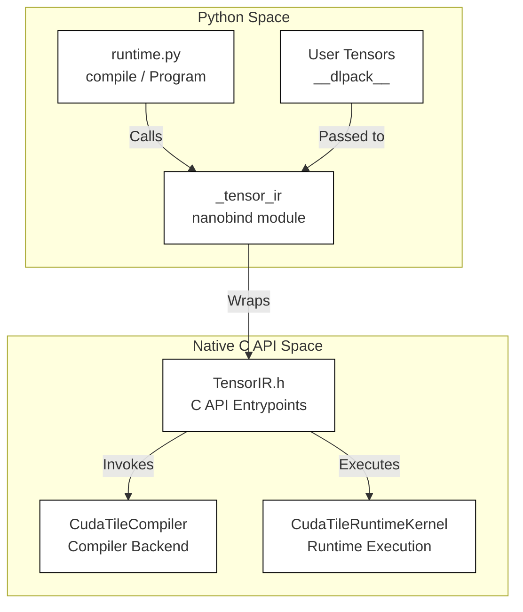
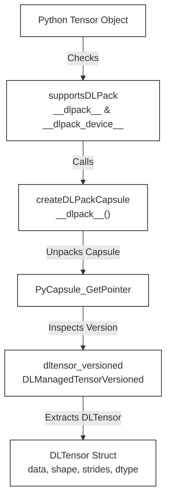

<!-- source: DeepWiki mcp.deepwiki.com · repo NVIDIA/tensor-ir · page 6.2 Python Bindings and Runtime Module · fetched 2026-10-26 -->

# Python Bindings and Runtime Module

<details>
<summary>Relevant source files</summary>

The following files were used as context for generating this wiki page:

- [python/bindings/TensorIRModule.cpp](python/bindings/TensorIRModule.cpp)
- [python/src/nv_tensor_ir/runtime.py](python/src/nv_tensor_ir/runtime.py)

</details>


## Purpose and Scope

This page covers the Python bindings and runtime integration layer of TensorIR, bridging the Python front-end with the native C API and compiler backend. It details the nanobind-based extension module `TensorIRModule.cpp`, the MLIR bindings exposed through `nv_tensor_ir._mlir`, the high-level Python runtime wrapper `runtime.py`, and the interoperability mechanism using DLPack for zero-copy tensor data exchange.


*Sources: [python/bindings/TensorIRModule.cpp:1-186](), [python/src/nv_tensor_ir/runtime.py:1-200]()*

---

## Nanobind Module and Compilation Options (`TensorIRModule.cpp`)

The native extension module is implemented in `python/bindings/TensorIRModule.cpp` using nanobind. It exposes compilation option structures, module cache key calculation, bytecode versioning, and argument packing utilities to Python.

### Compile Options Mapping
Python exposes a `CompileOptions` configuration structure that mirrors the native C structure `MlirTensorIRCudaTileCompileOptions`. The binding layer converts Python-side fields into native C structs via `wrapCompileOptions`:

* **`computeCapability`**: Target NVIDIA SM architecture version (default `100`).
* **`archPortability`**: Portability profile (`MlirTensorIRArchPortability`).
* **`ctaCount` & `warpCount`**: Thread block and warp allocation dimensions.
* **`tileSizes`**: Vector of user-specified tile dimensions.
* **`uniformSignature`**: Flag enabling uniform kernel signature generation.
* **`codegenStrategy`**: Selection between layout propagation and affine map lowering strategies.
* **`bytecodeVersion`**: Target bytecode format version.

```cpp
struct CompileOptions {
  int32_t computeCapability = 100;
  MlirTensorIRArchPortability archPortability =
      MlirTensorIRArchPortabilityFamilyPortable;
  int32_t ctaCount = 1;
  int32_t warpCount = 4;
  std::vector<int32_t> tileSizes;
  bool uniformSignature = false;
  MlirTensorIRCudaTileCodegenStrategy codegenStrategy =
      MlirTensorIRCudaTileCodegenStrategyLayoutPropagation;
  // ...
};
```
*Sources: [python/bindings/TensorIRModule.cpp:61-81](), [python/bindings/TensorIRModule.cpp:87-108]*

### Module Validation and Cache Keys
Before compilation or caching, modules are validated to ensure they conform to an MLIR `builtin.module` structure via `validateModule`. Cache keys are computed by serializing the compilation configuration and module representation through `mlirTensorIRCalculateCacheKey`:

```cpp
std::string calculateCacheKey(MlirModule module,
                              const CompileOptions &options) {
  MlirTensorIRCudaTileCompileOptions cOptions = wrapCompileOptions(options);
  std::string key;
  std::string error;
  checkCAPIResult(mlirTensorIRCalculateCacheKey(validateModule(module),
                                                cOptions, appendStringRef, &key,
                                                appendStringRef, &error),
                  "mlirTensorIRCalculateCacheKey", error);
  return key;
}
```
*Sources: [python/bindings/TensorIRModule.cpp:127-146]()*

*Sources: [python/bindings/TensorIRModule.cpp:42-146]()*

---

## DLPack Tensor Interoperability

To support arbitrary tensor backends (such as PyTorch, CuPy, JAX) without tight library coupling, `TensorIRModule.cpp` implements comprehensive DLPack inspection and conversion.

### DLPack Extraction Workflow
When tensor arguments are passed to a compiled kernel, the runtime verifies DLPack compliance, extracts capsules, and resolves underlying memory pointers and metadata:


*Sources: [python/bindings/TensorIRModule.cpp:148-186]()*

### Version Checking and Error Handling
The module checks for version compatibility via `dltensor_versioned` capsules. If the major version mismatches `DLPACK_MAJOR_VERSION`, or if capsule pointers are null, appropriate Python type errors or runtime exceptions are raised:

```cpp
  llvm::StringRef capsuleName(name ? name : "");
  if (capsuleName == "dltensor_versioned") {
    auto *versioned = static_cast<DLManagedTensorVersioned *>(ptr);
    if (versioned->version.major != DLPACK_MAJOR_VERSION) {
      throw nb::type_error(
          ("DLPack major version mismatch...").data());
    }
  }
```
*Sources: [python/bindings/TensorIRModule.cpp:180-186]()*

*Sources: [python/bindings/TensorIRModule.cpp:148-186]()*

---

## Python Runtime API and Program Lifecycle (`runtime.py`)

The high-level Python interface in `python/src/nv_tensor_ir/runtime.py` provides user-friendly abstractions over the native bindings.

### The `Program` Class
The `Program` class acts as a context manager wrapping the underlying compiled native program state. It manages initialization, validation, workspace allocation, and kernel launching.

| Method / Property | Role |
| :--- | :--- |
| `initialize()` | Initializes host-side runtime execution state. |
| `check_support(*args)` | Queries whether the compiled kernel supports the given tensor layout/types. |
| `query_workspace_size(*args)` | Returns required scratchpad workspace memory size in bytes. |
| `launch(*args, workspace, stream)` | Invokes the compiled CUDA kernel with packed arguments and execution streams. |
| `get_bytecode()` | Retrieves compiled TileIR bytecode or cuBin artifact bytes. |

```python
class Program:
    def __init__(self, native_program):
        self._native_program = native_program

    def launch(self, *args, workspace=None, stream=None) -> None:
        workspace_tensor = workspace
        if workspace_tensor is None:
            workspace_tensor = _make_workspace(self.query_workspace_size(*args))
        self._native_program.launch(args, workspace_tensor, stream)
```
*Sources: [python/src/nv_tensor_ir/runtime.py:61-145]()*

### Automatic Environment Detection and Workspace Allocation
`runtime.py` includes helper routines to detect the active CUDA compute capability via PyTorch (`_detect_compute_capability`) and automatically provision scratch workspace memory (`_make_workspace`) if omitted during launch:

```python
def _detect_compute_capability() -> int:
    try:
        import torch

        if torch.cuda.is_available():
            props = torch.cuda.get_device_properties(torch.cuda.current_device())
            return props.major * 10 + props.minor
    except ImportError:
        pass
    return 100
```
*Sources: [python/src/nv_tensor_ir/runtime.py:28-38](), [python/src/nv_tensor_ir/runtime.py:40-59]*

*Sources: [python/src/nv_tensor_ir/runtime.py:1-240]()*

---

