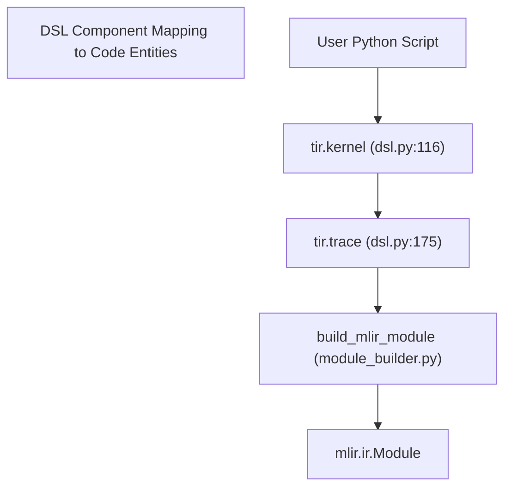
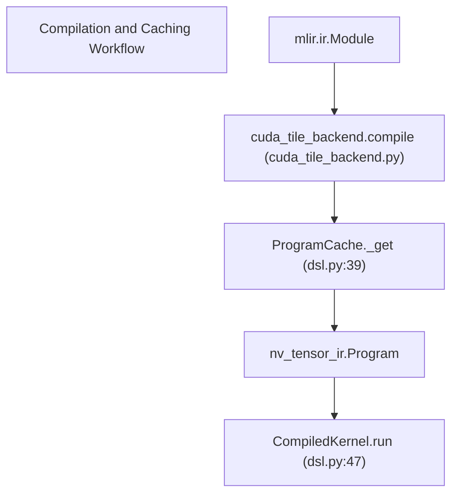

<!-- source: DeepWiki mcp.deepwiki.com · repo NVIDIA/tensor-ir · page 6.3 Python DSL · fetched 2026-10-26 -->

# Python DSL

Relevant source files

The following files were used as context for generating this wiki page:

- [python/src/nv_tensor_ir/dsl/__init__.py](python/src/nv_tensor_ir/dsl/__init__.py)
- [python/src/nv_tensor_ir/dsl/dsl.py](python/src/nv_tensor_ir/dsl/dsl.py)

The Python Domain-Specific Language (DSL) layer provided by `nv_tensor_ir.dsl` allows developers to write tensor expressions and GPU kernels in Python, which are then traced, lowered into MLIR modules, and compiled via backend services to execute on NVIDIA hardware. 

This page provides a high-level overview of the public API, decorators, caching mechanisms, and supporting modules. For deeper implementation details, refer to the child pages:
- [Tracing and Module Building](#6.3.1) — covers `tracing.py` and `module_builder.py`.
- [DSL CudaTile Backend, Caching and Profiling](#6.3.2) — covers `cuda_tile_backend.py`, cache keys, and profiling helpers.

---

## Core Components and Public API

The DSL exposes several key abstractions through `nv_tensor_ir.dsl` (`[python/src/nv_tensor_ir/dsl/__init__.py:10-46]()`):

*   **`@tir.kernel`**: A decorator used to mark Python functions as TensorIR kernels (`[python/src/nv_tensor_ir/dsl/dsl.py:116-127]()`).
*   **`compile` & `compile_traced`**: Entrypoints that compile decorated kernel functions or pre-traced graphs into executable kernels.
*   **`ProgramCache`**: An explicit caching mechanism to store and reuse compiled `nv_tensor_ir.Program` instances (`[python/src/nv_tensor_ir/dsl/dsl.py:25-45]()`).
*   **`DataType` & `TensorSpec`**: Type systems and tensor descriptor specifications used during tracing (`[python/src/nv_tensor_ir/dsl/__init__.py:24-25]()`).
*   **`ops`**: Mathematical and tensor operations mapped directly to lower-level MLIR dialect builders (`[python/src/nv_tensor_ir/dsl/__init__.py:26-29]()`).

Title: DSL Component Mapping to Code Entities

Sources: `python/src/nv_tensor_ir/dsl/dsl.py:116-184`, `python/src/nv_tensor_ir/dsl/module_builder.py:1-50`

---

## Tracing and Module Building

To translate Python control flow and arithmetic into MLIR, the DSL traces execution using concrete input tensors. The tracing subsystem intercepts operations and constructs an intermediate representation (`TraceGraph`), which is subsequently converted into an MLIR module (`[python/src/nv_tensor_ir/dsl/dsl.py:129-172]`).

For detailed information on how Python functions are analyzed, parameter types are validated, and MLIR modules are generated, see [Tracing and Module Building](#6.3.1).

Sources: `python/src/nv_tensor_ir/dsl/dsl.py:129-184`

---

## Backend Compilation, Caching, and Profiling

Once an MLIR module is built, it is passed to a target-specific backend (such as the `cuda_tile` backend) for optimization and compilation into a binary kernel (`[python/src/nv_tensor_ir/dsl/cuda_tile_backend.py]`). Compilation options, cache key calculations via `ProgramCache`, and kernel performance profiling via `run_profile` are managed in this layer (`[python/src/nv_tensor_ir/dsl/dsl.py:25-71]()`).

Title: Compilation and Caching Workflow

Sources: `python/src/nv_tensor_ir/dsl/dsl.py:25-71`, `python/src/nv_tensor_ir/dsl/cuda_tile_backend.py:1-50`

For detailed information on the CudaTile compiler integration, cache invalidation strategies, and CUPTI-based profiling utilities (`profile.py`), see [DSL CudaTile Backend, Caching and Profiling](#6.3.2).

Sources: `python/src/nv_tensor_ir/dsl/dsl.py:25-71`, `python/src/nv_tensor_ir/dsl/__init__.py:1-54`

---

