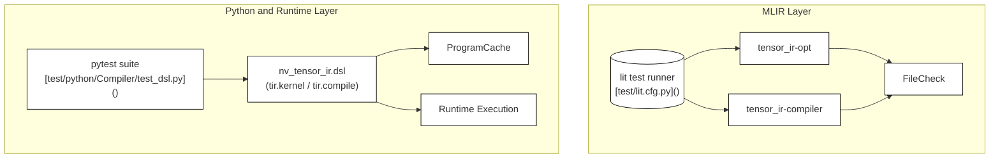
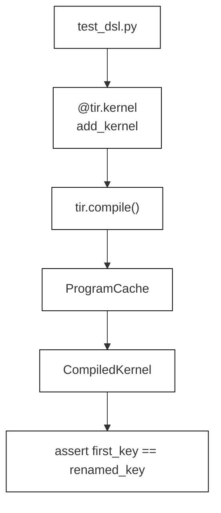

<!-- source: DeepWiki mcp.deepwiki.com · repo NVIDIA/tensor-ir · page 7 Testing Infrastructure · fetched 2026-10-26 -->

# Testing Infrastructure

Relevant source files

The following files were used as context for generating this wiki page:

- [test/lit.cfg.py](test/lit.cfg.py)
- [test/python/Compiler/test_dsl.py](test/python/Compiler/test_dsl.py)

The testing infrastructure of the TensorIR framework ensures correctness across all layers of the stack, ranging from MLIR dialect verification and transformation passes to Python Domain-Specific Language (DSL) compilation caches and end-to-end GPU kernel execution. The test suite is divided into MLIR-based verification using `lit` and `FileCheck`, and Python-based tests using `pytest` alongside native integration tests.

This is a PARENT page. For deeper technical details, refer to the following child pages:
- [Lit and FileCheck MLIR Tests](#7.1) — covers `[test/lit.cfg.py]()`, configuration management, dialect/transform/conversion test organization, and helper libraries in `test/lib`.
- [Python and Integration Tests](#7.2) — covers `[test/python/Compiler/test_dsl.py]()`, runtime testing, reference interpreters, and end-to-end kernel verification in `test/Integration/Compiler`.

---

## Testing Framework Overview

The TensorIR testing framework orchestrates multiple testing runners to validate compiler correctness, optimization passes, and runtime behavior. 

*Figure 1: TensorIR Testing Suite Architecture mapping runners to compiler and runtime code entities.*

Sources: `[test/lit.cfg.py:26-105]()`, `[test/python/Compiler/test_dsl.py:4-49]()`

---

## Lit and FileCheck MLIR Tests

MLIR-level tests are driven by the LLVM `lit` framework and verified using `FileCheck`. The configuration file `[test/lit.cfg.py]()` defines the test suite environment, tool paths for `tensor_ir-opt` and `tensor_ir-compiler`, target architecture substitutions (`%cubin_chip`), and python environment bindings [test/lit.cfg.py:26-105]().

For detailed coverage of test suites, organization of dialect/transform/conversion tests, and custom `test/lib` helper passes, see [Lit and FileCheck MLIR Tests](#7.1).

Sources: `[test/lit.cfg.py:26-187]()`

---

## Python and Integration Tests

Python tests validate the end-to-end usability of the `nv_tensor_ir` package, including tracing, caching behavior, dynamic shape normalization, and kernel execution via PyTorch interoperability. As demonstrated in `[test/python/Compiler/test_dsl.py]()`, tests exercise `tir.ProgramCache` stability, option handling, and multi-module separation [test/python/Compiler/test_dsl.py:52-166]().

*Figure 2: Python compilation cache test flow in `[test/python/Compiler/test_dsl.py]()`.*

For detailed coverage of `test/python`, `test_runtime.py`, `dsl_reference.py`, and end-to-end compiler integration tests, see [Python and Integration Tests](#7.2).

Sources: `[test/python/Compiler/test_dsl.py:25-166]()`

---

