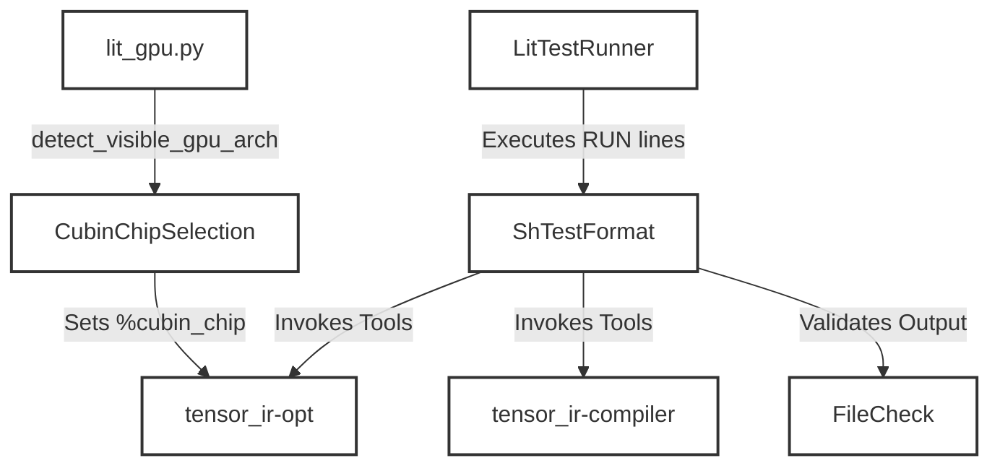
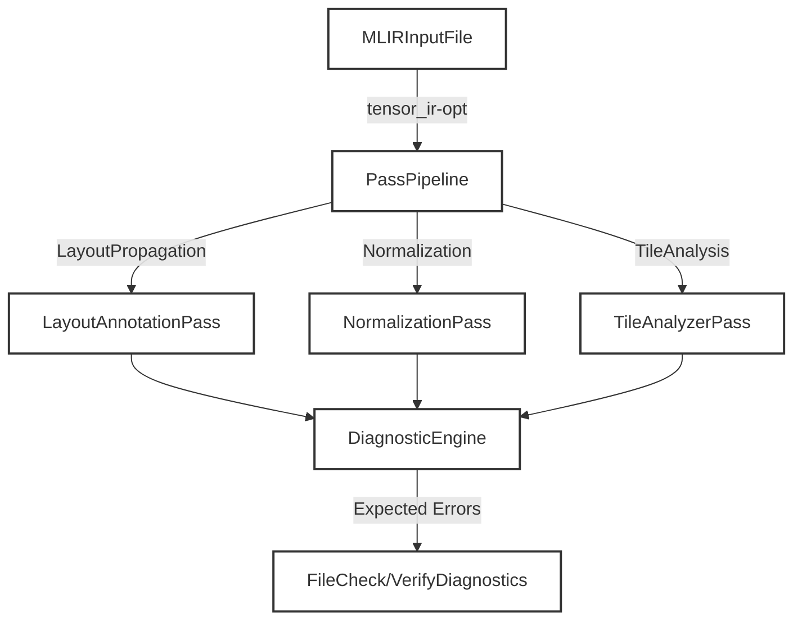

<!-- source: DeepWiki mcp.deepwiki.com · repo NVIDIA/tensor-ir · page 7.1 Lit and FileCheck MLIR Tests · fetched 2026-10-26 -->

# Lit and FileCheck MLIR Tests

Relevant source files

The following files were used as context for generating this wiki page:

- [test/Transform/layout-propagation-attributes-invalid.mlir](test/Transform/layout-propagation-attributes-invalid.mlir)
- [test/Transform/layout-propagation-attributes.mlir](test/Transform/layout-propagation-attributes.mlir)
- [test/Transform/layout-propagation-multi-output-invalid.mlir](test/Transform/layout-propagation-multi-output-invalid.mlir)
- [test/Transform/multi-output-tile-selection-invalid.mlir](test/Transform/multi-output-tile-selection-invalid.mlir)
- [test/lit.cfg.py](test/lit.cfg.py)

## Purpose and Scope
This section details the testing infrastructure used for verifying the TensorIR compiler framework via LLVM's `lit` test runner and `FileCheck`. It covers the configuration of test suites through `test/lit.cfg.py`, test organization across dialects, transform passes, and conversions, as well as diagnostic verification mechanisms and helper passes.

---

## Lit Configuration and Test Environment (`test/lit.cfg.py`)

The test suite is driven by `test/lit.cfg.py`, which configures the `lit` test runner for the `TENSOR_IR` project [test/lit.cfg.py:29-29](). 

Key aspects of the configuration include:
- **Test Format:** Uses `lit.formats.ShTest` to execute shell-based test scripts specified in `RUN` lines within `.mlir` files [test/lit.cfg.py:40-44]().
- **File Suffixes:** Registers `.mlir` files as the primary test input format [test/lit.cfg.py:46-47]().
- **Tool Substituted Binaries:** Configures paths for core compiler binaries and testing utilities such as `tensor_ir-compiler`, `tensor_ir-opt`, `FileCheck`, `not`, and Python executables [test/lit.cfg.py:92-98]().
- **GPU Architecture and Target Detection:** Detects visible GPU architectures via `detect_visible_gpu_arch()` and normalizes compute capabilities into `%cubin_chip` targets (e.g., handling Blackwell compute capabilities and environment overrides like `TEST_GPU_ARCH`) [test/lit.cfg.py:127-168]().
- **Environment Management:** Propagates environment variables such as `CUDA_VISIBLE_DEVICES`, `CUDA_DEVICE_ORDER`, sanitizers (`ASAN_OPTIONS`), and Python search paths (`PYTHONPATH`) for bindings and Python DSL tests [test/lit.cfg.py:111-121,171-187]().

*Figure 1: Lit execution flow and tool dispatch integration.*

**Sources:**
- `test/lit.cfg.py`

---

## Test Organization and Dialect/Transform Verification

Test files are organized hierarchically within the `test/` directory, mirroring the compiler architecture (e.g., dialects, transforms, conversions, python bindings).

### Transform and Attribute Verification Tests
Transform passes and attribute verifiers are extensively tested using `tensor_ir-opt` with `-verify-diagnostics`. This allows validation of both successful transformations and expected error conditions, such as invalid layouts, unaligned tile sizes, or unsupported dynamic multi-output graph structures.

For example, multi-output layout propagation and tile selection constraints are validated using diagnostic checks:
- **Multi-Output Ancestry Validation:** Tests ensure that independent result branches share a compatible nonconstant common SSA ancestor before lowering [test/Transform/layout-propagation-multi-output-invalid.mlir:6-15]().
- **Projected Result Partitioning:** Ensures that selected tile sizes evenly partition result-projected iteration space dimensions without violating constraints [test/Transform/multi-output-tile-selection-invalid.mlir:5-10]().
- **Attribute Constraints:** Validates `TensorSourceAttr`, `CompositeSourceAttr`, `ConcatSourceAttr`, and `ReductionSourceAttr` syntax, rank constraints, and dimension matching [test/Transform/layout-propagation-attributes-invalid.mlir:9-186](), while positive test cases verify correct parsing, printing, and normalization [test/Transform/layout-propagation-attributes.mlir:9-116]().

*Figure 2: Pass pipeline verification flow under `tensor_ir-opt`.*

**Sources:**
- `test/Transform/layout-propagation-multi-output-invalid.mlir`
- `test/Transform/multi-output-tile-selection-invalid.mlir`
- `test/Transform/layout-propagation-attributes-invalid.mlir`
- `test/Transform/layout-propagation-attributes.mlir`

---

