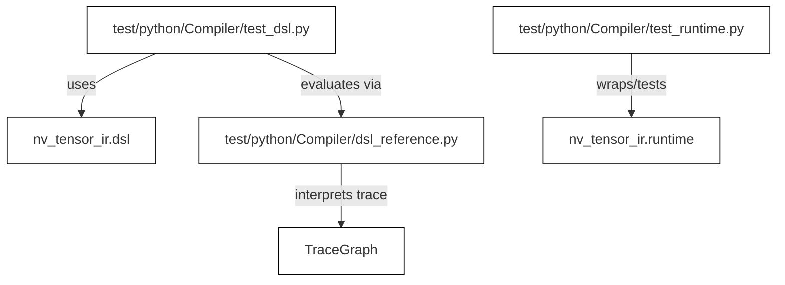
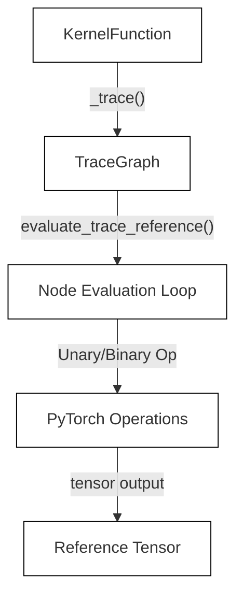
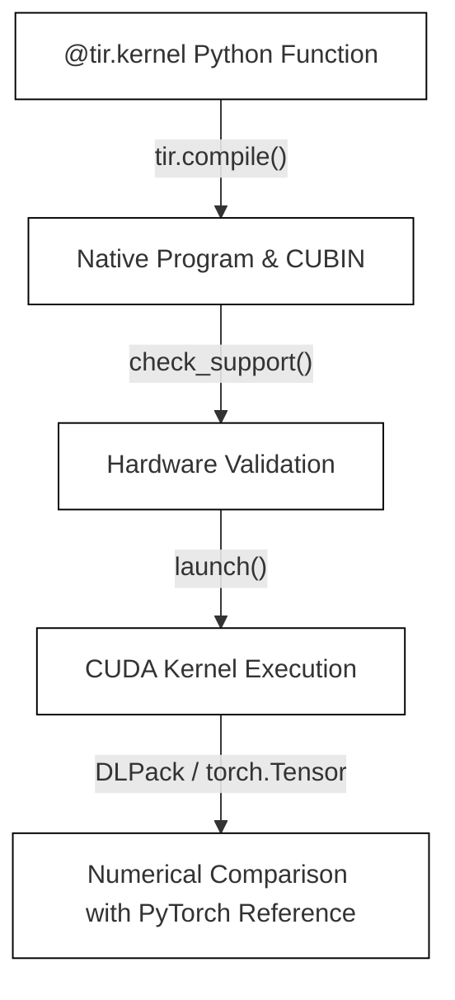

<!-- source: DeepWiki mcp.deepwiki.com · repo NVIDIA/tensor-ir · page 7.2 Python and Integration Tests · fetched 2026-10-26 -->

# Python and Integration Tests

Relevant source files

The following files were used as context for generating this wiki page:

- [test/python/Compiler/dsl_reference.py](test/python/Compiler/dsl_reference.py)
- [test/python/Compiler/test_dsl.py](test/python/Compiler/test_dsl.py)
- [test/python/Compiler/test_runtime.py](test/python/Compiler/test_runtime.py)

## Purpose and Scope

This page covers the Python-level testing infrastructure of the TensorIR compiler framework, located under `test/python/` and `test/Integration/Compiler/`. The test suite validates the Python domain-specific language (DSL), `ProgramCache` semantics, the `nv_tensor_ir.runtime` module bindings, numerical equivalence through a PyTorch-backed reference interpreter (`dsl_reference.py`), and end-to-end CUDA kernel compilation and execution via integration tests.

---

## 1. Python Test Suite Architecture (`test/python/Compiler/`)

The Python test suite exercises user-facing APIs, tracing infrastructure, caching behavior, and runtime wrappers. The core files include `test_dsl.py`, which validates kernel compilation, dynamic shapes, and caching rules [test/python/Compiler/test_dsl.py:30-167](), and `test_runtime.py`, which tests the native program lifecycle and runtime options mapping [test/python/Compiler/test_runtime.py:77-194]().

*Diagram 1: Natural Language Space to Code Entity Space mapping for Python test components.*

### Sources:
- `test/python/Compiler/test_dsl.py`
- `test/python/Compiler/test_runtime.py`
- `test/python/Compiler/dsl_reference.py`

---

## 2. DSL Reference Interpreter (`dsl_reference.py`)

To verify correctness without relying solely on hardware execution, `dsl_reference.py` provides a reference interpreter that mirrors TensorIR operations using PyTorch tensors and primitives. 

### Key Functions and Mappings
- `evaluate_kernel_reference`: Traces a `KernelFunction` and evaluates its `TraceGraph` using reference PyTorch logic [test/python/Compiler/dsl_reference.py:96-109]().
- `evaluate_trace_reference`: Iterates through `TraceGraph` nodes (inputs, constants, unary ops, binary ops, comparisons) and executes equivalent PyTorch operations on the target device [test/python/Compiler/dsl_reference.py:111-180]().
- `_UNARY_REFERENCES` and `_BINARY_REFERENCES`: Dictionaries mapping TensorIR operation names (e.g., `"relu_fwd"`, `"add"`, `"mul"`) to corresponding PyTorch functions (`torch.relu`, `torch.add`, etc.) [test/python/Compiler/dsl_reference.py:18-64]().
- `_CMP_REFERENCES`: Maps comparison predicates (`"eq"`, `"ogt"`, `"olt"`, etc.) to logical or relational PyTorch functions [test/python/Compiler/dsl_reference.py:66-87]().

*Diagram 2: Data flow of the DSL reference evaluation engine.*

### Sources:
- `test/python/Compiler/dsl_reference.py`

---

## 3. Runtime Wrapper and Options Testing (`test_runtime.py`)

`test_runtime.py` verifies the Python bindings for runtime execution, workspace management, and compilation options construction under `nv_tensor_ir.runtime`.

### Core Test Coverage
- **Workspace Management**: Tests `Program.launch()` behavior when workspaces are provided explicitly versus when workspace sizes are queried dynamically from the native program [test/python/Compiler/test_runtime.py:77-106]() using mock objects like `_FakeWorkspace` [test/python/Compiler/test_runtime.py:19-32]() and `_FakeNativeProgram` [test/python/Compiler/test_runtime.py:34-75]().
- **Compile Options Construction**: Validates `_make_compile_options` parsing of keyword arguments, enum conversions (`ArchPortability`, `CodegenStrategy`, `CudaTileArtifactKind`), and fallback compute capability detection [test/python/Compiler/test_runtime.py:150-192]().
- **Module Exports**: Ensures `nv_tensor_ir.runtime.__all__` strictly exposes public-facing classes and functions [test/python/Compiler/test_runtime.py:108-120]().

### Sources:
- `test/python/Compiler/test_runtime.py`

---

## 4. End-to-End Compiler Integration Tests (`test/Integration/Compiler`)

Integration tests in `test/Integration/Compiler` perform full round-trip compilation and execution of kernels on NVIDIA GPUs. 

### Verification Lifecycle
1. **Compilation**: Python functions decorated with `@tir.kernel` are traced and compiled via `tir.compile()` or cached via `tir.ProgramCache`.
2. **Support Checking**: The compiled `Program` uses `check_support()` to ensure hardware compatibility.
3. **Execution & Comparison**: Kernels are launched with input tensors (often backed by `torch.Tensor` via DLPack interop), and outputs are compared against PyTorch references generated via `dsl_reference.py`.

*Diagram 3: End-to-end integration test execution pipeline.*

### Sources:
- `test/python/Compiler/test_dsl.py`
- `test/python/Compiler/test_runtime.py`
- `test/python/Compiler/dsl_reference.py`

---

