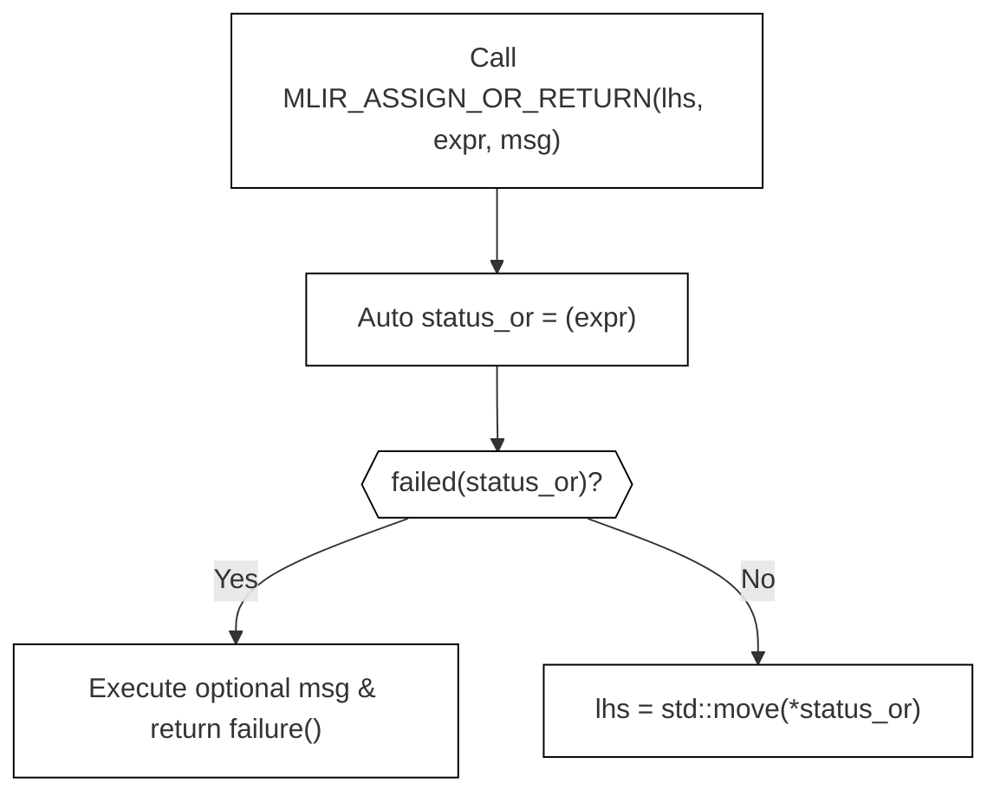
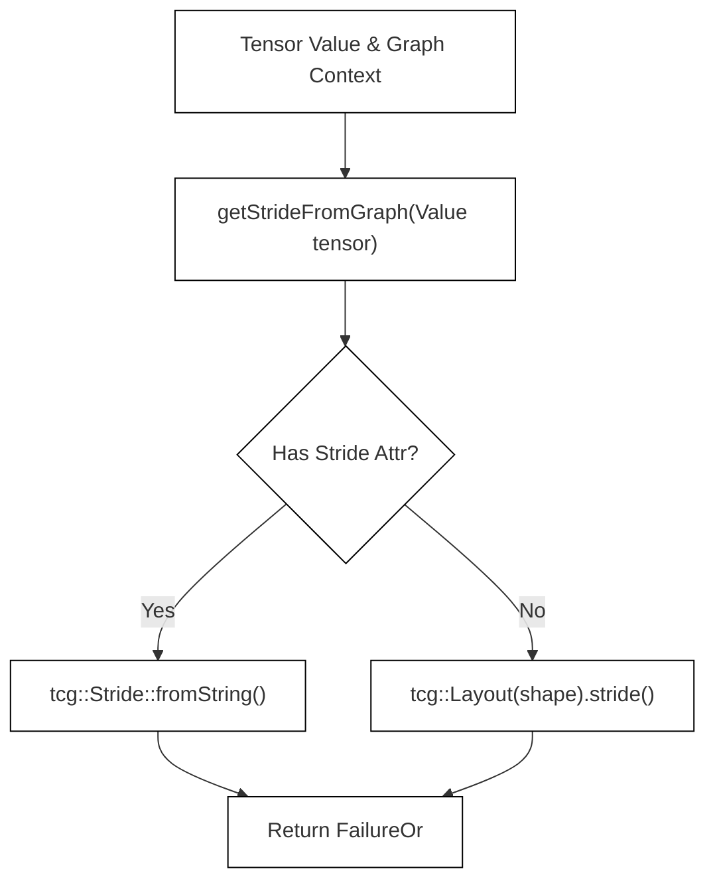
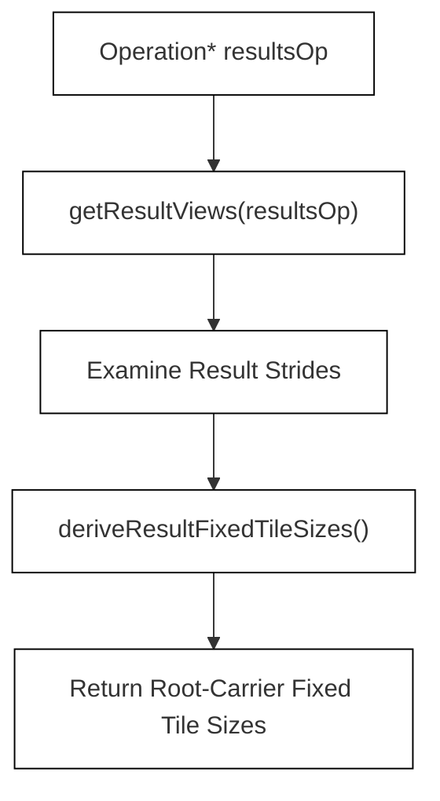

<!-- source: DeepWiki mcp.deepwiki.com · repo NVIDIA/tensor-ir · page 8.1 Utils Library · fetched 2026-10-26 -->

# Utils Library

Relevant source files

The following files were used as context for generating this wiki page:

- [include/tensor_ir/Utils/Utils.h](include/tensor_ir/Utils/Utils.h)
- [lib/Utils/Utils.cpp](lib/Utils/Utils.cpp)

## Purpose and Scope

The `Utils` library (`include/tensor_ir/Utils/` and `lib/Utils/`) provides foundational helper routines, error propagation macros, shape/stride math utilities, and layout attribute inspectors used across both the TensorIR compiler transformations and the runtime layers. It bridges high-level graph constructs with low-level CuTe layout abstractions [include/tensor_ir/Utils/Utils.h:1-10](), [lib/Utils/Utils.cpp:1-8]().

Sources: `include/tensor_ir/Utils/Utils.h`, `lib/Utils/Utils.cpp`

---

## Error Handling and Assignment Macros

To simplify working with MLIR's `LogicalResult` and `FailureOr<T>` types, the Utils library implements robust assignment and error-checking macros. These macros mirror common status-or patterns while integrating seamlessly with MLIR's diagnostic and failure propagation conventions [include/tensor_ir/Utils/Utils.h:27-85]().

- `MLIR_RETURN_IF_ERROR(expr)`: Evaluates an expression returning a `LogicalResult` (or type convertible to it) and returns `failure()` immediately if the expression fails [include/tensor_ir/Utils/Utils.h:32-37]().
- `MLIR_ASSIGN_OR_RETURN(lhs, expr, ...)`: Evaluates an expression yielding a `FailureOr<T>`, handles failure (optionally executing custom error recovery code or emitting a diagnostic message), and otherwise moves the unwrapped value into `lhs` [include/tensor_ir/Utils/Utils.h:43-85](). Arity dispatch (`TIR_GET_MACRO_3`) supports both message-free and custom-message overloads [include/tensor_ir/Utils/Utils.h:30-61]().

*Figure 1: Control flow of `MLIR_ASSIGN_OR_RETURN` macro execution.*

Sources: `include/tensor_ir/Utils/Utils.h`

---

## Tensor Descriptors, Shapes, and Stride Math

The library interfaces closely with the `tcutegen` library (`mlir::nv_tensor_ir::tcutegen`) to handle multi-dimensional tensor layouts, strides, and shapes [lib/Utils/Utils.cpp:7-21]().

### Stride and Alignment Extraction

- `getAlignmentFromGraph(Value tensor)`: Inspects a graph tensor operand or result, retrieving custom alignment attributes from `GraphOp` argument or result dictionaries [lib/Utils/Utils.cpp:58-101](). Falls back to default alignment rules via `getDefaultAlignment()` if no explicit attribute is set [lib/Utils/Utils.cpp:78-81]().
- `getStrideFromGraph(Value tensor)`: Queries graph argument or result attribute dictionaries for stride strings [lib/Utils/Utils.cpp:103-158](). If strides are omitted (common in dynamic shape scenarios to preserve ABI constraints), it defaults to contiguous row-major strides derived from the tensor shape [lib/Utils/Utils.cpp:131-138]().

*Figure 2: Natural Language Space to Code Entity Space mapping for stride resolution.*

Sources: `lib/Utils/Utils.cpp`, `include/tensor_ir/Utils/Utils.h`

---

## Graph Analysis and Multi-Output Layout Utilities

Graph-level utility functions inspect structural properties of `GraphOp` regions and manage multi-result layouts [include/tensor_ir/Utils/Utils.h:93-124]().

- `isEmptyRegionGraphOp(GraphOp graphOp)`: Verifies if the graph region contains only the terminating `results` operation [lib/Utils/Utils.cpp:162-166]().
- `hasDynamicInputOrOutputTensor(GraphOp graphOp)`: Scans all graph arguments and results for non-static tensor shapes [lib/Utils/Utils.cpp:168-188]().
- `getResultLayouts(Operation *resultsOp)`: Retrieves ABI-ordered per-result layouts attached by multi-output layout normalization passes [include/tensor_ir/Utils/Utils.h:107-108]().
- `getResultViews(Operation *resultsOp)`: Returns physical output views as `TensorSourceAttr` in root-carrier coordinates [include/tensor_ir/Utils/Utils.h:110-115]().
- `deriveResultFixedTileSizes(Operation *resultsOp)`: Analyzes physical result views to determine root-carrier dimensions that every CTA tile must cover completely (dimensions with zero stride in at least one physical view) [include/tensor_ir/Utils/Utils.h:117-123]().

*Figure 3: Data flow for deriving fixed CTA tile sizes from multi-output result views.*

Sources: `include/tensor_ir/Utils/Utils.h`, `lib/Utils/Utils.cpp`

---

