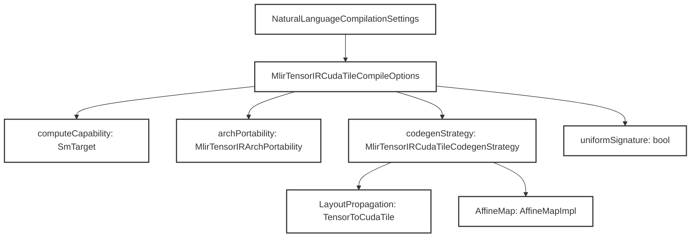
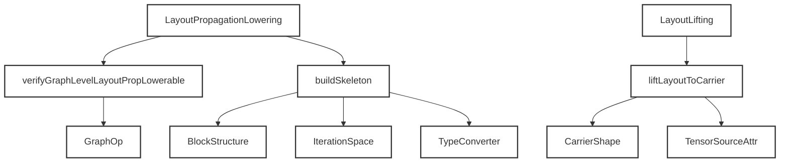

<!-- source: DeepWiki mcp.deepwiki.com · repo NVIDIA/tensor-ir · page 9 Glossary · fetched 2026-10-26 -->

# Glossary

Relevant source files

The following files were used as context for generating this wiki page:

- [README.md](README.md)
- [include/tensor_ir-c/TensorIR.h](include/tensor_ir-c/TensorIR.h)
- [include/tensor_ir/Conversion/TensorToCudaTile/TensorToCudaTileInternal.h](include/tensor_ir/Conversion/TensorToCudaTile/TensorToCudaTileInternal.h)
- [lib/Transform/LayoutAnnotation.cpp](lib/Transform/LayoutAnnotation.cpp)

This page provides formal technical definitions and code pointers for core terms, data structures, compiler passes, and execution artifacts specific to the TensorIR codebase.

---

## 1. Core Representations and Artifacts

### CUDA Tile IR
The target Intermediate Representation used by the TensorIR compiler to emit GPU device code via NVIDIA CUDA Tile technology. TensorIR graphs are lowered into CUDA Tile MLIR dialects before translation to bytecode or binary form.
- Sources: `README.md:47-48()`, `include/tensor_ir-c/TensorIR.h:145-146()`

### TileIR Bytecode
A serialized representation of CUDA Tile IR. It can be embedded in runtime packages, inspected via `--dump-tileir-bc`, or loaded dynamically via `--load-tileir-bc` for JIT compilation by the driver.
- Sources: `README.md:150-153()`, `include/tensor_ir-c/TensorIR.h:97-98()`

### Cubin
Compiled CUDA binary artifact (`.cubin`) generated for an architecture-conditional target (`MlirTensorIRArchPortabilityArchConditional`). In internal builds, it uses `libtileiras`; in OSS builds, it invokes a compatible `tileiras` binary found in `PATH`.
- Sources: `include/tensor_ir-c/TensorIR.h:99-103()`

### Tensor Descriptor (`TensorSourceAttr`)
An attribute encoding physical tensor layout metadata, including tensor ID, memory offset, layout string representations, and dynamic value mappings.
- Sources: `lib/Transform/LayoutAnnotation.cpp:80-85()`

### DLPack
An open standard for tensor memory interop used by the Python bindings to share memory buffers seamlessly between PyTorch and TensorIR runtime kernels without data duplication.
- Sources: `README.md:43()`, `lib/python/TensorIRModule.cpp` (implied by python runtime integration)

### Workspace
Temporary device memory allocated by the runtime to support multi-stage operations, reductions, or intermediate buffering during kernel execution.
- Sources: `include/tensor_ir-c/TensorIR.h` (runtime workspace integration)

### ProgramCache
A caching layer in the Python DSL (`cuda_tile_backend.py`) that stores compiled kernel programs to avoid redundant compilation overhead across repeated executions of identical program specifications.
- Sources: `README.md:95()`

---

## 2. Architecture and Compilation Strategy

### Layout Propagation Strategy (`MlirTensorIRCudaTileCodegenStrategyLayoutPropagation`)
The default TensorIR-to-CUDA-Tile lowering strategy. It derives memory access patterns and tiling by propagating layout source attributes across operations and aligning them with carrier shapes.
- Sources: `README.md:154-155()`, `include/tensor_ir-c/TensorIR.h:91-93()`

### Affine-Map Strategy (`MlirTensorIRCudaTileCodegenStrategyAffineMap`)
An alternative lowering path that derives iteration-space maps using MLIR affine analysis rather than layout propagation.
- Sources: `README.md:154-155()`, `include/tensor_ir-c/TensorIR.h:88-90()`

### Arch Portability (`MlirTensorIRArchPortability`)
Configuration parameter controlling how strictly generated code is tied to a specific GPU compute capability. Options include `MlirTensorIRArchPortabilityPortable`, `MlirTensorIRArchPortabilityFamilyPortable`, and `MlirTensorIRArchPortabilityArchConditional`.
- Sources: `include/tensor_ir-c/TensorIR.h:78-85()`

### SmTarget (`computeCapability`)
The target NVIDIA SM architecture (e.g., `sm_100`, `sm_100a`, `sm_100f`) specified via command-line flags or compile options. Defaults to the SM100 family target `sm_100f`.
- Sources: `README.md:156-158()`, `include/tensor_ir-c/TensorIR.h:114()`

### Uniform Signature (`uniformSignature`)
An option forcing the compiler to pass all tensor dimensions, sizes, and strides as explicit kernel arguments, including static sizes and strides that would otherwise be omitted.
- Sources: `README.md:165-166()`, `include/tensor_ir-c/TensorIR.h:135-136()`

---

### Diagram: Compilation Options & Strategy Mapping
The following diagram bridges natural language compilation settings to their corresponding C/C++ code entities in the TensorIR codebase.

*Sources: `include/tensor_ir-c/TensorIR.h:78-140()`*

---

## 3. Execution and Runtime Infrastructure

### Iteration Space
The abstract domain of loop iterations traversed by a kernel or tile. Discovered during graph splitting and stored as an iteration space ID mapping.
- Sources: `include/tensor_ir/Conversion/TensorToCudaTile/TensorToCudaTileInternal.h:120-134()`

### Block Structure (`BlockStructure`)
The organization of computational blocks and loops constructed during skeleton materialization (`buildSkeleton`) to structure CUDA Tile IR emission.
- Sources: `include/tensor_ir/Conversion/TensorToCudaTile/TensorToCudaTileInternal.h:120-134()`

### IterSpaceId (`iterSpaceId`)
An integer identifier tracking distinct iteration spaces across multi-iteration-space graphs and operation state updates.
- Sources: `include/tensor_ir/Conversion/TensorToCudaTile/TensorToCudaTileInternal.h:111-118()`

### Carrier Shape
The expanded tensor shape (derived via `liftLayoutToCarrier`) used to align disparate layouts during propagation and reduction/broadcast operations.
- Sources: `lib/Transform/LayoutAnnotation.cpp:93-103()`

### GraphOp (`GraphOp`)
The root MLIR operation encapsulating a TensorIR computational graph, verifying layout properties, arguments, and terminators.
- Sources: `include/tensor_ir/Conversion/TensorToCudaTile/TensorToCudaTileInternal.h:96()`

### ReduceUD (`ReduceUDOp`)
A user-defined reduction operation or reduction dialect construct whose region block arguments are handled specially during ancestry and layout collection.
- Sources: `lib/Transform/LayoutAnnotation.cpp:158-159()`

### MatmulSourceAttr (`MatmulSourceAttr`)
A layout source attribute specialized for matrix multiplication operations, managing layout views across contracting and batch dimensions.
- Sources: `include/tensor_ir/Conversion/TensorToCudaTile/TensorToCudaTileInternal.h:73-77()`

### Tile Size Attribute (`tile_size`)
An attribute controlling compiler-side loop tiling (`--tile-size`). It dictates the breakdown of iteration dimensions (e.g., `MxN` or `MxNxK`) and is validated against iteration space rank constraints.
- Sources: `README.md:159()`, `include/tensor_ir/Conversion/TensorToCudaTile/TensorToCudaTileInternal.h:86-96()`

### Arg Packer
A utility component responsible for packing kernel arguments, dynamic dimensions, and strides into the invocation buffer.
- Sources: `README.md:165()`

### Grid Computer
Logic that computes grid and block launch dimensions based on tile sizes and problem shapes.
- Sources: `README.md:135-136()`

---

### Diagram: Lowering & Layout Propagation Entities
The following diagram maps high-level lowering concepts to internal C++ functions and classes in the conversion pipeline.

*Sources: `include/tensor_ir/Conversion/TensorToCudaTile/TensorToCudaTileInternal.h:80-134()`, `lib/Transform/LayoutAnnotation.cpp:80-103()`*

---

## 4. Tools and Testing

### Lit Test
An MLIR testing infrastructure (`lit`) combining `FileCheck` assertions with input files to verify dialect canonicalization, transform passes, and codegen correctness.
- Sources: `README.md:69()`

### tensor_ir-opt
A standalone command-line compiler utility used for running specific TensorIR transformation passes, verifying MLIR dialects, and debugging graph transformations independently of full code generation.
- Sources: `README.md:84()`

---
*Sources: `README.md:69-84()`*