# Page: Overview

# Overview

<details>
<summary>Relevant source files</summary>

The following files were used as context for generating this wiki page:

- [CMakeLists.txt](CMakeLists.txt)
- [README.md](README.md)
- [include/tensor_ir/Compiler/Compiler.h](include/tensor_ir/Compiler/Compiler.h)

</details>


TensorIR Compiler is an MLIR-based framework designed to lower high-level tensor graphs into NVIDIA CUDA Tile IR GPU kernels [README.md:1-2](), [CMakeLists.txt:1-8](). By leveraging MLIR dialects, custom transformation passes, and the CUDA Tile IR code generation backend, TensorIR bridges high-level domain-specific languages (such as the Python DSL) with high-performance NVIDIA GPU execution [README.md:94-95]().

This parent page introduces the high-level architecture, repository layout, and core compilation workflow. 

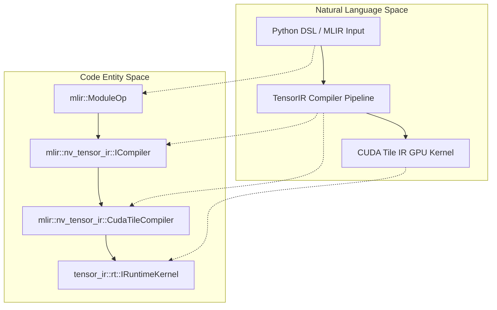
*Diagram 1: Bridging Natural Language Concepts to Code Entities in TensorIR.*
Sources: [README.md:1-2](), [include/tensor_ir/Compiler/Compiler.h:26-50](), [CMakeLists.txt:1-8]()

---

## 1.1. Getting Started and Build System

The TensorIR build system is structured around CMake and relies heavily on LLVM, MLIR, and the pinned NVIDIA CUDA Tile project [README.md:45-53](). Configuration options allow developers to control whether LLVM is downloaded automatically via `TENSOR_IR_DOWNLOAD_LLVM` [CMakeLists.txt:21-23](), whether Python bindings are built using `TENSOR_IR_ENABLE_BINDINGS_PYTHON` [CMakeLists.txt:13](), and whether test suites are generated via `TENSOR_IR_INCLUDE_TESTS` [CMakeLists.txt:14](). 

The project incorporates helper scripts under the `cmake/` directory to locate MLIR packages, configure compatibility policies, and fetch external dependencies like DLPack and CUDA Tile IR [CMakeLists.txt:72-106](). Installation rules are configured to export binary executables and Python packages cleanly [README.md:97-105]().

For details, see Getting Started and Build System.

Sources: [CMakeLists.txt:1-194](), [README.md:16-106]()

---

## 1.2. Compilation Pipeline End-to-End

The compilation pipeline takes an input `mlir::ModuleOp` (originating either from MLIR text files or the Python DSL tracing infrastructure) and transforms it through a series of analysis and optimization passes [include/tensor_ir/Compiler/Compiler.h:26-27](). These passes handle tasks such as layout propagation annotation, tile analysis, iteration space discovery, and graph splitting.

Once optimized, the intermediate representation is lowered via the conversion layer (such as the layout-propagation or affine-map strategy) into CUDA Tile dialect structures. The compiler backend then compiles the lowered representation into Tile IR bytecode or binary cubin artifacts, which are encapsulated into runtime kernel objects (`IRuntimeKernel`) ready for execution on targeted NVIDIA GPUs [README.md:148-167](), [include/tensor_ir/Compiler/Compiler.h:37-41]().

For details, see Compilation Pipeline End-to-End.

Sources: [README.md:114-167](), [include/tensor_ir/Compiler/Compiler.h:26-50]()

---

## 1.3. Command Line Tools

TensorIR provides standalone command-line executables—`tensor_ir-compiler` and `tensor_ir-opt`—to inspect, transform, compile, and execute tensor kernels directly from the shell [README.md:83-84](). These tools accept a wide array of command-line flags controlling target SM architectures (e.g., `--target-sm`), custom tile sizes (`--tile-size`), dynamic shapes (`--dynamic-dims`), and code generation strategies (`--codegen-strategy`) [README.md:138-167]().

Additionally, the tools support built-in reference verification modes (`--verify`) that compare the generated GPU kernel execution results against a reference interpreter implementation, as well as debugging options like per-pass IR dumping via `--print-ir-after-all` [README.md:109-120](), [README.md:159-164]().

For details, see Command Line Tools.

Sources: [README.md:83-85](), [README.md:107-174]()

---

# Page: Getting Started and Build System

# Getting Started and Build System

<details>
<summary>Relevant source files</summary>

The following files were used as context for generating this wiki page:

- [CMakeLists.txt](CMakeLists.txt)
- [README.md](README.md)

</details>


## Purpose and Scope
This page details the CMake-based build system, configuration options, external dependency management (LLVM/MLIR, CUDA Tile, and DLPack), helper build functions, and installation targets for the TensorIR Compiler. It provides instructions and architectural insights into how the project configures its build environment, interfaces with the CUDA Toolkit, and produces binaries like `tensor_ir-compiler` and `tensor_ir-opt`, as well as Python bindings.

Sources: `CMakeLists.txt:1-205]`, `[README.md:1-175]()`

---

## Project Configuration and Options

The TensorIR build system is driven by root configuration defined in `[CMakeLists.txt:7-30]()`. It establishes project metadata (`TensorIRCompiler`, version `0.1.2`), sets C++17 requirements (`[CMakeLists.txt:35-36]()`), and configures visibility controls (`[CMakeLists.txt:42-43]()`).

Key options exposed by the build system include:
* `TENSOR_IR_ENABLE_BINDINGS_PYTHON`: Controls whether Python bindings and the runtime module are built (default: `ON`) `[CMakeLists.txt:13-13]()`. Requires MLIR Python bindings `[CMakeLists.txt:113-119]()`.
* `TENSOR_IR_INCLUDE_TESTS`: Generates test-only targets, helper libraries, and configures the `lit` test suite (default: `ON`) `[CMakeLists.txt:14-14]`, `[CMakeLists.txt:186-188]`, `[CMakeLists.txt:193-194]()`.
* `TENSOR_IR_DOWNLOAD_LLVM`: Automatically downloads and builds the pinned LLVM project revision required by CUDA Tile (default: `ON` for top-level builds, `OFF` otherwise) `[CMakeLists.txt:16-24]()`.
* `TENSOR_IR_CUDART_LINKAGE`: Determines CUDA Runtime linkage, accepting either `DYNAMIC` or `STATIC` (default: `DYNAMIC`) `[CMakeLists.txt:26-28]()`.

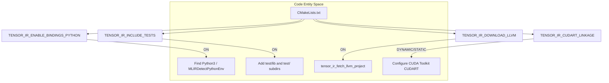
Sources: `[CMakeLists.txt:7-30]`, `[CMakeLists.txt:113-123]`, `[CMakeLists.txt:186-194]()`

---

## Dependency Fetching and Integration

TensorIR relies heavily on external LLVM/MLIR infrastructure and NVIDIA CUDA Tile IR. The build system manages these dependencies through dedicated CMake helper modules located in the `cmake/` directory.

### LLVM and MLIR
When `TENSOR_IR_DOWNLOAD_LLVM` is enabled, the helper function `tensor_ir_fetch_llvm_project` retrieves the pinned LLVM project source tree `[CMakeLists.txt:78-80]()`. Otherwise, LLVM and MLIR are located via standard CMake config packages (`find_package(MLIR CONFIG)` and `find_package(LLVM CONFIG)`), where `MLIR_DIR` can be explicitly provided `[README.md:48-53]()`. Common policies and ABI compatibility rules are then applied via `tensor_ir_configure_llvm_cmake_compatibility_policies()` and `tensor_ir_configure_cxx_llvm_abi_compatibility()` (`[CMakeLists.txt:88-89]()`, `[CMakeLists.txt:72-72]()`).

### CUDA Tile IR
CUDA Tile IR is fetched via `tensor_ir_fetch_cuda_tile()`, utilizing `CUDA_TILE_USE_LLVM_INSTALL_DIR` to coordinate the LLVM installation directory shared between TensorIR and CUDA Tile `[CMakeLists.txt:95-107]()`. Testing and Python bindings are explicitly disabled for the fetched CUDA Tile subproject (`[CMakeLists.txt:104-105]()`).

### DLPack Interoperability
When Python bindings are enabled (`TENSOR_IR_ENABLE_BINDINGS_PYTHON`), the build system fetches DLPack via `tensor_ir_fetch_dlpack()` to support zero-copy tensor interop with PyTorch and other frameworks (`[CMakeLists.txt:169-172]()`).

Sources: `[CMakeLists.txt:70-123]`, `[CMakeLists.txt:169-172]`, `[README.md:47-53]()`

---

## CMake Helper Scripts and Library Definitions

To maintain consistency across MLIR dialects, conversion passes, and runtime components, `[CMakeLists.txt:131-155]()` defines custom CMake wrapper functions around upstream MLIR/LLVM functions. These functions automatically register libraries with internal tracking scripts via `tensor_ir_register_library`:

* `add_tensor_ir_dialect_library(name)`: Wraps `add_mlir_library` for dialect components `[CMakeLists.txt:131-134]()`.
* `add_tensor_ir_library(name)`: Wraps general core and runtime libraries `[CMakeLists.txt:136-139]()`.
* `add_tensor_ir_public_c_api_library(name)`: Wraps `add_mlir_public_c_api_library` for C bindings `[CMakeLists.txt:141-144]()`.
* `add_tensor_ir_conversion_library(name)`: Registers lowering and conversion pass libraries `[CMakeLists.txt:146-149]()`.
* `add_tensor_ir_test_library(name)`: Registers test-only utility passes and libraries with the `TEST_LIBRARY` flag `[CMakeLists.txt:151-154]()`.

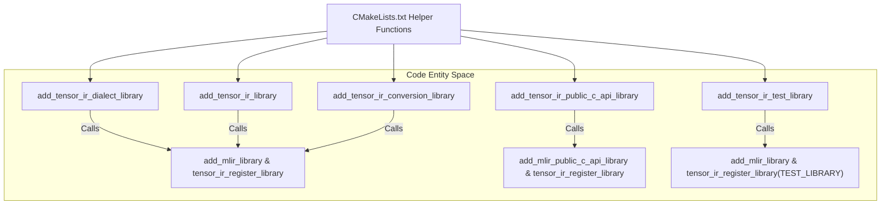
Sources: `[CMakeLists.txt:129-155]()`

---

## Build Targets and Installation

Once configured, targets are compiled using Ninja or Make. The primary compilation targets include:
* `tensor_ir-compiler`: The primary ahead-of-time and JIT compiler binary `[README.md:57]`, `[README.md:83]()`.
* `tensor_ir-opt`: The MLIR diagnostic and transformation pass tool `[README.md:57]`, `[README.md:84]()`.
* `tensor_ir_python_bindings`: Nanobind-based Python extension module and associated Python packages (`nv_tensor_ir`) `[README.md:57]`, `[README.md:85]()`.

### Installation Targets
Executing `cmake --install build` copies built binaries and Python wrappers into the designated prefix path `[README.md:97-105]`:
* `bin/tensor_ir-compiler` `[README.md:99]()`
* `bin/tensor_ir-opt` `[README.md:100]()`
* `python_packages/nv_tensor_ir` `[README.md:101]()`

To use Python bindings directly from the build tree without installation, users export `PYTHONPATH` pointing to `build/python_packages` `[README.md:87-92]()`.

Sources: `[README.md:55-106]()`

---

# Page: Compilation Pipeline End-to-End

# Compilation Pipeline End-to-End

<details>
<summary>Relevant source files</summary>

The following files were used as context for generating this wiki page:

- [lib/Compiler/Compiler.cpp](lib/Compiler/Compiler.cpp)
- [lib/Compiler/CudaTile/CudaTileCompiler.cpp](lib/Compiler/CudaTile/CudaTileCompiler.cpp)
- [lib/Conversion/TensorToCudaTile/TensorToCudaTile.cpp](lib/Conversion/TensorToCudaTile/TensorToCudaTile.cpp)

</details>


## Purpose and Scope

This section provides a complete technical walkthrough of the TensorIR compilation pipeline. It traces a kernel from its initial MLIR module representation (or Python DSL trace) through analysis and transformation passes, the `TensorToCudaTile` conversion layer, TileIR bytecode emission, compilation to a `cubin`, and finally instantiation into a runtime kernel ready for GPU execution.

---

## 1. Input Parsing and Frontend Entry

Compilation begins when an MLIR source string or an in-memory `mlir::ModuleOp` is passed to the compiler interface. The base class `mlir::nv_tensor_ir::ICompiler` handles dialect registration and parses source text into an MLIR module via `mlir::parseSourceString` [lib/Compiler/Compiler.cpp:80-97]().

Once parsed, the compilation request is dispatched to the selected backend. For CUDA GPUs, `mlir::nv_tensor_ir::backend::cuda_tile::CudaTileCompiler` acts as the primary orchestrator [lib/Compiler/CudaTile/CudaTileCompiler.cpp:160-182]().

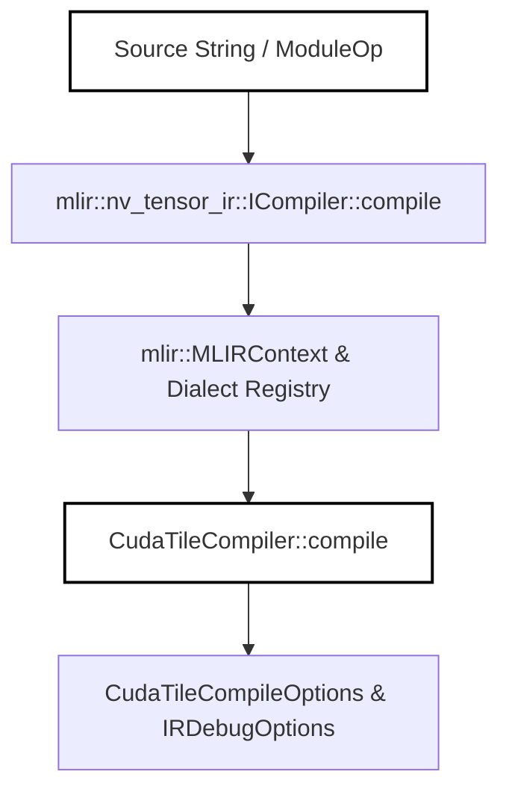
*Diagram 1: Compiler Frontend Entry and Context Initialization*
Sources: `lib/Compiler/Compiler.cpp:80-97`, `lib/Compiler/CudaTile/CudaTileCompiler.cpp:160-182`

---

## 2. Transform and Analysis Pipeline

Before lowering to the `cuda_tile` dialect, the high-level `nv_tensor_ir` operations undergo a sequence of canonicalization, layout propagation annotation, tile analysis, and graph splitting passes. 

1. **Layout Propagation Annotation & Normalization**: Derives carrier shapes and resolves multi-output graph structures.
2. **Tile Analysis and Selection**: Enumerates tile candidates and validates tile size attributes against hardware limits.
3. **Graph Splitting**: Discovers iteration space identifiers and breaks large tensor graphs into manageable block-level structures.

Sources: `lib/Compiler/CudaTile/CudaTileCompiler.cpp:170-182`

---

## 3. TensorToCudaTile Conversion Layer

The core lowering logic resides in `TensorToCudaTileConversionPass`, defined in `lib/Conversion/TensorToCudaTile/TensorToCudaTile.cpp`. 

### Type Conversion
The pass initializes a `TensorToCudaTileTypeConverter` which maps `nv_tensor_ir::TensorType`, scalar floats, and signed/unsigned integers into signless `cuda_tile::TileType` 0-D or multi-dimensional representations [lib/Conversion/TensorToCudaTile/TensorToCudaTile.cpp:29-57]().

### Conversion Strategies
Depending on pass options, the compiler selects between two distinct lowering strategies via `ConversionState`:
* **Layout Propagation Strategy**: Utilizes optimization hints, carrier shapes, and explicit iteration space discovery (`createLayoutPropagationConversionState`).
* **Affine Map Strategy**: Uses traditional affine map indexing (`createAffineMapConversionState`).

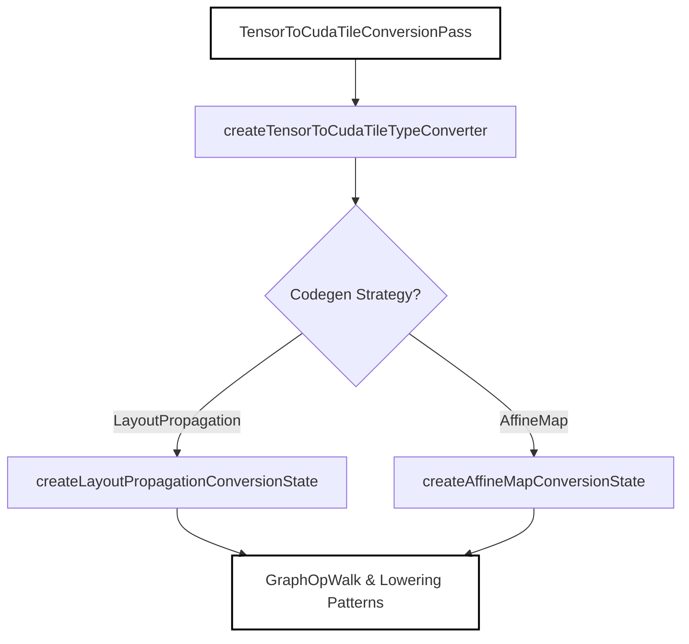
*Diagram 2: Conversion State Initialization and Strategy Dispatch*
Sources: `lib/Conversion/TensorToCudaTile/TensorToCudaTile.cpp:66-134`

---

## 4. Bytecode and Cubin Emission

After the `cuda_tile` dialect constructs are fully generated, the pipeline serializes the module into TileIR bytecode using `BytecodeWriter` routines. 

The generated bytecode or assembly (`TileIRAssembly`) is then compiled down to a GPU-executable `cubin` binary matching the target `SmTarget` compute capability [lib/Compiler/CudaTile/CudaTileCompiler.cpp:160-182]().

Sources: `lib/Compiler/CudaTile/CudaTileCompiler.cpp:160-182`

---

## 5. Runtime Kernel Instantiation

Once emission completes, the compiler wraps the resulting binary and metadata inside a `CudaTileRuntimeKernel` instance adhering to the `IRuntimeKernel` interface. 

Kernel argument layouts (`KernelArgLayout`) and argument packers prepare host-side tensors for uniform signature dispatch, managing streams, workspaces, and grid configurations during execution [lib/Compiler/CudaTile/CudaTileCompiler.cpp:159-182]().

Sources: `lib/Compiler/CudaTile/CudaTileCompiler.cpp:159-182`

---

# Page: Command Line Tools

# Command Line Tools

<details>
<summary>Relevant source files</summary>

The following files were used as context for generating this wiki page:

- [tools/tensor_ir-compiler/tensor_ir-compiler.cpp](tools/tensor_ir-compiler/tensor_ir-compiler.cpp)
- [tools/tensor_ir-compiler/test_options.h](tools/tensor_ir-compiler/test_options.h)
- [tools/tensor_ir-opt/CMakeLists.txt](tools/tensor_ir-opt/CMakeLists.txt)
- [tools/tensor_ir-opt/tensor_ir-opt.cpp](tools/tensor_ir-opt/tensor_ir-opt.cpp)

</details>


## Purpose and Scope
This page details the implementation, configuration, and execution flows of the TensorIR command-line tools: `tensor_ir-compiler` and `tensor_ir-opt`. These utilities provide end-to-end compilation, JIT execution, numerical verification, and fine-grained MLIR pass debugging. The core option schemas, parsing logic, and pass pipelines exposed through these binaries are analyzed below.

---

## 1. `tensor_ir-compiler` Options and Architecture (`test_options.h`)

The `tensor_ir-compiler` utility relies on `test_options.h` to declare its command-line interface via LLVM's `llvm::cl` option parsing library. Options are structured into three distinct categories: `GeneralCat`, `CompileCat`, and `TestCat` [tools/tensor_ir-compiler/test_options.h:38-44]().

### Option Categories and Flags
* **General Options (`GeneralCat`)**: Controls verbosity and file output. Key flags include `verbose` and `dump-artifact`, which serializes compiled device code and a corresponding `.meta` descriptor file [tools/tensor_ir-compiler/test_options.h:49-58]().
* **Compilation Options (`CompileCat`)**: Configures lowering targets and diagnostics. Key flags include:
  * `target-sm`: Specifies the target SM version (default: `sm_100f`) [tools/tensor_ir-compiler/test_options.h:69-73]().
  * `codegen-strategy`: Selects between `layout-propagation` and `affine-map` lowering paths [tools/tensor_ir-compiler/test_options.h:75-79]().
  * `bytecode-version`: Targets TileIR bytecode versions (`default`, `current`, `compatibility`) [tools/tensor_ir-compiler/test_options.h:81-92]().
  * `artifact-kind`: Requests either `tileir` bytecode or an eagerly assembled `cubin` [tools/tensor_ir-compiler/test_options.h:94-103]().
  * Diagnostic and timing flags: `timing`, `print-ir-after-all`, and `print-ir-tree-dir` [tools/tensor_ir-compiler/test_options.h:106-128]().
* **Test Options (`TestCat`)**: Controls execution and verification:
  * `launch` and `verify`: Triggers GPU execution and numerical reference checks [tools/tensor_ir-compiler/test_options.h:134-140]().
  * `seed`, `iterations`, and `tolerance`: Configures test data generation and comparison bounds [tools/tensor_ir-compiler/test_options.h:142-153]().
  * `dynamic-dims`: Passes runtime integer values for dynamic `?` shape dimensions [tools/tensor_ir-compiler/test_options.h:154-158]().

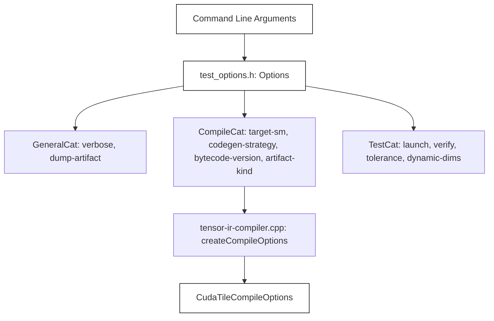
*Sources: [tools/tensor_ir-compiler/test_options.h:31-158](), [tools/tensor_ir-compiler/tensor_ir-compiler.cpp:101-123]()*

---

## 2. Compiler Pipeline and Verification Execution (`tensor_ir-compiler.cpp`)

The core execution driver in `tensor_ir-compiler.cpp` loads input MLIR modules, configures compilation passes, compiles to runtime kernels, and optionally executes or verifies them against a reference interpreter.

### Compilation and Artifact Emission Flow
1. **Module Parsing**: `parseModule()` loads the input file, registers TensorIR dialects into an `mlir::MLIRContext`, and parses the source string into an `mlir::ModuleOp` [tools/tensor_ir-compiler/tensor_ir-compiler.cpp:75-99]().
2. **Strategy Parsing**: `parseCodegenStrategy()` translates string identifiers (`layout-propagation` / `affine-map`) into `mlir::nv_tensor_ir::CudaTileCodegenStrategy` enums [tools/tensor_ir-compiler/tensor_ir-compiler.cpp:51-64]().
3. **Compile Options Setup**: `createCompileOptions()` builds a `backend::cuda_tile::CudaTileCompileOptions` struct, forwarding target SM parameters, tile sizes, uniformity flags, and debugging environment variable overrides [tools/tensor_ir-compiler/tensor_ir-compiler.cpp:101-123]().
4. **Compilation**: `compileModule()` invokes the `ICompiler::compile` interface to yield an `IRuntimeKernelPtr` [tools/tensor_ir-compiler/tensor_ir-compiler.cpp:125-137]().
5. **Artifact Dumping**: `dumpArtifact()` extracts raw device code from `CudaTileRuntimeKernel` and writes both the binary stream and its accompanying `.meta` descriptor [tools/tensor_ir-compiler/tensor_ir-compiler.cpp:139-173]().

### Dynamic Shapes and Verification Mode
* **Dynamic Dimensions**: The `--dynamic-dims` option accepts comma-separated runtime values that bind to dynamic `?` dimensions during kernel argument layout analysis and host-side buffer allocation.
* **Verification**: When `--verify` is active, the driver executes both the compiled CudaTile runtime kernel and the reference interpreter (`ReferenceGraph`), comparing output tensors within the configured `--tolerance` threshold.

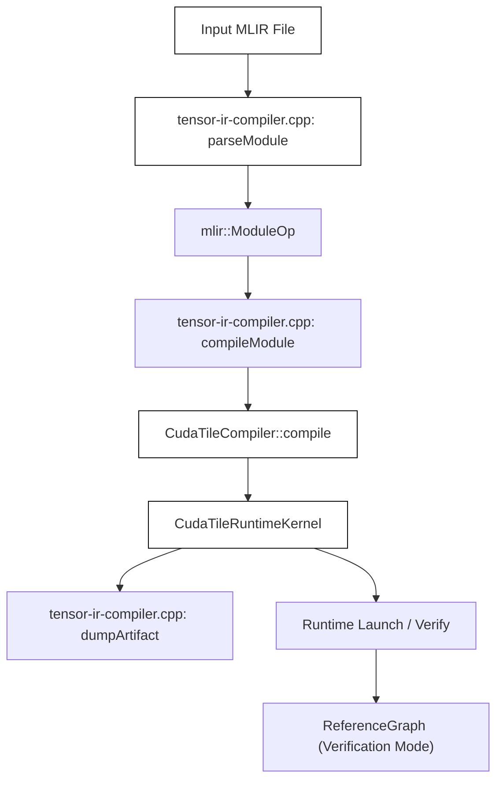
*Sources: [tools/tensor_ir-compiler/tensor_ir-compiler.cpp:51-173]()*

---

## 3. `tensor_ir-opt` Optimizer and Testing Driver (`tensor_ir-opt.cpp`)

`tensor_ir-opt` serves as the MLIR-based test driver for TensorIR, mirroring `mlir-opt` but pre-loaded with TensorIR dialects, transform passes, and custom pass pipelines [tools/tensor_ir-opt/tensor_ir-opt.cpp:133-148]().

### Pipeline Command-Line Options
`tensor_ir-opt` registers `TensorToCudaTilePipelineCLOptions` to expose pipeline parameters via MLIR's `PassOptions` infrastructure [tools/tensor_ir-opt/tensor_ir-opt.cpp:26-51]():
* `tile-size`: List of integers defining iteration space tile dimensions [tools/tensor_ir-opt/tensor_ir-opt.cpp:28-30]().
* `reduction-tile-size`: Tile size assigned to contracting axes [tools/tensor_ir-opt/tensor_ir-opt.cpp:31-34]().
* `persistence`: Kernel persistence mode (`none` or `static`) [tools/tensor_ir-opt/tensor_ir-opt.cpp:35-42]().
* `sm-count` and `occupancy`: Hardware sizing parameters for persistent kernels [tools/tensor_ir-opt/tensor_ir-opt.cpp:43-50]().

### Registered Tool Pipelines
The optimizer registers two primary pass pipelines for testing and debugging [tools/tensor_ir-opt/tensor_ir-opt.cpp:107-131]():
1. `layout-propagation-pipeline`: Executes layout annotation, normalization, tile analysis, tile selection, graph splitting, and final lowering to the `CudaTile` dialect [tools/tensor_ir-opt/tensor_ir-opt.cpp:109-122]().
2. `verify-layout-prop-lowerable`: Runs the complete graph analysis and tile selection phases, followed by `TestVerifyLayoutPropLowerablePass` to validate lowerability without emitting device code [tools/tensor_ir-opt/tensor_ir-opt.cpp:73-128]().

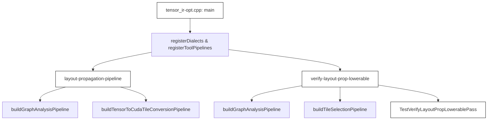
*Sources: [tools/tensor_ir-opt/tensor_ir-opt.cpp:26-148]()*

---

# Page: The nv_tensor_ir Dialect

# The nv_tensor_ir Dialect

<details>
<summary>Relevant source files</summary>

The following files were used as context for generating this wiki page:

- [include/tensor_ir/Dialect/TensorDialect.td](include/tensor_ir/Dialect/TensorDialect.td)
- [lib/Dialect/TensorOps.cpp](lib/Dialect/TensorOps.cpp)

</details>


## Purpose and Scope

The `nv_tensor_ir` dialect is the core MLIR-based intermediate representation for modeling high-level tensor operation graphs, designed after cuDNN graph representations [include/tensor_ir/Dialect/TensorDialect.td:16-19](). It abstracts tensor computations—such as matrix multiplications, reductions, pointwise operations, and structural transformations—into a unified dependency graph. Shape relationships within the dialect are governed by three named policies: *inherited* extents, *equal merge* between operand extents, and *broadcast merge* allowing unit extents to expand [include/tensor_ir/Dialect/TensorDialect.td:21-27]().

This page provides a high-level overview of the dialect's operations, types, attributes, and registration interfaces. For detailed technical specifications, refer to the child pages linked throughout.

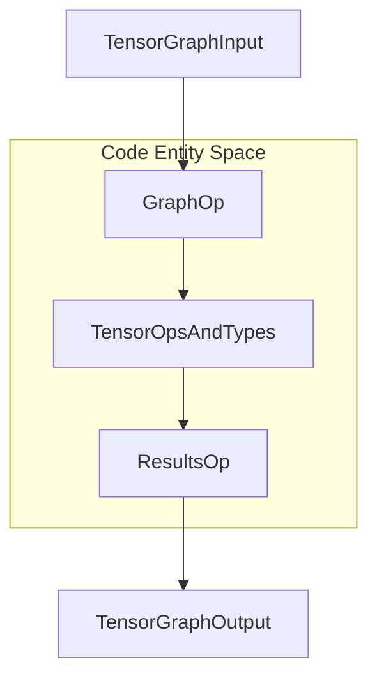
*Figure 1: High-level graph container structure of the nv_tensor_ir dialect mapping input tensors to results via `GraphOp` and `ResultsOp`.*

Sources: `include/tensor_ir/Dialect/TensorDialect.td:9-28`

---

## 2.1 Operations and Types

The `nv_tensor_ir` dialect defines a rich set of operations representing tensor math and structural manipulation. At the root of every graph lies `GraphOp`, which establishes a region containing the computation graph and defines its block arguments [lib/Dialect/TensorOps.cpp:27-32](). The execution terminal is marked by `ResultsOp`, collecting output values. Core compute primitives include `MatmulOp`, `ReduceOp`, `ReduceUDOp`, and various pointwise operations, alongside layout and shape operators like `ConcatenateOp`, `IotaOp`, `ReshapeOp`, `BroadcastOp`, `TransposeOp`, and `SliceOp`.

Operations enforce strict validation logic during construction and verification, including dynamic dimension verification via `DynamicDimsOpInterface` [lib/Dialect/TensorOps.cpp:123-141]() and shape matching for complex operations like matrix multiplication [lib/Dialect/TensorOps.cpp:74-120](). 

For full details on TableGen definitions, verification routines, and individual operator semantics, see [Operations and Types](#2.1).

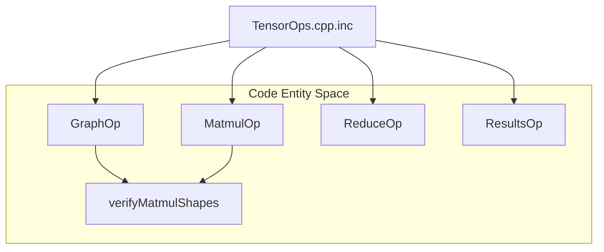
*Figure 2: Operation verification and lowering foundation in `TensorOps.cpp`.*

Sources: `include/tensor_ir/Dialect/TensorDialect.td:9-100`, `lib/Dialect/TensorOps.cpp:27-196`

---

## 2.2 Attributes and Layout Source Interfaces

To support lowering, hardware-specific mapping, and tile-based transformations, the `nv_tensor_ir` dialect introduces specialized attributes and interfaces. Attributes such as `alignment`, `stride`, `cost`, `allow_tma`, `iter_space_map`, `iter_space_id`, `tile_size`, and `tile_candidates` decorate operations and values with metadata essential for optimization passes [include/tensor_ir/Dialect/TensorDialect.td:31-93]().

Layout derivation relies on source attribute classes including `TensorSourceAttr`, `CompositeSourceAttr`, `ConcatSourceAttr`, `ReductionSourceAttr`, and `MatmulSourceAttr`. These attributes implement the `LayoutSourceAttrInterface` to bridge high-level tensor abstractions with CuTe layout views used during lowering.

For complete documentation on attribute structures and layout interfaces, see [Attributes and Layout Source Interfaces](#2.2).

Sources: `include/tensor_ir/Dialect/TensorDialect.td:30-94`

---

## 2.3 Canonicalization and Dialect Registration

To streamline graphs before lowering and optimization, the `nv_tensor_ir` dialect defines canonicalization patterns, constant folding hooks, and simplification routines. These patterns eliminate redundant transformations, fold static shapes, and normalize layout source annotations. 

Dialect registration libraries tie the components together, exposing standard MLIR dialect registration entrypoints so that external passes and compiler tools (such as `tensor_ir-opt`) can load, parse, and verify `nv_tensor_ir` modules.

For implementation specifics on pattern application and registration libraries, see [Canonicalization and Dialect Registration](#2.3).

Sources: `include/tensor_ir/Dialect/TensorDialect.td:9-100`

---

# Page: Operations and Types

# Operations and Types

<details>
<summary>Relevant source files</summary>

The following files were used as context for generating this wiki page:

- [include/tensor_ir/Dialect/TensorDialect.td](include/tensor_ir/Dialect/TensorDialect.td)
- [lib/Dialect/TensorOps.cpp](lib/Dialect/TensorOps.cpp)

</details>


## 1. Purpose and Scope
The **Operations and Types** page covers the core structural and operational building blocks of the `nv_tensor_ir` dialect (`TensorIR_Dialect`). Modeled after high-level cuDNN graph representations, the dialect provides operations for tensor manipulation, matrix multiplication, reductions, pointwise computations, and graph containerization (`GraphOp` and `ResultsOp`). This section details the TableGen definitions, shape merge policies, verification rules, and runtime/compiler interface implementations.

Sources: `include/tensor_ir/Dialect/TensorDialect.td:9-28`

---

## 2. Core Graph Container Operations (`GraphOp` & `ResultsOp`)
The `nv_tensor_ir` dialect encapsulates compute graphs using container operations:
- **`GraphOp`**: Acts as the root boundary for the tensor graph, declaring block arguments as graph inputs (`isGraphInput`) and managing region arguments.
- **`ResultsOp`**: Terminates the graph region, returning computed tensor results and linking output values (`isGraphOutput`).

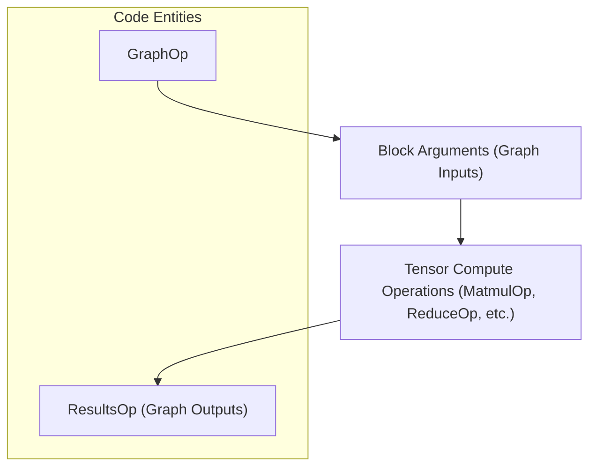
*Figure 1: Graph Container Structure connecting `GraphOp` to `ResultsOp`.*

Sources: `lib/Dialect/TensorOps.cpp:27-38`, `lib/Dialect/TensorOps.cpp:157-196`

---

## 3. Shape Policies and Verification
The dialect defines shape propagation and verification policies for handling static and dynamic tensor extents:
- **Inherited**: Preserves the source extent exactly, maintaining static or dynamic status.
- **Equal Merge (`mergeEqualDimensions`)**: Accepts dynamic extents as unknowns refined by static extents; mismatched static extents fail.
- **Broadcast Merge (`mergeBroadcastDimensions`)**: Allows unit extents (`1`) to broadcast against other dimensions or dynamic symbols.

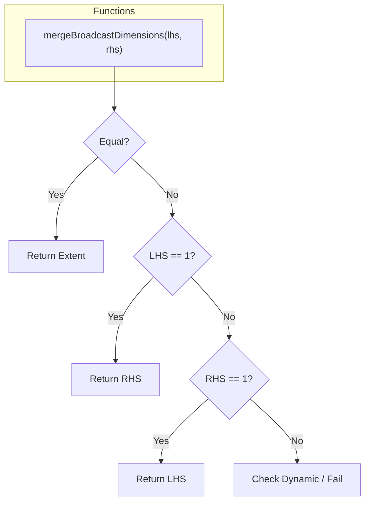
*Figure 2: Broadcast Dimension Merging Data Flow.*

Sources: `include/tensor_ir/Dialect/TensorDialect.td:21-28`, `lib/Dialect/TensorOps.cpp:40-72`

---

## 4. Operation Categories & TableGen Definitions

### MatmulOp Verification
Matrix multiplication is governed by `verifyMatmulShapes`, ensuring ranks are at least 2, batch dimensions satisfy broadcast rules, contracting dimensions match, and matrix dimensions align between operands $A$, $B$, and result $C$.

Sources: `lib/Dialect/TensorOps.cpp:74-120`

### Pointwise, Broadcast, Reshape, Transpose, and Slice
Operations in this category perform elementwise transformations or layout changes. They adhere to shape inference constraints where result extents are derived via inherited or broadcast merge policies.

Sources: `include/tensor_ir/Dialect/TensorDialect.td:21-28`, `lib/Dialect/TensorOps.cpp:40-72`

### ReduceOp and ReduceUDOp
Reductions support built-in reduction operations (`ReduceOp`) as well as user-defined reduction regions (`ReduceUDOp`) via specialized parsing and printing hooks (`parseReductionBody`).

Sources: `lib/Dialect/TensorOps.cpp:147-152`

### ConcatenateOp and IotaOp
- **`ConcatenateOp`**: Joins multiple tensors along a specified axis.
- **`IotaOp`**: Generates a tensor filled with sequential index values along a dimension.

Sources: `lib/Dialect/TensorOps.cpp:151-152`

---

## 5. Dynamic Dimensions and Interfaces
Operations implementing `DynamicDimsOpInterface` are validated via `verifyDynamicDimsOpInterface`. This checks that the number of dynamic size operands matches the total count of dynamic dimensions across all operation results.

Sources: `lib/Dialect/TensorOps.cpp:122-141`

---

# Page: Attributes and Layout Source Interfaces

# Attributes and Layout Source Interfaces

<details>
<summary>Relevant source files</summary>

The following files were used as context for generating this wiki page:

- [include/tensor_ir/Dialect/TensorAttrs.td](include/tensor_ir/Dialect/TensorAttrs.td)
- [lib/Dialect/TensorAttrs.cpp](lib/Dialect/TensorAttrs.cpp)

</details>


## Overview and Scope

This page details the layout attribute system and layout source interfaces within the `nv_tensor_ir` MLIR dialect. TensorIR represents memory layouts, slices, broadcasts, reductions, and matrix multiplications using custom MLIR attributes. These attributes implement `LayoutSourceAttrInterface` and integrate tightly with CuTe layout views (`tcutegen::Layout`), bridging high-level tensor operations to low-level CUDA Tile IR memory structures.

Sources: `include/tensor_ir/Dialect/TensorAttrs.td` [include/tensor_ir/Dialect/TensorAttrs.td:1-69](), `lib/Dialect/TensorAttrs.cpp` [lib/Dialect/TensorAttrs.cpp:1-20]().

---

## 1. Layout Source Attribute Interface

The core abstraction for layout provenance in TensorIR is `LayoutSourceAttrInterface`. Concrete layout attributes conform to this interface to provide layout strings, dimensions, and dynamic shape mappings that guide lowering passes during tile generation.

### Natural Language to Code Entity Space Mapping

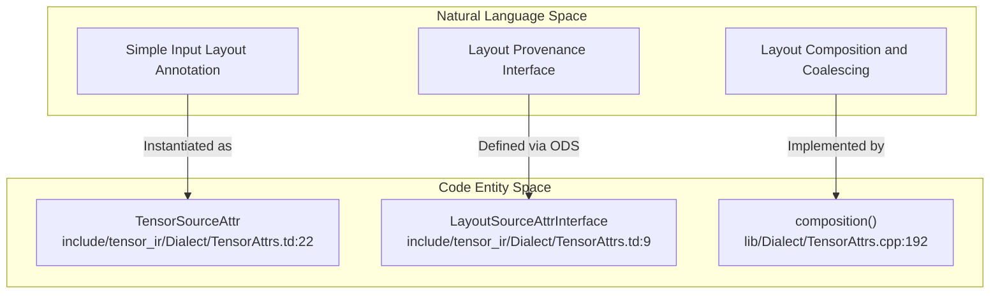
Sources: `include/tensor_ir/Dialect/TensorAttrs.td` [include/tensor_ir/Dialect/TensorAttrs.td:9-23](), `lib/Dialect/TensorAttrs.cpp` [lib/Dialect/TensorAttrs.cpp:192-203]().

---

## 2. Concrete Layout Source Attributes

TensorIR defines several concrete layout source attributes via TableGen. Each attribute models a specific graph operation or tensor memory pattern.

| Attribute Name | Mnemonic | Description / Parameters | Key Methods / Declarations |
| --- | --- | --- | --- |
| `TensorSourceAttr` | `tensor_source` | Represents an input tensor layout (`tensor_id`, `offset`, `layout`, `dynamicValueMapping`) | `getCuteLayout()` [include/tensor_ir/Dialect/TensorAttrs.td:67]() |
| `CompositeSourceAttr` | `composite_source` | Collection of layouts for a tensor (`sources`) | `size()`, `getSource(size_t)` [include/tensor_ir/Dialect/TensorAttrs.td:85-90]() |
| `ConcatSourceAttr` | `concat_source` | Concatenation of multiple layouts (`dimension`, `sources`, `argumentIndex`) | `size()`, `getSource(size_t)` [include/tensor_ir/Dialect/TensorAttrs.td:117-123]() |
| `ReductionSourceAttr` | `reduction_source` | Reduction view on an underlying source (`view`, `source`) | `getCuteLayout()`, `getReductionSize()`, `getReductionShape()` [include/tensor_ir/Dialect/TensorAttrs.td:142-149]() |
| `MatmulSourceAttr` | `matmul_source` | Matrix multiplication layout (`lhs`, `rhs`, `view`) | Defined in `TensorAttrs.td` [include/tensor_ir/Dialect/TensorAttrs.td:152-160]() |

### Attribute Composition and Hierarchy

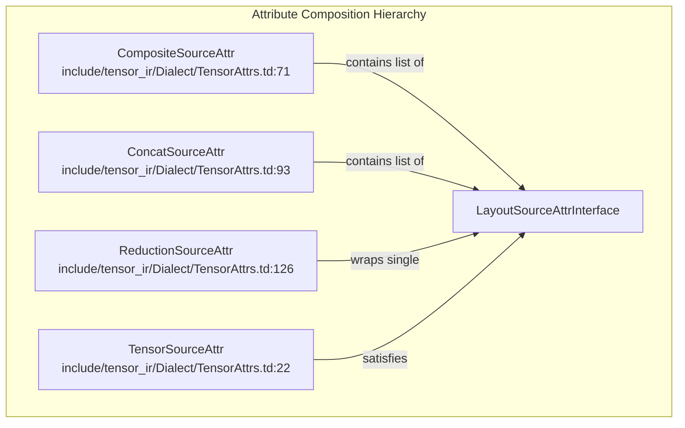
Sources: `include/tensor_ir/Dialect/TensorAttrs.td` [include/tensor_ir/Dialect/TensorAttrs.td:22-160]().

---

## 3. Implementation and Helper Utilities

The companion implementation file `lib/Dialect/TensorAttrs.cpp` provides shape manipulation, dynamic dimension counting, and layout composition utilities used across compilation passes.

### Key Internal Functions

*   `isValidTensorElementType(Type type)`: Validates supported integer (1, 8, 16, 32, 64-bit) and floating-point element types. [lib/Dialect/TensorAttrs.cpp:28-47]()
*   `product(ArrayRef<int64_t> values)`: Computes dimension size products or returns `kDynamic` for non-positive values. [lib/Dialect/TensorAttrs.cpp:51-57]()
*   `countDynamicSizes(const tcg::Layout &layout)`: Counts runtime-backed dynamic values in a CuTe layout, omitting logical broadcast extents (dynamic shapes with static zero stride). [lib/Dialect/TensorAttrs.cpp:62-92]()
*   `getCommonIterationSpace(...)`: Derives an iteration space compatible with multiple input shapes. [lib/Dialect/TensorAttrs.cpp:102-153]()
*   `composition(...)`: Composes a CuTe layout with a target shape in logical order. [lib/Dialect/TensorAttrs.cpp:192-203]()

Sources: `lib/Dialect/TensorAttrs.cpp` [lib/Dialect/TensorAttrs.cpp:28-203]().

---

# Page: Canonicalization and Dialect Registration

# Canonicalization and Dialect Registration

<details>
<summary>Relevant source files</summary>

The following files were used as context for generating this wiki page:

- [include/tensor_ir-c/TensorIR.h](include/tensor_ir-c/TensorIR.h)
- [lib/Dialect/Canonicalization.cpp](lib/Dialect/Canonicalization.cpp)

</details>


## Purpose and Scope
This section details the canonicalization patterns, folding logic, and registration libraries implemented for the `nv_tensor_ir` dialect. It covers how MLIR dialects and pass registration entrypoints are exposed via the C API [include/tensor_ir-c/TensorIR.h:20-29](), and how graph-level optimizations, shape checks, type conversion checks, and slice/permutation compositions are realized in the rewriting infrastructure [lib/Dialect/Canonicalization.cpp:1-174]().

---

## 1. Dialect and C-API Registration

The TensorIR framework exposes C API hooks to register its dialects and passes into MLIR execution contexts and registries [include/tensor_ir-c/TensorIR.h:20-29](). 

The core registration entrypoints include:
- `MLIR_DECLARE_CAPI_DIALECT_REGISTRATION`: Declares the registration symbol for the `nv_tensor_ir` dialect [include/tensor_ir-c/TensorIR.h:23-24]().
- `mlirTensorIRRegisterAllDialects`: Populates an `MlirDialectRegistry` instance with all requisite dialects used by TensorIR [include/tensor_ir-c/TensorIR.h:26-28]().

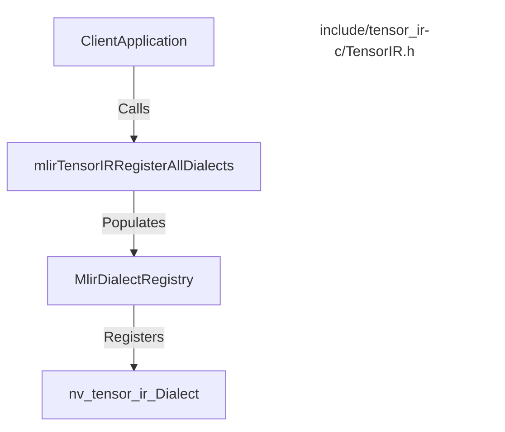
*Diagram 1: Dialect Registration Flow in Code Entity Space*

Sources: `include/tensor_ir-c/TensorIR.h`

---

## 2. Canonicalization Infrastructure and Helper Functions

Canonicalization patterns simplify operations, eliminate redundant casts, and compose nested operations (such as slices and permutations) prior to lowering [lib/Dialect/Canonicalization.cpp:1-174](). 

### Static Shape and Layout Queries
The file `lib/Dialect/Canonicalization.cpp` defines static utility functions to inspect values and operations before applying rewrites:
- `hasStaticShape(Value value)`: Checks whether a given `Value` is a `RankedTensorType` with completely static dimensions [lib/Dialect/Canonicalization.cpp:15-18]().
- `hasLayoutAnnotation(Operation *op)`: Verifies if an operation possesses the TensorIR layout attribute name via `TensorIRDialect::getLayoutAttrName()` [lib/Dialect/Canonicalization.cpp:20-22]().

### Lossless Conversion Checks
Type promotion and downcasting optimizations rely on lossless conversion verifications for integers and floats:
- `isUnsignedIntegerType`: Identifies 1-bit widths or explicitly unsigned integer types [lib/Dialect/Canonicalization.cpp:24-26]().
- `isLosslessIntegerConvert`: Validates bit width constraints between source and target integer types [lib/Dialect/Canonicalization.cpp:28-40]().
- `isLosslessIntegerToFloatConvert`: Inspects `llvm::fltSemantics` precision and max exponents to ensure no precision loss [lib/Dialect/Canonicalization.cpp:43-51]().
- `isLosslessFloatConvert`: Compares precision, max exponent, and min exponent across floating-point semantics [lib/Dialect/Canonicalization.cpp:53-62]().
- `isLosslessConvert`: Combines the above logic to determine if a tensor element-type conversion can be safely removed [lib/Dialect/Canonicalization.cpp:64-86]().

Sources: `lib/Dialect/Canonicalization.cpp`

---

## 3. Slice and Permutation Composition

TensorIR canonicalization optimizes nested data movement operators like transposes and slices.

### Permutation Composition
`composePermutations` combines two adjacent transpose or permutation attributes (`innerPermutation` and `outerPermutation`) into a single unified `DenseI64ArrayAttr` to reduce traversal overhead [lib/Dialect/Canonicalization.cpp:93-103]().

### Slice Composition
Sequential slice operations are analyzed to determine if they can be collapsed into a single `SliceOp`:
- `computeComposedSliceDimension`: Computes the combined start, limit, and stride for a single dimension given nested slice parameters, guarding against arithmetic overflow using `llvm::MulOverflow` and `llvm::AddOverflow` [lib/Dialect/Canonicalization.cpp:105-138]().
- `canComposeSlices`: Iterates through all rank dimensions of a nested `SliceOp` chain to guarantee that the composition is valid across every axis [lib/Dialect/Canonicalization.cpp:140-172]().

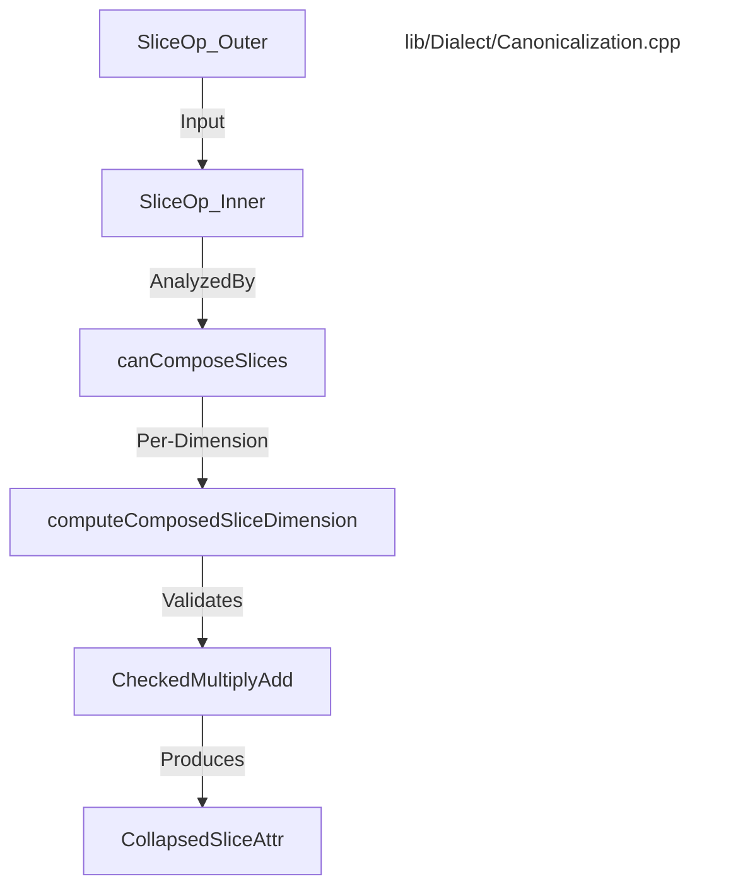
*Diagram 2: Slice Composition Logic in Code Entity Space*

Sources: `lib/Dialect/Canonicalization.cpp`

---

## 4. Folding and Constant Attributes

Constant and splat construction helpers assist in folding operations during pattern matching:
- `buildSplatElementsAttr`: Constructs a `DenseElementsAttr` splat tensor of the output type using a provided scalar `Attribute` value [lib/Dialect/Canonicalization.cpp:88-91]().

Sources: `lib/Dialect/Canonicalization.cpp`

---

# Page: Transform Passes

# Transform Passes

<details>
<summary>Relevant source files</summary>

The following files were used as context for generating this wiki page:

- [lib/Transform/LayoutAnnotation.cpp](lib/Transform/LayoutAnnotation.cpp)
- [lib/Transform/TileSelectionPass.cpp](lib/Transform/TileSelectionPass.cpp)

</details>


## Purpose and Scope

The transform pass pipeline in TensorIR is responsible for preparing high-level tensor dataflow graphs (`GraphOp`) for downstream lowering into CUDA Tile IR GPU kernels. Operating within the MLIR framework, these passes perform key structural analyses, layout annotations, tile candidate evaluations, iteration space discoveries, and graph transformations. 

The pipeline bridges the gap between abstract tensor operations and the hardware-aware execution requirements of Tensor Core architecture by establishing explicit carrier shapes, validating block and tile configurations, and normalizing multi-output or reduction patterns.

Sources: [lib/Transform/LayoutAnnotation.cpp:1-31](), [lib/Transform/TileSelectionPass.cpp:1-51]()

---

## Pass Pipeline Architecture

The transform passes execute sequentially on the `GraphOp` construct, progressively enriching the graph with layout data, tile hints, and iteration space metadata required by the conversion layer.

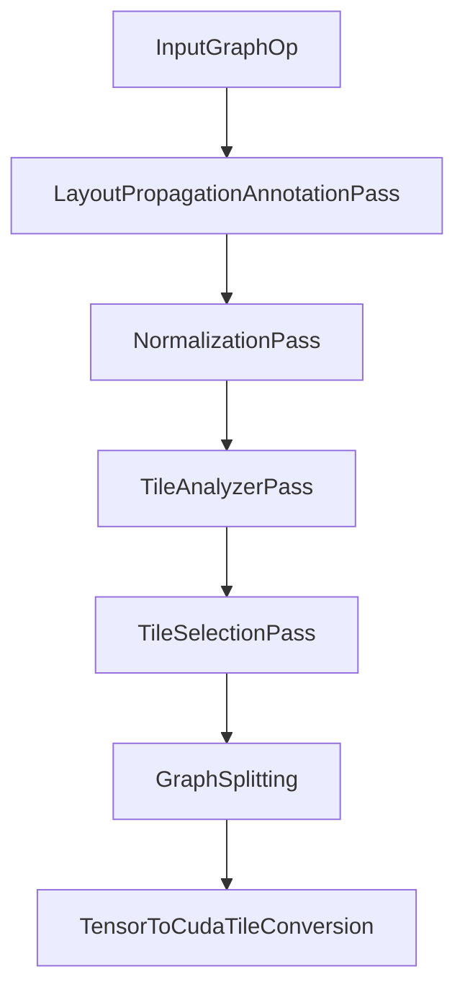
*Figure 1: Transform pass pipeline progression from raw graph input to lowering-ready operations.*

Sources: [lib/Transform/LayoutAnnotation.cpp:25-31](), [lib/Transform/TileSelectionPass.cpp:8-11]()

---

## 3.1 Layout Propagation Annotation and Normalization

The layout annotation and normalization passes assign physical layouts and carrier shapes to tensor values within the graph. `LayoutPropagationAnnotationPass` derives carrier shapes, traces backward SSA ancestries, and handles rank expansions or dimension lifts (`liftLayoutToCarrier`). Following annotation, the normalization phase handles multi-output results, resolves physical output layouts via `buildPhysicalResultSource`, and applies necessary reduction fixups.

For details, see [Layout Propagation Annotation and Normalization](#3.1).

Sources: [lib/Transform/LayoutAnnotation.cpp:32-191]()

---

## 3.2 Tile Analysis and Tile Selection

Tile analysis and selection determine the optimal compute tile shape for execution. The `TileAnalyzerPass` evaluates iteration spaces and generates ranked tile candidates. Subsequently, `TileSelectionPass` resolves tile hints across multiple priority tiers: explicit pass options, `tile_size` attributes on `GraphOp`, or the best-scored entry from `tile_candidates`. It then validates the chosen tile against the graph's iteration space metadata.

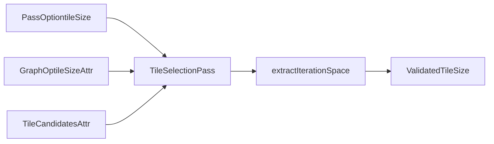
*Figure 2: Tile resolution hierarchy and validation sequence inside `TileSelectionPass`.*

For details, see [Tile Analysis and Tile Selection](#3.2).

Sources: [lib/Transform/TileSelectionPass.cpp:74-160]()

---

## 3.3 Graph Splitting and Iteration Space Discovery

Complex or multi-iteration-space graphs require structural decomposition before lowering. The `GraphSplitting` pass and `DiscoverIterationSpaceInfo` utility analyze multi-dimensional iteration spaces, assign unique iteration space identifiers (`iterSpaceId`), and partition graphs to ensure that loops and memory accesses map cleanly onto target hardware execution models.

For details, see [Graph Splitting and Iteration Space Discovery](#3.3).

Sources: [lib/Transform/LayoutAnnotation.cpp:25-31](), [lib/Transform/TileSelectionPass.cpp:78-92]()

---

# Page: Layout Propagation Annotation and Normalization

# Layout Propagation Annotation and Normalization

<details>
<summary>Relevant source files</summary>

The following files were used as context for generating this wiki page:

- [lib/Transform/LayoutAnnotation.cpp](lib/Transform/LayoutAnnotation.cpp)
- [test/Transform/layout-propagation-annotation.mlir](test/Transform/layout-propagation-annotation.mlir)
- [test/Transform/layout-propagation-normalize.mlir](test/Transform/layout-propagation-normalize.mlir)

</details>


## Purpose and Scope

This section covers the layout propagation and normalization transform passes within the TensorIR compiler pipeline: `LayoutPropagationAnnotationPass` and `LayoutPropagationNormalizationPass`. These passes operate on the `nv_tensor_ir` dialect to attach explicit physical layout metadata (`TensorSourceAttr`, `CompositeSourceAttr`) to tensor operations, derive carrier shapes for complex data flow, handle multi-output graph results, and perform normalization and reduction layout fixups prior to lowering.

Sources: [lib/Transform/LayoutAnnotation.cpp:25-90]()

---

## 1. Pass Architecture and Core Passes

The layout annotation pipeline transforms high-level tensor operations by propagating physical memory layouts, strides, and offsets backward and forward through the Data Flow Graph (DFG). 

The two primary passes implemented in the transformation framework are:
1. **`LayoutPropagationAnnotationPass`**: Traverses operations (`ReshapeOp`, `BroadcastOp`, `TransposeOp`, pointwise ops) and propagates layout attributes (`LayoutSourceAttrInterface`) through SSA value chains [lib/Transform/LayoutAnnotation.cpp:39-154]().
2. **`LayoutPropagationNormalizationPass`**: Consolidates and normalizes layout representations (such as joining contiguous dimensions, handling zero-stride broadcast axes, and simplifying `CompositeSourceAttr` structures) [test/Transform/layout-propagation-normalize.mlir:5-132]().

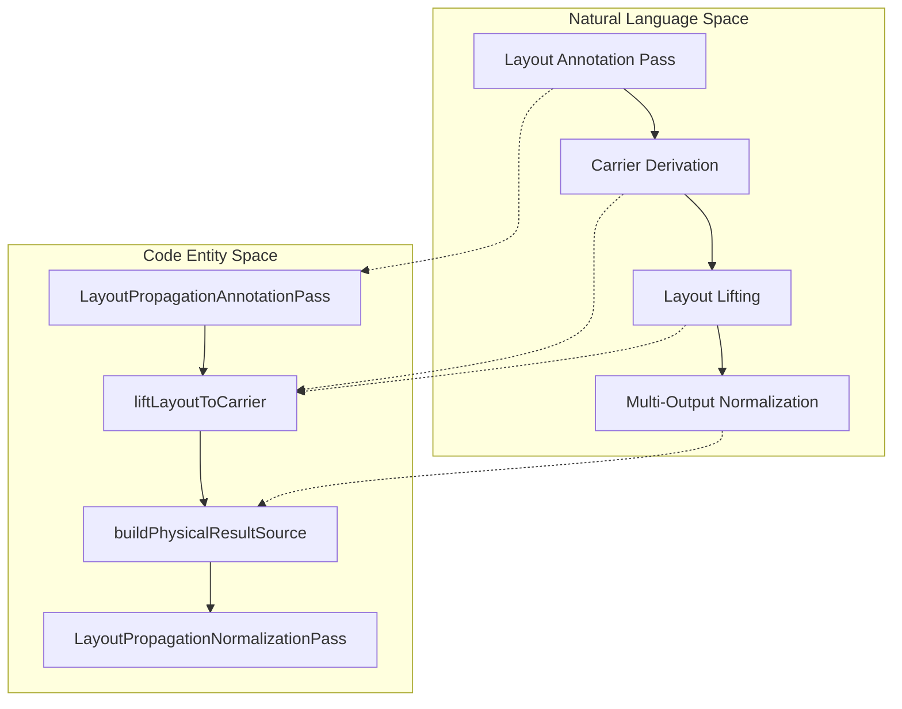
*Diagram 1: Bridging layout propagation concepts to code entities.*

Sources: [lib/Transform/LayoutAnnotation.cpp:25-90](), [test/Transform/layout-propagation-normalize.mlir:1-132]()

---

## 2. Carrier Derivation and Layout Lifting

TensorIR operations frequently encounter situations where intermediate tensors have shapes that do not directly align with downstream consumer or upstream producer carrier registers. The process of **layout lifting** adjusts layouts to fit a target **carrier shape**.

### Layout Lifting (`liftLayoutToCarrier`)

The function `liftLayoutToCarrier` attempts to express a given layout within a target `carrierShape`. Beyond standard reshaping and broadcasting, it supports **rank expansion** by inserting unit dimensions before broadcasting them:

```cpp
static FailureOr<LayoutSourceAttrInterface>
liftLayoutToCarrier(LayoutSourceAttrInterface layout,
                    ArrayRef<int64_t> carrierShape);
```
- If the layout's shape already matches `carrierShape`, it returns the layout unchanged [lib/Transform/LayoutAnnotation.cpp:95-97]().
- If a direct `broadcast` or `reshape` succeeds, those layout views are returned [lib/Transform/LayoutAnnotation.cpp:98-103]().
- For rank expansion, it enumerates compatible dimension alignments, verifying that unmatched dimensions are strictly of size `1` or dynamic [lib/Transform/LayoutAnnotation.cpp:110-154]().

### Carrier Anchors and SSA Ancestry

To determine valid carriers, the pass traverses the backward SSA ancestry of terminal values using `collectAncestors` and identifies structural reference points via `isCarrierAnchor`:
- Operations like `ConstantOp` and `SplatOp` are excluded as anchor points because they do not dictate physical memory layouts [lib/Transform/LayoutAnnotation.cpp:160-180]().
- Tensor operands with ranks greater than zero serve as carrier anchors for layout propagation [lib/Transform/LayoutAnnotation.cpp:171-180]().

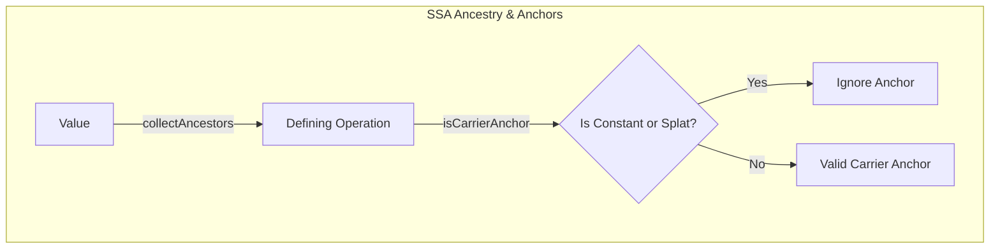
*Diagram 2: Carrier anchor evaluation flow.*

Sources: [lib/Transform/LayoutAnnotation.cpp:93-191]()

---

## 3. Multi-Output Normalization and Results

For operations and graphs producing multiple output tensors, physical output layouts must be constructed and registered so that the codegen backend can map return values to kernel arguments or workspace memory.

### Physical Result Source Construction (`buildPhysicalResultSource`)

The helper function `buildPhysicalResultSource` builds the physical output layout for a specific `resultIndex` on a `GraphOp`:
- Output tensor IDs are assigned sequentially following graph inputs in the converted kernel signature [lib/Transform/LayoutAnnotation.cpp:51-85]().
- Stride attributes are extracted from result dictionaries if present (via `TensorIRDialect::getStrideAttrName()`) [lib/Transform/LayoutAnnotation.cpp:64-75]().
- A `TensorSourceAttr` is instantiated combining the tensor ID, zero offset, physical layout string representation, and dynamic value mapping [lib/Transform/LayoutAnnotation.cpp:80-85]().

```cpp
static FailureOr<TensorSourceAttr>
buildPhysicalResultSource(GraphOp graphOp, size_t resultIndex);
```

Sources: [lib/Transform/LayoutAnnotation.cpp:51-85]()

---

## 4. Normalization and Reduction Fixups

The normalization pass processes layout sources attached to graph results and intermediate operations to ensure canonical forms:
- **Unit Dimensions with Zero Stride**: Normalizes unit-extent dimensions to explicit zero strides (e.g., `(1) -> (1):(0)`) [test/Transform/layout-propagation-normalize.mlir:9-15]().
- **Contiguous Dimension Joining**: Coalesces adjacent contiguous dimensions to simplify index calculations (e.g., `(2, 4) -> (8):(1)`) [test/Transform/layout-propagation-normalize.mlir:19-35]().
- **Composite Source Normalization**: Aligns multiple input sources in `CompositeSourceAttr` (such as those entering binary operations like `add`) so their layouts share compatible shapes and strides [test/Transform/layout-propagation-normalize.mlir:83-128]().

```mermaid
graph TD
    subgraph "Normalization Pipeline"
        NS["TensorSourceAttr / CompositeSourceAttr"] --> Unit["Normalize Unit Dims (stride=0)"]
        Unit --> Contig["Join Contiguous Dims"]
        Contig --> Comp["Normalize Composite Sources"]
        Comp --> Out["Canonical Layout Attribute"]
    end
```
*Diagram 3: Normalization pipeline transformations.*

Sources: [test/Transform/layout-propagation-normalize.mlir:1-132]()

---

# Page: Tile Analysis and Tile Selection

# Tile Analysis and Tile Selection

<details>
<summary>Relevant source files</summary>

The following files were used as context for generating this wiki page:

- [lib/Transform/TileAnalyzerPass.cpp](lib/Transform/TileAnalyzerPass.cpp)
- [lib/Transform/TileSelectionPass.cpp](lib/Transform/TileSelectionPass.cpp)
- [test/Transform/multi-output-tile-selection.mlir](test/Transform/multi-output-tile-selection.mlir)
- [test/Transform/tile-selection-metadata-invalid.mlir](test/Transform/tile-selection-metadata-invalid.mlir)

</details>


## Purpose and Scope
This section covers the mechanics of `TileAnalyzerPass` and `TileSelectionPass` within the TensorIR transformation pipeline. These passes analyze tensor iteration spaces, evaluate and enumerate valid tile candidates using backend heuristics, resolve explicit or heuristic tile choices, and validate tile dimensions against layout attributes before handing off execution state to backend lowering passes.

```
LayoutPropagationAnnotationPass
       │
       ▼
LayoutPropagationNormalizationPass
       │
       ▼
   TileAnalyzerPass  ──► (Generates "tile_candidates" & fallback tiles)
       │
       ▼
  TileSelectionPass  ──► (Resolves and validates final "tile_size")
       │
       ▼
TensorToCudaTileConversionPass
```

Sources: `lib/Transform/TileAnalyzerPass.cpp:1-11()`, `lib/Transform/TileSelectionPass.cpp:8-11()`

---

## Tile Analysis Pipeline and TileAnalyzerPass

`TileAnalyzerPass` runs after layout normalization to inspect the graph's iteration space and produce ranked tile size candidates. It extracts shape and stride configurations from layout source attributes and interfaces with the underlying cutegen tile candidate generator (`mlir::nv_tensor_ir::tcutegen`).

### Iteration Space Extraction and Source Collection
The analyzer inspects the graph terminator (the results operation) for an `iteration_space` attribute (`lib/Transform/TileAnalyzerPass.cpp:170-171()`). It recursively walks the layout source tree using `collectSourceInfo` to identify leaf `TensorSourceAttr` instances and fixed-tile dimensions (such as reduction or concatenation axes requiring specific alignment like dimension `1`) (`lib/Transform/TileAnalyzerPass.cpp:144-157()`):

* `TensorSourceAttr`: Represents a concrete tensor input/output layout mapped to the iteration space.
* `ConcatSourceAttr`: Forces fixed tiling constraints (e.g., setting concatenated dimensions to a fixed stride/tile size of `1`) (`lib/Transform/TileAnalyzerPass.cpp:147-151()`).
* `CompositeSourceAttr`: Groups multiple layout sources together (`lib/Transform/TileAnalyzerPass.cpp:152-156()`).

Element sizes in bytes are determined via `getElementSizeBytesForSource`, inspecting the `GraphOp` argument or result types (`lib/Transform/TileAnalyzerPass.cpp:82-111()`). Layout shapes and strides are extracted using `extractShapeAndStridesFromLayout` (`lib/Transform/TileAnalyzerPass.cpp:115-138()`).

### Fallback Tile Generation
When the candidate generator cannot produce valid candidates due to awkward shapes, dynamic dimensions, or small iteration spaces, `TileAnalyzerPass` invokes a conservative fallback routine `generateFallbackTile` (`lib/Transform/TileAnalyzerPass.cpp:45-65()`):
* **Dynamic Dimensions (`<= 0`)**: Assigned `kDefaultDynamicTileSize` (`128`) (`lib/Transform/TileAnalyzerPass.cpp:38`, `51-52()` ).
* **Static Dimensions**: Clamped using `llvm::bit_floor` and bounded by `kMaxFallbackTileSize` (`128`) (`lib/Transform/TileAnalyzerPass.cpp:39`, `56-59()`).
* **Fixed Dimensions**: Overridden by entries in `fixedTileDims` (`lib/Transform/TileAnalyzerPass.cpp:61-63()`).

```mermaid
graph TD
    A["GraphOp"] --> B["extractIterationSpace"]
    B --> C["collectSourceInfo"]
    C --> D{"Valid Candidate Found?"}
    D -- Yes --> E["Store tile_candidates ArrayAttr"]
    D -- No --> F["generateFallbackTile"]
    F --> E
```
Sources: `lib/Transform/TileAnalyzerPass.cpp:35-171()`

---

## Tile Selection Priority and TileSelectionPass

`TileSelectionPass` consumes tile hints from multiple sources, establishes a single validated `tile_size` attribute on the `GraphOp`, and cleans up temporary analysis attributes (`lib/Transform/TileSelectionPass.cpp:5-44()`).

### Resolution Priority Order
The pass checks three potential sources for tile shapes in strict priority order (`lib/Transform/TileSelectionPass.cpp:108-152()`):
1. **Pass Option (`tile_size`)**: Explicitly passed via compilation or command-line flags, overriding all graph-level settings (`lib/Transform/TileSelectionPass.cpp:111-117()`).
2. **`tile_size` Attribute**: An existing `DenseI32ArrayAttr` directly attached to the `GraphOp` (`lib/Transform/TileSelectionPass.cpp:119-126()`).
3. **`tile_candidates` Attribute**: Generated by `TileAnalyzerPass`, where the pass selects the highest-scoring candidate (`tile_candidates[0]`) (`lib/Transform/TileSelectionPass.cpp:127-144()`).

If none of these sources are available, the pass reports an error and signals pass failure (`lib/Transform/TileSelectionPass.cpp:145-152()`).

```mermaid
graph TD
    Start["TileSelectionPass::runOnOperation"] --> Opt{"tile_size option provided?"}
    Opt -- Yes --> UseOpt["Use tile_size pass option"]
    Opt -- No --> Attr{"GraphOp tile_size attr present?"}
    Attr -- Yes --> UseAttr["Use GraphOp tile_size attribute"]
    Attr -- No --> Cand{"tile_candidates attr present?"}
    Cand -- Yes --> UseCand["Select tile_candidates[0]"]
    Cand -- No --> Fail["Emit Error & Signal Failure"]
    UseOpt --> Validate["Verify against Iteration Space"]
    UseAttr --> Validate
    UseCand --> Validate
```
Sources: `lib/Transform/TileSelectionPass.cpp:108-160()`

---

## Tile Candidates, Attributes, and Metadata Validation

Once a tile shape is resolved, `TileSelectionPass` validates it against the graph's iteration space metadata (`lib/Transform/TileSelectionPass.cpp:154-160()`).

### Validation Rules and Error Boundaries
* **Rank Matching**: The selected tile's rank must match the iteration space rank (`test/Transform/tile-selection-metadata-invalid.mlir:9-18()`). Mismatches emit diagnostics such as `result_views rank X does not match iteration space rank Y`.
* **Dimension Validity**: Individual tile dimensions are checked for power-of-2 compliance and boundary constraints relative to static iteration space extents.
* **Cleanup**: Upon successful selection and validation, temporary attributes like `tile_candidates` are removed from the `GraphOp`, leaving a finalized `tile_size` array attribute for downstream conversion passes (`lib/Transform/TileSelectionPass.cpp:36-43()`).

### Example: Multi-Output RMSNorm Auto-Tiling
In multi-output patterns like RMSNorm, tile analysis projects carrier dimensions to ensure proper CTA (Cooperative Thread Array) ownership over computed statistics (`test/Transform/multi-output-tile-selection.mlir:5-22()`):
```mlir
nv_tensor_ir.graph @rmsnorm_auto_tile(
    %x: tensor<64x16xf32> {nv_tensor_ir.stride = "(16,1)"}
    ) -> (tensor<64x16xf32> {nv_tensor_ir.stride = "(16,1)"},
          tensor<64x1xf32> {nv_tensor_ir.stride = "(1,1)"}) {
  %sq = mul %x, %x : tensor<64x16xf32>
  %sum = reduce(%sq)<dimensions = [1], reduction_mode = <add>>
      : tensor<64x16xf32> -> tensor<64x1xf32>
  %wide = broadcast %sum : tensor<64x1xf32> -> tensor<64x16xf32>
  %y = mul %x, %wide : tensor<64x16xf32>
  results %y, %sum : tensor<64x16xf32>, tensor<64x1xf32>
}
```
The resulting `tile_size` attribute is injected directly into the graph attributes (e.g., `attributes {tile_size = array<i32: 2, 16>}`) prior to lowering (`test/Transform/multi-output-tile-selection.mlir:8()`).

Sources: `lib/Transform/TileSelectionPass.cpp:30-50()`, `test/Transform/multi-output-tile-selection.mlir:1-40()`, `test/Transform/tile-selection-metadata-invalid.mlir:1-18()`

---

# Page: Graph Splitting and Iteration Space Discovery

# Graph Splitting and Iteration Space Discovery

<details>
<summary>Relevant source files</summary>

The following files were used as context for generating this wiki page:

- [lib/Transform/DiscoverIterationSpaceInfo.cpp](lib/Transform/DiscoverIterationSpaceInfo.cpp)
- [lib/Transform/GraphSplitting.cpp](lib/Transform/GraphSplitting.cpp)
- [test/Transform/discover-iteration-space-info-multi-iter-space.mlir](test/Transform/discover-iteration-space-info-multi-iter-space.mlir)

</details>


## Purpose and Scope
This page covers section 3.3 of the TensorIR compiler wiki, detailing the `GraphSplitting` pass and the `DiscoverIterationSpaceInfo` pass (`DiscoverIterationSpaceInfoPass` and `RemoveIterationSpaceMapsPass`). These transform passes prepare graphs for lowering by converting reconvergent directed acyclic graphs (DAGs) into trees via layout-aware cloning, and by analyzing iteration space topologies, dimensions, and transition boundaries.

Sources: `lib/Transform/GraphSplitting.cpp:21-28` [], `lib/Transform/DiscoverIterationSpaceInfo.cpp:4-9` []

---

## 1. Graph Splitting Pass (`GraphSplittingPass`)

### Algorithmic Overview
The `GraphSplitting` pass converts reconvergent DAGs into trees [lib/Transform/GraphSplitting.cpp:24-27](). When an SSA value is consumed by multiple paths that require conflicting layouts (distinct strides or offsets), the pass clones the defining operation of that value—producing one copy per unique layout [lib/Transform/GraphSplitting.cpp:24-27]().

### Key Data Structures and Functions
- **`CacheKey`**: A caching structure containing the defining `Operation *`, an `iterSpaceId` integer, and a layout `Attribute` [lib/Transform/GraphSplitting.cpp:36-45](). It is specialized in `llvm::DenseMapInfo` to memoize cloned values [lib/Transform/GraphSplitting.cpp:50-66]().
- **`GraphSplittingPass`**: Inherits from `impl::GraphSplittingPassBase<GraphSplittingPass>` [lib/Transform/GraphSplitting.cpp:71-72](). Its `runOnOperation()` driver extracts the terminator `ResultsOp`, instantiates an `OpBuilder`, and allocates a cache and an `iterSpaceCounter` [lib/Transform/GraphSplitting.cpp:74-85]().
- **`materialize` Lambda**: A recursive helper inside `runOnOperation()` that checks if a `Value` is a block argument or looks up/inserts into the `cache` using the `CacheKey` [lib/Transform/GraphSplitting.cpp:88-120](). It handles operand layout inference for pointwise operations and layout modifications [lib/Transform/GraphSplitting.cpp:122-177]().

```mermaid
graph TD
    A["GraphSplittingPass::runOnOperation"] --> B["CacheKey"]
    B --> C["materialize"]
    C --> D["PointwiseOpInterface"]
    C --> E["LayoutSourceAttrInterface"]
    
    sub_code["Code Entities in lib/Transform/GraphSplitting.cpp"]
    style sub_code fill:none,stroke:none
```
Sources: `lib/Transform/GraphSplitting.cpp:21-120` []

---

## 2. Iteration Space Discovery (`DiscoverIterationSpaceInfoPass`)

### Algorithmic Overview
The `DiscoverIterationSpaceInfo` pass discovers the global iteration space rank, computes dimension domains, assigns `iterSpaceId` attributes, and identifies multi-iteration-space boundaries (such as transitions caused by reductions followed by broadcasts) [lib/Transform/DiscoverIterationSpaceInfo.cpp:46-84]().

### Key Classes and Functions
- **`IterationSpaceDiscoverer`**: The core analyzer class instantiated with a `GraphOp` [lib/Transform/DiscoverIterationSpaceInfo.cpp:48-50](). It tracks `iterSpaceRank`, `currentIterSpaceId`, and coordinates discovery and propagation phases [lib/Transform/DiscoverIterationSpaceInfo.cpp:66-84]().
- **`discoverIterationSpaceDimensions()`**: Walks the graph, queries operations implementing `IterationSpaceInfoInterface`, and determines the maximum iteration space rank across the graph [lib/Transform/DiscoverIterationSpaceInfo.cpp:86-107]().
- **`expandCanonicalDimStatesToIterSpace()`**: Expands canonical dimension domain states (based on operation output rank) up to the global iteration space rank using an `AffineMap` [lib/Transform/DiscoverIterationSpaceInfo.cpp:110-127]().
- **`propagateIterSpaceIdsAndCanonicalDimDomains()`**: Maps SSA values to iteration space IDs and dimension states, establishing initial graph input states and walking the IR to join operand domains [lib/Transform/DiscoverIterationSpaceInfo.cpp:129-177]().

```mermaid
graph TD
    A["IterationSpaceDiscoverer"] --> B["discoverIterationSpaceDimensions"]
    A --> C["propagateIterSpaceIdsAndCanonicalDimDomains"]
    C --> D["expandCanonicalDimStatesToIterSpace"]
    
    sub_code2["Code Entities in lib/Transform/DiscoverIterationSpaceInfo.cpp"]
    style sub_code2 fill:none,stroke:none
```
Sources: `lib/Transform/DiscoverIterationSpaceInfo.cpp:46-177` []

---

## 3. Multi-Iteration-Space Graphs and Transitions

### Transition Mechanics
When operations expand unit dimensions or change domain states from `Def` to `Undef` and back (for instance, a reduction followed by a non-unit broadcast expansion), the discovery pass increments the `iterSpaceId` to partition the graph into distinct iteration spaces [test/Transform/discover-iteration-space-info-multi-iter-space.mlir:38-71]().

Consider a reduction followed by a broadcast, which creates a new iteration space transition [test/Transform/discover-iteration-space-info-multi-iter-space.mlir:45-71]():

```mlir
// Example structure generated during discovery
%reduced = reduce(%input) <dimensions = [1], reduction_mode = <add>>
    : tensor<16x32x64xf32> -> tensor<16x1x64xf32>

// Triggers an iteration space transition due to domain redefinition
%broadcast = broadcast %reduced : tensor<16x1x64xf32> -> tensor<16x48x64xf32>
```

Sources: `test/Transform/discover-iteration-space-info-multi-iter-space.mlir:38-71` []

---

# Page: TensorToCudaTile Conversion

# TensorToCudaTile Conversion

<details>
<summary>Relevant source files</summary>

The following files were used as context for generating this wiki page:

- [include/tensor_ir/Conversion/TensorToCudaTile/TensorToCudaTile.h](include/tensor_ir/Conversion/TensorToCudaTile/TensorToCudaTile.h)
- [include/tensor_ir/Conversion/TensorToCudaTile/TensorToCudaTileInternal.h](include/tensor_ir/Conversion/TensorToCudaTile/TensorToCudaTileInternal.h)
- [lib/Conversion/TensorToCudaTile/TensorToCudaTile.cpp](lib/Conversion/TensorToCudaTile/TensorToCudaTile.cpp)

</details>


The TensorToCudaTile conversion layer transforms high-level TensorIR graphs (`GraphOp`) into the `cuda_tile` dialect. This subsystem is driven by the `TensorToCudaTileConversionPass` defined in `lib/Conversion/TensorToCudaTile/TensorToCudaTile.cpp:66-162`, which orchestrates type conversion, validation, and lowering strategies. 

The compiler supports two primary codegen strategies: **Layout Propagation** and **Affine Map**. It utilizes a shared `ConversionState` interface (`include/tensor_ir/Conversion/TensorToCudaTile/TensorToCudaTile.h:38-67`) and internal plumbing headers (`include/tensor_ir/Conversion/TensorToCudaTile/TensorToCudaTileInternal.h:1-136`) to manage iteration spaces, tile descriptors, and operation-specific pattern matching.

---

## 4.1 Layout Propagation Strategy

The layout propagation strategy acts as the default and primary lowering path. It relies on layout source attributes, carrier shapes, and multi-output graph analyses to propagate tile dimensions through the computation graph. The core driver implements `ConversionStateImpl`, manages `GraphOpConversion` and `ResultsOpConversion`, constructs tensor descriptors, and handles static persistence along with function signature conversion.

For deep technical details, implementation specifics, and structural layouts, see [Layout Propagation Strategy](#4.1).

Sources:
- `include/tensor_ir/Conversion/TensorToCudaTile/TensorToCudaTile.h:138-142`
- `include/tensor_ir/Conversion/TensorToCudaTile/TensorToCudaTileInternal.h:81-118`
- `lib/Conversion/TensorToCudaTile/TensorToCudaTile.cpp:121-133`

---

## 4.2 Affine Map Strategy

The affine map strategy provides an alternative lowering path implemented via `AffineMapImpl`. It computes tensor coordinate transformations using explicit `AffineMap` expressions rather than relying on global layout propagation attributes. This path includes distinct diagnostic handlers and handles scenarios where layout attributes are absent or irregular.

For details on this alternative lowering path, diagnostics, and structural differences, see [Affine Map Strategy](#4.2).

Sources:
- `include/tensor_ir/Conversion/TensorToCudaTile/TensorToCudaTile.h:127-134`
- `lib/Conversion/TensorToCudaTile/TensorToCudaTile.cpp:131-133`

---

## 4.3 Structure Building and Iteration Spaces

To emit valid loop nests and block structures for reductions, matmuls, and concatenated operations, the conversion layer builds a skeletal representation using helper routines such as `buildSkeleton` and `buildBlockStructure`. This tracks `IterationSpace` instances, handles `BlockStructure` metadata, manages `IfOp` chains for concatenations, and coordinates multidimensional iteration spaces.

```mermaid
graph TD
    sub5["GraphOpConversion"] -->|Calls| sub6["buildSkeleton"]
    sub6 -->|Produces| sub7["BlockStructure"]
    sub7 -->|Contains| sub8["IterationSpace"]
    sub8 -->|Tracks| sub9["LoadedTiles"]

    classDef default stroke:#000,fill:#fff;
```
*Figure 4.1: Iteration space structure building pipeline bridging graph ops to block structures.*

Sources:
- `include/tensor_ir/Conversion/TensorToCudaTile/TensorToCudaTile.h:81-125`
- `include/tensor_ir/Conversion/TensorToCudaTile/TensorToCudaTileInternal.h:119-136`

For full details on skeleton construction and iteration spaces, see [Structure Building and Iteration Spaces](#4.3).

Sources:
- `include/tensor_ir/Conversion/TensorToCudaTile/TensorToCudaTile.h:81-125`
- `include/tensor_ir/Conversion/TensorToCudaTile/TensorToCudaTileInternal.h:119-136`

---

## 4.4 Operation Lowering Patterns

Per-operation lowering is broken into dedicated pattern families (pointwise, reduction, and matmul) supported by validation functions and shared emission helpers. Pre-flight checks guarantee that operations are valid prior to IR modification.

```mermaid
graph TD
    CP["TensorToCudaTileConversionPass"] -->|SelectsStrategy| CS["ConversionState"]
    CS -->|Validates| VPO["validatePointwiseOpLowerable"]
    CS -->|Validates| VRO["validateReductionOpLowerable"]
    CS -->|Validates| VMO["validateMatmulOpLowerable"]
    CS -->|Invokes| RP["registerPointwisePatterns"]
    CS -->|Invokes| RR["registerReductionPatterns"]
    CS -->|Invokes| RM["registerMatmulPatterns"]

    classDef default stroke:#000,fill:#fff;
```
*Figure 4.2: Mapping natural language conversion tasks to code entities and validation functions.*

Sources:
- `include/tensor_ir/Conversion/TensorToCudaTile/TensorToCudaTileInternal.h:24-78`
- `lib/Conversion/TensorToCudaTile/TensorToCudaTile.cpp:66-162`

For details on specific pattern groups, consult the child sections:
- For matrix multiplication lowerings, see [Matmul Lowering](#4.4.1).
- For reduction mode emission and identities, see [Reduction Lowering](#4.4.2).
- For pointwise, broadcast, and multi-output graphs, see [Pointwise, Broadcast and Multi-Output Lowering](#4.4.3).

Sources:
- `include/tensor_ir/Conversion/TensorToCudaTile/TensorToCudaTileInternal.h:24-78`
- `lib/Conversion/TensorToCudaTile/TensorToCudaTile.cpp:66-162`

---

# Page: Layout Propagation Strategy

# Layout Propagation Strategy

<details>
<summary>Relevant source files</summary>

The following files were used as context for generating this wiki page:

- [lib/Conversion/TensorToCudaTile/LayoutPropagationImpl.cpp](lib/Conversion/TensorToCudaTile/LayoutPropagationImpl.cpp)
- [test/Conversion/TensorToCudaTile/static_persistent_layout_prop.mlir](test/Conversion/TensorToCudaTile/static_persistent_layout_prop.mlir)
- [test/Conversion/TensorToCudaTile/static_persistent_layout_prop_dynamic.mlir](test/Conversion/TensorToCudaTile/static_persistent_layout_prop_dynamic.mlir)

</details>


## Purpose and Scope

This page covers the implementation details of the layout propagation lowering strategy in the `TensorToCudaTile` conversion pass. The layout propagation framework converts high-level `nv_tensor_ir` graphs into `cuda_tile` dialect operations by driving code generation using explicit iteration spaces, layout attributes, and tensor descriptors. Key components include `ConversionStateImpl`, `GraphOpConversion`, `ResultsOpConversion`, tensor descriptors, static persistence management, and signature conversions.

Sources:
- `lib/Conversion/TensorToCudaTile/LayoutPropagationImpl.cpp:1-162`
- `test/Conversion/TensorToCudaTile/static_persistent_layout_prop.mlir:1-50`

---

## 1. ConversionStateImpl and State Lifecycle

The core state engine for layout-propagation-based lowering is encapsulated by `ConversionStateImpl`, which inherits from the base `ConversionState` interface [lib/Conversion/TensorToCudaTile/LayoutPropagationImpl.cpp:57](). The state is instantiated with compilation options, target contexts, and optimization hints, and it is reset per graph conversion [lib/Conversion/TensorToCudaTile/LayoutPropagationImpl.cpp:21-25].

During a graph conversion, `ConversionStateImpl` manages:
- **`normalizedLayout`**: The root-carrier layout shared by graph results (`LayoutSourceAttrInterface`) [lib/Conversion/TensorToCudaTile/LayoutPropagationImpl.cpp:125]().
- **`inputDescriptors` / `outputDescriptors`**: Collections of `TensorDescriptor` structs tracking pointers, dynamic sizes, and strides for graph arguments and results [lib/Conversion/TensorToCudaTile/LayoutPropagationImpl.cpp:128-129].
- **`blockStructures` and `iterationSpaces`**: Mappings tracking block control flow and iteration space dimensions [lib/Conversion/TensorToCudaTile/LayoutPropagationImpl.cpp:137-140].
- **Static Persistence Parameters**: Variables governing persistent thread block execution (`staticPersistenceActive`, `staticPersistenceGridSize`, `staticPersistenceTotalTiles`) [lib/Conversion/TensorToCudaTile/LayoutPropagationImpl.cpp:119-123].

```mermaid
graph TD
    sub5["ConversionStateImpl Scope"]
    sub5 -->|Virtual Override| A["start(GraphOp graphOp)"]
    sub5 -->|Virtual Override| B["update(ConversionPatternRewriter& rewriter, Operation* op)"]
    sub5 -->|Virtual Override| C["getTile(Value operand)"]
    sub5 -->|Virtual Override| D["getTileShape()"]
    
    A -->|Extracts| E["Iteration Space & Tile Size"]
    B -->|Binds| F["Operand Layouts & Block Structures"]
    C -->|Emits| G["Tile Loads & Adaptor Mappings"]
```
Sources:
- `lib/Conversion/TensorToCudaTile/LayoutPropagationImpl.cpp:57-145`

---

## 2. GraphOpConversion and ResultsOpConversion

The lowering of graph boundaries (`GraphOp` and `ResultsOp`) orchestrates the transition from tensor-level operations to `cuda_tile` kernels. 

### Graph Lowering Sequence
1. **Entry Creation**: A `cuda_tile::EntryOp` is created, and the graph region is moved inside it.
2. **Signature Conversion**: `buildSignatureConversion` is called to transform tensor function arguments into low-level pointer and metadata parameters.
3. **Descriptor Initialization**: SSA values for block arguments update the `TensorDescriptor` structures (setting tensor base pointers, dynamic shape sizes, and stride values). Row-major defaults are computed if explicit strides are absent [lib/Conversion/TensorToCudaTile/LayoutPropagationImpl.cpp:30-37].
4. **Block ID Resolution**: A `cuda_tile::GetTileBlockIdOp` is emitted, mapping linear block indices to multidimensional iteration space coordinates [lib/Conversion/TensorToCudaTile/LayoutPropagationImpl.cpp:38-39].
5. **Skeleton Building**: `buildSkeleton` establishes structural block loops for operations modifying iteration spaces (such as reductions, matmuls, or concatenations) [lib/Conversion/TensorToCudaTile/LayoutPropagationImpl.cpp:40-41].

```mermaid
graph TD
    sub6["GraphOpConversion Pipeline"]
    sub6 -->|Step 1| H["cuda_tile::EntryOp"]
    H -->|Step 2| I["buildSignatureConversion"]
    I -->|Step 3| J["Update TensorDescriptor Pointers/Strides"]
    J -->|Step 4| K["cuda_tile::GetTileBlockIdOp"]
    K -->|Step 5| L["buildSkeleton & Tile Load Emission"]
```
Sources:
- `lib/Conversion/TensorToCudaTile/LayoutPropagationImpl.cpp:30-49`

---

## 3. Tensor Descriptors and Signature Conversion

To support dynamic shapes and non-contiguous layouts, `ConversionStateImpl` builds a uniform or specialized signature for the compiled kernel function [lib/Conversion/TensorToCudaTile/LayoutPropagationImpl.cpp:153-157].

- **Tensor Arguments**: Each tensor parameter translates to a base pointer argument.
- **Dynamic Sizes and Strides**: Depending on whether `uniformSignature` is active (`options.uniformSignature`), dynamic or all dimensions supply size and stride parameters following each tensor pointer [lib/Conversion/TensorToCudaTile/LayoutPropagationImpl.cpp:113-115, 153-157].
- **`TensorDescriptor` Structure**: Bundles the lowered pointer value alongside runtime shape and stride dimensions to facilitate `load_view_tko` and `store_view_tko` generation.

Sources:
- `lib/Conversion/TensorToCudaTile/LayoutPropagationImpl.cpp:113-115, 127-129, 153-157`

---

## 4. Static Persistence

When static persistence is enabled via pipeline attributes (`persistence=static`), the code generator wraps tile processing in a persistent grid loop. This pattern allows a fixed number of thread blocks (governed by SM count and occupancy constraints) to dynamically iterate over the total tile space [test/Conversion/TensorToCudaTile/static_persistent_layout_prop.mlir:1-19].

### Mechanics of Static Persistence
- **Total Tile Calculation**: Computes aggregate tiles from tensor dimensions and tile shapes (e.g., total tiles = `3200 * 4 * 1 = 12800`) [test/Conversion/TensorToCudaTile/static_persistent_layout_prop.mlir:3-4].
- **Persistent Grid Mapping**: Multiplies streaming multiprocessor counts (`sm-count`) by target occupancy to derive the grid stride [test/Conversion/TensorToCudaTile/static_persistent_layout_prop.mlir:1-4].
- **Control Flow Emission**: Emits a `for` loop over iteration spaces using `get_tile_block_id` as the base offset and total tile count as the upper bound [test/Conversion/TensorToCudaTile/static_persistent_layout_prop.mlir:8-19]. For dynamic shapes, runtime calculations use `muli`, `mini`, and `maxi` operators [test/Conversion/TensorToCudaTile/static_persistent_layout_prop_dynamic.mlir:9-15].

```mermaid
graph TD
    sub7["Static Persistence Emission"]
    sub7 -->|Input Attributes| M["sm-count & occupancy"]
    M -->|Compute| N["totalTiles & Grid Limit"]
    N -->|Conditional Check| O{totalTiles > Grid?}
    O -->|Yes| P["Emit Persistent for loop with stride"]
    O -->|No| Q["Direct Single-Pass Execution"]
```
Sources:
- `test/Conversion/TensorToCudaTile/static_persistent_layout_prop.mlir:1-27`
- `test/Conversion/TensorToCudaTile/static_persistent_layout_prop_dynamic.mlir:1-29`

---

# Page: Affine Map Strategy

# Affine Map Strategy

<details>
<summary>Relevant source files</summary>

The following files were used as context for generating this wiki page:

- [lib/Conversion/TensorToCudaTile/AffineMapImpl.cpp](lib/Conversion/TensorToCudaTile/AffineMapImpl.cpp)
- [test/Conversion/TensorToCudaTile/affine_map_diagnostics.mlir](test/Conversion/TensorToCudaTile/affine_map_diagnostics.mlir)

</details>


## Purpose and Scope

Section 4.2 covers the **Affine Map Strategy**, an alternative lowering path within the TensorToCudaTile conversion phase of the TensorIR compiler. Unlike the default layout propagation strategy (Section 4.1), the affine map strategy relies explicitly on MLIR `AffineMap` attributes and iteration space identifiers (`iter_space_ids` and `iter_space_map`) attached to tensor descriptors and operations to derive tensor memory views and loop structures. This page details the implementation in `lib/Conversion/TensorToCudaTile/AffineMapImpl.cpp`, its diagnostic mechanisms, and its architectural differences from layout propagation.

Sources: `lib/Conversion/TensorToCudaTile/AffineMapImpl.cpp:1-48`, `test/Conversion/TensorToCudaTile/affine_map_diagnostics.mlir:1-5`

---

## Architecture and Core Components

The affine map strategy translates TensorIR operations into CUDA Tile IR by inspecting affine expressions and mapping them directly to hardware iteration spaces. 

### Key Data Structures and Helpers

- **`TensorDescriptorStaticMetadata`**: Decodes static shape and layout facts from TensorIR tensor descriptors, capturing static sizes, strides, stride divisibility, and explicit stride flags [lib/Conversion/TensorToCudaTile/AffineMapImpl.cpp:145-150]().
- **`CudaTileTensorDescriptor`**: Manages IR references for input and output tensor components in CUDA Tile IR, including block arguments for pointers, dimension sizes, strides, dynamic size/stride mappings, affine maps, and iteration space memberships [lib/Conversion/TensorToCudaTile/AffineMapImpl.cpp:156-180]().
- **`collectIterSpaceIds(nv_tensor_ir::GraphOp graphOp)`**: Walks the graph operation to gather a sorted, unique vector of all iteration space IDs present across operations, defaulting to space `0` if none are found [lib/Conversion/TensorToCudaTile/AffineMapImpl.cpp:89-115]().
- **`getIterSpaceIdForOp(Operation *op)`**: Retrieves the integer attribute specifying the iteration space ID for a given operation, defaulting to `0` [lib/Conversion/TensorToCudaTile/AffineMapImpl.cpp:78-85]().
- **Filtering Utilities**: `getFilteredDynamicSizesOrStrides` and `getFilteredDynamicDivisibility` extract dynamic dimensions and divisibility metadata corresponding to dynamic extents in tensor views [lib/Conversion/TensorToCudaTile/AffineMapImpl.cpp:36-63]().

```mermaid
graph TD
    GraphOp["nv_tensor_ir::GraphOp"] --> CollectIds["collectIterSpaceIds()"]
    CollectIds --> SortedIds["SmallVector<int32_t> sortedIds"]
    Op["Operation*"] --> GetId["getIterSpaceIdForOp()"]
    GetId --> Desc["CudaTileTensorDescriptor"]
    Desc --> Meta["TensorDescriptorStaticMetadata"]
    Meta --> Filter["getFilteredDynamicSizesOrStrides()"]
    
    sub: "Code Entity Space"
    GraphOp
    CollectIds
    SortedIds
    GetId
    Desc
    Meta
    Filter
```

Sources: `lib/Conversion/TensorToCudaTile/AffineMapImpl.cpp:36-180`

---

## Diagnostics and Error Handling

Because the affine map strategy requires explicit tensor dimension sources for every iteration space coordinate, missing annotations trigger explicit compiler diagnostics rather than relying on silent pointer dereference assertions.

When an operation references an iteration space ID that lacks a corresponding dimension source (e.g., omitting iteration space `1` from descriptors), the pass emits a diagnostic error and fails legalization. This is tested extensively via lit tests.

```mermaid
graph TD
    Opt["tensor_ir-opt -convert-tensor-to-cuda-tile='codegen-strategy=affine_map'"] --> Input["Missing Iteration Space MLIR Input"]
    Input --> Verify["AffineMapImpl Pass Execution"]
    Verify --> Check{"Iteration Space Found?"}
    Check -- No --> EmitError["Emit Error: failed to locate tensor dimension for iteration space"]
    Check -- Yes --> Lower["Generate CudaTile IR"]
    
    sub: "Diagnostic Code Path"
    Opt
    Verify
    Check
    EmitError
```

### Example Diagnostic Test

In `test/Conversion/TensorToCudaTile/affine_map_diagnostics.mlir`, omitting iteration space `1` from input tensor attributes triggers a verified compilation error:

```mlir
// expected-error@+2 {{failed to locate tensor dimension for iteration space 1, dimension 0}}
// expected-error@+1 {{failed to legalize operation 'nv_tensor_ir.graph'}}
nv_tensor_ir.graph @missing_iteration_space_descriptor(...)
```[test/Conversion/TensorToCudaTile/affine_map_diagnostics.mlir:7-9]()

Sources: `test/Conversion/TensorToCudaTile/affine_map_diagnostics.mlir:1-71`, `lib/Conversion/TensorToCudaTile/AffineMapImpl.cpp:76-85`

---

## Differences from Layout Propagation

The affine map strategy differs fundamentally from the default layout propagation strategy (Section 4.1) in how memory layouts and iteration spaces are resolved:

| Feature | Layout Propagation Strategy (`LayoutPropagationAnnotationPass`) | Affine Map Strategy (`AffineMapImpl`) |
| :--- | :--- | :--- |
| **Primary Driver** | Carrier shapes, propagated layout annotations, and automatic inference. | Explicit `affine_map` attributes and `iter_space_ids` per operation. |
| **Dimension Resolution** | Inferred via layout propagation and carrier normalization passes. | Explicitly queried via `collectIterSpaceIds` and mapped through `AffineMap` dimensions. |
| **Error Reporting** | Encounters structure mismatches or assertion failures during implicit lowering. | Issues precise diagnostics (e.g., `failed to locate tensor dimension for iteration space...`) when dimensions are missing. |
| **Use Case** | Production lowering path optimized for multi-output graphs and complex layouts. | Alternative diagnostic and explicit-mapping lowering pathway. |

Sources: `lib/Conversion/TensorToCudaTile/AffineMapImpl.cpp:76-115`, `test/Conversion/TensorToCudaTile/affine_map_diagnostics.mlir:1-12`

---

# Page: Structure Building and Iteration Spaces

# Structure Building and Iteration Spaces

<details>
<summary>Relevant source files</summary>

The following files were used as context for generating this wiki page:

- [lib/Conversion/TensorToCudaTile/StructureBuilder.cpp](lib/Conversion/TensorToCudaTile/StructureBuilder.cpp)
- [test/Conversion/TensorToCudaTile/iterspace_concat.mlir](test/Conversion/TensorToCudaTile/iterspace_concat.mlir)
- [test/Conversion/TensorToCudaTile/multi_iter_space.mlir](test/Conversion/TensorToCudaTile/multi_iter_space.mlir)

</details>


## Purpose and Scope

The structure building and iteration space layer handles the translation of high-level TensorIR graph structures, multi-output layouts, and partitioned tensor regions into explicit CUDA Tile IR control flow, block structures, and loop nests. Within the `TensorToCudaTile` conversion pipeline, functions such as `buildSkeleton` and `buildBlockStructure` orchestrate how blocks, conditional branches (`cuda_tile::IfOp`), and reduction/matmul loop iterations are formed. 

This page details the implementation of `IterationSpace`, `BlockStructure`, the generation of chained `IfOp` statements for tensor concatenations (`buildConcatBlockStructure`), and the handling of reduction and matrix multiplication loop nests.

Sources: `lib/Conversion/TensorToCudaTile/StructureBuilder.cpp:1-171](), `test/Conversion/TensorToCudaTile/iterspace_concat.mlir:1-163](), `test/Conversion/TensorToCudaTile/multi_iter_space.mlir:1-157]()

---

## Core Data Structures: `IterationSpace` and `BlockStructure`

During lowering, operations that alter control flow or require partitioning across tile dimensions are organized using two primary internal data structures:

- **`IterationSpace`**: Represents a localized iteration space bound to a specific block, tile shape, index values, and extracted tensor sources.
- **`BlockStructure`**: Encapsulates a collection of nested or sequential `IterationSpace` entries along with any yielded return values resulting from conditional blocks or loops.

```mermaid
graph TD
    subgraph "Control Flow and Structures"
        BS["BlockStructure"] --> IS1["IterationSpace 1 (Then Block)"]
        BS --> IS2["IterationSpace 2 (Else Block)"]
        BS --> YV["yieldValues"]
        IS1 --> TS1["Extract Tensor Sources"]
        IS2 --> TS2["Extract Tensor Sources"]
    end
```
*Diagram 1: BlockStructure and IterationSpace relationships*

Sources: `lib/Conversion/TensorToCudaTile/StructureBuilder.cpp:78-155]()

---

## Concatenation and `IfOp` Chain Generation

Concatenating tensors along a dimension requires mapping the active tile index to the corresponding input operand. This is implemented via `buildConcatBlockStructure` in `lib/Conversion/TensorToCudaTile/StructureBuilder.cpp`. 

### Implementation Details

When a `ConcatenateOp` is encountered, the conversion verifies that the layout attribute is a `ConcatSourceAttr` [lib/Conversion/TensorToCudaTile/StructureBuilder.cpp:83-88]() and that the tile size in the concatenated dimension is equal to `1` [lib/Conversion/TensorToCudaTile/StructureBuilder.cpp:91-97](). 

For $N$ operands, the builder generates a chain of $N-1$ conditional `cuda_tile::IfOp` statements:
1. The index variable along `concatDim` is compared against the threshold shape of the current operand using `cuda_tile::CmpIOp` (unsigned less-than) [lib/Conversion/TensorToCudaTile/StructureBuilder.cpp:115-125]().
2. The *then* branch handles the active operand's tile load and computation.
3. The *else* branch adjusts the index via `cuda_tile::SubIOp` and either nests another `IfOp` or falls through to the final operand [lib/Conversion/TensorToCudaTile/StructureBuilder.cpp:127-148]().

```mermaid
graph TD
    Start["ConcatenateOp Entry"] --> CheckDim["Verify Concat Dimension Tile Size == 1"]
    CheckDim --> LoopOps["Iterate Operands i = 0 to N-2"]
    LoopOps --> Cmp["Compare index[concatDim] < threshold"]
    Cmp --> IfOp["cuda_tile::IfOp"]
    IfOp --> ThenBlock["Then: Block for Operand i"]
    IfOp --> ElseBlock["Else: SubI index and Continue"]
    ElseBlock --> LastOp["Last Operand Block"]
```
*Diagram 2: Control flow graph for multi-way concatenation building*

### MLIR Lowering Example

In test cases such as `@test_concat_across_columns`, a 2-way concatenation along dimension 0 produces a single `cuda_tile::IfOp` checking if the block index is less than the threshold `2`:

```mlir
%[[CMP:.*]] = cmpi less_than %[[BLOCK:.*]], %[[TWO]], unsigned
%[[RESULT:.*]] = if %[[CMP]] -> (tile<1x512xf32>) {
  %[[ARG0:.*]], %{{.*}} = load_view_tko weak %{{.*}}[%[[BLOCK]], %[[ZERO]]]
  yield %[[ARG0]]
} else {
  %[[IDX:.*]] = subi %[[BLOCK]], %[[TWO]]
  %[[ARG1:.*]], %{{.*}} = load_view_tko weak %{{.*}}[%[[IDX]], %[[ZERO]]]
  yield %[[ARG1]]
}
```

For 3-way or nested concatenations, inner `IfOp` chains are recursively generated [test/Conversion/TensorToCudaTile/iterspace_concat.mlir:74-141]().

Sources: `lib/Conversion/TensorToCudaTile/StructureBuilder.cpp:78-155](), `test/Conversion/TensorToCudaTile/iterspace_concat.mlir:18-141]()

---

## Reduction and Matmul Loop Nests

Reductions and matrix multiplications require partitioning contracting dimensions into tiled loops to match hardware execution constraints on NVIDIA GPUs.

### Reduction Tile Shape Calculation

Reductions distribute the reduction tile size evenly across contracting dimensions via `calculateReductionTileShape` [lib/Conversion/TensorToCudaTile/StructureBuilder.cpp:161-171](). The helper validates that dimension sizes are positive and evenly divisible by the requested tile configuration.

```mermaid
graph TD
    RedStart["ReductionOp / MatmulOp"] --> CalcTile["calculateReductionTileShape"]
    CalcTile --> Distribute["Distribute Tile Size Across Contracting Dimensions"]
    Distribute --> EmitLoops["Emit Tile Loop Nests"]
    EmitLoops --> Epilogue["Reduction Emission Helper / Prologue / Epilogue"]
```
*Diagram 3: Reduction and Matmul structure building flow*

Sources: `lib/Conversion/TensorToCudaTile/StructureBuilder.cpp:161-171](), `test/Conversion/TensorToCudaTile/multi_iter_space.mlir:1-157]()

---

# Page: Operation Lowering Patterns

# Operation Lowering Patterns

<details>
<summary>Relevant source files</summary>

The following files were used as context for generating this wiki page:

- [include/tensor_ir/Conversion/TensorToCudaTile/TensorToCudaTileInternal.h](include/tensor_ir/Conversion/TensorToCudaTile/TensorToCudaTileInternal.h)
- [lib/Conversion/TensorToCudaTile/EmitHelpers.cpp](lib/Conversion/TensorToCudaTile/EmitHelpers.cpp)

</details>


The TensorIR compiler conversion layer translates high-level TensorIR operations into target-specific CUDA Tile IR operations. This parent page provides an overview of the per-op pattern families, shared emission helpers, and legality checking frameworks that power the translation. Detailed technical breakdowns for specific operation categories are covered in the child sections below.

---

## 1. Shared Infrastructure and Verification Framework

The TensorToCudaTile conversion layer relies on shared internal plumbing headers and emission utility files to ensure consistency between pre-flight feasibility checks and actual code generation [include/tensor_ir/Conversion/TensorToCudaTile/TensorToCudaTileInternal.h:26-33](). Legality check functions, such as `validatePointwiseOpLowerable`, `validateReductionOpLowerable`, and `validateMatmulOpLowerable`, act as pure predicates that inspect element types, attributes, and shapes without mutating the rewriter state [include/tensor_ir/Conversion/TensorToCudaTile/TensorToCudaTileInternal.h:34-74]().

Emission helpers handle common tasks such as constant generation, layout transformation, and loop structuring [lib/Conversion/TensorToCudaTile/EmitHelpers.cpp:16-27](). For example, `createConstant` builds `cuda_tile::ConstantOp` nodes for both integer and floating-point scalar configurations [lib/Conversion/TensorToCudaTile/EmitHelpers.cpp:75-90](), while `applyLayout` updates tensor descriptors with dynamic sizes and strides derived from layout attributes [lib/Conversion/TensorToCudaTile/EmitHelpers.cpp:108-118]().

```mermaid
graph TD
    subgraph "NaturalLanguageSpace"
        A["PerOpLegalityCheck"] --> B["EmitConstantsAndLayouts"]
    end
    subgraph "CodeEntitySpace"
        C["validatePointwiseOpLowerable"] --> E["include/tensor_ir/Conversion/TensorToCudaTile/TensorToCudaTileInternal.h"]
        D["createConstant"] --> F["lib/Conversion/TensorToCudaTile/EmitHelpers.cpp"]
    end
    A -.-> C
    B -.-> D
```

Sources:
- `include/tensor_ir/Conversion/TensorToCudaTile/TensorToCudaTileInternal.h` [include/tensor_ir/Conversion/TensorToCudaTile/TensorToCudaTileInternal.h:1-136]()
- `lib/Conversion/TensorToCudaTile/EmitHelpers.cpp` [lib/Conversion/TensorToCudaTile/EmitHelpers.cpp:1-118]()

---

## 2. Matmul Lowering Overview

Matrix multiplication operations in TensorIR are lowered through specialized conversion patterns that classify tensor dimensions, determine appropriate tile sizes, and emit optimized matrix multiplication primitives (`MmaF` and `MmaI`) [include/tensor_ir/Conversion/TensorToCudaTile/TensorToCudaTileInternal.h:70-77](). Output normalization ensures that accumulation results map correctly back to standard tile structures.

For deep technical details, dimension classification strategies, and tile shape selection algorithms, see [Matmul Lowering](#4.4.1).

Sources:
- `include/tensor_ir/Conversion/TensorToCudaTile/TensorToCudaTileInternal.h` [include/tensor_ir/Conversion/TensorToCudaTile/TensorToCudaTileInternal.h:68-78]()

---

## 3. Reduction Lowering Overview

Reduction operations process input tensors across contracting dimensions using dedicated reduction pattern families [include/tensor_ir/Conversion/TensorToCudaTile/TensorToCudaTileInternal.h:53-67](). The `ReductionEmissionHelper` coordinates identity value selection, prologue generation, the core reduction loop, and epilogue formatting across various reduction modes [lib/Conversion/TensorToCudaTile/EmitHelpers.cpp:25-27]().

For detailed information on reduction identities, emission helper routines, and reduction mode handling, see [Reduction Lowering](#4.4.2).

Sources:
- `include/tensor_ir/Conversion/TensorToCudaTile/TensorToCudaTileInternal.h` [include/tensor_ir/Conversion/TensorToCudaTile/TensorToCudaTileInternal.h:51-67]()
- `lib/Conversion/TensorToCudaTile/EmitHelpers.cpp` [lib/Conversion/TensorToCudaTile/EmitHelpers.cpp:25-27]()

---

## 4. Pointwise, Broadcast and Multi-Output Lowering Overview

Pointwise and constant operations rely on strict validation routines like `validatePointwiseOpLowerable` and `validateConstantOpLowerable` to ensure elements map directly to CUDA Tile intrinsics [include/tensor_ir/Conversion/TensorToCudaTile/TensorToCudaTileInternal.h:34-43](). Broadcasts interpret zero-stride layout extents [lib/Conversion/TensorToCudaTile/EmitHelpers.cpp:146-150](), while multi-output graphs coordinate complex result mappings and data persistence.

For comprehensive coverage of pointwise validation, broadcast layouts, and multi-output graph lowering patterns, see [Pointwise, Broadcast and Multi-Output Lowering](#4.4.3).

```mermaid
graph TD
    subgraph "VerificationPipeline"
        G["GraphOp"] --> H["verifyGraphLevelLayoutPropLowerable"]
        H --> I["validatePointwiseOpLowerable"]
        H --> J["validateReductionOpLowerable"]
        H --> K["validateMatmulOpLowerable"]
    end
```

Sources:
- `include/tensor_ir/Conversion/TensorToCudaTile/TensorToCudaTileInternal.h` [include/tensor_ir/Conversion/TensorToCudaTile/TensorToCudaTileInternal.h:34-78]()
- `lib/Conversion/TensorToCudaTile/EmitHelpers.cpp` [lib/Conversion/TensorToCudaTile/EmitHelpers.cpp:146-150]()

---

# Page: Matmul Lowering

# Matmul Lowering

<details>
<summary>Relevant source files</summary>

The following files were used as context for generating this wiki page:

- [lib/Conversion/TensorToCudaTile/MatmulOps.cpp](lib/Conversion/TensorToCudaTile/MatmulOps.cpp)
- [test/Conversion/TensorToCudaTile/iterspace_matmul.mlir](test/Conversion/TensorToCudaTile/iterspace_matmul.mlir)

</details>


## Purpose and Scope
This section covers the conversion of high-level matrix multiplication operations (`nv_tensor_ir.matmul`) into low-level CUDA Tile IR primitives within the `TensorToCudaTile` conversion pass. Specifically, it details `MatmulOpConversion`, which performs dimension classification via layout analysis, computes appropriate tile shapes across batch, $M$, $N$, and $K$ dimensions, generates matrix-multiply-accumulate operations (`mmaf` or `mmai`), and coordinates loop structures and output normalization.

Sources: `lib/Conversion/TensorToCudaTile/MatmulOps.cpp:44-53` [lib/Conversion/TensorToCudaTile/MatmulOps.cpp]()

---

## Dimension Classification and Layout Analysis

During lowering, `MatmulOpConversion` inspects the layout attributes attached to the matrix multiplication operation to classify dimensions into distinct categories: batch, left-input ($M$), right-input ($N$), and broadcasted dimensions.

The conversion routine extracts the `MatmulSourceAttr` layout from the operation and iterates over the CuTe layout view ranks. Stride inspection determines the role of each dimension:
* **Broadcast**: Identified when a dimension stride equals `0`.
* **Batch**: Identified when a dimension stride is greater than or equal to the product of $M$, $N$, and $K$ components.
* **LeftInput ($M$ Spans)**: Identified when strides align with the $M$ dimension hierarchy.
* **RightInput ($N$ Spans)**: Identified by remaining non-zero strides corresponding to the $N$ dimension hierarchy.

```mermaid
graph TD
    A["MatmulOp"] --> B["MatmulOpConversion::matchAndRewrite"]
    B --> C["MatmulSourceAttr (getCuteLayout)"]
    C --> D["Dimension Classification Loop"]
    D --> E["DimensionType::Broadcast (stride == 0)"]
    D --> F["DimensionType::Batch (stride >= M*N*K)"]
    D --> G["DimensionType::LeftInput (stride >= N*K)"]
    D --> H["DimensionType::RightInput (stride < N*K)"]

    style A fill:none,stroke:none
    style B fill:none,stroke:none
    style C fill:none,stroke:none
    style D fill:none,stroke:none
    style E fill:none,stroke:none
    style F fill:none,stroke:none
    style G fill:none,stroke:none
    style H fill:none,stroke:none
```
Sources: `lib/Conversion/TensorToCudaTile/MatmulOps.cpp:88-110` [lib/Conversion/TensorToCudaTile/MatmulOps.cpp]()

---

## Tile Shapes and Contracting Dimensions

Once dimensions are classified, the compiler calculates the respective tile sizes for batch (`tileB`), $M$ (`tileM`), $N$ (`tileN`), and $K$ (`tileK`) axes. The contracting dimension tile size ($tileK$) is derived from the LHS input shape and the rank of the contracting shape specified in the layout attributes.

Input tiles for the left-hand side (LHS) and right-hand side (RHS) are retrieved from the conversion state, and dynamic reshaping is applied if the underlying tile shapes mismatch the expected MMA tile configuration.

```mermaid
graph TD
    A["MatmulOpConversion"] --> B["lhsTile & rhsTile Retrieval"]
    B --> C["lhsTileShape / rhsTileShape Analysis"]
    C --> D["Contracting Shape Extraction (take_back)"]
    D --> E["tileK Product Calculation"]
    E --> F["MMA Shape Assembly (mmaLhsShape, mmaRhsShape, mmaOutputShape)"]
    F --> G["cuda_tile::ReshapeOp Lowering"]

    style A fill:none,stroke:none
    style B fill:none,stroke:none
    style C fill:none,stroke:none
    style D fill:none,stroke:none
    style E fill:none,stroke:none
    style F fill:none,stroke:none
    style G fill:none,stroke:none
```
Sources: `lib/Conversion/TensorToCudaTile/MatmulOps.cpp:64-86` [lib/Conversion/TensorToCudaTile/MatmulOps.cpp](), `lib/Conversion/TensorToCudaTile/MatmulOps.cpp:112-140` [lib/Conversion/TensorToCudaTile/MatmulOps.cpp]()

---

## MmaF and MmaI Creation

The core computation is lowered into hardware-supported matrix-multiply-accumulate instructions (`mmaf` for floating-point types, or `mmai` for integer types). 

Type validation is performed prior to emission via `isSupportedMatmulTypes`, which restricts lowering to supported hardware precisions (e.g., `f16` inputs with `f16`/`f32` outputs, `bf16`/`f32` inputs with `f32` outputs, `f64`, and `i8` integers producing `i32`).

For larger contracting dimensions, a loop nest is generated over the $K$ axis using `cuda_tile` loop structures, accumulating partial products across iterations.

Sources: `lib/Conversion/TensorToCudaTile/MatmulOps.cpp:24-42` [lib/Conversion/TensorToCudaTile/MatmulOps.cpp](), `test/Conversion/TensorToCudaTile/iterspace_matmul.mlir:114-125` [test/Conversion/TensorToCudaTile/iterspace_matmul.mlir]()

---

## Output Normalization and Post-Processing

Following the execution of the MMA instruction, the resulting accumulator tile undergoes normalization and optional structural layout transformations. If downstream consumers or explicit graph operations require layout permutations (such as a `transpose` or `permute`), conversion patterns insert permutation operators to match the target tensor representation before storing views back to memory.

Sources: `test/Conversion/TensorToCudaTile/iterspace_matmul.mlir:88-89` [test/Conversion/TensorToCudaTile/iterspace_matmul.mlir]()

---

# Page: Reduction Lowering

# Reduction Lowering

<details>
<summary>Relevant source files</summary>

The following files were used as context for generating this wiki page:

- [lib/Conversion/TensorToCudaTile/ReductionOps.cpp](lib/Conversion/TensorToCudaTile/ReductionOps.cpp)
- [test/Transform/layout-propagation-reduction.mlir](test/Transform/layout-propagation-reduction.mlir)

</details>


## Purpose and Scope

This section details the lowering mechanism for reduction operations within the TensorIR compilation pipeline. Specifically, it covers the conversion patterns for `ReduceOp` (predefined reduction types) and `ReduceUDOp` (user-defined reduction computations) from the `nv_tensor_ir` dialect into `cuda_tile` dialect operations. Key components include the analysis of reduction dimension counts, the orchestration of tile shape transformations, the role of `ReductionEmissionHelper` in managing identities, prologues, and epilogues, and the handling of small versus large reduction iterations via loop skeletons [lib/Conversion/TensorToCudaTile/ReductionOps.cpp:1-50]().

Sources: `lib/Conversion/TensorToCudaTile/ReductionOps.cpp`

---

## Reduction Lowering Architecture and Patterns

The lowering of reduction operations is implemented primarily through the `ReduceOpConversion` pattern, which matches `ReduceOp` nodes in the TensorIR graph [lib/Conversion/TensorToCudaTile/ReductionOps.cpp:53-60](). Because the underlying CUDA Tile IR target natively supports contraction along only a single dimension, TensorIR's layout propagation pass guarantees that multiple reduction dimensions are merged and made adjacent prior to lowering [lib/Conversion/TensorToCudaTile/ReductionOps.cpp:13-15]().

The conversion sequence follows these key phases:
1. **State & Layout Retrieval**: Updates the conversion state via `state.update` and retrieves the `ReductionSourceAttr` layout constraints to determine input, result, and output tile shapes [lib/Conversion/TensorToCudaTile/ReductionOps.cpp:60-84]().
2. **Emission Helper Initialization**: Instantiates a `ReductionEmissionHelper` using the operation's reduction mode and element data type [lib/Conversion/TensorToCudaTile/ReductionOps.cpp:97-101]().
3. **Skeleton or Direct Emission**: 
   - For small reduction domains, a single `cuda_tile::ReduceOp` is emitted [lib/Conversion/TensorToCudaTile/ReductionOps.cpp:19-21, 135-138]().
   - For large reduction domains where blocks are generated, `buildSkeleton` builds a loop nest over tiles in the reduction dimension, accumulating results into the block structure [lib/Conversion/TensorToCudaTile/ReductionOps.cpp:23-27, 102-120]().
4. **Epilogue & Broadcasting**: Applies any required epilogue transformations and handles result reshaping or broadcasting (`cuda_tile::BroadcastOp`) if the output tile shape demands it [lib/Conversion/TensorToCudaTile/ReductionOps.cpp:16-17, 153-157]().

```mermaid
graph TD
    A["ReduceOp"] --> B["ReduceOpConversion::matchAndRewrite"]
    B --> C["ReductionSourceAttr"]
    B --> D["ReductionEmissionHelper"]
    D --> E{{"BlockStructure yieldValues empty?"}}
    E -- "Yes (Small Reduction)" --> F["buildPrologue"]
    E -- "No (Large Reduction)" --> G["buildSkeleton Loop Nest"]
    F --> H["cuda_tile::ReduceOp"]
    G --> H
    H --> I["cuda_tile::YieldOp"]
    H --> J["buildEpilogue"]
    J --> K["Reshape / BroadcastOp"]

    classDef default fill:#FFFFFF,stroke:#000000,stroke-width:1px;
```
*Figure 1: Natural Language Space to Code Entity Space mapping for reduction lowering flows.*

Sources: `lib/Conversion/TensorToCudaTile/ReductionOps.cpp`

---

## The `ReductionEmissionHelper` and Reduction Modes

The `ReductionEmissionHelper` class encapsulates the arithmetic semantics of reductions, mapping high-level TensorIR reduction modes (such as addition, maximum, or minimum) to low-level scalar and vector operations [lib/Conversion/TensorToCudaTile/ReductionOps.cpp:97-100](). 

The helper governs three distinct phases of code generation:
* **Prologue (`buildPrologue`)**: Prepares the input tile values before reduction accumulation [lib/Conversion/TensorToCudaTile/ReductionOps.cpp:110-119]().
* **Reduction Accumulation (`buildReduction`)**: Implements the inner reduction loop body, combining left-hand side and right-hand side arguments inside the `cuda_tile::ReduceOp` block region [lib/Conversion/TensorToCudaTile/ReductionOps.cpp:111-112, 140-149]().
* **Epilogue (`buildEpilogue`)**: Processes the output of the tile reduction (e.g., scaling or final adjustments) using the reduction size attribute [lib/Conversion/TensorToCudaTile/ReductionOps.cpp:153-155]().

Additionally, `ReductionEmissionHelper` supplies the neutral identity elements required by `cuda_tile::ReduceOp` through its identity retrieval functions [lib/Conversion/TensorToCudaTile/ReductionOps.cpp:133-134]().

```mermaid
graph TD
    A["ReductionEmissionHelper"] --> B["getIdentity"]
    A --> C["buildPrologue"]
    A --> D["buildReduction"]
    A --> E["buildEpilogue"]
    
    C --> F["Input Tile Preparation"]
    D --> G["Accumulation Loop / Block Body"]
    E --> H["Post-Reduction Scaling / Adjustment"]

    classDef default fill:#FFFFFF,stroke:#000000,stroke-width:1px;
```
*Figure 2: Lifecycle phases managed by `ReductionEmissionHelper`.*

Sources: `lib/Conversion/TensorToCudaTile/ReductionOps.cpp`

---

## Layout Propagation and Multi-Dimension Lowering

Layout propagation for reductions ensures that axes targeted for reduction are correctly aligned and collapsed into contiguous dimensions when handled by the conversion pass. Multi-dimensional reductions utilize `#nv_tensor_ir.reduction_source` attributes to encode layout maps for both input tensors and reduction strides [test/Transform/layout-propagation-reduction.mlir:13-19]().

| Attribute / Component | Role in Lowering | Source Reference |
|-----------------------|------------------|------------------|
| `#nv_tensor_ir.reduction_source` | Specifies layout mappings, source tensors, and reduction dimension groupings. | [test/Transform/layout-propagation-reduction.mlir:4]() |
| `ReduceOp` | High-level reduction op with dimensions and reduction mode attributes. | [lib/Conversion/TensorToCudaTile/ReductionOps.cpp:53-59]() |
| `cuda_tile::ReduceOp` | Low-tile dialect operation accepting single-dimension reductions and identity attributes. | [lib/Conversion/TensorToCudaTile/ReductionOps.cpp:135-138]() |

Sources: `lib/Conversion/TensorToCudaTile/ReductionOps.cpp`, `test/Transform/layout-propagation-reduction.mlir`

---

# Page: Pointwise, Broadcast and Multi-Output Lowering

# Pointwise, Broadcast and Multi-Output Lowering

<details>
<summary>Relevant source files</summary>

The following files were used as context for generating this wiki page:

- [test/Conversion/TensorToCudaTile/broadcast_layout.mlir](test/Conversion/TensorToCudaTile/broadcast_layout.mlir)
- [test/Conversion/TensorToCudaTile/multi_output.mlir](test/Conversion/TensorToCudaTile/multi_output.mlir)
- [test/Conversion/TensorToCudaTile/validate_pointwise.mlir](test/Conversion/TensorToCudaTile/validate_pointwise.mlir)

</details>


This section covers the conversion details for pointwise operations, constant value validation, broadcast layouts, and multi-output graph lowering within the `TensorToCudaTile` conversion layer of the TensorIR compiler [test/Conversion/TensorToCudaTile/validate_pointwise.mlir:1-6]() [test/Conversion/TensorToCudaTile/broadcast_layout.mlir:1-2]() [test/Conversion/TensorToCudaTile/multi_output.mlir:1-6](). It details how the pre-flight lowerability checks enforce element type and constant constraints [test/Conversion/TensorToCudaTile/validate_pointwise.mlir:8-52](), how tensor broadcasts are lowered into partition views and tile broadcast instructions [test/Conversion/TensorToCudaTile/broadcast_layout.mlir:3-24](), and how multi-result graphs (such as RMSNorm training passes) handle shared carriers, extractions, and transposed statistics [test/Conversion/TensorToCudaTile/multi_output.mlir:3-95]().

---

## 1. Pointwise and Constant Validation

The TensorIR compiler executes pre-flight feasibility checks through `-verify-layout-prop-lowerable` to ensure that pointwise operations, constants, and reduction modes can be successfully synthesized by the tile lowering patterns before code generation begins [test/Conversion/TensorToCudaTile/validate_pointwise.mlir:1-6]().

Key validation checks include:
- **Element Type Restrictions**: Operations like `pow` require floating-point result types and reject integer inputs [test/Conversion/TensorToCudaTile/validate_pointwise.mlir:8-16](). Bitwise or logical `not` is strictly restricted to boolean (`i1`) element types [test/Conversion/TensorToCudaTile/validate_pointwise.mlir:20-27](). Exact GELU lowerings rely on `cuda_tile.experimental$erf`, which is limited to `f32` and `f64`, rejecting half-precision `f16` tensors [test/Conversion/TensorToCudaTile/validate_pointwise.mlir:31-40]().
- **Constant Literals**: Tensor-typed constants must carry a splat literal value. Non-splat dense literal values are unsupported and rejected by the validator [test/Conversion/TensorToCudaTile/validate_pointwise.mlir:43-52]().
- **Reduction Modes**: The `customize` reduction mode carries a user-defined combiner region that cannot be synthesized automatically by the tile lowering pass, causing it to be rejected [test/Conversion/TensorToCudaTile/validate_pointwise.mlir:71-82]().
- **Metadata Consistency**: Single-output and multi-output result metadata checks verify that result layouts and iteration spaces match the normalized carrier shapes [test/Conversion/TensorToCudaTile/validate_pointwise.mlir:85-98]().

```mermaid
graph TD
    ValidationStart["LayoutPropLowerablePass"] --> CheckOp["Inspect Pointwise / Reduce / Constant Op"]
    CheckOp --> TypeCheck{"Element Type Supported?"}
    TypeCheck -- No --> RejectType["Emit Error: unsupported element type"]
    TypeCheck -- Yes --> ConstCheck{"Is Tensor Constant?"}
    ConstCheck -- Yes --> SplatCheck{"Is Splat Literal?"}
    SplatCheck -- No --> RejectConst["Emit Error: unsupported constant value"]
    SplatCheck -- Yes --> Accept["Pass Verification"]
    ConstCheck -- No --> ReduceCheck{"Is Customize Reduction?"}
    ReduceCheck -- Yes --> RejectReduce["Emit Error: Unsupported reduction mode"]
    ReduceCheck -- No --> Accept
```
*Diagram 1: Pointwise and Constant Validation Data Flow (Natural Language Space to Code Entity Space)*

**Sources:** `test/Conversion/TensorToCudaTile/validate_pointwise.mlir:1-99` [test/Conversion/TensorToCudaTile/validate_pointwise.mlir:1-98]()

---

## 2. Broadcast Layouts

When a tensor broadcast operation is encountered during lowering, the conversion pattern maps the source tensor into a `tensor_view` and a `partition_view` before executing tile-level expansion [test/Conversion/TensorToCudaTile/broadcast_layout.mlir:3-24]().

The broadcast lowering flow operates as follows:
- **Partition Creation**: A tensor view is instantiated using `make_tensor_view` and partitioned via `make_partition_view` with layout attributes reflecting source strides [test/Conversion/TensorToCudaTile/broadcast_layer.mlir:3-11]() [test/Conversion/TensorToCudaTile/broadcast_layout.mlir:28-36]().
- **Load and Expand**: Elements are loaded using `load_view_tko` and expanded via the `broadcast` tile operation into higher-dimensional tiles (e.g., `tile<1x1xf32> -> tile<1x32xf32>`) [test/Conversion/TensorToCudaTile/broadcast_layout.mlir:7-11]() [test/Conversion/TensorToCudaTile/broadcast_layout.mlir:32-36]().
- **Dynamic Extents**: Broadcast operations over dynamically shaped rows (such as `tensor<?x32xf32>`) retain stride consistency and correctly scale tile partition loads across dynamic boundaries [test/Conversion/TensorToCudaTile/broadcast_layout.mlir:106-126]().

```mermaid
graph TD
    InputTensor["TensorArgument"] --> MakeView["make_tensor_view"]
    MakeView --> MakePart["make_partition_view"]
    MakePart --> LoadOp["load_view_tko"]
    LoadOp --> BroadcastTile["broadcast Tile Op"]
    BroadcastTile --> ComputeOp["Binary ComputeOp addf / mulf"]
    ComputeOp --> StoreOp["store_view_tko"]
```
*Diagram 2: Broadcast Lowering Pipeline and Memory Views*

**Sources:** `test/Conversion/TensorToCudaTile/broadcast_layout.mlir:1-127` [test/Conversion/TensorToCudaTile/broadcast_layout.mlir:1-126]()

---

## 3. Multi-Output Graph Lowering

Multi-output graphs, such as those representing RMSNorm forward training paths, produce multiple return tensors with disparate layouts and shapes derived from shared intermediate computations [test/Conversion/TensorToCudaTile/multi_output.mlir:3-29]().

Key mechanisms in multi-output lowering include:
- **Carrier Selection and Transport**: The compiler selects a primary carrier computation tile (e.g., a reduction result) and propagates it backward or forward through SSA edges. Reversing the ABI return order of the graph does not alter the underlying computation tile or carrier selection; it only rearranges the store destinations [test/Conversion/TensorToCudaTile/multi_output.mlir:33-58]().
- **Compact Tile Extraction**: When a broadcasted value must also be returned as a compact reduced statistic (e.g., reducing along dimension 1 from `tile<32x16xf32>` to `tile<32xf32>`), the lowering pattern uses `extract` on the broadcasted tile to derive the compact `[T_R, 1]` tile for storage [test/Conversion/TensorToCudaTile/multi_output.mlir:6-12]().
- **Transposed Statistics**: If a compact reduction result is transposed at the graph ABI level (e.g., `tensor<64x1xf32>` to `tensor<1x64xf32>`), carrier lifting traces the SSA path backward, undoes the transpose, and restores the projected dimension with zero stride [test/Conversion/TensorToCudaTile/multi_output.mlir:62-76](). The CUDA Tile backend treats the explicit `transpose` operation as a no-op during physical code generation [test/Conversion/TensorToCudaTile/multi_output.mlir:62-76]().

```mermaid
graph TD
    MultiGraph["nv_tensor_ir.graph multi-output"] --> ReduceNode["reduce Op: tile<32x16xf32> -> tile<32xf32>"]
    ReduceNode --> ReshapeNode["reshape: tile<32x16xf32>"]
    ReshapeNode --> BroadcastNode["broadcast: tile<32x16xf32>"]
    BroadcastNode --> StorePrimary["store_view_tko (Full Tensor)"]
    BroadcastNode --> ExtractNode["extract Op: compact tile"]
    ExtractNode --> TransposeCheck{"Is Transposed?"}
    TransposeCheck -- Yes --> UndoTranspose["Lift SSA Backward / Zero-Stride Restore"]
    TransposeCheck -- No --> DirectStore["Store Compact Tile"]
    UndoTranspose --> StoreSecondary["store_view_tko (Secondary Output)"]
    DirectStore --> StoreSecondary
```
*Diagram 3: Multi-Output Carrier Lifting and Extraction Flow*

**Sources:** `test/Conversion/TensorToCudaTile/multi_output.mlir:1-129` [test/Conversion/TensorToCudaTile/multi_output.mlir:1-129]()

---

# Page: Compiler Backend and Runtime

# Compiler Backend and Runtime

<details>
<summary>Relevant source files</summary>

The following files were used as context for generating this wiki page:

- [include/tensor_ir/Compiler/Compiler.h](include/tensor_ir/Compiler/Compiler.h)
- [lib/Compiler/Compiler.cpp](lib/Compiler/Compiler.cpp)

</details>


## Purpose and Scope

This page provides a high-level overview of the TensorIR compiler backend infrastructure, the concrete NVIDIA CUDA Tile backend, and the runtime kernel execution machinery. The TensorIR compiler abstracts lowering targets via the `ICompiler` interface, routing high-level MLIR modules through cache key generation [include/tensor_ir/Compiler/Compiler.h:26-27]() and backend-specific compilation paths [include/tensor_ir/Compiler/Compiler.h:33-50](). 

The backend produces executable runtime kernel abstractions (`IRuntimeKernel`) that manage argument packing, grid computation, device streams, and host-device coordination. For detailed specifications, algorithms, and implementation mechanics, refer to the child pages linked below.

- [CudaTile Compiler and Compile Options](#5.1)
- [Kernel Argument Layout](#5.2)
- [Runtime Kernel Execution](#5.3)
- [Reference Interpreter](#5.4)

---

## Architecture Overview

The backend and runtime subsystems bridge abstract tensor graph operations to physical GPU execution. The compilation pipeline handles module parsing, option validation [lib/Compiler/Compiler.cpp:61](), cache-key generation [lib/Compiler/Compiler.cpp:32-48](), and backend delegation [lib/Compiler/Compiler.cpp:99-109]().

```mermaid
graph TD
    sub-module["ModuleOp Input"]
    sub-cache["calculateCacheKey"]
    sub-factory["ICompiler::create"]
    sub-compiler["CudaTileCompiler"]
    sub-runtime["IRuntimeKernel"]

    sub-module --> sub-cache
    sub-cache --> sub-factory
    sub-factory --> sub-compiler
    sub-compiler --> sub-runtime

    classDef default fill:#fff,stroke:#333,stroke-width:2px;
```
*Figure 1: Compiler Backend Code Entity Mapping.*

Sources:
- `include/tensor_ir/Compiler/Compiler.h`
- `lib/Compiler/Compiler.cpp`

---

## 5.1. CudaTile Compiler and Compile Options

The core compilation interface is defined by `ICompiler` [include/tensor_ir/Compiler/Compiler.h:33-50](), which provides methods for compiling an MLIR `ModuleOp` or a raw string source into executable runtime kernels, as well as verifying compilation capability via `canCompile`. The factory method `ICompiler::create` initializes backend instances, defaulting to `CudaTileCompiler` when `CompilerBackend::Auto` or `CompilerBackend::CudaTile` is selected [lib/Compiler/Compiler.cpp:99-109]().

Compilation configuration is governed by `CompileOptions`, which handles target compute capabilities, backend-specific flags, and deterministic unique string generation for caching [lib/Compiler/Compiler.cpp:61-78](). Cache keys are constructed by normalizing graph symbol names and printing the generic MLIR operation form to ensure semantic equivalence independent of arbitrary SSA names [lib/Compiler/Compiler.cpp:22-48]().

For details, see [CudaTile Compiler and Compile Options](#5.1).

Sources:
- `include/tensor_ir/Compiler/Compiler.h`
- `lib/Compiler/Compiler.cpp`

---

## 5.2. Kernel Argument Layout

Once a kernel is compiled, interacting with it requires precise mapping of tensor dimensions, strides, and memory buffers to the kernel signature. The kernel argument layout subsystem analyzes tensor parameters to construct uniform signatures that accommodate dynamic shapes and strides without requiring recompilation for varying batch sizes or input dimensions.

Argument packers serialize host-side tensors and scalar parameters into the flat byte buffers expected by CUDA kernel launch APIs, translating high-level multidimensional representations into low-level driver arguments.

For details, see [Kernel Argument Layout](#5.2).

---

## 5.3. Runtime Kernel Execution

The execution layer abstracts raw CUDA driver interactions behind the `IRuntimeKernel` interface. Concrete implementations such as `CudaTileRuntimeKernel` manage resource allocation, workspace queries, and kernel grid configurations via grid computers. 

Launch helpers coordinate asynchronous execution across user-provided or internal device streams, handling parameter binding and execution status propagation back to the host environment.

```mermaid
graph TD
    sub-kernel["IRuntimeKernel"] --> sub-impl["CudaTileRuntimeKernel"]
    sub-impl --> sub-grid["Grid Computers & Launch Helpers"]
    sub-grid --> sub-stream["CUDA Streams & Workspace"]

    classDef default fill:#fff,stroke:#333,stroke-width:2px;
```
*Figure 2: Runtime Execution Component Flow.*

For details, see [Runtime Kernel Execution](#5.3).

Sources:
- `include/tensor_ir/Compiler/Compiler.h`
- `lib/Compiler/Compiler.cpp`

---

## 5.4. Reference Interpreter

To validate compiler optimizations and backend code generation, TensorIR includes a reference interpreter. The interpreter evaluates tensor graphs and individual nodes directly using simplified data structures (`SimplifiedTensor` and `TensorMemory`) rather than launching GPU kernels.

This execution path serves as an oracle for numerical verification, ensuring that layout transformations, pointwise operations, reductions, and matrix multiplications preserve mathematical correctness during end-to-end testing.

For details, see [Reference Interpreter](#5.4).

---

# Page: CudaTile Compiler and Compile Options

# CudaTile Compiler and Compile Options

<details>
<summary>Relevant source files</summary>

The following files were used as context for generating this wiki page:

- [include/tensor_ir/Compiler/CudaTile/CudaTileCompiler.h](include/tensor_ir/Compiler/CudaTile/CudaTileCompiler.h)
- [lib/Compiler/CudaTile/CudaTileCompiler.cpp](lib/Compiler/CudaTile/CudaTileCompiler.cpp)
- [lib/Compiler/CudaTile/CudaTileFrontend.cpp](lib/Compiler/CudaTile/CudaTileFrontend.cpp)
- [lib/Compiler/CudaTile/TileIRAssembly.cpp](lib/Compiler/CudaTile/TileIRAssembly.cpp)

</details>


The CudaTile compiler backend (`CudaTileCompiler`) is responsible for taking an optimized `mlir::ModuleOp` containing TensorIR operations, lowering it through the frontend and conversion pipelines, emitting Tile IR bytecode, and optionally assembling it into an NVIDIA GPU `cubin` artifact using the external `tileiras` tool. It encapsulates options, environment variable overrides, and runtime kernel generation.

---

## 1. Core Compiler Classes

The compilation subsystem centers around `CudaTileCompiler`, which implements the generic `ICompiler` interface to process TensorIR modules into executable runtime kernels (`::tensor_ir::rt::IRuntimeKernelPtr`).

### `CudaTileCompiler`
`CudaTileCompiler` is defined in `include/tensor_ir/Compiler/CudaTile/CudaTileCompiler.h:96-107()` and implemented in `lib/Compiler/CudaTile/CudaTileCompiler.cpp:145-182()`. It provides two primary methods:
* `canCompile(mlir::ModuleOp module, const CompileOptions &options) const`: Validates whether the provided module and compile options are supported by the frontend.
* `compile(mlir::ModuleOp module, const CompileOptions &options)`: Lowers the module, runs pipeline passes, serializes Tile IR bytecode, and produces a `CudaTileRuntimeKernel`.

### `CudaTileCompileOptions`
Configuration parameters for the CudaTile backend are captured in `CudaTileCompileOptions` (inheriting from `CompileOptions`), defined in `include/tensor_ir/Compiler/CudaTile/CudaTileCompiler.h:121-160()`. Key fields include:
* `ctaCount`: Number of cooperative thread arrays (CTAs / blocks) per grid.
* `warpCount`: Number of warps per CTA.
* `tileSize`: Tile sizes per dimension (e.g., `{128, 128}`). Required for dynamic shape support and grid sizing.
* `uniformSignature`: Enforces that the kernel signature always includes arguments for all tensor sizes and strides.
* `codegenStrategy`: Selects between `LayoutPropagation` and `AffineMap` lowering strategies.
* `bytecodeVersion`: Target TileIR bytecode version, defaulting to `max(kCurrentCompatibilityVersion, 13.3)` via `getDefaultBytecodeVersion()` (`[include/tensor_ir/Compiler/CudaTile/CudaTileCompiler.h:41-52]()`).
* `artifactKind`: Selects whether to emit `TileIR` bytecode or compile further to `Cubin` via `tileiras`.

### `IRDebugOptions`
Debug controls for capturing intermediate MLIR dumps, bytecode snapshots, and pass timing are managed by `IRDebugOptions` (`[include/tensor_ir/Compiler/CudaTile/CudaTileCompiler.h:58-86]()`).

```mermaid
graph TD
    subcode["Code Entity Space: CudaTileCompiler & Options"]
    ICompiler["ICompiler (Base)"] --> CudaTileCompiler["CudaTileCompiler\n[include/tensor_ir/Compiler/CudaTile/CudaTileCompiler.h:96]()"]
    CompileOptions["CompileOptions (Base)"] --> CudaTileCompileOptions["CudaTileCompileOptions\n[include/tensor_ir/Compiler/CudaTile/CudaTileCompiler.h:121]()"]
    CudaTileCompileOptions --> IRDebugOptions["IRDebugOptions\n[include/tensor_ir/Compiler/CudaTile/CudaTileCompiler.h:58]()"]
    CudaTileCompileOptions --> CudaTileArtifactKind["CudaTileArtifactKind\n[include/tensor_ir/Compiler/CudaTile/CudaTileCompiler.h:28]()"]
    CudaTileCompiler -->|uses| makeFrontendOptions["CudaTileCompiler::makeFrontendOptions\n[lib/Compiler/CudaTile/CudaTileCompiler.cpp:130]()"]
    CudaTileCompiler -->|uses| makePipelineOptions["CudaTileCompiler::makePipelineOptions\n[lib/Compiler/CudaTile/CudaTileCompiler.cpp:111]()"]
```
*Sources: [include/tensor_ir/Compiler/CudaTile/CudaTileCompiler.h:28-160](), [lib/Compiler/CudaTile/CudaTileCompiler.cpp:111-143]()*

---

## 2. Environment Variable Overrides

To facilitate rapid experimentation and debugging without modifying frontend driver code, `CudaTileCompiler` checks process environment variables during `compile()` and `canCompile()`. These overrides take precedence over or augment programmatically supplied options.

| Environment Variable | Target Option / Behavior | Parsing / Handling Function |
| :--- | :--- | :--- |
| `TENSOR_IR_CODEGEN_STRATEGY` | Overrides `codegenStrategy` (`layout-propagation` vs `affine-map`) | `getCodegenStrategy()` (`[lib/Compiler/CudaTile/CudaTileCompiler.cpp:80-95]`) |
| `TENSOR_IR_MAX_TILE_CANDIDATES` | Overrides `maxTileCandidates` integer limit | `getMaxTileCandidatesFromEnvOrDefault()` (`[lib/Compiler/CudaTile/CudaTileCompiler.cpp:97-105]`) |
| `TENSOR_IR_DUMP_IR` | Path to dump lowered CudaTile dialect MLIR | `applyPathEnvVar()` (`[lib/Compiler/CudaTile/CudaTileCompiler.cpp:59-78]`) |
| `TENSOR_IR_DUMP_TILEIR_BC` | Path to dump generated Tile IR bytecode | `applyPathEnvVar()` (`[lib/Compiler/CudaTile/CudaTileCompiler.cpp:59-78]`) |
| `TENSOR_IR_LOAD_TILEIR_BC` | Path to load external Tile IR bytecode, bypassing code generation | `applyPathEnvVar()` (`[lib/Compiler/CudaTile/CudaTileCompiler.cpp:59-78]`) |
| `TENSOR_IR_PRINT_IR_AFTER_ALL` | Enables printing IR after every pass manager pass | `applyBoolEnvVar()` (`[lib/Compiler/CudaTile/CudaTileCompiler.cpp:38-57]`) |
| `TENSOR_IR_PRINT_IR_TREE_DIR` | Directory to write per-pass IR snapshot files | `applyPathEnvVar()` (`[lib/Compiler/CudaTile/CudaTileCompiler.cpp:59-78]`) |
| `TENSOR_IR_TIMING` | Enables pass execution timing reports to stderr | `applyBoolEnvVar()` (`[lib/Compiler/CudaTile/CudaTileCompiler.cpp:38-57]`) |

*Sources: [lib/Compiler/CudaTile/CudaTileCompiler.cpp:26-107]*

---

## 3. Compilation Data Flow and Frontend Lowering

When `CudaTileCompiler::compile` is invoked, it converts compile options into pipeline and frontend options, triggers lowering via `lowerTensorIRToCudaTile`, and constructs runtime kernel objects.

```mermaid
graph TD
    subcode["Code Entity Space: Compilation Execution Flow"]
    InputModule["mlir::ModuleOp Module"] --> CudaTileCompile["CudaTileCompiler::compile\n[lib/Compiler/CudaTile/CudaTileCompiler.cpp:160]()"]
    CudaTileCompile --> ReadEnv["Environment Variable Overrides\n[lib/Compiler/CudaTile/CudaTileCompiler.cpp:169]()"]
    ReadEnv --> FrontendOpts["CudaTileCompiler::makeFrontendOptions\n[lib/Compiler/CudaTile/CudaTileCompiler.cpp:130]()"]
    FrontendOpts --> Lowering["compiler::cuda_tile::lowerTensorIRToCudaTile\n[lib/Compiler/CudaTile/CudaTileCompiler.cpp:178]()"]
    Lowering --> Bytecode["Bytecode Serialization & Optional tileiras Assembly\n[lib/Compiler/CudaTile/TileIRAssembly.cpp:149]()"]
    Bytecode --> RuntimeKernel["CudaTileRuntimeKernel\n[include/tensor_ir/Runtime/CudaTile/CudaTileRuntimeKernel.h]()"]
```
*Sources: [lib/Compiler/CudaTile/CudaTileCompiler.cpp:160-182](), [lib/Compiler/CudaTile/TileIRAssembly.cpp:149-160]()*

---

## 4. TileIR Assembly to Cubin (`tileiras`)

If `CudaTileCompileOptions::artifactKind` is set to `CudaTileArtifactKind::Cubin`, the compiler attempts to translate raw Tile IR bytecode into an NVIDIA GPU binary (`cubin`) using the `tileiras` assembler executable found in the system `PATH`.

The assembly process is implemented in `lib/Compiler/CudaTile/TileIRAssembly.cpp:149-160()` via `assembleTileIRToCubin`:
1. **Executable Discovery**: Searches for `tileiras` using `llvm::sys::findProgramByName` (`[lib/Compiler/CudaTile/TileIRAssembly.cpp:81]()`).
2. **Version Compatibility Check**: Queries `tileiras --list-versions` and verifies that the requested `BytecodeVersion` is supported by the installed tool (`[lib/Compiler/CudaTile/TileIRAssembly.cpp:88-105]()`).
3. **Temporary File Management**: Writes bytecode to a temporary `.tilebc` file and invokes `tileiras` with appropriate `--gpu-name=sm_XX` and `--output-file` arguments (`[lib/Compiler/CudaTile/TileIRAssembly.cpp:107-130]()`).
4. **Fallback Handling**: If `tileiras` is missing or unsupported (`isUnavailable`), assembly gracefully falls back to returning empty optional buffers, allowing execution to proceed with TileIR bytecode (`[lib/Compiler/CudaTile/TileIRAssembly.cpp:141-160]()`).

*Sources: [lib/Compiler/CudaTile/TileIRAssembly.cpp:23-160]*

---

# Page: Kernel Argument Layout

# Kernel Argument Layout

<details>
<summary>Relevant source files</summary>

The following files were used as context for generating this wiki page:

- [include/tensor_ir/Compiler/CudaTile/KernelArgLayout.h](include/tensor_ir/Compiler/CudaTile/KernelArgLayout.h)
- [include/tensor_ir/Runtime/CudaTile/KernelArgLayout.h](include/tensor_ir/Runtime/CudaTile/KernelArgLayout.h)
- [lib/Analysis/KernelArgLayout.cpp](lib/Analysis/KernelArgLayout.cpp)

</details>


## Purpose and Scope

The `KernelArgLayout` infrastructure defines how TensorIR graphs map their high-level MLIR operands (tensors and scalar parameters) into a flat kernel argument ABI list. It bridges the compiler backend and the runtime execution engine by producing metadata that dictates argument flattening, dynamic dimension/stride parameterization, uniform signature handling, and grid computation dispatch.

This page details the core data structures (`TensorArgDesc` and `KernelArgLayout`), the layout extraction logic (`extractKernelArgLayout`), and how dynamic dimensions, strides, and scalars are packed into kernel invocations.

Sources:
- `include/tensor_ir/Compiler/CudaTile/KernelArgLayout.h:20-25`
- `include/tensor_ir/Runtime/CudaTile/KernelArgLayout.h:5-10`

---

## Data Structures for Kernel Argument ABI

The runtime representation of argument layout relies on two primary structures defined in `include/tensor_ir/Runtime/CudaTile/KernelArgLayout.h`: `TensorArgDesc` and `KernelArgLayout`.

### TensorArgDesc

`TensorArgDesc` describes how a single graph operand (either a tensor or a scalar) maps to flat kernel arguments. For tensor operands, the signature is expanded into a base pointer followed by dynamic sizes and dynamic strides. For scalar operands, it is passed by value.

- `rank`: The tensor rank (`int32_t`) [include/tensor_ir/Runtime/CudaTile/KernelArgLayout.h:37-37].
- `staticShape`: Concrete values for known dimensions, with `kDynamic` (`std::numeric_limits<int64_t>::min()`) representing runtime-determined dimensions [include/tensor_ir/Runtime/CudaTile/KernelArgLayout.h:33-40].
- `staticStrides`: Concrete strides or `kDynamic`. Empty if strides are computed automatically [include/tensor_ir/Runtime/CudaTile/KernelArgLayout.h:41-44].
- `numDynSizes` / `numDynStrides`: Counts of dynamic size and stride parameters emitted into the flat argument list [include/tensor_ir/Runtime/CudaTile/KernelArgLayout.h:46-47].
- `isScalar` / `scalarSizeInBytes`: Indicates whether an operand is a scalar passed by value and records its width in bytes for `memcpy` operations by the runtime argument packer [include/tensor_ir/Runtime/CudaTile/KernelArgLayout.h:50-56].
- `totalArgs()`: Computes the total flat kernel arguments consumed by the operand (1 for scalar; `1 + numDynSizes + numDynStrides` for tensors) [include/tensor_ir/Runtime/CudaTile/KernelArgLayout.h:61-63].

### KernelArgLayout

`KernelArgLayout` aggregates all operand descriptors and global execution metadata for a compiled kernel:
- `tensorDescs`: A vector containing `TensorArgDesc` for each valid input and output tensor/scalar [include/tensor_ir/Runtime/CudaTile/KernelArgLayout.h:68-68].
- `tileSizes`: Tile dimensions copied from conversion options [include/tensor_ir/Runtime/CudaTile/KernelArgLayout.h:69-69].
- `numInputs`: Number of valid input arguments [include/tensor_ir/Runtime/CudaTile/KernelArgLayout.h:70-70].
- `totalKernelArgs`: Total number of flat kernel arguments [include/tensor_ir/Runtime/CudaTile/KernelArgLayout.h:71-71].
- `uniformSignature`: Boolean flag indicating whether all sizes and strides are emitted as arguments regardless of static-ness [include/tensor_ir/Runtime/CudaTile/KernelArgLayout.h:92-94].
- `gridShapeTensorIdx` & `gridShape`: Identifies which tensor's shape (or normalized iteration space) drives runtime grid dimension calculations [include/tensor_ir/Runtime/CudaTile/KernelArgLayout.h:73-86].

Sources:
- `include/tensor_ir/Runtime/CudaTile/KernelArgLayout.h:34-122`

---

## Layout Extraction Implementation

The function `extractKernelArgLayout` constructs a `KernelArgLayout` instance by inspecting a TensorIR `GraphOp`, its function type, argument attributes, and pipeline conversion options.

```mermaid
graph TD
    A["GraphOp"] --> B["extractKernelArgLayout"]
    C["TensorToCudaTilePipelineOptions"] --> B
    B --> D["getTensorDescriptors"]
    D --> E["processTensors_Inputs"]
    D --> F["processTensors_Results"]
    E --> G["buildDesc_or_buildScalarDesc"]
    F --> G
    G --> H["KernelArgLayout"]
    
    classDef default fill:#fff,stroke:#333,stroke-width:2px;
```
*Figure 1: Natural Language Space to Code Entity Space mapping for argument layout extraction.*

### Core Extraction Logic

The extraction process follows these steps:
1. Copies pipeline options such as `uniformSignature`, `persistence`, `smCount`, and `occupancy` into the layout struct [lib/Analysis/KernelArgLayout.cpp:28-34].
2. Retrieves tensor descriptors for inputs and results using `mlir::nv_tensor_ir::getTensorDescriptors` [lib/Analysis/KernelArgLayout.cpp:44-51].
3. Iterates over input and output types, processing scalars and tensors while skipping rank-0 tensors (which require no dynamic shapes or strides) [lib/Analysis/KernelArgLayout.cpp:97-124].
4. Determines grid tensor selection using `mlir::nv_tensor_ir::useOutputTensorShapeForGrid` to align runtime grid calculations with compile-time tile analysis [lib/Analysis/KernelArgLayout.cpp:146-170].

Sources:
- `include/tensor_ir/Compiler/CudaTile/KernelArgLayout.h:20-25`
- `lib/Analysis/KernelArgLayout.cpp:25-172`

---

## Uniform Signatures and Dynamic Dims/Strides

The argument layout engine supports two signature generation modes controlled by `uniformSignature`:

1. **Dynamic-Only Mode (`uniformSignature = false`)**:
   - Only dimensions and strides evaluated as dynamic (`kDynamic`) produce explicit kernel arguments. Statically-known shapes and strides are embedded directly into the generated CUDA Tile IR constants.
2. **Uniform Signature Mode (`uniformSignature = true`)**:
   - Every tensor dimension and explicit stride produces a kernel argument parameter, even when statically known. This provides a uniform kernel signature across inputs with varying static shapes, simplifying dynamic dispatch and runtime argument packaging.

```mermaid
graph TD
    A["TensorOperand"] --> B{uniformSignature}
    B -- "false" --> C["Emit Argument Only if kDynamic"]
    B -- "true" --> D["Emit Argument for Every Dimension / Stride"]
    C --> E["FlatKernelArgs"]
    D --> E
    
    classDef default fill:#fff,stroke:#333,stroke-width:2px;
```
*Figure 2: Data flow for uniform versus dynamic-only argument flattening.*

Sources:
- `include/tensor_ir/Runtime/CudaTile/KernelArgLayout.h:92-94`
- `lib/Analysis/KernelArgLayout.cpp:54-76`

---

## Argument Packers and ABI Integration

Once `KernelArgLayout` is generated by the compiler backend, the runtime execution engine (`tensor_ir::rt`) uses the layout descriptor to:
- Allocate space for the flat argument buffer.
- Copy scalar values by value based on `scalarSizeInBytes` [include/tensor_ir/Runtime/CudaTile/KernelArgLayout.h:50-56].
- Assign pointers and dynamic size/stride parameters to tensor operands sequentially using `getArgOffset` [include/tensor_ir/Runtime/CudaTile/KernelArgLayout.h:115-121].
- Compute dynamic grid dimensions using `gridShape` and `gridShapeTensorIdx` [include/tensor_ir/Runtime/CudaTile/KernelArgLayout.h:73-86].

Sources:
- `include/tensor_ir/Runtime/CudaTile/KernelArgLayout.h:5-10`, `include/tensor_ir/Runtime/CudaTile/KernelArgLayout.h:115-121`

---

# Page: Runtime Kernel Execution

# Runtime Kernel Execution

<details>
<summary>Relevant source files</summary>

The following files were used as context for generating this wiki page:

- [include/tensor_ir/Runtime/CudaTile/CudaTileRuntimeKernel.h](include/tensor_ir/Runtime/CudaTile/CudaTileRuntimeKernel.h)
- [include/tensor_ir/Runtime/CudaTile/KernelLaunchHelpers.h](include/tensor_ir/Runtime/CudaTile/KernelLaunchHelpers.h)
- [include/tensor_ir/Runtime/IRuntimeKernel.h](include/tensor_ir/Runtime/IRuntimeKernel.h)

</details>


## Purpose and Scope

This page details the runtime execution layer for compiled NVIDIA CUDA Tile IR kernels within the TensorIR framework. It covers the core `IRuntimeKernel` abstraction [include/tensor_ir/Runtime/IRuntimeKernel.h:24-66](), the concrete `CudaTileRuntimeKernel` implementation [include/tensor_ir/Runtime/CudaTile/CudaTileRuntimeKernel.h:65-139](), argument packing strategies via `KernelArgPacker` and `PointerOnlyArgPacker` [include/tensor_ir/Runtime/CudaTile/KernelLaunchHelpers.h:85-172](), grid size computation, workspace queries, and driver version compatibility handling.

---

## 1. The IRuntimeKernel Interface

The abstract base class `IRuntimeKernel` defines the pure virtual interface for all compiled GPU kernels [include/tensor_ir/Runtime/IRuntimeKernel.h:24-66](). It follows a TVM-style FFI calling convention using `PackedArgs`.

Key virtual functions provided by `IRuntimeKernel`:
- `name()`: Returns a debugging/logging name for the runtime kernel [include/tensor_ir/Runtime/IRuntimeKernel.h:28-29]().
- `initializeRuntimeState()`: Triggers lazy loading of CUDA modules in the current CUDA context [include/tensor_ir/Runtime/IRuntimeKernel.h:35-39]().
- `unloadRuntimeState()`: Performs optional cleanup of runtime state [include/tensor_ir/Runtime/IRuntimeKernel.h:41-42]().
- `checkSupport(PackedArgs args)`: Validates argument shapes, dtypes, and alignment before execution [include/tensor_ir/Runtime/IRuntimeKernel.h:48-50]().
- `queryWorkspaceSize(PackedArgs args)`: Queries the temporary workspace memory size required for the given arguments [include/tensor_ir/Runtime/IRuntimeKernel.h:56-57]().
- `launch(PackedArgs args, Workspace workspace, Stream stream)`: Dispatches the kernel execution on a specified CUDA stream [include/tensor_ir/Runtime/IRuntimeKernel.h:63-65]().

```mermaid
graph TD
  A["IRuntimeKernel"] --> B["name()"]
  A --> C["initializeRuntimeState()"]
  A --> D["unloadRuntimeState()"]
  A --> E["checkSupport(PackedArgs)"]
  A --> F["queryWorkspaceSize(PackedArgs)"]
  A --> G["launch(PackedArgs, Workspace, Stream)"]
```
Sources: `include/tensor_ir/Runtime/IRuntimeKernel.h:24-66`

---

## 2. CudaTileRuntimeKernel Implementation

`CudaTileRuntimeKernel` is the concrete implementation of `IRuntimeKernel` tailored for the `CudaTile` backend [include/tensor_ir/Runtime/CudaTile/CudaTileRuntimeKernel.h:65-139](). It manages compiled device code (`cubin` or TileIR bytecode), CUDA module handles (`CUlibrary lib_`), and execution handles (`CUkernel kernel_`).

### 2.1 Driver Version Compatibility

Before execution, the runtime verifies that the active CUDA driver version satisfies the requirements of the compiled bytecode version using helper functions:
- `requiredCudaDriverApiVersionForBytecode()` calculates the minimum required driver version [include/tensor_ir/Runtime/CudaTile/CudaTileRuntimeKernel.h:27-33]().
- `getBytecodeDriverCompatibilityMessage()` generates diagnostics if the driver is older than the bytecode target [include/tensor_ir/Runtime/CudaTile/CudaTileRuntimeKernel.h:41-57]().

```mermaid
graph TD
  H["CudaTileRuntimeKernel"] --> I["initializeRuntimeState()"]
  H --> J["checkSupport()"]
  H --> K["queryWorkspaceSize()"]
  H --> L["launch()"]
  H --> M["setArgPacker()"]
  H --> N["setGridComputer()"]
  H --> O["setTileIRFallbackAssembler()"]
```
Sources: `include/tensor_ir/Runtime/CudaTile/CudaTileRuntimeKernel.h:27-139`

---

## 3. Kernel Argument Packing Strategies

Kernel launch arguments are assembled using strategies derived from the `KernelArgPacker` class template [include/tensor_ir/Runtime/CudaTile/KernelLaunchHelpers.h:85-111]().

### 3.1 PointerOnlyArgPacker

`PointerOnlyArgPacker` is optimized for static shapes where only data pointers and immediate scalars are passed to the kernel [include/tensor_ir/Runtime/CudaTile/KernelLaunchHelpers.h:121-172]().
- **Tensor Operands**: Writes the raw memory pointer (`reinterpret_cast<int64_t>(ptr)`) into the argument slot [include/tensor_ir/Runtime/CudaTile/KernelLaunchHelpers.h:142]().
- **Scalar Operands**: Copies scalar bytes into the low-order bytes of the `int64_t` slot via `detail::packScalarIntoInt64Slot()` [include/tensor_ir/Runtime/CudaTile/KernelLaunchHelpers.h:131-139](). Scalars exceeding `sizeof(int64_t)` (such as 16-byte complex types) are rejected to prevent buffer overflow [include/tensor_ir/Runtime/CudaTile/KernelLaunchHelpers.h:62-73]().

```mermaid
graph TD
  P["KernelArgPacker"] --> Q["PointerOnlyArgPacker"]
  P --> R["FlatArgPacker"]
  Q --> S["packScalarIntoInt64Slot()"]
  Q --> T["packArgs()"]
```
Sources: `include/tensor_ir/Runtime/CudaTile/KernelLaunchHelpers.h:62-172`

---

## 4. Grid Computers and Execution Management

`CudaTileRuntimeKernel` delegates grid dimension calculations and argument transformations to composable helper strategies:
- **`RuntimeArgPacker`**: Instantiated using `KernelArgPacker<RuntimeOperandAccessor>` [include/tensor_ir/Runtime/CudaTile/CudaTileRuntimeKernel.h:60-61]().
- **`RuntimeGridComputer`**: Instantiated using `GridSizeComputer<RuntimeOperandAccessor>` to compute grid configurations dynamically at launch time [include/tensor_ir/Runtime/CudaTile/CudaTileRuntimeKernel.h:62-63]().

The actual execution flow invokes `launch()` with packed arguments, workspace allocations, and an asynchronous CUDA stream [include/tensor_ir/Runtime/CudaTile/CudaTileRuntimeKernel.h:88-89]().

```mermaid
graph TD
  U["CudaTileRuntimeKernel"] --> V["RuntimeArgPacker"]
  U --> W["RuntimeGridComputer"]
  V --> X["packArgs()"]
  W --> Y["computeGridSize()"]
```
Sources: `include/tensor_ir/Runtime/CudaTile/CudaTileRuntimeKernel.h:60-64`, `include/tensor_ir/Runtime/CudaTile/CudaTileRuntimeKernel.h:88-89`

---

# Page: Reference Interpreter

# Reference Interpreter

<details>
<summary>Relevant source files</summary>

The following files were used as context for generating this wiki page:

- [include/tensor_ir/Reference/ReferenceGraph.h](include/tensor_ir/Reference/ReferenceGraph.h)
- [include/tensor_ir/Reference/ReferenceNode.h](include/tensor_ir/Reference/ReferenceNode.h)
- [include/tensor_ir/Reference/SimplifiedTensor.h](include/tensor_ir/Reference/SimplifiedTensor.h)
- [include/tensor_ir/Reference/TensorMemory.h](include/tensor_ir/Reference/TensorMemory.h)
- [lib/Reference/CMakeLists.txt](lib/Reference/CMakeLists.txt)
- [lib/Reference/ConstantUtils.h](lib/Reference/ConstantUtils.h)
- [lib/Reference/ReferenceGraph.cpp](lib/Reference/ReferenceGraph.cpp)
- [lib/Reference/ReferenceNode.cpp](lib/Reference/ReferenceNode.cpp)
- [lib/Reference/SimplifiedTensor.cpp](lib/Reference/SimplifiedTensor.cpp)
- [lib/Reference/TensorMemory.cpp](lib/Reference/TensorMemory.cpp)

</details>


## Purpose and Scope

The Reference Interpreter provides an independent, host-based execution engine for TensorIR computational graphs (`mlir::ModuleOp`). Its primary purpose is numerical verification: by executing an MLIR module through standard C++ operations on host memory (`SimplifiedTensor`), the reference interpreter generates ground-truth outputs to validate CUDA tile IR GPU kernels. 

The reference interpreter subsystem consists of:
- **`ReferenceGraph`**: Parses MLIR modules, discovers inputs and outputs, and builds a directed acyclic execution graph [include/tensor_ir/Reference/ReferenceGraph.h:28-44]().
- **`Node` & Operation Subclasses**: Encapsulate individual operations (e.g., `ConstantNode`, `MatmulNode`, binary pointwise nodes) providing input validation and host-side floating-point/integer compute routines [include/tensor_ir/Reference/ReferenceNode.h:30-72]().
- **`SimplifiedTensor` & `TensorDesc`**: Manages tensor metadata (dimensions, strides, data types) and multi-dimensional index translation [include/tensor_ir/Reference/SimplifiedTensor.h:50-86]().
- **`TensorMemory`, `DeviceBuffer`, & `DeviceRun`**: Handles host buffer allocation (`TensorMemory`) and device buffer lifecycle management for comparison runs [include/tensor_ir/Reference/TensorMemory.h:26-111]().
- **Constant Utilities (`ConstantUtils.h`)**: Provides bounds checking and range validation for literal-to-integer conversion [lib/Reference/ConstantUtils.h:16-37]().

---

## 1. Reference Graph Construction and Execution

The `ReferenceGraph` class is responsible for ingesting an MLIR module, mapping SSA values to reference tensors, and topologically evaluating the graph [include/tensor_ir/Reference/ReferenceGraph.h:29-37]().

```mermaid
graph TD
    A["ModuleOp"] --> B["ReferenceGraph::buildFromMLIR"]
    B --> C["ReferenceGraph::createIOTensor"]
    B --> D["ModuleOp::walk"]
    D --> E["ConstantOp / SplatOp / IotaOp"]
    D --> F["ReduceOp / MatmulOp"]
    D --> G["BinaryPointwise Ops"]
    C --> H["SimplifiedTensor (Inputs/Outputs)"]
    E --> I["ConstantNode / SplatNode / IotaNode"]
    F --> J["MatmulNode / ReduceNode"]
    G --> K["Node Execution (Topological)"]
    H --> K
    I --> K
    J --> K
    K --> L["ReferenceGraph::execute"]

    subgraph "Code Entity Space"
      B
      C
      H
      I
      J
      K
      L
    end
```
*Figure 1: Architectural mapping of `ReferenceGraph` graph construction and execution flow.*

### Dynamic Dimensions and Strides
Before building the graph from an MLIR module, callers can inject runtime values for dynamic dimensions (`?`) using `ReferenceGraph::setDynamicDims()` and dynamic strides using `ReferenceGraph::setDynamicStrides()` [include/tensor_ir/Reference/ReferenceGraph.h:54-68](). 

During graph building (`ReferenceGraph::buildFromMLIR`), tensor shapes and stride patterns are extracted directly from MLIR types [include/tensor_ir/Reference/ReferenceGraph.h:74-85](). If a tensor descriptor encounters dynamic dimensions, they are resolved using the pre-configured runtime values.

Sources:
- `include/tensor_ir/Reference/ReferenceGraph.h:28-86`
- `lib/Reference/ReferenceGraph.cpp:77-111`

---

## 2. Node Hierarchy and Operation Evaluation

The base class `Node` defines the common interface for all graph operations [include/tensor_ir/Reference/ReferenceNode.h:30-72](). Every node implements input validation via `validate()` and execution via `computeValidated()` [include/tensor_ir/Reference/ReferenceNode.h:46-67]().

```mermaid
graph TD
    Node["Node"] --> ConstantNode["ConstantNode"]
    Node --> SplatNode["SplatNode"]
    Node --> IotaNode["IotaNode"]
    Node --> MatmulNode["MatmulNode"]
    Node --> ReduceNode["ReduceNode"]
    Node --> BinaryPointwiseNode["BinaryPointwise Nodes (AddOp, MulOp, etc.)"]

    subgraph "Code Entity Space"
      Node
      ConstantNode
      SplatNode
      IotaNode
      MatmulNode
      ReduceNode
    end
```
*Figure 2: `Node` inheritance hierarchy for reference operator evaluation.*

### Key Node Classes
- **`ConstantNode`**: Stores a scalar literal and populates the output tensor's host buffer [include/tensor_ir/Reference/ReferenceNode.h:84-104](). Constant attributes (dense elements, float, or integer attributes) are extracted via helper functions like `getScalarConstantValue()` [lib/Reference/ReferenceGraph.cpp:33-62]().
- **`SplatNode`**: Fills an output tensor from a single-element scalar input [include/tensor_ir/Reference/ReferenceNode.h:113-134]().
- **`IotaNode`**: Materializes logical coordinates along a specified `iotaDimension` converted to the tensor data type [include/tensor_ir/Reference/ReferenceNode.h:146-166]().
- **`MatmulNode`**: Performs matrix multiplication ($C = A \times B$) supporting 2D `(M, K) @ (K, N) -> (M, N)` and 3D batched layouts [include/tensor_ir/Reference/ReferenceNode.h:173-195]().

Sources:
- `include/tensor_ir/Reference/ReferenceNode.h:30-104`
- `lib/Reference/ReferenceGraph.cpp:33-62`
- `lib/Reference/ReferenceNode.cpp:34-62`

---

## 3. SimplifiedTensor, TensorDesc, and TensorMemory

The reference interpreter decouples metadata description from memory allocation using `SimplifiedTensor`, `TensorDesc`, and `TensorMemory`.

```mermaid
graph TD
    SimplifiedTensor["SimplifiedTensor"] --> TensorDesc["TensorDesc (dims, strides, dtype, totalElements)"]
    SimplifiedTensor --> TensorMemory["TensorMemory (hostMemory via std::calloc)"]
    TensorDesc --> SizeCalc["getSizeInBytes() & validateStridedOffsetsWithinAllocation()"]

    subgraph "Code Entity Space"
      SimplifiedTensor
      TensorDesc
      TensorMemory
    end
```
*Figure 3: Memory and descriptor layout in `SimplifiedTensor`.*

### `TensorDesc` and Index Translation
`TensorDesc` tracks tensor dimensions, strides, element types, and total element counts [include/tensor_ir/Reference/SimplifiedTensor.h:50-55](). Strides are automatically calculated via `TensorDesc::computeStrides()` if explicit strides are absent [lib/Reference/SimplifiedTensor.cpp:118-135](). 

`SimplifiedTensor` provides multi-dimensional index mapping to compute host buffer offsets [include/tensor_ir/Reference/SimplifiedTensor.h:125-160]():
- `getStorageIndex(int64_t linearIndex)`
- `getStorageIndex(llvm::ArrayRef<int64_t> indices)`

### `TensorMemory` Lifecycle
`TensorMemory` owns a single CPU host buffer allocated via `std::calloc` upon construction and freed via `std::free` on destruction [include/tensor_ir/Reference/TensorMemory.h:26-51](), [lib/Reference/TensorMemory.cpp:17-25]().

Sources:
- `include/tensor_ir/Reference/SimplifiedTensor.h:50-86`
- `include/tensor_ir/Reference/TensorMemory.h:26-51`
- `lib/Reference/SimplifiedTensor.cpp:118-169`
- `lib/Reference/TensorMemory.cpp:17-25`

---

## 4. Device Execution and Constant Utilities

To support side-by-side verification between reference outputs and compiled CUDA kernels, the reference runtime provides RAII device wrappers (`DeviceBuffer`, `DeviceRun`) [include/tensor_ir/Reference/TensorMemory.h:58-111]().

### `DeviceBuffer` and `DeviceRun`
- **`DeviceBuffer`**: Encapsulates a single CUDA device allocation, supporting zero-initialization, host-to-device copies (`copyFrom`), and device-to-host copies (`copyTo`) [include/tensor_ir/Reference/TensorMemory.h:58-89](), [lib/Reference/TensorMemory.cpp:35-101]().
- **`DeviceRun`**: Manages input and output device buffers for a single kernel execution, packing them into `tensor_ir::rt::Any` arguments for invocation [include/tensor_ir/Reference/TensorMemory.h:93-111](), [lib/Reference/TensorMemory.cpp:103-169]().

### Constant Utilities
`ConstantUtils.h` provides template functions such as `convertFiniteConstantToInteger()` to safely cast floating-point constants to integer types with boundary and finiteness checks [lib/Reference/ConstantUtils.h:16-37]().

Sources:
- `include/tensor_ir/Reference/TensorMemory.h:58-111`
- `lib/Reference/ConstantUtils.h:16-37`
- `lib/Reference/TensorMemory.cpp:35-169`

---

# Page: APIs and Bindings

# APIs and Bindings

<details>
<summary>Relevant source files</summary>

The following files were used as context for generating this wiki page:

- [include/tensor_ir-c/TensorIR.h](include/tensor_ir-c/TensorIR.h)
- [python/bindings/TensorIRModule.cpp](python/bindings/TensorIRModule.cpp)

</details>


## Purpose and Scope
This page provides a high-level overview of the integration layers that bridge user-facing abstractions with the core TensorIR compiler and runtime backend. The TensorIR project exposes its capabilities through three distinct tiers: a low-level C API (`TensorIR.h`), Python bindings backed by nanobind (`TensorIRModule.cpp`), and a high-level Python Domain-Specific Language (`nv_tensor_ir.dsl`). 

As a parent page, this section summarizes the architectural relationship between these layers. For comprehensive technical details, please refer to the respective child pages:
- [C API](#6.1)
- [Python Bindings and Runtime Module](#6.2)
- [Python DSL](#6.3)

---

## Architecture and Layering Overview

The following diagram bridges the natural language conceptual spaces of the API layers to their concrete code entities within the repository.

### API Layer Mapping to Code Entities
```mermaid
graph TD
  subgraph "NaturalLanguageSpace"
    PythonDSL["Python DSL Layer"]
    PythonBindings["Python Runtime & Bindings"]
    CAPILayer["Core C API Layer"]
  end
  subgraph "CodeEntitySpace"
    DSLModule["nv_tensor_ir.dsl / module_builder.py"]
    NanobindModule["python/bindings/TensorIRModule.cpp"]
    CHeader["include/tensor_ir-c/TensorIR.h"]
    CCpp["lib/CAPI/TensorIR.cpp"]
  end
  PythonDSL --> DSLModule
  PythonBindings --> NanobindModule
  CAPILayer --> CHeader
  CAPILayer --> CCpp
```
Sources: `python/bindings/TensorIRModule.cpp:1-186`, `include/tensor_ir-c/TensorIR.h:1-170`

---

## 6.1. C API
The C API serves as the primary foreign function interface (FFI) boundary, enabling non-Python host applications and the Python bindings to interact with the TensorIR compiler infrastructure. It defines stable C structures and functions for dialect registration, bytecode version management, compile options configuration, packed argument handling, and program execution lifecycles.

For complete technical specifications, see [C API](#6.1).

Sources: `include/tensor_ir-c/TensorIR.h:1-170`

---

## 6.2. Python Bindings and Runtime Module
The Python bindings layer bridges the C API into Python using nanobind. It exposes MLIR components under `nv_tensor_ir._mlir`, wraps configuration structs like `CompileOptions`, manages cache key calculations (`calculateCacheKey`), and provides tensor interoperability via DLPack capsules (`__dlpack__`, `DLTensor`) [python/bindings/TensorIRModule.cpp:61-186].

For complete technical specifications, see [Python Bindings and Runtime Module](#6.2).

Sources: `python/bindings/TensorIRModule.cpp:1-186`

---

## 6.3. Python DSL
The Python Domain-Specific Language (`nv_tensor_ir.dsl`) offers an ergonomic user-facing interface built around the `@tir.kernel` decorator. It manages tracing, module building, CUDA Tile backend compilation, `ProgramCache` management, and profile execution.

For complete technical specifications, see [Python DSL](#6.3).

### 6.3.1. Tracing and Module Building
Traces user-defined Python functions into `nv_tensor_ir` MLIR modules using tracing utilities and module builders.

### 6.3.2. DSL CudaTile Backend, Caching and Profiling
Handles compilation dispatch, `ProgramCache` keys, and kernel profiling via `run_profile`.

Sources: `python/bindings/TensorIRModule.cpp:136-146`, `include/tensor_ir-c/TensorIR.h:111-170`

---

## Compilation and Execution Request Flow

The following diagram illustrates how compilation and execution requests flow downward from user-written Python code through the DSL, binding layers, C API, and finally to the underlying compiler backend.

### Request Flow Architecture
```mermaid
graph LR
  UserCode["User Python Script"] --> DSL["nv_tensor_ir.dsl"]
  DSL --> Tracer["tracing.py / module_builder.py"]
  Tracer --> Nanobind["TensorIRModule.cpp"]
  Nanobind --> CAPI["TensorIR.h / TensorIR.cpp"]
  CAPI --> Compiler["CudaTileCompiler"]
  Compiler --> Runtime["IRuntimeKernel / Launch"]
```
Sources: `python/bindings/TensorIRModule.cpp:136-146`, `include/tensor_ir-c/TensorIR.h:111-170`

---

# Page: C API

# C API

<details>
<summary>Relevant source files</summary>

The following files were used as context for generating this wiki page:

- [include/tensor_ir-c/TensorIR.h](include/tensor_ir-c/TensorIR.h)
- [lib/CAPI/TensorIR.cpp](lib/CAPI/TensorIR.cpp)

</details>


## Purpose and Scope
The TensorIR C API provides a stable foreign function interface (FFI) bridging C/C++ clients—and through them, language bindings like Python (`nanobind`)—to the internal MLIR and runtime infrastructure of TensorIR. Defined in `include/tensor_ir-c/TensorIR.h` and implemented in `lib/CAPI/TensorIR.cpp`, this layer exposes dialect registration routines, CUDA Tile bytecode version controls, rich compilation options structs, runtime argument packers, and kernel program lifecycle management [include/tensor_ir-c/TensorIR.h:1-170](), [lib/CAPI/TensorIR.cpp:1-185]().

Sources: `include/tensor_ir-c/TensorIR.h`, `lib/CAPI/TensorIR.cpp`

---

## Dialect and Pass Registration
To make the `nv_tensor_ir` dialect available within MLIR contexts created across language boundaries, the C API exports explicit registration macros and hooks. The registration maps the string name `nv_tensor_ir` to `mlir::nv_tensor_ir::TensorIRDialect` [lib/CAPI/TensorIR.cpp:26-28]().

Key registration symbols exposed by the header include:
* `MLIR_DECLARE_CAPI_DIALECT_REGISTRATION(nv_tensor_ir, nv_tensor_ir)`: Declares standard MLIR C API registration entrypoints for the dialect [include/tensor_ir-c/TensorIR.h:23-24]().
* `mlirTensorIRRegisterAllDialects(MlirDialectRegistry registry)`: Adds all necessary dialects utilized by TensorIR compilation pipelines into a provided `MlirDialectRegistry` [include/tensor_ir-c/TensorIR.h:26-28]().

Sources: `include/tensor_ir-c/TensorIR.h`, `lib/CAPI/TensorIR.cpp`

---

## Bytecode Version API
CUDA Tile bytecode formats evolve alongside hardware architectures and compiler features. The C API manages version compatibility via the `MlirTensorIRBytecodeVersion` structure, which stores major, minor, and tag fields [include/tensor_ir-c/TensorIR.h:34-39]().

Core functions for querying and manipulating versions include:
* `mlirTensorIRGetCurrentBytecodeVersion()`: Retrieves the latest bytecode version supported by the current build [include/tensor_ir-c/TensorIR.h:41-43]().
* `mlirTensorIRGetCompatibilityBytecodeVersion()`: Returns the version offering the broadest compatibility range [include/tensor_ir-c/TensorIR.h:45-47]().
* `mlirTensorIRGetDefaultBytecodeVersion()`: Returns the default target version selected for compilation [include/tensor_ir-c/TensorIR.h:49-51]().
* `mlirTensorIRFormatBytecodeVersion()`: Safely formats version structs into strings via a callback mechanism [include/tensor_ir-c/TensorIR.h:59-62]().
* `mlirTensorIRBytecodeVersionEqual()` and `mlirTensorIRBytecodeVersionHash()`: Provide equality checks and hashing for version lookup tables [include/tensor_ir-c/TensorIR.h:64-71]().

In `lib/CAPI/TensorIR.cpp`, these C structures are converted to and from internal C++ `BytecodeVersion` objects via `wrapBytecodeVersion()` and `unwrapBytecodeVersion()` [lib/CAPI/TensorIR.cpp:50-67]().

Sources: `include/tensor_ir-c/TensorIR.h`, `lib/CAPI/TensorIR.cpp`

---

## CUDA Tile Compilation Options Structs
Compilation behavior is governed by `MlirTensorIRCudaTileCompileOptions`, a flat configuration struct passed across the FFI boundary [include/tensor_ir-c/TensorIR.h:111-170](). It controls target compute capability, parallelism attributes, code generation strategies, artifact kinds, and debug path overrides.

The configuration relies on several enumeration types:
* `MlirTensorIRArchPortability`: Determines whether generated code is `Portable`, `FamilyPortable`, or `ArchConditional` [include/tensor_ir-c/TensorIR.h:78-85]().
* `MlirTensorIRCudaTileCodegenStrategy`: Selects between `AffineMap` and `LayoutPropagation` lowering strategies [include/tensor_ir-c/TensorIR.h:88-93]().
* `MlirTensorIRCudaTileArtifactKind`: Selects whether compilation produces `TileIR` bytecode or assembled `Cubin` artifacts [include/tensor_ir-c/TensorIR.h:95-103]().

### Compilation Options Translation Diagram
The following diagram illustrates how raw C compilation options are unwrapped, validated, and transformed into C++ `CudaTileCompileOptions` objects inside the C API implementation layer.

```mermaid
graph TD
    A["MlirTensorIRCudaTileCompileOptions"] -->|Passed via FFI| B["makeCudaTileCompileOptions()"]
    B --> C["SmTarget::fromCc()"]
    B --> D["unwrapCodegenStrategy()"]
    B --> E["unwrapBytecodeVersion()"]
    C --> F["CudaTileCompileOptions"]
    D --> F
    E --> F
    F --> G["cudaTileOptions.validate()"]
    G -->|Success| H["C++ CudaTileCompileOptions Ready"]
    G -->|Failure| I["Status::InvalidArgument()"]
```
Sources: `include/tensor_ir-c/TensorIR.h`, `lib/CAPI/TensorIR.cpp`

---

## Packed Arguments and Data Interop
At the runtime boundary, kernel arguments are passed using packed argument structures (`MlirTensorIRPackedArgs` and `MlirTensorIRArgument`). The C API unpacks these structures into vectors of `Any` and `TensorView` objects, allowing dynamic dispatch and type-safe execution [lib/CAPI/TensorIR.cpp:149-177]().

Argument kinds supported by `MlirTensorIRArgument` include:
* `MlirTensorIRArgumentKindNone`: Empty or null argument placeholder [lib/CAPI/TensorIR.cpp:155-157]().
* `MlirTensorIRArgumentKindInt64`: 64-bit integer values [lib/CAPI/TensorIR.cpp:158-160]().
* `MlirTensorIRArgumentKindFloat64`: Double-precision floating-point values [lib/CAPI/TensorIR.cpp:161-163]().
* `MlirTensorIRArgumentKindPointer`: Raw device or host memory pointers [lib/CAPI/TensorIR.cpp:164-166]().
* `MlirTensorIRArgumentKindTensor`: Multi-dimensional tensor descriptors containing data pointers, rank, shape arrays, and stride arrays [lib/CAPI/TensorIR.cpp:167-171]().

### Argument Unpacking Flow Diagram
The process of transforming raw C argument arrays into C++ runtime primitives is mapped below:

```mermaid
graph TD
    A["MlirTensorIRPackedArgs"] --> B["unwrapPackedArgs()"]
    B --> C{Switch on MlirTensorIRArgumentKind}
    C -->|MlirTensorIRArgumentKindInt64| D["Any(argument.value.int64Value)"]
    C -->|MlirTensorIRArgumentKindFloat64| E["Any(argument.value.float64Value)"]
    C -->|MlirTensorIRArgumentKindPointer| F["Any(argument.value.pointerValue)"]
    C -->|MlirTensorIRArgumentKindTensor| G["TensorView{data, rank, shape, strides}"]
    D --> H["llvm::SmallVector<Any, 8>"]
    E --> H
    F --> H
    G --> H
```
Sources: `include/tensor_ir-c/TensorIR.h`, `lib/CAPI/TensorIR.cpp`

---

## Program Lifecycle and Launch
The C API supports managing compiled program lifecycles, querying kernel workspace requirements, binding streams, and launching kernels on target CUDA devices. Once compilation yields a runtime kernel representation (`IRuntimeKernelPtr`), execution proceeds by packing arguments, querying required temporary workspace memory, and invoking the kernel execution routines provided by `CudaTileRuntimeKernel` [lib/CAPI/TensorIR.cpp:42-48]().

Sources: `include/tensor_ir-c/TensorIR.h`, `lib/CAPI/TensorIR.cpp`

---

# Page: Python Bindings and Runtime Module

# Python Bindings and Runtime Module

<details>
<summary>Relevant source files</summary>

The following files were used as context for generating this wiki page:

- [python/bindings/TensorIRModule.cpp](python/bindings/TensorIRModule.cpp)
- [python/src/nv_tensor_ir/runtime.py](python/src/nv_tensor_ir/runtime.py)

</details>


## Purpose and Scope

This page covers the Python bindings and runtime integration layer of TensorIR, bridging the Python front-end with the native C API and compiler backend. It details the nanobind-based extension module `TensorIRModule.cpp`, the MLIR bindings exposed through `nv_tensor_ir._mlir`, the high-level Python runtime wrapper `runtime.py`, and the interoperability mechanism using DLPack for zero-copy tensor data exchange.

```mermaid
graph TD
    subgraph Python Space
        A["runtime.py<br>compile / Program"] -->|Calls| B["_tensor_ir<br>nanobind module"]
        C["User Tensors<br>__dlpack__"] -->|Passed to| B
    end
    subgraph Native C API Space
        B -->|Wraps| D["TensorIR.h<br>C API Entrypoints"]
        D -->|Invokes| E["CudaTileCompiler<br>Compiler Backend"]
        D -->|Executes| F["CudaTileRuntimeKernel<br>Runtime Execution"]
    end
    
    classDef default stroke:#000,fill:#fff;
```
*Sources: [python/bindings/TensorIRModule.cpp:1-186](), [python/src/nv_tensor_ir/runtime.py:1-200]()*

---

## Nanobind Module and Compilation Options (`TensorIRModule.cpp`)

The native extension module is implemented in `python/bindings/TensorIRModule.cpp` using nanobind. It exposes compilation option structures, module cache key calculation, bytecode versioning, and argument packing utilities to Python.

### Compile Options Mapping
Python exposes a `CompileOptions` configuration structure that mirrors the native C structure `MlirTensorIRCudaTileCompileOptions`. The binding layer converts Python-side fields into native C structs via `wrapCompileOptions`:

* **`computeCapability`**: Target NVIDIA SM architecture version (default `100`).
* **`archPortability`**: Portability profile (`MlirTensorIRArchPortability`).
* **`ctaCount` & `warpCount`**: Thread block and warp allocation dimensions.
* **`tileSizes`**: Vector of user-specified tile dimensions.
* **`uniformSignature`**: Flag enabling uniform kernel signature generation.
* **`codegenStrategy`**: Selection between layout propagation and affine map lowering strategies.
* **`bytecodeVersion`**: Target bytecode format version.

```cpp
struct CompileOptions {
  int32_t computeCapability = 100;
  MlirTensorIRArchPortability archPortability =
      MlirTensorIRArchPortabilityFamilyPortable;
  int32_t ctaCount = 1;
  int32_t warpCount = 4;
  std::vector<int32_t> tileSizes;
  bool uniformSignature = false;
  MlirTensorIRCudaTileCodegenStrategy codegenStrategy =
      MlirTensorIRCudaTileCodegenStrategyLayoutPropagation;
  // ...
};
```
*Sources: [python/bindings/TensorIRModule.cpp:61-81](), [python/bindings/TensorIRModule.cpp:87-108]*

### Module Validation and Cache Keys
Before compilation or caching, modules are validated to ensure they conform to an MLIR `builtin.module` structure via `validateModule`. Cache keys are computed by serializing the compilation configuration and module representation through `mlirTensorIRCalculateCacheKey`:

```cpp
std::string calculateCacheKey(MlirModule module,
                              const CompileOptions &options) {
  MlirTensorIRCudaTileCompileOptions cOptions = wrapCompileOptions(options);
  std::string key;
  std::string error;
  checkCAPIResult(mlirTensorIRCalculateCacheKey(validateModule(module),
                                                cOptions, appendStringRef, &key,
                                                appendStringRef, &error),
                  "mlirTensorIRCalculateCacheKey", error);
  return key;
}
```
*Sources: [python/bindings/TensorIRModule.cpp:127-146]()*

*Sources: [python/bindings/TensorIRModule.cpp:42-146]()*

---

## DLPack Tensor Interoperability

To support arbitrary tensor backends (such as PyTorch, CuPy, JAX) without tight library coupling, `TensorIRModule.cpp` implements comprehensive DLPack inspection and conversion.

### DLPack Extraction Workflow
When tensor arguments are passed to a compiled kernel, the runtime verifies DLPack compliance, extracts capsules, and resolves underlying memory pointers and metadata:

```mermaid
graph TD
    A["Python Tensor Object"] -->|Checks| B["supportsDLPack<br>__dlpack__ & __dlpack_device__"]
    B -->|Calls| C["createDLPackCapsule<br>__dlpack__()"]
    C -->|Unpacks Capsule| D["PyCapsule_GetPointer"]
    D -->|Inspects Version| E["dltensor_versioned<br>DLManagedTensorVersioned"]
    E -->|Extracts DLTensor| F["DLTensor Struct<br>data, shape, strides, dtype"]
    
    classDef default stroke:#000,fill:#fff;
```
*Sources: [python/bindings/TensorIRModule.cpp:148-186]()*

### Version Checking and Error Handling
The module checks for version compatibility via `dltensor_versioned` capsules. If the major version mismatches `DLPACK_MAJOR_VERSION`, or if capsule pointers are null, appropriate Python type errors or runtime exceptions are raised:

```cpp
  llvm::StringRef capsuleName(name ? name : "");
  if (capsuleName == "dltensor_versioned") {
    auto *versioned = static_cast<DLManagedTensorVersioned *>(ptr);
    if (versioned->version.major != DLPACK_MAJOR_VERSION) {
      throw nb::type_error(
          ("DLPack major version mismatch...").data());
    }
  }
```
*Sources: [python/bindings/TensorIRModule.cpp:180-186]()*

*Sources: [python/bindings/TensorIRModule.cpp:148-186]()*

---

## Python Runtime API and Program Lifecycle (`runtime.py`)

The high-level Python interface in `python/src/nv_tensor_ir/runtime.py` provides user-friendly abstractions over the native bindings.

### The `Program` Class
The `Program` class acts as a context manager wrapping the underlying compiled native program state. It manages initialization, validation, workspace allocation, and kernel launching.

| Method / Property | Role |
| :--- | :--- |
| `initialize()` | Initializes host-side runtime execution state. |
| `check_support(*args)` | Queries whether the compiled kernel supports the given tensor layout/types. |
| `query_workspace_size(*args)` | Returns required scratchpad workspace memory size in bytes. |
| `launch(*args, workspace, stream)` | Invokes the compiled CUDA kernel with packed arguments and execution streams. |
| `get_bytecode()` | Retrieves compiled TileIR bytecode or cuBin artifact bytes. |

```python
class Program:
    def __init__(self, native_program):
        self._native_program = native_program

    def launch(self, *args, workspace=None, stream=None) -> None:
        workspace_tensor = workspace
        if workspace_tensor is None:
            workspace_tensor = _make_workspace(self.query_workspace_size(*args))
        self._native_program.launch(args, workspace_tensor, stream)
```
*Sources: [python/src/nv_tensor_ir/runtime.py:61-145]()*

### Automatic Environment Detection and Workspace Allocation
`runtime.py` includes helper routines to detect the active CUDA compute capability via PyTorch (`_detect_compute_capability`) and automatically provision scratch workspace memory (`_make_workspace`) if omitted during launch:

```python
def _detect_compute_capability() -> int:
    try:
        import torch

        if torch.cuda.is_available():
            props = torch.cuda.get_device_properties(torch.cuda.current_device())
            return props.major * 10 + props.minor
    except ImportError:
        pass
    return 100
```
*Sources: [python/src/nv_tensor_ir/runtime.py:28-38](), [python/src/nv_tensor_ir/runtime.py:40-59]*

*Sources: [python/src/nv_tensor_ir/runtime.py:1-240]()*

---

# Page: Python DSL

# Python DSL

<details>
<summary>Relevant source files</summary>

The following files were used as context for generating this wiki page:

- [python/src/nv_tensor_ir/dsl/__init__.py](python/src/nv_tensor_ir/dsl/__init__.py)
- [python/src/nv_tensor_ir/dsl/dsl.py](python/src/nv_tensor_ir/dsl/dsl.py)

</details>


The Python Domain-Specific Language (DSL) layer provided by `nv_tensor_ir.dsl` allows developers to write tensor expressions and GPU kernels in Python, which are then traced, lowered into MLIR modules, and compiled via backend services to execute on NVIDIA hardware. 

This page provides a high-level overview of the public API, decorators, caching mechanisms, and supporting modules. For deeper implementation details, refer to the child pages:
- [Tracing and Module Building](#6.3.1) — covers `tracing.py` and `module_builder.py`.
- [DSL CudaTile Backend, Caching and Profiling](#6.3.2) — covers `cuda_tile_backend.py`, cache keys, and profiling helpers.

---

## Core Components and Public API

The DSL exposes several key abstractions through `nv_tensor_ir.dsl` (`[python/src/nv_tensor_ir/dsl/__init__.py:10-46]()`):

*   **`@tir.kernel`**: A decorator used to mark Python functions as TensorIR kernels (`[python/src/nv_tensor_ir/dsl/dsl.py:116-127]()`).
*   **`compile` & `compile_traced`**: Entrypoints that compile decorated kernel functions or pre-traced graphs into executable kernels.
*   **`ProgramCache`**: An explicit caching mechanism to store and reuse compiled `nv_tensor_ir.Program` instances (`[python/src/nv_tensor_ir/dsl/dsl.py:25-45]()`).
*   **`DataType` & `TensorSpec`**: Type systems and tensor descriptor specifications used during tracing (`[python/src/nv_tensor_ir/dsl/__init__.py:24-25]()`).
*   **`ops`**: Mathematical and tensor operations mapped directly to lower-level MLIR dialect builders (`[python/src/nv_tensor_ir/dsl/__init__.py:26-29]()`).

Title: DSL Component Mapping to Code Entities
```mermaid
graph TD
    Title["DSL Component Mapping to Code Entities"]
    UserScript["User Python Script"] --> KernelFunc["tir.kernel (dsl.py:116)"]
    KernelFunc --> TraceGraphEngine["tir.trace (dsl.py:175)"]
    TraceGraphEngine --> ModuleBuilder["build_mlir_module (module_builder.py)"]
    ModuleBuilder --> MLIRModule["mlir.ir.Module"]
```
Sources: `python/src/nv_tensor_ir/dsl/dsl.py:116-184`, `python/src/nv_tensor_ir/dsl/module_builder.py:1-50`

---

## Tracing and Module Building

To translate Python control flow and arithmetic into MLIR, the DSL traces execution using concrete input tensors. The tracing subsystem intercepts operations and constructs an intermediate representation (`TraceGraph`), which is subsequently converted into an MLIR module (`[python/src/nv_tensor_ir/dsl/dsl.py:129-172]`).

For detailed information on how Python functions are analyzed, parameter types are validated, and MLIR modules are generated, see [Tracing and Module Building](#6.3.1).

Sources: `python/src/nv_tensor_ir/dsl/dsl.py:129-184`

---

## Backend Compilation, Caching, and Profiling

Once an MLIR module is built, it is passed to a target-specific backend (such as the `cuda_tile` backend) for optimization and compilation into a binary kernel (`[python/src/nv_tensor_ir/dsl/cuda_tile_backend.py]`). Compilation options, cache key calculations via `ProgramCache`, and kernel performance profiling via `run_profile` are managed in this layer (`[python/src/nv_tensor_ir/dsl/dsl.py:25-71]()`).

Title: Compilation and Caching Workflow
```mermaid
graph TD
    Title["Compilation and Caching Workflow"]
    MLIRInput["mlir.ir.Module"] --> BackendCompile["cuda_tile_backend.compile (cuda_tile_backend.py)"]
    BackendCompile --> CacheLookup["ProgramCache._get (dsl.py:39)"]
    CacheLookup --> ProgramObj["nv_tensor_ir.Program"]
    ProgramObj --> CompiledKernelExec["CompiledKernel.run (dsl.py:47)"]
```
Sources: `python/src/nv_tensor_ir/dsl/dsl.py:25-71`, `python/src/nv_tensor_ir/dsl/cuda_tile_backend.py:1-50`

For detailed information on the CudaTile compiler integration, cache invalidation strategies, and CUPTI-based profiling utilities (`profile.py`), see [DSL CudaTile Backend, Caching and Profiling](#6.3.2).

Sources: `python/src/nv_tensor_ir/dsl/dsl.py:25-71`, `python/src/nv_tensor_ir/dsl/__init__.py:1-54`

---

# Page: Tracing and Module Building

# Tracing and Module Building

<details>
<summary>Relevant source files</summary>

The following files were used as context for generating this wiki page:

- [python/src/nv_tensor_ir/dsl/module_builder.py](python/src/nv_tensor_ir/dsl/module_builder.py)
- [python/src/nv_tensor_ir/dsl/tracing.py](python/src/nv_tensor_ir/dsl/tracing.py)

</details>


## Purpose and Scope

This section describes the implementation of the Python tracing subsystem (`python/src/nv_tensor_ir/dsl/tracing.py`) and the MLIR module builder (`python/src/nv_tensor_ir/dsl/module_builder.py`). Together, these components capture user-defined Python tensor expressions written under `@tir.kernel` decorators and lower them into well-formed MLIR modules utilizing the `nv_tensor_ir` dialect.

---

## 1. Python Tracing Infrastructure (`tracing.py`)

The tracing infrastructure intercepts standard mathematical operations on tensor abstractions and records them into an intermediate representation graph called `TraceGraph`.

### Core Data Structures and Enums

*   **`NodeKind`**: Defines the categorization of every node recorded in the trace graph, including `NodeKind.INPUT`, `NodeKind.OUTPUT_REF`, `NodeKind.CONSTANT`, `NodeKind.SPLAT`, `NodeKind.UNARY`, `NodeKind.BINARY`, `NodeKind.CONVERT`, `NodeKind.CMP`, `NodeKind.MOVEMENT`, `NodeKind.CONCATENATE`, `NodeKind.IOTA`, `NodeKind.REDUCE`, `NodeKind.SELECT`, and `NodeKind.MATMUL` [python/src/nv_tensor_ir/dsl/tracing.py:15-30]().
*   **Operations (`UnaryOp`, `BinaryOp`, `MovementOp`)**: Enums enumerating supported math and tensor transformation primitives [python/src/nv_tensor_ir/dsl/tracing.py:32-76]().
*   **`TensorInfo`**: A frozen dataclass storing metadata for tensors, including `name`, `dtype`, `shape`, `stride`, and `dynamic_shape` flags [python/src/nv_tensor_ir/dsl/tracing.py:88-97]().
*   **`TraceNode`**: Represents an individual operation or variable within the trace, holding its `kind`, `op`, `tensor_info`, input argument indices (`args`), and operation attributes (`kwargs`) [python/src/nv_tensor_ir/dsl/tracing.py:100-110]().

### Graph Management and Context

The active trace graph is managed via context variables (`_CURRENT_TRACE_GRAPH`) to allow transparent operator overloading without explicitly passing graph references through every user expression [python/src/nv_tensor_ir/dsl/tracing.py:186-206]().

*   **`TraceGraph`**: Maintains a linear sequence of `TraceNode` objects, keeping track of `input_ids`, `output_ref_ids`, and final `result_ids` [python/src/nv_tensor_ir/dsl/tracing.py:112-184]().
*   **`TracedTensor`**: Wraps a graph node ID, exposing overloaded Python operators (`__add__`, `__sub__`, `__mul__`, etc.) that append corresponding binary or unary nodes to the active `TraceGraph` [python/src/nv_tensor_ir/dsl/tracing.py:208-225]().

```mermaid
graph TD
    UserCode["User Kernel Function"] -->|Calls| TracedTensor["TracedTensor Operators"]
    TracedTensor -->|Appends Node| TraceGraph["TraceGraph"]
    TraceGraph -->|Stores| TraceNode["TraceNode"]
    TraceGraph -->|Tracks| NodeKind["NodeKind Enum"]
    TraceGraph -->|Metadata| TensorInfo["TensorInfo Dataclass"]

    classDef default stroke:#000,fill:none;
```

**Sources:** `python/src/nv_tensor_ir/dsl/tracing.py:15-225`

---

## 2. MLIR Module Construction (`module_builder.py`)

Once a Python function has been traced into a `TraceGraph`, `build_mlir_module` translates the graph into an MLIR module instance using the Python bindings for MLIR [python/src/nv_tensor_ir/dsl/module_builder.py:20-88]().

### Compilation Flow in `build_mlir_module`

1.  **Context Initialization**: Initializes an `ir.Context`, disables multithreading to avoid thread pool accumulation, and registers the `nv_tensor_ir` dialect [python/src/nv_tensor_ir/dsl/module_builder.py:30-34]().
2.  **Signature Extraction**: Iterates through `graph.input_ids` and output information to derive input/result tensor types and attributes via `_tensor_type` and `_tensor_attr` [python/src/nv_tensor_ir/dsl/module_builder.py:40-48]().
3.  **Graph Operation Creation**: Emits an `nv_tensor_ir.GraphOp` containing a single block whose arguments correspond to the graph inputs [python/src/nv_tensor_ir/dsl/module_builder.py:50-61]().
4.  **Node Lowering (`_build_node`)**: Iterates through graph nodes, skipping inputs and output references, and dispatches each node to construct the corresponding MLIR operation (`ConstantOp`, `SplatOp`, `BinaryOp`, `UnaryOp`, `ConvertOp`, movement ops, `ConcatenateOp`, `IotaOp`, `ReduceOp`, `CmpOp`) [python/src/nv_tensor_ir/dsl/module_builder.py:63-182]().
5.  **Terminator Emission**: Concludes the graph region by emitting an `nv_tensor_ir.ResultsOp` containing the SSA values mapped to `graph.result_ids` [python/src/nv_tensor_ir/dsl/module_builder.py:83-85]().

```mermaid
graph TD
    TraceGraph["TraceGraph"] -->|Passed to| build_mlir_module["build_mlir_module"]
    build_mlir_module -->|Creates| MLIRContext["ir.Context & Module"]
    MLIRContext -->|Emits| GraphOp["nv_tensor_ir.GraphOp"]
    GraphOp -->|Builds Body via| BuildNode["_build_node()"]
    BuildNode -->|Maps Operations| MappedValues["SSA Value Map"]
    MappedValues -->|Terminates with| ResultsOp["nv_tensor_ir.ResultsOp"]

    classDef default stroke:#000,fill:none;
```

**Sources:** `python/src/nv_tensor_ir/dsl/module_builder.py:20-182`

---

## 3. Translation and Data Flow Architecture

The pipeline bridges high-level Python expressions to low-level MLIR representations through the cooperation of `tracing.py` and `module_builder.py`.

| Component / Function | Role in Pipeline | Code Reference |
| :--- | :--- | :--- |
| `TraceGraph` | Aggregates nodes during Python execution | `python/src/nv_tensor_ir/dsl/tracing.py:112-184` |
| `TracedTensor` | Intercepts arithmetic and movement operator calls | `python/src/nv_tensor_ir/dsl/tracing.py:208-225` |
| `build_mlir_module` | Entrypoint converting `TraceGraph` to MLIR | `python/src/nv_tensor_ir/dsl/module_builder.py:20-88` |
| `_build_node` | Lowers individual `NodeKind` instances into MLIR ops | `python/src/nv_tensor_ir/dsl/module_builder.py:90-182` |

**Sources:** `python/src/nv_tensor_ir/dsl/tracing.py:112-225`, `python/src/nv_tensor_ir/dsl/module_builder.py:20-182`

---

# Page: DSL CudaTile Backend, Caching and Profiling

# DSL CudaTile Backend, Caching and Profiling

<details>
<summary>Relevant source files</summary>

The following files were used as context for generating this wiki page:

- [python/src/nv_tensor_ir/dsl/cuda_tile_backend.py](python/src/nv_tensor_ir/dsl/cuda_tile_backend.py)
- [python/src/nv_tensor_ir/dsl/profile.py](python/src/nv_tensor_ir/dsl/profile.py)

</details>


## Purpose and Scope
This page details the implementation of the CUDA Tile backend support for the TensorIR tracing DSL (`python/src/nv_tensor_ir/dsl/cuda_tile_backend.py`), including kernel compilation lifecycle, dynamic shape validations, program cache key calculation, and CUPTI-backed kernel runtime profiling (`python/src/nv_tensor_ir/dsl/profile.py`).

---

## 1. CUDA Tile Backend Implementation (`cuda_tile_backend.py`)

The CUDA Tile backend integrates the tracing DSL with the core `nv_tensor_ir` MLIR compiler infrastructure. Traced operations and graphs are compiled into executable kernels via `compile_cuda_tile` [python/src/nv_tensor_ir/dsl/cuda_tile_backend.py:151-187] and wrapped in the `CudaTileCompiledKernel` class [python/src/nv_tensor_ir/dsl/cuda_tile_backend.py:42-70].

### `CudaTileCompiledKernel`
The `CudaTileCompiledKernel` class inherits from `CompiledKernel` and maintains references to the compiled MLIR `program`, the underlying `module`, the capture `graph`, and input/output counts [python/src/nv_tensor_ir/dsl/cuda_tile_backend.py:42-55]. 
- `get_bytecode(self)` retrieves the compiled program bytecode via `self.program.get_bytecode()` [python/src/nv_tensor_ir/dsl/cuda_tile_backend.py:56-57].
- `run(self, *inputs, output)` validates input/output tensor counts against expected dimensions and invokes `self.program.launch(*inputs, *outputs)` [python/src/nv_tensor_ir/dsl/cuda_tile_backend.py:59-69].

### Dynamic Shape Support and Metadata Overrides
Dynamic shape processing is managed through `prepare_tensor_infos`, which delegates to `_check_dynamic_shape_supported` and `_dynamic_ir_metadata_overrides` [python/src/nv_tensor_ir/dsl/cuda_tile_backend.py:72-121]. 
- `_check_dynamic_shape_supported` restricts allowed node kinds to inputs, output references, constants, splats, unary/binary/convert/cmp/matmul/select ops, and transpose movement ops [python/src/nv_tensor_ir/dsl/cuda_tile_backend.py:23-38, 84-96].
- `_dynamic_ir_metadata_overrides` seeds dynamic tracking with input and output reference IDs, traverses trace nodes to propagate dynamic traits forward via SSA and `like` arguments, and constructs a dictionary of overridden `TensorInfo` descriptors with `dynamic_shape=True` [python/src/nv_tensor_ir/dsl/cuda_tile_backend.py:99-121].

Sources: `python/src/nv_tensor_ir/dsl/cuda_tile_backend.py`

---

## 2. Compilation Flow and Program Caching

Compilation via `compile_cuda_tile` resolves compile options using `_resolve_compile_options` and checks for dynamic matmul constraints (requiring `CodegenStrategy.AffineMap`) [python/src/nv_tensor_ir/dsl/cuda_tile_backend.py:141-168]. 

If a `ProgramCache` instance is provided, compilation keys are computed using `_calculate_cache_key`, which queries `nv_tensor_ir.calculate_cache_key` and applies an SHA-256 hash [python/src/nv_tensor_ir/dsl/cuda_tile_backend.py:124-135]. Cache misses trigger compilation via `nv_tensor_ir.compile` and store the resulting program back into the cache [python/src/nv_tensor_ir/dsl/cuda_tile_backend.py:170-177].

Title: "CUDA Tile Compilation and Caching Data Flow"
```mermaid
graph TD
    A["TraceGraph"] --> B["compile_cuda_tile"]
    B --> C["_resolve_compile_options"]
    C --> D["_calculate_cache_key"]
    D --> E["nv_tensor_ir.calculate_cache_key"]
    E --> F["sha256 digest"]
    F --> G{"ProgramCache lookup"}
    G -- "Miss" --> H["nv_tensor_ir.compile"]
    H --> I["ProgramCache._put"]
    G -- "Hit" --> J["Cached Program"]
    I --> K["CudaTileCompiledKernel"]
    J --> K
```

Sources: `python/src/nv_tensor_ir/dsl/cuda_tile_backend.py`

---

## 3. Runtime Profiling with CUPTI (`profile.py`)

Profiling support is implemented in `python/src/nv_tensor_ir/dsl/profile.py`, utilizing the NVIDIA CUPTI profiling library to capture concurrent kernel execution metrics.

### Initialization and CUPTI Callbacks
`init_cupti` checks for optional dependencies (`cupti-python` and `cuda-python`), registers internal memory request callbacks (`func_buffer_requested`), and activity completion callbacks (`func_buffer_completed`) that collect `CONCURRENT_KERNEL` activities into a thread-safe queue (`_cupti_buffer_queue`) [python/src/nv_tensor_ir/dsl/profile.py:14-49].

### Profiling Configuration and Execution
`ProfilingConfig` controls `warmup` and `iterations` counts, enforcing non-negative warmup rounds and positive iteration counts during post-initialization [python/src/nv_tensor_ir/dsl/profile.py:51-70].

`profile_launches` executes warmup launches, synchronizes the device using `cudaDeviceSynchronize`, and loops over measured iterations while enabling and flushing CUPTI concurrent kernel activities [python/src/nv_tensor_ir/dsl/profile.py:81-114]. Captured durations are normalized from nanoseconds to microseconds and summarized by `_timing_stats` [python/src/nv_tensor_ir/dsl/profile.py:111-125].

### Timing Statistics and Outlier Filtering
`_timing_stats` computes descriptive metrics (minimum, average, median, maximum) and filters out 3-sigma outliers if the sample size meets or exceeds `_OUTLIER_FILTER_MIN_SAMPLES` (30 samples) [python/src/nv_tensor_ir/dsl/profile.py:14-154].

Title: "CUPTI Profiling Pipeline Architecture"
```mermaid
graph TD
    A["profile_launches"] --> B["init_cupti"]
    B --> C["cupti.activity_register_callbacks"]
    A --> D["Warmup Launches"]
    D --> E["cudaDeviceSynchronize"]
    E --> F["Measured Iterations Loop"]
    F --> G["cupti.activity_enable"]
    G --> H["launch function"]
    H --> I["cudaDeviceSynchronize"]
    I --> J["cupti.activity_flush_all"]
    J --> K["func_buffer_completed"]
    K --> L["_cupti_buffer_queue"]
    L --> M["_timing_stats"]
    M --> N["Console Output Summary"]
```

Sources: `python/src/nv_tensor_ir/dsl/profile.py`

---

# Page: Testing Infrastructure

# Testing Infrastructure

<details>
<summary>Relevant source files</summary>

The following files were used as context for generating this wiki page:

- [test/lit.cfg.py](test/lit.cfg.py)
- [test/python/Compiler/test_dsl.py](test/python/Compiler/test_dsl.py)

</details>


The testing infrastructure of the TensorIR framework ensures correctness across all layers of the stack, ranging from MLIR dialect verification and transformation passes to Python Domain-Specific Language (DSL) compilation caches and end-to-end GPU kernel execution. The test suite is divided into MLIR-based verification using `lit` and `FileCheck`, and Python-based tests using `pytest` alongside native integration tests.

This is a PARENT page. For deeper technical details, refer to the following child pages:
- [Lit and FileCheck MLIR Tests](#7.1) — covers `[test/lit.cfg.py]()`, configuration management, dialect/transform/conversion test organization, and helper libraries in `test/lib`.
- [Python and Integration Tests](#7.2) — covers `[test/python/Compiler/test_dsl.py]()`, runtime testing, reference interpreters, and end-to-end kernel verification in `test/Integration/Compiler`.

---

## Testing Framework Overview

The TensorIR testing framework orchestrates multiple testing runners to validate compiler correctness, optimization passes, and runtime behavior. 

```mermaid
graph TD
    subgraph "MLIR Layer"
        Lit[("lit test runner\n[test/lit.cfg.py]()")] --> Opt["tensor_ir-opt"]
        Lit --> Comp["tensor_ir-compiler"]
        Opt --> FC["FileCheck"]
        Comp --> FC
    end
    subgraph "Python and Runtime Layer"
        PyTest["pytest suite\n[test/python/Compiler/test_dsl.py]()"] --> DSL["nv_tensor_ir.dsl\n(tir.kernel / tir.compile)"]
        DSL --> Cache["ProgramCache"]
        DSL --> RT["Runtime Execution"]
    end
    classDef default fill:#fff,stroke:#000,stroke-width:1px;
```
*Figure 1: TensorIR Testing Suite Architecture mapping runners to compiler and runtime code entities.*

Sources: `[test/lit.cfg.py:26-105]()`, `[test/python/Compiler/test_dsl.py:4-49]()`

---

## Lit and FileCheck MLIR Tests

MLIR-level tests are driven by the LLVM `lit` framework and verified using `FileCheck`. The configuration file `[test/lit.cfg.py]()` defines the test suite environment, tool paths for `tensor_ir-opt` and `tensor_ir-compiler`, target architecture substitutions (`%cubin_chip`), and python environment bindings [test/lit.cfg.py:26-105]().

For detailed coverage of test suites, organization of dialect/transform/conversion tests, and custom `test/lib` helper passes, see [Lit and FileCheck MLIR Tests](#7.1).

Sources: `[test/lit.cfg.py:26-187]()`

---

## Python and Integration Tests

Python tests validate the end-to-end usability of the `nv_tensor_ir` package, including tracing, caching behavior, dynamic shape normalization, and kernel execution via PyTorch interoperability. As demonstrated in `[test/python/Compiler/test_dsl.py]()`, tests exercise `tir.ProgramCache` stability, option handling, and multi-module separation [test/python/Compiler/test_dsl.py:52-166]().

```mermaid
graph TD
    TestFile["test_dsl.py"] --> KernelDef["@tir.kernel\nadd_kernel"]
    KernelDef --> Compile["tir.compile()"]
    Compile --> CacheLookup["ProgramCache"]
    CacheLookup --> NativeProg["CompiledKernel"]
    NativeProg --> Assertions["assert first_key == renamed_key"]
    classDef default fill:#fff,stroke:#000,stroke-width:1px;
```
*Figure 2: Python compilation cache test flow in `[test/python/Compiler/test_dsl.py]()`.*

For detailed coverage of `test/python`, `test_runtime.py`, `dsl_reference.py`, and end-to-end compiler integration tests, see [Python and Integration Tests](#7.2).

Sources: `[test/python/Compiler/test_dsl.py:25-166]()`

---

# Page: Lit and FileCheck MLIR Tests

# Lit and FileCheck MLIR Tests

<details>
<summary>Relevant source files</summary>

The following files were used as context for generating this wiki page:

- [test/Transform/layout-propagation-attributes-invalid.mlir](test/Transform/layout-propagation-attributes-invalid.mlir)
- [test/Transform/layout-propagation-attributes.mlir](test/Transform/layout-propagation-attributes.mlir)
- [test/Transform/layout-propagation-multi-output-invalid.mlir](test/Transform/layout-propagation-multi-output-invalid.mlir)
- [test/Transform/multi-output-tile-selection-invalid.mlir](test/Transform/multi-output-tile-selection-invalid.mlir)
- [test/lit.cfg.py](test/lit.cfg.py)

</details>


## Purpose and Scope
This section details the testing infrastructure used for verifying the TensorIR compiler framework via LLVM's `lit` test runner and `FileCheck`. It covers the configuration of test suites through `test/lit.cfg.py`, test organization across dialects, transform passes, and conversions, as well as diagnostic verification mechanisms and helper passes.

---

## Lit Configuration and Test Environment (`test/lit.cfg.py`)

The test suite is driven by `test/lit.cfg.py`, which configures the `lit` test runner for the `TENSOR_IR` project [test/lit.cfg.py:29-29](). 

Key aspects of the configuration include:
- **Test Format:** Uses `lit.formats.ShTest` to execute shell-based test scripts specified in `RUN` lines within `.mlir` files [test/lit.cfg.py:40-44]().
- **File Suffixes:** Registers `.mlir` files as the primary test input format [test/lit.cfg.py:46-47]().
- **Tool Substituted Binaries:** Configures paths for core compiler binaries and testing utilities such as `tensor_ir-compiler`, `tensor_ir-opt`, `FileCheck`, `not`, and Python executables [test/lit.cfg.py:92-98]().
- **GPU Architecture and Target Detection:** Detects visible GPU architectures via `detect_visible_gpu_arch()` and normalizes compute capabilities into `%cubin_chip` targets (e.g., handling Blackwell compute capabilities and environment overrides like `TEST_GPU_ARCH`) [test/lit.cfg.py:127-168]().
- **Environment Management:** Propagates environment variables such as `CUDA_VISIBLE_DEVICES`, `CUDA_DEVICE_ORDER`, sanitizers (`ASAN_OPTIONS`), and Python search paths (`PYTHONPATH`) for bindings and Python DSL tests [test/lit.cfg.py:111-121,171-187]().

```mermaid
graph TD
    A["LitTestRunner"] -->|"Executes RUN lines"| B["ShTestFormat"]
    B -->|"Invokes Tools"| C["tensor_ir-opt"]
    B -->|"Invokes Tools"| D["tensor_ir-compiler"]
    B -->|"Validates Output"| E["FileCheck"]
    F["lit_gpu.py"] -->|"detect_visible_gpu_arch"| G["CubinChipSelection"]
    G -->|"Sets %cubin_chip"| C
    
    classDef default fill:#fff,stroke:#333,stroke-width:2px;
```
*Figure 1: Lit execution flow and tool dispatch integration.*

**Sources:**
- `test/lit.cfg.py`

---

## Test Organization and Dialect/Transform Verification

Test files are organized hierarchically within the `test/` directory, mirroring the compiler architecture (e.g., dialects, transforms, conversions, python bindings).

### Transform and Attribute Verification Tests
Transform passes and attribute verifiers are extensively tested using `tensor_ir-opt` with `-verify-diagnostics`. This allows validation of both successful transformations and expected error conditions, such as invalid layouts, unaligned tile sizes, or unsupported dynamic multi-output graph structures.

For example, multi-output layout propagation and tile selection constraints are validated using diagnostic checks:
- **Multi-Output Ancestry Validation:** Tests ensure that independent result branches share a compatible nonconstant common SSA ancestor before lowering [test/Transform/layout-propagation-multi-output-invalid.mlir:6-15]().
- **Projected Result Partitioning:** Ensures that selected tile sizes evenly partition result-projected iteration space dimensions without violating constraints [test/Transform/multi-output-tile-selection-invalid.mlir:5-10]().
- **Attribute Constraints:** Validates `TensorSourceAttr`, `CompositeSourceAttr`, `ConcatSourceAttr`, and `ReductionSourceAttr` syntax, rank constraints, and dimension matching [test/Transform/layout-propagation-attributes-invalid.mlir:9-186](), while positive test cases verify correct parsing, printing, and normalization [test/Transform/layout-propagation-attributes.mlir:9-116]().

```mermaid
graph TD
    A["MLIRInputFile"] -->|"tensor_ir-opt"| B["PassPipeline"]
    B -->|"LayoutPropagation"| C["LayoutAnnotationPass"]
    B -->|"Normalization"| D["NormalizationPass"]
    B -->|"TileAnalysis"| E["TileAnalyzerPass"]
    C --> F["DiagnosticEngine"]
    D --> F
    E --> F
    F -->|"Expected Errors"| G["FileCheck/VerifyDiagnostics"]

    classDef default fill:#fff,stroke:#333,stroke-width:2px;
```
*Figure 2: Pass pipeline verification flow under `tensor_ir-opt`.*

**Sources:**
- `test/Transform/layout-propagation-multi-output-invalid.mlir`
- `test/Transform/multi-output-tile-selection-invalid.mlir`
- `test/Transform/layout-propagation-attributes-invalid.mlir`
- `test/Transform/layout-propagation-attributes.mlir`

---

# Page: Python and Integration Tests

# Python and Integration Tests

<details>
<summary>Relevant source files</summary>

The following files were used as context for generating this wiki page:

- [test/python/Compiler/dsl_reference.py](test/python/Compiler/dsl_reference.py)
- [test/python/Compiler/test_dsl.py](test/python/Compiler/test_dsl.py)
- [test/python/Compiler/test_runtime.py](test/python/Compiler/test_runtime.py)

</details>


## Purpose and Scope

This page covers the Python-level testing infrastructure of the TensorIR compiler framework, located under `test/python/` and `test/Integration/Compiler/`. The test suite validates the Python domain-specific language (DSL), `ProgramCache` semantics, the `nv_tensor_ir.runtime` module bindings, numerical equivalence through a PyTorch-backed reference interpreter (`dsl_reference.py`), and end-to-end CUDA kernel compilation and execution via integration tests.

---

## 1. Python Test Suite Architecture (`test/python/Compiler/`)

The Python test suite exercises user-facing APIs, tracing infrastructure, caching behavior, and runtime wrappers. The core files include `test_dsl.py`, which validates kernel compilation, dynamic shapes, and caching rules [test/python/Compiler/test_dsl.py:30-167](), and `test_runtime.py`, which tests the native program lifecycle and runtime options mapping [test/python/Compiler/test_runtime.py:77-194]().

```mermaid
graph TD
    sub5["test/python/Compiler/test_dsl.py"] -->|"uses"| sub1["nv_tensor_ir.dsl"]
    sub5 -->|"evaluates via"| sub3["test/python/Compiler/dsl_reference.py"]
    sub6["test/python/Compiler/test_runtime.py"] -->|"wraps/tests"| sub2["nv_tensor_ir.runtime"]
    sub3 -->|"interprets trace"| sub4["TraceGraph"]
    
    classDef default stroke:#000,fill:#fff;
```
*Diagram 1: Natural Language Space to Code Entity Space mapping for Python test components.*

### Sources:
- `test/python/Compiler/test_dsl.py`
- `test/python/Compiler/test_runtime.py`
- `test/python/Compiler/dsl_reference.py`

---

## 2. DSL Reference Interpreter (`dsl_reference.py`)

To verify correctness without relying solely on hardware execution, `dsl_reference.py` provides a reference interpreter that mirrors TensorIR operations using PyTorch tensors and primitives. 

### Key Functions and Mappings
- `evaluate_kernel_reference`: Traces a `KernelFunction` and evaluates its `TraceGraph` using reference PyTorch logic [test/python/Compiler/dsl_reference.py:96-109]().
- `evaluate_trace_reference`: Iterates through `TraceGraph` nodes (inputs, constants, unary ops, binary ops, comparisons) and executes equivalent PyTorch operations on the target device [test/python/Compiler/dsl_reference.py:111-180]().
- `_UNARY_REFERENCES` and `_BINARY_REFERENCES`: Dictionaries mapping TensorIR operation names (e.g., `"relu_fwd"`, `"add"`, `"mul"`) to corresponding PyTorch functions (`torch.relu`, `torch.add`, etc.) [test/python/Compiler/dsl_reference.py:18-64]().
- `_CMP_REFERENCES`: Maps comparison predicates (`"eq"`, `"ogt"`, `"olt"`, etc.) to logical or relational PyTorch functions [test/python/Compiler/dsl_reference.py:66-87]().

```mermaid
graph TD
    KernelFunc["KernelFunction"] -->|"_trace()"| TraceGraph["TraceGraph"]
    TraceGraph -->|"evaluate_trace_reference()"| NodeLoop["Node Evaluation Loop"]
    NodeLoop -->|"Unary/Binary Op"| TorchOps["PyTorch Operations"]
    TorchOps -->|"tensor output"| VerifiedOutput["Reference Tensor"]

    classDef default stroke:#000,fill:#fff;
```
*Diagram 2: Data flow of the DSL reference evaluation engine.*

### Sources:
- `test/python/Compiler/dsl_reference.py`

---

## 3. Runtime Wrapper and Options Testing (`test_runtime.py`)

`test_runtime.py` verifies the Python bindings for runtime execution, workspace management, and compilation options construction under `nv_tensor_ir.runtime`.

### Core Test Coverage
- **Workspace Management**: Tests `Program.launch()` behavior when workspaces are provided explicitly versus when workspace sizes are queried dynamically from the native program [test/python/Compiler/test_runtime.py:77-106]() using mock objects like `_FakeWorkspace` [test/python/Compiler/test_runtime.py:19-32]() and `_FakeNativeProgram` [test/python/Compiler/test_runtime.py:34-75]().
- **Compile Options Construction**: Validates `_make_compile_options` parsing of keyword arguments, enum conversions (`ArchPortability`, `CodegenStrategy`, `CudaTileArtifactKind`), and fallback compute capability detection [test/python/Compiler/test_runtime.py:150-192]().
- **Module Exports**: Ensures `nv_tensor_ir.runtime.__all__` strictly exposes public-facing classes and functions [test/python/Compiler/test_runtime.py:108-120]().

### Sources:
- `test/python/Compiler/test_runtime.py`

---

## 4. End-to-End Compiler Integration Tests (`test/Integration/Compiler`)

Integration tests in `test/Integration/Compiler` perform full round-trip compilation and execution of kernels on NVIDIA GPUs. 

### Verification Lifecycle
1. **Compilation**: Python functions decorated with `@tir.kernel` are traced and compiled via `tir.compile()` or cached via `tir.ProgramCache`.
2. **Support Checking**: The compiled `Program` uses `check_support()` to ensure hardware compatibility.
3. **Execution & Comparison**: Kernels are launched with input tensors (often backed by `torch.Tensor` via DLPack interop), and outputs are compared against PyTorch references generated via `dsl_reference.py`.

```mermaid
graph TD
    PyKernel["@tir.kernel Python Function"] -->|"tir.compile()"| NativeProg["Native Program & CUBIN"]
    NativeProg -->|"check_support()"| HWCheck["Hardware Validation"]
    HWCheck -->|"launch()"| GPUExec["CUDA Kernel Execution"]
    GPUExec -->|"DLPack / torch.Tensor"| OutputVerify["Numerical Comparison with PyTorch Reference"]

    classDef default stroke:#000,fill:#fff;
```
*Diagram 3: End-to-end integration test execution pipeline.*

### Sources:
- `test/python/Compiler/test_dsl.py`
- `test/python/Compiler/test_runtime.py`
- `test/python/Compiler/dsl_reference.py`

---

# Page: Support Utilities

# Support Utilities

<details>
<summary>Relevant source files</summary>

The following files were used as context for generating this wiki page:

- [include/tensor_ir/Utils/Utils.h](include/tensor_ir/Utils/Utils.h)
- [lib/Utils/Utils.cpp](lib/Utils/Utils.cpp)

</details>


The support utilities layer provides shared infrastructural code used across the TensorIR compiler passes, lowering pipelines, and runtime modules. It encompasses tensor descriptor manipulation, shape and stride math, layout attribute queries, and macro-based error propagation mechanics.

For deep technical details on specific components, refer to the child pages:
- [Utils Library](#8.1)
- [Status and Error Handling](#8.2)

```mermaid
graph TD
  SupportLayer[""Support Utilities Layer""]
  SupportLayer --> UtilsLib[""Utils Library (include/tensor_ir/Utils/Utils.h)""]
  SupportLayer --> SupportLib[""Status & Error Handling (include/tensor_ir/Support)""]
  UtilsLib --> StrideFn[""getStrideFromGraph()""]
  UtilsLib --> AlignFn[""getAlignmentFromGraph()""]
  UtilsLib --> Desc[""TensorDescriptor struct""]
  SupportLib --> Macros[""MLIR_ASSIGN_OR_RETURN()""]
  SupportLib --> StatusCheck[""MLIR_RETURN_IF_ERROR()""]
```
Sources: `include/tensor_ir/Utils/Utils.h:1-136`, `lib/Utils/Utils.cpp:1-102`

---

## 8.1 Utils Library

The Utils library provides core helper functions and data structures for interacting with graph inputs and outputs, querying memory alignment, deriving tensor strides, and parsing layout configurations. These utilities are defined in `include/tensor_ir/Utils/Utils.h` and implemented in `lib/Utils/Utils.cpp`.

Key capabilities provided by the Utils library include:
- **Graph Stride and Alignment Queries**: Extracting physical layouts, strides, and memory alignment constraints from `GraphOp` signatures via `getStrideFromGraph` and `getAlignmentFromGraph` [include/tensor_ir/Utils/Utils.h:88-91](), [lib/Utils/Utils.cpp:58-158]().
- **Tensor Descriptors**: Encapsulating per-dimension sizes, strides, dynamic dimension handling, alignment, and TMA (Tensor Memory Accelerator) access constraints in the `TensorDescriptor` struct [include/tensor_ir/Utils/Utils.h:134-136]().
- **Multi-Output Layout Helpers**: Resolving ABI-ordered result layouts and physical output views using `getResultLayouts`, `getResultViews`, and `deriveResultFixedTileSizes` [include/tensor_ir/Utils/Utils.h:107-123]().

For detailed information on shape and stride math, environment variable parsing, and implementation details, see [Utils Library](#8.1).

Sources: `include/tensor_ir/Utils/Utils.h:1-254`, `lib/Utils/Utils.cpp:1-534`

---

## 8.2 Status and Error Handling

TensorIR uses robust error handling macros and status propagation primitives to manage fallible operations across MLIR passes and runtime layers. Rather than relying solely on exceptions, operations return status or failure indicators integrated cleanly with MLIR's `LogicalResult` and `FailureOr<T>` constructs.

Important error handling features include:
- **Error Propagation Macros**: `MLIR_RETURN_IF_ERROR` and `MLIR_ASSIGN_OR_RETURN` (supporting arity dispatch and custom error messages) for simplifying control flow when calling fallible functions [include/tensor_ir/Utils/Utils.h:32-85]().
- **Diagnostics Conversion**: Interfacing between low-level compiler status codes and MLIR diagnostic engines (`emitError`) at API boundaries.

For detailed information on `Status`/`StatusOr` semantics and diagnostic translation pipelines, see [Status and Error Handling](#8.2).

Sources: `include/tensor_ir/Utils/Utils.h:32-85`

---

# Page: Utils Library

# Utils Library

<details>
<summary>Relevant source files</summary>

The following files were used as context for generating this wiki page:

- [include/tensor_ir/Utils/Utils.h](include/tensor_ir/Utils/Utils.h)
- [lib/Utils/Utils.cpp](lib/Utils/Utils.cpp)

</details>


## Purpose and Scope

The `Utils` library (`include/tensor_ir/Utils/` and `lib/Utils/`) provides foundational helper routines, error propagation macros, shape/stride math utilities, and layout attribute inspectors used across both the TensorIR compiler transformations and the runtime layers. It bridges high-level graph constructs with low-level CuTe layout abstractions [include/tensor_ir/Utils/Utils.h:1-10](), [lib/Utils/Utils.cpp:1-8]().

Sources: `include/tensor_ir/Utils/Utils.h`, `lib/Utils/Utils.cpp`

---

## Error Handling and Assignment Macros

To simplify working with MLIR's `LogicalResult` and `FailureOr<T>` types, the Utils library implements robust assignment and error-checking macros. These macros mirror common status-or patterns while integrating seamlessly with MLIR's diagnostic and failure propagation conventions [include/tensor_ir/Utils/Utils.h:27-85]().

- `MLIR_RETURN_IF_ERROR(expr)`: Evaluates an expression returning a `LogicalResult` (or type convertible to it) and returns `failure()` immediately if the expression fails [include/tensor_ir/Utils/Utils.h:32-37]().
- `MLIR_ASSIGN_OR_RETURN(lhs, expr, ...)`: Evaluates an expression yielding a `FailureOr<T>`, handles failure (optionally executing custom error recovery code or emitting a diagnostic message), and otherwise moves the unwrapped value into `lhs` [include/tensor_ir/Utils/Utils.h:43-85](). Arity dispatch (`TIR_GET_MACRO_3`) supports both message-free and custom-message overloads [include/tensor_ir/Utils/Utils.h:30-61]().

```mermaid
graph TD
    Start["Call MLIR_ASSIGN_OR_RETURN(lhs, expr, msg)"] --> Eval["Auto status_or = (expr)"]
    Eval --> Check{{"failed(status_or)?"}}
    Check -- Yes --> FailBlock["Execute optional msg & return failure()"]
    Check -- No --> Assign["lhs = std::move(*status_or)"]
    
    classDef default fill:#fff,stroke:#000,stroke-width:1px;
```
*Figure 1: Control flow of `MLIR_ASSIGN_OR_RETURN` macro execution.*

Sources: `include/tensor_ir/Utils/Utils.h`

---

## Tensor Descriptors, Shapes, and Stride Math

The library interfaces closely with the `tcutegen` library (`mlir::nv_tensor_ir::tcutegen`) to handle multi-dimensional tensor layouts, strides, and shapes [lib/Utils/Utils.cpp:7-21]().

### Stride and Alignment Extraction

- `getAlignmentFromGraph(Value tensor)`: Inspects a graph tensor operand or result, retrieving custom alignment attributes from `GraphOp` argument or result dictionaries [lib/Utils/Utils.cpp:58-101](). Falls back to default alignment rules via `getDefaultAlignment()` if no explicit attribute is set [lib/Utils/Utils.cpp:78-81]().
- `getStrideFromGraph(Value tensor)`: Queries graph argument or result attribute dictionaries for stride strings [lib/Utils/Utils.cpp:103-158](). If strides are omitted (common in dynamic shape scenarios to preserve ABI constraints), it defaults to contiguous row-major strides derived from the tensor shape [lib/Utils/Utils.cpp:131-138]().

```mermaid
graph TD
    NLPSpace["Tensor Value & Graph Context"] --> CodeEntity["getStrideFromGraph(Value tensor)"]
    CodeEntity --> CheckAttr{"Has Stride Attr?"}
    CheckAttr -- Yes --> ParseStride["tcg::Stride::fromString()"]
    CheckAttr -- No --> FallbackLayout["tcg::Layout(shape).stride()"]
    ParseStride --> Result["Return FailureOr<tcg::Stride>"]
    FallbackLayout --> Result

    classDef default fill:#fff,stroke:#000,stroke-width:1px;
```
*Figure 2: Natural Language Space to Code Entity Space mapping for stride resolution.*

Sources: `lib/Utils/Utils.cpp`, `include/tensor_ir/Utils/Utils.h`

---

## Graph Analysis and Multi-Output Layout Utilities

Graph-level utility functions inspect structural properties of `GraphOp` regions and manage multi-result layouts [include/tensor_ir/Utils/Utils.h:93-124]().

- `isEmptyRegionGraphOp(GraphOp graphOp)`: Verifies if the graph region contains only the terminating `results` operation [lib/Utils/Utils.cpp:162-166]().
- `hasDynamicInputOrOutputTensor(GraphOp graphOp)`: Scans all graph arguments and results for non-static tensor shapes [lib/Utils/Utils.cpp:168-188]().
- `getResultLayouts(Operation *resultsOp)`: Retrieves ABI-ordered per-result layouts attached by multi-output layout normalization passes [include/tensor_ir/Utils/Utils.h:107-108]().
- `getResultViews(Operation *resultsOp)`: Returns physical output views as `TensorSourceAttr` in root-carrier coordinates [include/tensor_ir/Utils/Utils.h:110-115]().
- `deriveResultFixedTileSizes(Operation *resultsOp)`: Analyzes physical result views to determine root-carrier dimensions that every CTA tile must cover completely (dimensions with zero stride in at least one physical view) [include/tensor_ir/Utils/Utils.h:117-123]().

```mermaid
graph TD
    ResultsOp["Operation* resultsOp"] --> GetViews["getResultViews(resultsOp)"]
    GetViews --> AnalyzeStride["Examine Result Strides"]
    AnalyzeStride --> FixedDims["deriveResultFixedTileSizes()"]
    FixedDims --> CTA["Return Root-Carrier Fixed Tile Sizes"]

    classDef default fill:#fff,stroke:#000,stroke-width:1px;
```
*Figure 3: Data flow for deriving fixed CTA tile sizes from multi-output result views.*

Sources: `include/tensor_ir/Utils/Utils.h`, `lib/Utils/Utils.cpp`

---

# Page: Status and Error Handling

# Status and Error Handling

<details>
<summary>Relevant source files</summary>

The following files were used as context for generating this wiki page:

- [lib/CAPI/TensorIR.cpp](lib/CAPI/TensorIR.cpp)
- [lib/Compiler/Compiler.cpp](lib/Compiler/Compiler.cpp)

</details>


## Purpose and Scope

The error handling architecture of TensorIR resides in `include/tensor_ir/Support` and `lib/Support`, providing robust, exception-light error propagation mechanisms via `Status` and `StatusOr<T>` classes. At API boundaries—such as the C API (`lib/CAPI/TensorIR.cpp`) and the compiler entry points (`lib/Compiler/Compiler.cpp`)—these internal status objects are converted into C-compatible return codes, error strings, and callback notifications.

Sources: `lib/CAPI/TensorIR.cpp:37-67()`, `lib/Compiler/Compiler.cpp:60-97()`

---

## Core Abstractions: `Status` and `StatusOr<T>`

TensorIR utilizes value-based error handling similar to modern systems programming libraries (e.g., Abseil or LLVM support utilities):

* **`Status`**: Represents the outcome of an operation, carrying a success state or an error code (`StatusCode`) alongside an optional diagnostic message string.
* **`StatusOr<T>`**: A discriminated union holding either a valid value of type `T` or a `Status` failure object. It enables direct checking via `.ok()` and value retrieval via dereference operators.

Common status check patterns in the compiler backend and C API unwrappers verify failure before unwrapping payloads:

```cpp
StatusOr<BytecodeVersion> bytecodeVersion = unwrapBytecodeVersion(options.bytecodeVersion);
if (!bytecodeVersion.ok()) {
  return bytecodeVersion.status();
}
```
*(Cited from `lib/CAPI/TensorIR.cpp:128-132()`)*

Sources: `lib/CAPI/TensorIR.cpp:37-40()`, `lib/CAPI/TensorIR.cpp:128-132()`

---

## Error Propagation and Validation Patterns

Compiler options and configuration structures implement validation methods returning a `Status` object rather than throwing exceptions. For instance, `CompileOptions::validate()` delegates to derived implementations [lib/Compiler/Compiler.cpp:60-61]().

Similarly, compilation entry points check parsing and build stages, returning structured status errors upon failure:

```cpp
auto module = mlir::parseSourceString<mlir::ModuleOp>(source, parserConfig);
if (!module) {
  return Status::CompilationError("Failed to parse MLIR source string");
}
```
*(Cited from `lib/Compiler/Compiler.cpp:90-93()`)*

Sources: `lib/Compiler/Compiler.cpp:60-61()`, `lib/Compiler/Compiler.cpp:80-97()`

---

## API Boundary Diagnostics Conversion

At the C API boundary (`lib/CAPI/TensorIR.cpp`), C++ `Status` and `StatusOr<T>` objects are translated into primitives that C and foreign function interfaces (such as Python bindings via nanobind) can consume safely. Helper functions unwrap raw structs, check validity, and map invalid inputs to descriptiveInvalidArgument errors.

```mermaid
title "API Boundary Translation and Natural Language Mapping"
graph TD
    MlirOptions[MlirTensorIRCudaTileCompileOptions] --> MakeOpts[makeCudaTileCompileOptions]
    MakeOpts --> UnrapVer[unwrapBytecodeVersion]
    UnrapVer -->|Failure| StatusInv["Status::InvalidArgument"]
    UnrapVer -->|Success| ValidCheck[cudaTileOptions.validate]
    ValidCheck -->|Error| StatusRet[Return Status]
    ValidCheck -->|OK| CudaOpts[CudaTileCompileOptions]

    subCodeSpace["Code Entity Space"]
    MakeOpts -.->|Implemented in| CAPIFile["lib/CAPI/TensorIR.cpp"]
    StatusInv -.->|Constructs error| CAPIFile
```
Sources: `lib/CAPI/TensorIR.cpp:55-67()`, `lib/CAPI/TensorIR.cpp:94-147()`

---

## Error Codes and Diagnostics Flow

The data flow for error propagation across the compilation and C-API translation pipeline follows a strict hierarchical check-and-propagate pattern.

```mermaid
title "Error Propagation Data Flow in Compilation and CAPI"
graph TD
    Input[Input Source or C Struct] --> Parse[mlir::parseSourceString]
    Parse -->|Null module| ErrParse["Status::CompilationError"]
    Parse -->|Valid module| CompileCall[ICompiler::compile]
    CompileCall --> OptValidate[CompileOptions::validate]
    OptValidate -->|Invalid config| ErrArg["Status::InvalidArgument"]
    OptValidate -->|Valid config| BackendExec[Backend Execution]
    BackendExec -->|Execution error| ErrRuntime[Runtime / Compilation Status]
    
    ErrParse --> CAPIConv[C API Error Boundary]
    ErrArg --> CAPIConv
    ErrRuntime --> CAPIConv
    CAPIConv --> EmitErr[emitError Callback]
```
Sources: `lib/CAPI/TensorIR.cpp:142-146()`, `lib/CAPI/TensorIR.cpp:183-185()`, `lib/Compiler/Compiler.cpp:90-93()`

---

# Page: Glossary

# Glossary

<details>
<summary>Relevant source files</summary>

The following files were used as context for generating this wiki page:

- [README.md](README.md)
- [include/tensor_ir-c/TensorIR.h](include/tensor_ir-c/TensorIR.h)
- [include/tensor_ir/Conversion/TensorToCudaTile/TensorToCudaTileInternal.h](include/tensor_ir/Conversion/TensorToCudaTile/TensorToCudaTileInternal.h)
- [lib/Transform/LayoutAnnotation.cpp](lib/Transform/LayoutAnnotation.cpp)

</details>


This page provides formal technical definitions and code pointers for core terms, data structures, compiler passes, and execution artifacts specific to the TensorIR codebase.

---

## 1. Core Representations and Artifacts

### CUDA Tile IR
The target Intermediate Representation used by the TensorIR compiler to emit GPU device code via NVIDIA CUDA Tile technology. TensorIR graphs are lowered into CUDA Tile MLIR dialects before translation to bytecode or binary form.
- Sources: `README.md:47-48()`, `include/tensor_ir-c/TensorIR.h:145-146()`

### TileIR Bytecode
A serialized representation of CUDA Tile IR. It can be embedded in runtime packages, inspected via `--dump-tileir-bc`, or loaded dynamically via `--load-tileir-bc` for JIT compilation by the driver.
- Sources: `README.md:150-153()`, `include/tensor_ir-c/TensorIR.h:97-98()`

### Cubin
Compiled CUDA binary artifact (`.cubin`) generated for an architecture-conditional target (`MlirTensorIRArchPortabilityArchConditional`). In internal builds, it uses `libtileiras`; in OSS builds, it invokes a compatible `tileiras` binary found in `PATH`.
- Sources: `include/tensor_ir-c/TensorIR.h:99-103()`

### Tensor Descriptor (`TensorSourceAttr`)
An attribute encoding physical tensor layout metadata, including tensor ID, memory offset, layout string representations, and dynamic value mappings.
- Sources: `lib/Transform/LayoutAnnotation.cpp:80-85()`

### DLPack
An open standard for tensor memory interop used by the Python bindings to share memory buffers seamlessly between PyTorch and TensorIR runtime kernels without data duplication.
- Sources: `README.md:43()`, `lib/python/TensorIRModule.cpp` (implied by python runtime integration)

### Workspace
Temporary device memory allocated by the runtime to support multi-stage operations, reductions, or intermediate buffering during kernel execution.
- Sources: `include/tensor_ir-c/TensorIR.h` (runtime workspace integration)

### ProgramCache
A caching layer in the Python DSL (`cuda_tile_backend.py`) that stores compiled kernel programs to avoid redundant compilation overhead across repeated executions of identical program specifications.
- Sources: `README.md:95()`

---

## 2. Architecture and Compilation Strategy

### Layout Propagation Strategy (`MlirTensorIRCudaTileCodegenStrategyLayoutPropagation`)
The default TensorIR-to-CUDA-Tile lowering strategy. It derives memory access patterns and tiling by propagating layout source attributes across operations and aligning them with carrier shapes.
- Sources: `README.md:154-155()`, `include/tensor_ir-c/TensorIR.h:91-93()`

### Affine-Map Strategy (`MlirTensorIRCudaTileCodegenStrategyAffineMap`)
An alternative lowering path that derives iteration-space maps using MLIR affine analysis rather than layout propagation.
- Sources: `README.md:154-155()`, `include/tensor_ir-c/TensorIR.h:88-90()`

### Arch Portability (`MlirTensorIRArchPortability`)
Configuration parameter controlling how strictly generated code is tied to a specific GPU compute capability. Options include `MlirTensorIRArchPortabilityPortable`, `MlirTensorIRArchPortabilityFamilyPortable`, and `MlirTensorIRArchPortabilityArchConditional`.
- Sources: `include/tensor_ir-c/TensorIR.h:78-85()`

### SmTarget (`computeCapability`)
The target NVIDIA SM architecture (e.g., `sm_100`, `sm_100a`, `sm_100f`) specified via command-line flags or compile options. Defaults to the SM100 family target `sm_100f`.
- Sources: `README.md:156-158()`, `include/tensor_ir-c/TensorIR.h:114()`

### Uniform Signature (`uniformSignature`)
An option forcing the compiler to pass all tensor dimensions, sizes, and strides as explicit kernel arguments, including static sizes and strides that would otherwise be omitted.
- Sources: `README.md:165-166()`, `include/tensor_ir-c/TensorIR.h:135-136()`

---

### Diagram: Compilation Options & Strategy Mapping
The following diagram bridges natural language compilation settings to their corresponding C/C++ code entities in the TensorIR codebase.

```mermaid
graph TD
    A["NaturalLanguageCompilationSettings"] --> B["MlirTensorIRCudaTileCompileOptions"]
    B --> C["computeCapability: SmTarget"]
    B --> D["archPortability: MlirTensorIRArchPortability"]
    B --> E["codegenStrategy: MlirTensorIRCudaTileCodegenStrategy"]
    B --> F["uniformSignature: bool"]
    
    E --> G["LayoutPropagation: TensorToCudaTile"]
    E --> H["AffineMap: AffineMapImpl"]

    classDef default fill:#fff,stroke:#333,stroke-width:2px;
```
*Sources: `include/tensor_ir-c/TensorIR.h:78-140()`*

---

## 3. Execution and Runtime Infrastructure

### Iteration Space
The abstract domain of loop iterations traversed by a kernel or tile. Discovered during graph splitting and stored as an iteration space ID mapping.
- Sources: `include/tensor_ir/Conversion/TensorToCudaTile/TensorToCudaTileInternal.h:120-134()`

### Block Structure (`BlockStructure`)
The organization of computational blocks and loops constructed during skeleton materialization (`buildSkeleton`) to structure CUDA Tile IR emission.
- Sources: `include/tensor_ir/Conversion/TensorToCudaTile/TensorToCudaTileInternal.h:120-134()`

### IterSpaceId (`iterSpaceId`)
An integer identifier tracking distinct iteration spaces across multi-iteration-space graphs and operation state updates.
- Sources: `include/tensor_ir/Conversion/TensorToCudaTile/TensorToCudaTileInternal.h:111-118()`

### Carrier Shape
The expanded tensor shape (derived via `liftLayoutToCarrier`) used to align disparate layouts during propagation and reduction/broadcast operations.
- Sources: `lib/Transform/LayoutAnnotation.cpp:93-103()`

### GraphOp (`GraphOp`)
The root MLIR operation encapsulating a TensorIR computational graph, verifying layout properties, arguments, and terminators.
- Sources: `include/tensor_ir/Conversion/TensorToCudaTile/TensorToCudaTileInternal.h:96()`

### ReduceUD (`ReduceUDOp`)
A user-defined reduction operation or reduction dialect construct whose region block arguments are handled specially during ancestry and layout collection.
- Sources: `lib/Transform/LayoutAnnotation.cpp:158-159()`

### MatmulSourceAttr (`MatmulSourceAttr`)
A layout source attribute specialized for matrix multiplication operations, managing layout views across contracting and batch dimensions.
- Sources: `include/tensor_ir/Conversion/TensorToCudaTile/TensorToCudaTileInternal.h:73-77()`

### Tile Size Attribute (`tile_size`)
An attribute controlling compiler-side loop tiling (`--tile-size`). It dictates the breakdown of iteration dimensions (e.g., `MxN` or `MxNxK`) and is validated against iteration space rank constraints.
- Sources: `README.md:159()`, `include/tensor_ir/Conversion/TensorToCudaTile/TensorToCudaTileInternal.h:86-96()`

### Arg Packer
A utility component responsible for packing kernel arguments, dynamic dimensions, and strides into the invocation buffer.
- Sources: `README.md:165()`

### Grid Computer
Logic that computes grid and block launch dimensions based on tile sizes and problem shapes.
- Sources: `README.md:135-136()`

---

### Diagram: Lowering & Layout Propagation Entities
The following diagram maps high-level lowering concepts to internal C++ functions and classes in the conversion pipeline.

```mermaid
graph TD
    A["LayoutPropagationLowering"] --> B["verifyGraphLevelLayoutPropLowerable"]
    A --> C["buildSkeleton"]
    B --> D["GraphOp"]
    C --> E["BlockStructure"]
    C --> F["IterationSpace"]
    C --> G["TypeConverter"]
    
    H["LayoutLifting"] --> I["liftLayoutToCarrier"]
    I --> J["CarrierShape"]
    I --> K["TensorSourceAttr"]

    classDef default fill:#fff,stroke:#333,stroke-width:2px;
```
*Sources: `include/tensor_ir/Conversion/TensorToCudaTile/TensorToCudaTileInternal.h:80-134()`, `lib/Transform/LayoutAnnotation.cpp:80-103()`*

---

## 4. Tools and Testing

### Lit Test
An MLIR testing infrastructure (`lit`) combining `FileCheck` assertions with input files to verify dialect canonicalization, transform passes, and codegen correctness.
- Sources: `README.md:69()`

### tensor_ir-opt
A standalone command-line compiler utility used for running specific TensorIR transformation passes, verifying MLIR dialects, and debugging graph transformations independently of full code generation.
- Sources: `README.md:84()`

---
*Sources: `README.md:69-84()`*