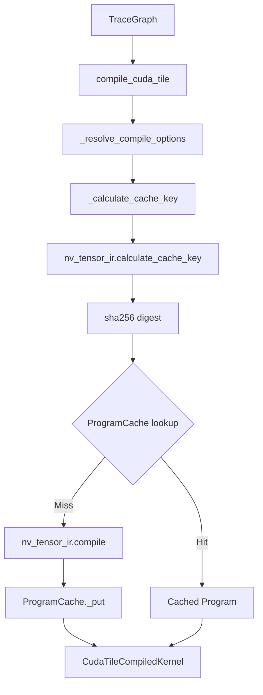
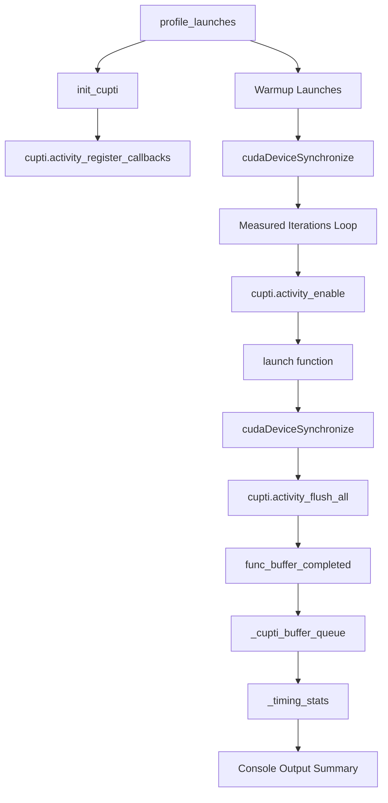

<!-- source: DeepWiki mcp.deepwiki.com · repo NVIDIA/tensor-ir · extra page DSL CudaTile Backend, Caching and Profiling · fetched 2026-10-26 -->

# DSL CudaTile Backend, Caching and Profiling

Relevant source files

The following files were used as context for generating this wiki page:

- [python/src/nv_tensor_ir/dsl/cuda_tile_backend.py](python/src/nv_tensor_ir/dsl/cuda_tile_backend.py)
- [python/src/nv_tensor_ir/dsl/profile.py](python/src/nv_tensor_ir/dsl/profile.py)

## Purpose and Scope
This page details the implementation of the CUDA Tile backend support for the TensorIR tracing DSL (`python/src/nv_tensor_ir/dsl/cuda_tile_backend.py`), including kernel compilation lifecycle, dynamic shape validations, program cache key calculation, and CUPTI-backed kernel runtime profiling (`python/src/nv_tensor_ir/dsl/profile.py`).

---

## 1. CUDA Tile Backend Implementation (`cuda_tile_backend.py`)

The CUDA Tile backend integrates the tracing DSL with the core `nv_tensor_ir` MLIR compiler infrastructure. Traced operations and graphs are compiled into executable kernels via `compile_cuda_tile` [python/src/nv_tensor_ir/dsl/cuda_tile_backend.py:151-187] and wrapped in the `CudaTileCompiledKernel` class [python/src/nv_tensor_ir/dsl/cuda_tile_backend.py:42-70].

### `CudaTileCompiledKernel`
The `CudaTileCompiledKernel` class inherits from `CompiledKernel` and maintains references to the compiled MLIR `program`, the underlying `module`, the capture `graph`, and input/output counts [python/src/nv_tensor_ir/dsl/cuda_tile_backend.py:42-55]. 
- `get_bytecode(self)` retrieves the compiled program bytecode via `self.program.get_bytecode()` [python/src/nv_tensor_ir/dsl/cuda_tile_backend.py:56-57].
- `run(self, *inputs, output)` validates input/output tensor counts against expected dimensions and invokes `self.program.launch(*inputs, *outputs)` [python/src/nv_tensor_ir/dsl/cuda_tile_backend.py:59-69].

### Dynamic Shape Support and Metadata Overrides
Dynamic shape processing is managed through `prepare_tensor_infos`, which delegates to `_check_dynamic_shape_supported` and `_dynamic_ir_metadata_overrides` [python/src/nv_tensor_ir/dsl/cuda_tile_backend.py:72-121]. 
- `_check_dynamic_shape_supported` restricts allowed node kinds to inputs, output references, constants, splats, unary/binary/convert/cmp/matmul/select ops, and transpose movement ops [python/src/nv_tensor_ir/dsl/cuda_tile_backend.py:23-38, 84-96].
- `_dynamic_ir_metadata_overrides` seeds dynamic tracking with input and output reference IDs, traverses trace nodes to propagate dynamic traits forward via SSA and `like` arguments, and constructs a dictionary of overridden `TensorInfo` descriptors with `dynamic_shape=True` [python/src/nv_tensor_ir/dsl/cuda_tile_backend.py:99-121].

Sources: `python/src/nv_tensor_ir/dsl/cuda_tile_backend.py`

---

## 2. Compilation Flow and Program Caching

Compilation via `compile_cuda_tile` resolves compile options using `_resolve_compile_options` and checks for dynamic matmul constraints (requiring `CodegenStrategy.AffineMap`) [python/src/nv_tensor_ir/dsl/cuda_tile_backend.py:141-168]. 

If a `ProgramCache` instance is provided, compilation keys are computed using `_calculate_cache_key`, which queries `nv_tensor_ir.calculate_cache_key` and applies an SHA-256 hash [python/src/nv_tensor_ir/dsl/cuda_tile_backend.py:124-135]. Cache misses trigger compilation via `nv_tensor_ir.compile` and store the resulting program back into the cache [python/src/nv_tensor_ir/dsl/cuda_tile_backend.py:170-177].

Title: "CUDA Tile Compilation and Caching Data Flow"

Sources: `python/src/nv_tensor_ir/dsl/cuda_tile_backend.py`

---

## 3. Runtime Profiling with CUPTI (`profile.py`)

Profiling support is implemented in `python/src/nv_tensor_ir/dsl/profile.py`, utilizing the NVIDIA CUPTI profiling library to capture concurrent kernel execution metrics.

### Initialization and CUPTI Callbacks
`init_cupti` checks for optional dependencies (`cupti-python` and `cuda-python`), registers internal memory request callbacks (`func_buffer_requested`), and activity completion callbacks (`func_buffer_completed`) that collect `CONCURRENT_KERNEL` activities into a thread-safe queue (`_cupti_buffer_queue`) [python/src/nv_tensor_ir/dsl/profile.py:14-49].

### Profiling Configuration and Execution
`ProfilingConfig` controls `warmup` and `iterations` counts, enforcing non-negative warmup rounds and positive iteration counts during post-initialization [python/src/nv_tensor_ir/dsl/profile.py:51-70].

`profile_launches` executes warmup launches, synchronizes the device using `cudaDeviceSynchronize`, and loops over measured iterations while enabling and flushing CUPTI concurrent kernel activities [python/src/nv_tensor_ir/dsl/profile.py:81-114]. Captured durations are normalized from nanoseconds to microseconds and summarized by `_timing_stats` [python/src/nv_tensor_ir/dsl/profile.py:111-125].

### Timing Statistics and Outlier Filtering
`_timing_stats` computes descriptive metrics (minimum, average, median, maximum) and filters out 3-sigma outliers if the sample size meets or exceeds `_OUTLIER_FILTER_MIN_SAMPLES` (30 samples) [python/src/nv_tensor_ir/dsl/profile.py:14-154].

Title: "CUPTI Profiling Pipeline Architecture"

Sources: `python/src/nv_tensor_ir/dsl/profile.py`

---

