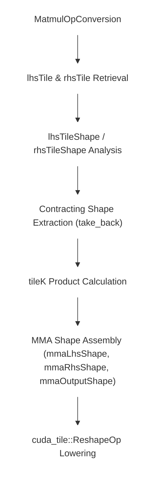

<!-- source: DeepWiki mcp.deepwiki.com · repo NVIDIA/tensor-ir · extra page Matmul Lowering · fetched 2026-10-26 -->

# Matmul Lowering

<details>
<summary>Relevant source files</summary>

The following files were used as context for generating this wiki page:

- [lib/Conversion/TensorToCudaTile/MatmulOps.cpp](lib/Conversion/TensorToCudaTile/MatmulOps.cpp)
- [test/Conversion/TensorToCudaTile/iterspace_matmul.mlir](test/Conversion/TensorToCudaTile/iterspace_matmul.mlir)

</details>


## Purpose and Scope
This section covers the conversion of high-level matrix multiplication operations (`nv_tensor_ir.matmul`) into low-level CUDA Tile IR primitives within the `TensorToCudaTile` conversion pass. Specifically, it details `MatmulOpConversion`, which performs dimension classification via layout analysis, computes appropriate tile shapes across batch, $M$, $N$, and $K$ dimensions, generates matrix-multiply-accumulate operations (`mmaf` or `mmai`), and coordinates loop structures and output normalization.

Sources: `lib/Conversion/TensorToCudaTile/MatmulOps.cpp:44-53` [lib/Conversion/TensorToCudaTile/MatmulOps.cpp]()

---

## Dimension Classification and Layout Analysis

During lowering, `MatmulOpConversion` inspects the layout attributes attached to the matrix multiplication operation to classify dimensions into distinct categories: batch, left-input ($M$), right-input ($N$), and broadcasted dimensions.

The conversion routine extracts the `MatmulSourceAttr` layout from the operation and iterates over the CuTe layout view ranks. Stride inspection determines the role of each dimension:
* **Broadcast**: Identified when a dimension stride equals `0`.
* **Batch**: Identified when a dimension stride is greater than or equal to the product of $M$, $N$, and $K$ components.
* **LeftInput ($M$ Spans)**: Identified when strides align with the $M$ dimension hierarchy.
* **RightInput ($N$ Spans)**: Identified by remaining non-zero strides corresponding to the $N$ dimension hierarchy.

```mermaid
graph TD
    A["MatmulOp"] --> B["MatmulOpConversion::matchAndRewrite"]
    B --> C["MatmulSourceAttr (getCuteLayout)"]
    C --> D["Dimension Classification Loop"]
    D --> E["DimensionType::Broadcast (stride == 0)"]
    D --> F["DimensionType::Batch (stride >= M*N*K)"]
    D --> G["DimensionType::LeftInput (stride >= N*K)"]
    D --> H["DimensionType::RightInput (stride < N*K)"]

    style A fill:none,stroke:none
    style B fill:none,stroke:none
    style C fill:none,stroke:none
    style D fill:none,stroke:none
    style E fill:none,stroke:none
    style F fill:none,stroke:none
    style G fill:none,stroke:none
    style H fill:none,stroke:none
```
Sources: `lib/Conversion/TensorToCudaTile/MatmulOps.cpp:88-110` [lib/Conversion/TensorToCudaTile/MatmulOps.cpp]()

---

## Tile Shapes and Contracting Dimensions

Once dimensions are classified, the compiler calculates the respective tile sizes for batch (`tileB`), $M$ (`tileM`), $N$ (`tileN`), and $K$ (`tileK`) axes. The contracting dimension tile size ($tileK$) is derived from the LHS input shape and the rank of the contracting shape specified in the layout attributes.

Input tiles for the left-hand side (LHS) and right-hand side (RHS) are retrieved from the conversion state, and dynamic reshaping is applied if the underlying tile shapes mismatch the expected MMA tile configuration.


Sources: `lib/Conversion/TensorToCudaTile/MatmulOps.cpp:64-86` [lib/Conversion/TensorToCudaTile/MatmulOps.cpp](), `lib/Conversion/TensorToCudaTile/MatmulOps.cpp:112-140` [lib/Conversion/TensorToCudaTile/MatmulOps.cpp]()

---

## MmaF and MmaI Creation

The core computation is lowered into hardware-supported matrix-multiply-accumulate instructions (`mmaf` for floating-point types, or `mmai` for integer types). 

Type validation is performed prior to emission via `isSupportedMatmulTypes`, which restricts lowering to supported hardware precisions (e.g., `f16` inputs with `f16`/`f32` outputs, `bf16`/`f32` inputs with `f32` outputs, `f64`, and `i8` integers producing `i32`).

For larger contracting dimensions, a loop nest is generated over the $K$ axis using `cuda_tile` loop structures, accumulating partial products across iterations.

Sources: `lib/Conversion/TensorToCudaTile/MatmulOps.cpp:24-42` [lib/Conversion/TensorToCudaTile/MatmulOps.cpp](), `test/Conversion/TensorToCudaTile/iterspace_matmul.mlir:114-125` [test/Conversion/TensorToCudaTile/iterspace_matmul.mlir]()

---

## Output Normalization and Post-Processing

Following the execution of the MMA instruction, the resulting accumulator tile undergoes normalization and optional structural layout transformations. If downstream consumers or explicit graph operations require layout permutations (such as a `transpose` or `permute`), conversion patterns insert permutation operators to match the target tensor representation before storing views back to memory.

Sources: `test/Conversion/TensorToCudaTile/iterspace_matmul.mlir:88-89` [test/Conversion/TensorToCudaTile/iterspace_matmul.mlir]()

---

