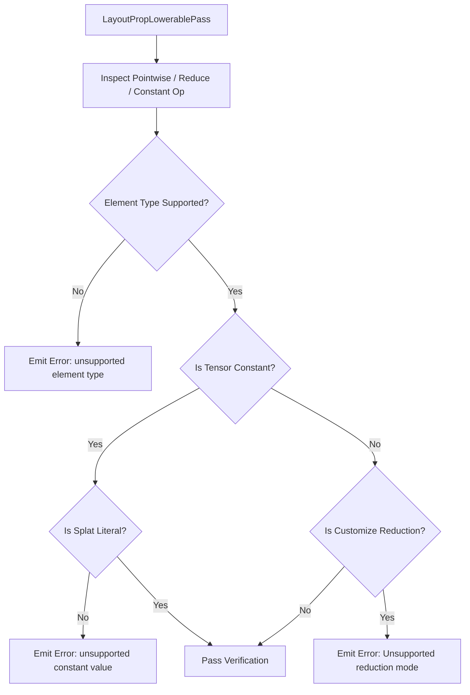
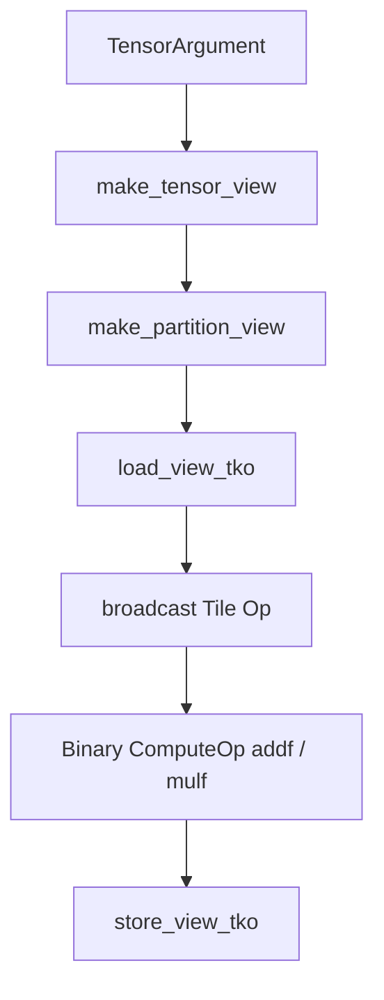
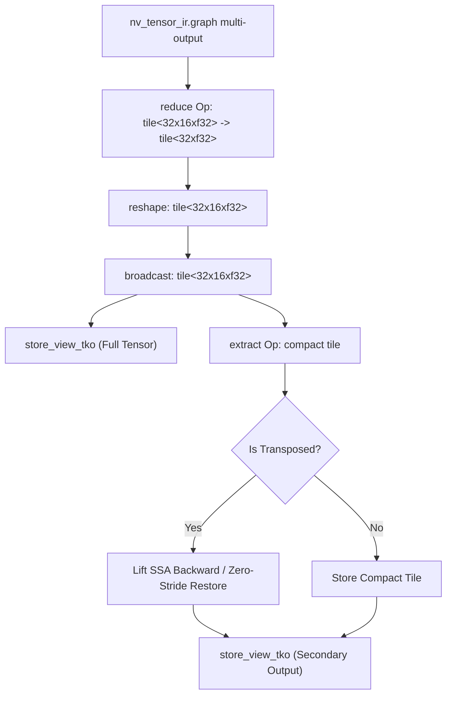

<!-- source: DeepWiki mcp.deepwiki.com · repo NVIDIA/tensor-ir · extra page Pointwise, Broadcast and Multi-Output Lowering · fetched 2026-10-26 -->

# Pointwise, Broadcast and Multi-Output Lowering

Relevant source files

The following files were used as context for generating this wiki page:

- [test/Conversion/TensorToCudaTile/broadcast_layout.mlir](test/Conversion/TensorToCudaTile/broadcast_layout.mlir)
- [test/Conversion/TensorToCudaTile/multi_output.mlir](test/Conversion/TensorToCudaTile/multi_output.mlir)
- [test/Conversion/TensorToCudaTile/validate_pointwise.mlir](test/Conversion/TensorToCudaTile/validate_pointwise.mlir)

This section covers the conversion details for pointwise operations, constant value validation, broadcast layouts, and multi-output graph lowering within the `TensorToCudaTile` conversion layer of the TensorIR compiler [test/Conversion/TensorToCudaTile/validate_pointwise.mlir:1-6]() [test/Conversion/TensorToCudaTile/broadcast_layout.mlir:1-2]() [test/Conversion/TensorToCudaTile/multi_output.mlir:1-6](). It details how the pre-flight lowerability checks enforce element type and constant constraints [test/Conversion/TensorToCudaTile/validate_pointwise.mlir:8-52](), how tensor broadcasts are lowered into partition views and tile broadcast instructions [test/Conversion/TensorToCudaTile/broadcast_layout.mlir:3-24](), and how multi-result graphs (such as RMSNorm training passes) handle shared carriers, extractions, and transposed statistics [test/Conversion/TensorToCudaTile/multi_output.mlir:3-95]().

---

## 1. Pointwise and Constant Validation

The TensorIR compiler executes pre-flight feasibility checks through `-verify-layout-prop-lowerable` to ensure that pointwise operations, constants, and reduction modes can be successfully synthesized by the tile lowering patterns before code generation begins [test/Conversion/TensorToCudaTile/validate_pointwise.mlir:1-6]().

Key validation checks include:
- **Element Type Restrictions**: Operations like `pow` require floating-point result types and reject integer inputs [test/Conversion/TensorToCudaTile/validate_pointwise.mlir:8-16](). Bitwise or logical `not` is strictly restricted to boolean (`i1`) element types [test/Conversion/TensorToCudaTile/validate_pointwise.mlir:20-27](). Exact GELU lowerings rely on `cuda_tile.experimental$erf`, which is limited to `f32` and `f64`, rejecting half-precision `f16` tensors [test/Conversion/TensorToCudaTile/validate_pointwise.mlir:31-40]().
- **Constant Literals**: Tensor-typed constants must carry a splat literal value. Non-splat dense literal values are unsupported and rejected by the validator [test/Conversion/TensorToCudaTile/validate_pointwise.mlir:43-52]().
- **Reduction Modes**: The `customize` reduction mode carries a user-defined combiner region that cannot be synthesized automatically by the tile lowering pass, causing it to be rejected [test/Conversion/TensorToCudaTile/validate_pointwise.mlir:71-82]().
- **Metadata Consistency**: Single-output and multi-output result metadata checks verify that result layouts and iteration spaces match the normalized carrier shapes [test/Conversion/TensorToCudaTile/validate_pointwise.mlir:85-98]().

*Diagram 1: Pointwise and Constant Validation Data Flow (Natural Language Space to Code Entity Space)*

**Sources:** `test/Conversion/TensorToCudaTile/validate_pointwise.mlir:1-99` [test/Conversion/TensorToCudaTile/validate_pointwise.mlir:1-98]()

---

## 2. Broadcast Layouts

When a tensor broadcast operation is encountered during lowering, the conversion pattern maps the source tensor into a `tensor_view` and a `partition_view` before executing tile-level expansion [test/Conversion/TensorToCudaTile/broadcast_layout.mlir:3-24]().

The broadcast lowering flow operates as follows:
- **Partition Creation**: A tensor view is instantiated using `make_tensor_view` and partitioned via `make_partition_view` with layout attributes reflecting source strides [test/Conversion/TensorToCudaTile/broadcast_layer.mlir:3-11]() [test/Conversion/TensorToCudaTile/broadcast_layout.mlir:28-36]().
- **Load and Expand**: Elements are loaded using `load_view_tko` and expanded via the `broadcast` tile operation into higher-dimensional tiles (e.g., `tile<1x1xf32> -> tile<1x32xf32>`) [test/Conversion/TensorToCudaTile/broadcast_layout.mlir:7-11]() [test/Conversion/TensorToCudaTile/broadcast_layout.mlir:32-36]().
- **Dynamic Extents**: Broadcast operations over dynamically shaped rows (such as `tensor<?x32xf32>`) retain stride consistency and correctly scale tile partition loads across dynamic boundaries [test/Conversion/TensorToCudaTile/broadcast_layout.mlir:106-126]().

*Diagram 2: Broadcast Lowering Pipeline and Memory Views*

**Sources:** `test/Conversion/TensorToCudaTile/broadcast_layout.mlir:1-127` [test/Conversion/TensorToCudaTile/broadcast_layout.mlir:1-126]()

---

## 3. Multi-Output Graph Lowering

Multi-output graphs, such as those representing RMSNorm forward training paths, produce multiple return tensors with disparate layouts and shapes derived from shared intermediate computations [test/Conversion/TensorToCudaTile/multi_output.mlir:3-29]().

Key mechanisms in multi-output lowering include:
- **Carrier Selection and Transport**: The compiler selects a primary carrier computation tile (e.g., a reduction result) and propagates it backward or forward through SSA edges. Reversing the ABI return order of the graph does not alter the underlying computation tile or carrier selection; it only rearranges the store destinations [test/Conversion/TensorToCudaTile/multi_output.mlir:33-58]().
- **Compact Tile Extraction**: When a broadcasted value must also be returned as a compact reduced statistic (e.g., reducing along dimension 1 from `tile<32x16xf32>` to `tile<32xf32>`), the lowering pattern uses `extract` on the broadcasted tile to derive the compact `[T_R, 1]` tile for storage [test/Conversion/TensorToCudaTile/multi_output.mlir:6-12]().
- **Transposed Statistics**: If a compact reduction result is transposed at the graph ABI level (e.g., `tensor<64x1xf32>` to `tensor<1x64xf32>`), carrier lifting traces the SSA path backward, undoes the transpose, and restores the projected dimension with zero stride [test/Conversion/TensorToCudaTile/multi_output.mlir:62-76](). The CUDA Tile backend treats the explicit `transpose` operation as a no-op during physical code generation [test/Conversion/TensorToCudaTile/multi_output.mlir:62-76]().

*Diagram 3: Multi-Output Carrier Lifting and Extraction Flow*

**Sources:** `test/Conversion/TensorToCudaTile/multi_output.mlir:1-129` [test/Conversion/TensorToCudaTile/multi_output.mlir:1-129]()

---

