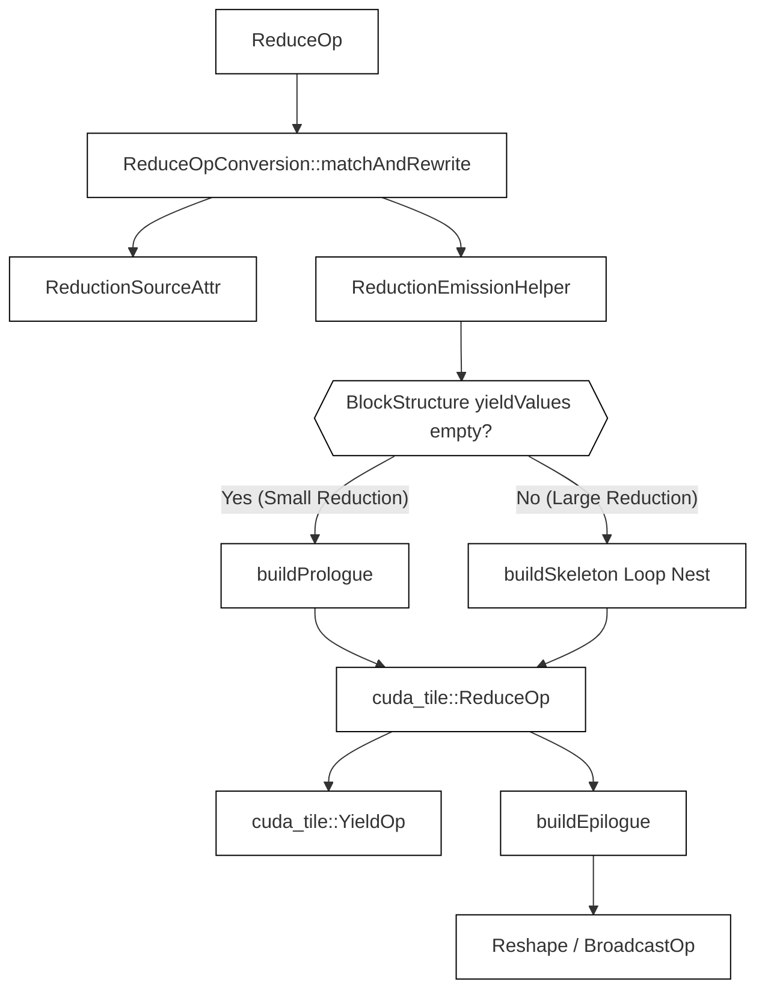
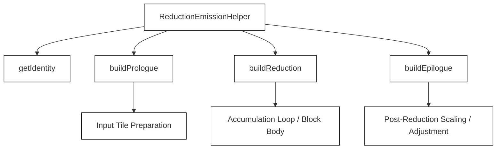

<!-- source: DeepWiki mcp.deepwiki.com · repo NVIDIA/tensor-ir · extra page Reduction Lowering · fetched 2026-10-26 -->

# Reduction Lowering

Relevant source files

The following files were used as context for generating this wiki page:

- [lib/Conversion/TensorToCudaTile/ReductionOps.cpp](lib/Conversion/TensorToCudaTile/ReductionOps.cpp)
- [test/Transform/layout-propagation-reduction.mlir](test/Transform/layout-propagation-reduction.mlir)

## Purpose and Scope

This section details the lowering mechanism for reduction operations within the TensorIR compilation pipeline. Specifically, it covers the conversion patterns for `ReduceOp` (predefined reduction types) and `ReduceUDOp` (user-defined reduction computations) from the `nv_tensor_ir` dialect into `cuda_tile` dialect operations. Key components include the analysis of reduction dimension counts, the orchestration of tile shape transformations, the role of `ReductionEmissionHelper` in managing identities, prologues, and epilogues, and the handling of small versus large reduction iterations via loop skeletons [lib/Conversion/TensorToCudaTile/ReductionOps.cpp:1-50]().

Sources: `lib/Conversion/TensorToCudaTile/ReductionOps.cpp`

---

## Reduction Lowering Architecture and Patterns

The lowering of reduction operations is implemented primarily through the `ReduceOpConversion` pattern, which matches `ReduceOp` nodes in the TensorIR graph [lib/Conversion/TensorToCudaTile/ReductionOps.cpp:53-60](). Because the underlying CUDA Tile IR target natively supports contraction along only a single dimension, TensorIR's layout propagation pass guarantees that multiple reduction dimensions are merged and made adjacent prior to lowering [lib/Conversion/TensorToCudaTile/ReductionOps.cpp:13-15]().

The conversion sequence follows these key phases:
1. **State & Layout Retrieval**: Updates the conversion state via `state.update` and retrieves the `ReductionSourceAttr` layout constraints to determine input, result, and output tile shapes [lib/Conversion/TensorToCudaTile/ReductionOps.cpp:60-84]().
2. **Emission Helper Initialization**: Instantiates a `ReductionEmissionHelper` using the operation's reduction mode and element data type [lib/Conversion/TensorToCudaTile/ReductionOps.cpp:97-101]().
3. **Skeleton or Direct Emission**: 
   - For small reduction domains, a single `cuda_tile::ReduceOp` is emitted [lib/Conversion/TensorToCudaTile/ReductionOps.cpp:19-21, 135-138]().
   - For large reduction domains where blocks are generated, `buildSkeleton` builds a loop nest over tiles in the reduction dimension, accumulating results into the block structure [lib/Conversion/TensorToCudaTile/ReductionOps.cpp:23-27, 102-120]().
4. **Epilogue & Broadcasting**: Applies any required epilogue transformations and handles result reshaping or broadcasting (`cuda_tile::BroadcastOp`) if the output tile shape demands it [lib/Conversion/TensorToCudaTile/ReductionOps.cpp:16-17, 153-157]().

*Figure 1: Natural Language Space to Code Entity Space mapping for reduction lowering flows.*

Sources: `lib/Conversion/TensorToCudaTile/ReductionOps.cpp`

---

## The `ReductionEmissionHelper` and Reduction Modes

The `ReductionEmissionHelper` class encapsulates the arithmetic semantics of reductions, mapping high-level TensorIR reduction modes (such as addition, maximum, or minimum) to low-level scalar and vector operations [lib/Conversion/TensorToCudaTile/ReductionOps.cpp:97-100](). 

The helper governs three distinct phases of code generation:
* **Prologue (`buildPrologue`)**: Prepares the input tile values before reduction accumulation [lib/Conversion/TensorToCudaTile/ReductionOps.cpp:110-119]().
* **Reduction Accumulation (`buildReduction`)**: Implements the inner reduction loop body, combining left-hand side and right-hand side arguments inside the `cuda_tile::ReduceOp` block region [lib/Conversion/TensorToCudaTile/ReductionOps.cpp:111-112, 140-149]().
* **Epilogue (`buildEpilogue`)**: Processes the output of the tile reduction (e.g., scaling or final adjustments) using the reduction size attribute [lib/Conversion/TensorToCudaTile/ReductionOps.cpp:153-155]().

Additionally, `ReductionEmissionHelper` supplies the neutral identity elements required by `cuda_tile::ReduceOp` through its identity retrieval functions [lib/Conversion/TensorToCudaTile/ReductionOps.cpp:133-134]().

*Figure 2: Lifecycle phases managed by `ReductionEmissionHelper`.*

Sources: `lib/Conversion/TensorToCudaTile/ReductionOps.cpp`

---

## Layout Propagation and Multi-Dimension Lowering

Layout propagation for reductions ensures that axes targeted for reduction are correctly aligned and collapsed into contiguous dimensions when handled by the conversion pass. Multi-dimensional reductions utilize `#nv_tensor_ir.reduction_source` attributes to encode layout maps for both input tensors and reduction strides [test/Transform/layout-propagation-reduction.mlir:13-19]().

| Attribute / Component | Role in Lowering | Source Reference |
|-----------------------|------------------|------------------|
| `#nv_tensor_ir.reduction_source` | Specifies layout mappings, source tensors, and reduction dimension groupings. | [test/Transform/layout-propagation-reduction.mlir:4]() |
| `ReduceOp` | High-level reduction op with dimensions and reduction mode attributes. | [lib/Conversion/TensorToCudaTile/ReductionOps.cpp:53-59]() |
| `cuda_tile::ReduceOp` | Low-tile dialect operation accepting single-dimension reductions and identity attributes. | [lib/Conversion/TensorToCudaTile/ReductionOps.cpp:135-138]() |

Sources: `lib/Conversion/TensorToCudaTile/ReductionOps.cpp`, `test/Transform/layout-propagation-reduction.mlir`

---

