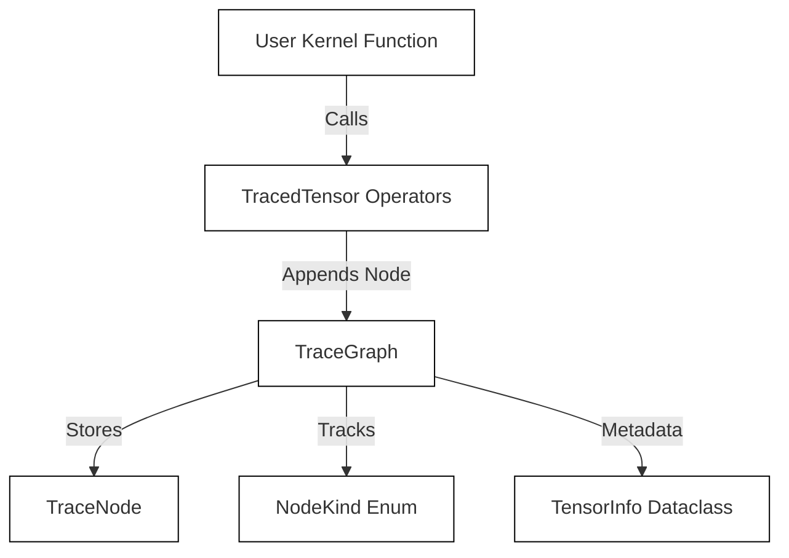
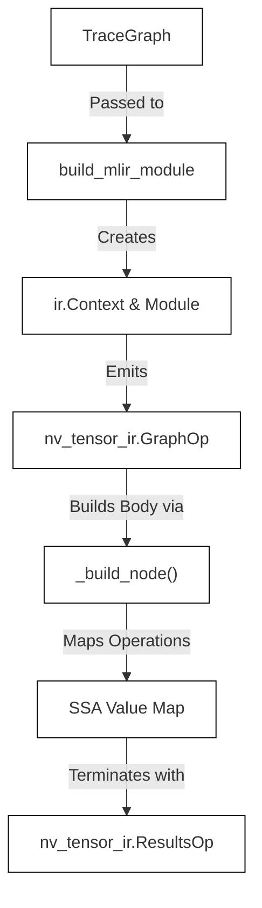

<!-- source: DeepWiki mcp.deepwiki.com · repo NVIDIA/tensor-ir · extra page Tracing and Module Building · fetched 2026-10-26 -->

# Tracing and Module Building

Relevant source files

The following files were used as context for generating this wiki page:

- [python/src/nv_tensor_ir/dsl/module_builder.py](python/src/nv_tensor_ir/dsl/module_builder.py)
- [python/src/nv_tensor_ir/dsl/tracing.py](python/src/nv_tensor_ir/dsl/tracing.py)

## Purpose and Scope

This section describes the implementation of the Python tracing subsystem (`python/src/nv_tensor_ir/dsl/tracing.py`) and the MLIR module builder (`python/src/nv_tensor_ir/dsl/module_builder.py`). Together, these components capture user-defined Python tensor expressions written under `@tir.kernel` decorators and lower them into well-formed MLIR modules utilizing the `nv_tensor_ir` dialect.

---

## 1. Python Tracing Infrastructure (`tracing.py`)

The tracing infrastructure intercepts standard mathematical operations on tensor abstractions and records them into an intermediate representation graph called `TraceGraph`.

### Core Data Structures and Enums

*   **`NodeKind`**: Defines the categorization of every node recorded in the trace graph, including `NodeKind.INPUT`, `NodeKind.OUTPUT_REF`, `NodeKind.CONSTANT`, `NodeKind.SPLAT`, `NodeKind.UNARY`, `NodeKind.BINARY`, `NodeKind.CONVERT`, `NodeKind.CMP`, `NodeKind.MOVEMENT`, `NodeKind.CONCATENATE`, `NodeKind.IOTA`, `NodeKind.REDUCE`, `NodeKind.SELECT`, and `NodeKind.MATMUL` [python/src/nv_tensor_ir/dsl/tracing.py:15-30]().
*   **Operations (`UnaryOp`, `BinaryOp`, `MovementOp`)**: Enums enumerating supported math and tensor transformation primitives [python/src/nv_tensor_ir/dsl/tracing.py:32-76]().
*   **`TensorInfo`**: A frozen dataclass storing metadata for tensors, including `name`, `dtype`, `shape`, `stride`, and `dynamic_shape` flags [python/src/nv_tensor_ir/dsl/tracing.py:88-97]().
*   **`TraceNode`**: Represents an individual operation or variable within the trace, holding its `kind`, `op`, `tensor_info`, input argument indices (`args`), and operation attributes (`kwargs`) [python/src/nv_tensor_ir/dsl/tracing.py:100-110]().

### Graph Management and Context

The active trace graph is managed via context variables (`_CURRENT_TRACE_GRAPH`) to allow transparent operator overloading without explicitly passing graph references through every user expression [python/src/nv_tensor_ir/dsl/tracing.py:186-206]().

*   **`TraceGraph`**: Maintains a linear sequence of `TraceNode` objects, keeping track of `input_ids`, `output_ref_ids`, and final `result_ids` [python/src/nv_tensor_ir/dsl/tracing.py:112-184]().
*   **`TracedTensor`**: Wraps a graph node ID, exposing overloaded Python operators (`__add__`, `__sub__`, `__mul__`, etc.) that append corresponding binary or unary nodes to the active `TraceGraph` [python/src/nv_tensor_ir/dsl/tracing.py:208-225]().

**Sources:** `python/src/nv_tensor_ir/dsl/tracing.py:15-225`

---

## 2. MLIR Module Construction (`module_builder.py`)

Once a Python function has been traced into a `TraceGraph`, `build_mlir_module` translates the graph into an MLIR module instance using the Python bindings for MLIR [python/src/nv_tensor_ir/dsl/module_builder.py:20-88]().

### Compilation Flow in `build_mlir_module`

1.  **Context Initialization**: Initializes an `ir.Context`, disables multithreading to avoid thread pool accumulation, and registers the `nv_tensor_ir` dialect [python/src/nv_tensor_ir/dsl/module_builder.py:30-34]().
2.  **Signature Extraction**: Iterates through `graph.input_ids` and output information to derive input/result tensor types and attributes via `_tensor_type` and `_tensor_attr` [python/src/nv_tensor_ir/dsl/module_builder.py:40-48]().
3.  **Graph Operation Creation**: Emits an `nv_tensor_ir.GraphOp` containing a single block whose arguments correspond to the graph inputs [python/src/nv_tensor_ir/dsl/module_builder.py:50-61]().
4.  **Node Lowering (`_build_node`)**: Iterates through graph nodes, skipping inputs and output references, and dispatches each node to construct the corresponding MLIR operation (`ConstantOp`, `SplatOp`, `BinaryOp`, `UnaryOp`, `ConvertOp`, movement ops, `ConcatenateOp`, `IotaOp`, `ReduceOp`, `CmpOp`) [python/src/nv_tensor_ir/dsl/module_builder.py:63-182]().
5.  **Terminator Emission**: Concludes the graph region by emitting an `nv_tensor_ir.ResultsOp` containing the SSA values mapped to `graph.result_ids` [python/src/nv_tensor_ir/dsl/module_builder.py:83-85]().

**Sources:** `python/src/nv_tensor_ir/dsl/module_builder.py:20-182`

---

## 3. Translation and Data Flow Architecture

The pipeline bridges high-level Python expressions to low-level MLIR representations through the cooperation of `tracing.py` and `module_builder.py`.

| Component / Function | Role in Pipeline | Code Reference |
| :--- | :--- | :--- |
| `TraceGraph` | Aggregates nodes during Python execution | `python/src/nv_tensor_ir/dsl/tracing.py:112-184` |
| `TracedTensor` | Intercepts arithmetic and movement operator calls | `python/src/nv_tensor_ir/dsl/tracing.py:208-225` |
| `build_mlir_module` | Entrypoint converting `TraceGraph` to MLIR | `python/src/nv_tensor_ir/dsl/module_builder.py:20-88` |
| `_build_node` | Lowers individual `NodeKind` instances into MLIR ops | `python/src/nv_tensor_ir/dsl/module_builder.py:90-182` |

**Sources:** `python/src/nv_tensor_ir/dsl/tracing.py:112-225`, `python/src/nv_tensor_ir/dsl/module_builder.py:20-182`

---

