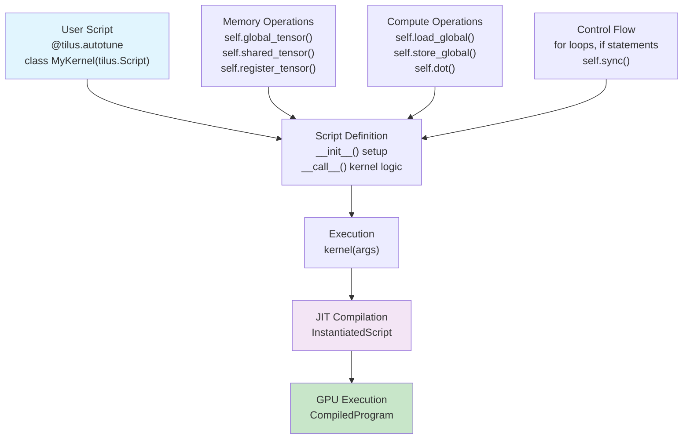
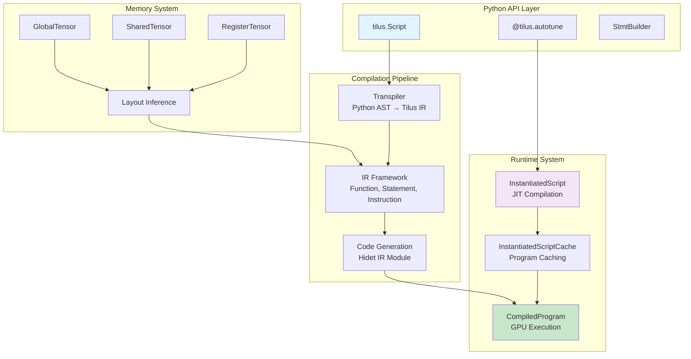
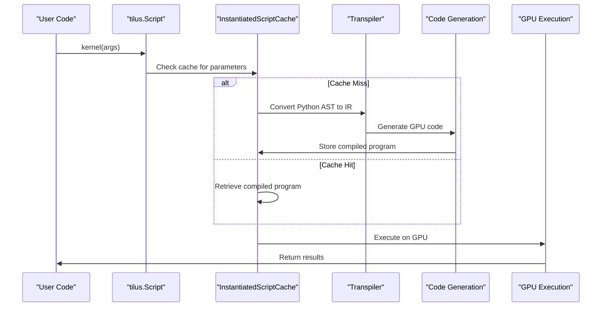

<!-- source: DeepWiki mcp.deepwiki.com · repo NVIDIA/tilus · page 2 Getting Started · fetched 2026-10-26 -->

# Getting Started

<details>
<summary>Relevant source files</summary>

The following files were used as context for generating this wiki page:

- [.gitignore](.gitignore)
- [docs/source/_static/custom.css](docs/source/_static/custom.css)
- [docs/source/conf.py](docs/source/conf.py)
- [docs/source/getting-started/install.rst](docs/source/getting-started/install.rst)
- [docs/source/index.rst](docs/source/index.rst)
- [docs/source/programming-guides/control-flow.rst](docs/source/programming-guides/control-flow.rst)
- [docs/source/programming-guides/thread-group.rst](docs/source/programming-guides/thread-group.rst)
- [docs/source/python-api/tilus-script.rst](docs/source/python-api/tilus-script.rst)
- [pyproject.toml](pyproject.toml)
- [tests/lang/test_thread_group.py](tests/lang/test_thread_group.py)

</details>


This page provides installation instructions and basic examples to help you start programming GPU kernels with Tilus. It covers system requirements, installation, and walks through creating your first kernel to understand the fundamental workflow from Python script to GPU execution.

For detailed programming guides and advanced features, see [Programming Guide](#5). For comprehensive API documentation, see [Core Systems](#3).

## Overview and Workflow

Tilus enables GPU programming through a Python-based domain-specific language built around the `tilus.Script` class. The system follows a clear workflow from high-level Python code to optimized GPU kernels.

### User Programming Workflow



**Sources:** [pyproject.toml:1-123](), [docs/source/python-api/tilus-script.rst:1-123]()

### System Architecture Components



**Sources:** [docs/source/python-api/tilus-script.rst:10-27](), [tests/lang/test_thread_group.py:21-50]()

## Installation

### System Requirements

Tilus requires:
- Python 3.10 or higher
- NVIDIA GPU with CUDA support
- Compatible CUDA driver (version 580.65.06 or newer recommended)

### Standard Installation

Install Tilus from PyPI using pip:

```bash
pip install tilus
```

### Development Installation

For development or to access the latest features:

```bash
git clone git@github.com:NVIDIA/tilus.git
cd tilus
pip install -e .
```

The `-e` flag enables editable installation, allowing immediate reflection of source code changes without reinstalling.

### CUDA Driver Compatibility

For older GPU drivers (prior to 580.65.06), install a compatible version of `cuda-python`:

```bash
pip install tilus "cuda-python<13"
```

**Sources:** [docs/source/getting-started/install.rst:1-28](), [pyproject.toml:28-32]()

## Dependencies and Build System

| Component | Version | Purpose |
|-----------|---------|---------|
| `hidet` | 0.6.1 | Backend compilation framework |
| `torch` | Latest | Tensor operations and GPU memory management |
| `tabulate` | Latest | Table formatting for output |

### Development Dependencies

| Tool | Version | Purpose |
|------|---------|---------|
| `ruff` | 0.11.0 | Code linting and formatting |
| `mypy` | 1.15.0 | Static type checking |
| `pytest` | Latest | Testing framework |
| `sphinx` | Latest | Documentation generation |

**Sources:** [pyproject.toml:28-55]()

## First Kernel Example

Here's a simple vector addition kernel that demonstrates the basic Tilus programming model:

### Basic Vector Addition

```python
import tilus
from tilus import float32, int32

class VectorAdd(tilus.Script):
    def __init__(self, block_size: int = 256):
        super().__init__()
        self.block_size = block_size
    
    def __call__(self, n: int32, a_ptr: ~float32, b_ptr: ~float32, c_ptr: ~float32):
        # Set execution configuration
        self.attrs.blocks = (n + self.block_size - 1) // self.block_size
        self.attrs.warps = self.block_size // 32
        
        # Create global tensor views
        a = self.global_view(a_ptr, dtype=float32, shape=[n])
        b = self.global_view(b_ptr, dtype=float32, shape=[n])
        c = self.global_view(c_ptr, dtype=float32, shape=[n])
        
        # Calculate thread block offset
        offset = self.blockIdx.x * self.block_size
        
        # Load data from global memory
        a_data = self.load_global(a, offsets=[offset], shape=[self.block_size])
        b_data = self.load_global(b, offsets=[offset], shape=[self.block_size])
        
        # Perform computation
        result = a_data + b_data
        
        # Store result back to global memory
        self.store_global(c, result, offsets=[offset])

# Usage
import torch

# Create input tensors
n = 1024
a = torch.randn(n, dtype=torch.float32, device="cuda")
b = torch.randn(n, dtype=torch.float32, device="cuda")
c = torch.zeros(n, dtype=torch.float32, device="cuda")

# Execute kernel
kernel = VectorAdd(block_size=256)
kernel(n, a, b, c)

# Verify result
expected = a + b
torch.testing.assert_close(c, expected)
```

### Key Programming Concepts

| Concept | API Method | Purpose |
|---------|------------|---------|
| **Script Definition** | `class MyKernel(tilus.Script)` | Define GPU kernel class |
| **Execution Config** | `self.attrs.blocks`, `self.attrs.warps` | Set grid and block dimensions |
| **Memory Views** | `self.global_view()` | Create views of global memory |
| **Data Loading** | `self.load_global()` | Load data from global memory |
| **Data Storing** | `self.store_global()` | Store data to global memory |
| **Thread Indexing** | `self.blockIdx.x` | Access block index |

**Sources:** [tests/lang/test_thread_group.py:21-50](), [docs/source/python-api/tilus-script.rst:80-107]()

## Compilation and Execution Flow

### JIT Compilation Process



**Sources:** [docs/source/python-api/tilus-script.rst:22-26]()

### Memory Hierarchy Usage

The example above demonstrates Tilus's memory model:

1. **Global Memory**: Input/output tensors accessed via `global_view()`
2. **Register Memory**: Intermediate computations stored in registers automatically
3. **Thread Block**: Execution organized by block and warp configuration

For shared memory usage and advanced memory optimization, see [Memory Model and Tensor Types](#3.3).

## Next Steps

### Learning Path

1. **Basic Concepts**: Review [Script System](#3.1) for detailed DSL documentation
2. **Memory Management**: Study [Memory Model and Tensor Types](#3.3) for optimization
3. **Examples**: Explore [Basic Matrix Multiplication](#5.1) for progressive optimization techniques
4. **Advanced Features**: Learn [FlashAttention Implementation](#5.2) for complex kernels

### Key Resources

| Resource | Location | Purpose |
|----------|----------|---------|
| **API Reference** | [Core Systems](#3) | Comprehensive class and method documentation |
| **Programming Examples** | [Programming Guide](#5) | Step-by-step tutorials and examples |
| **Advanced Features** | [GPU Programming Features](#6) | Hardware-specific optimizations |

### Common Next Examples

- **Shared Memory Usage**: Implement tiled matrix multiplication
- **Auto-tuning**: Use `@tilus.autotune` for parameter optimization  
- **Thread Groups**: Fine-grained thread control for complex algorithms
- **Async Operations**: Overlap memory transfers with computation

**Sources:** [docs/source/index.rst:13-44](), [docs/source/programming-guides/control-flow.rst:1-99](), [docs/source/programming-guides/thread-group.rst:1-162]()

---

