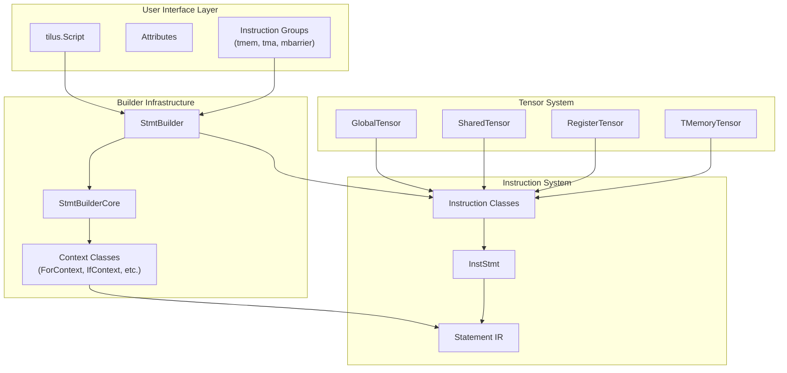
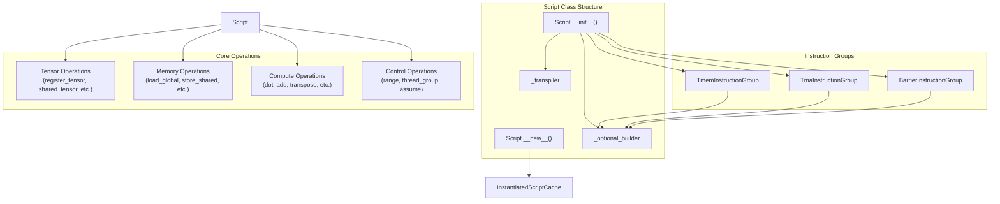
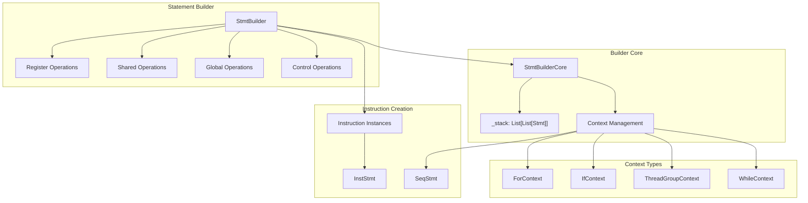
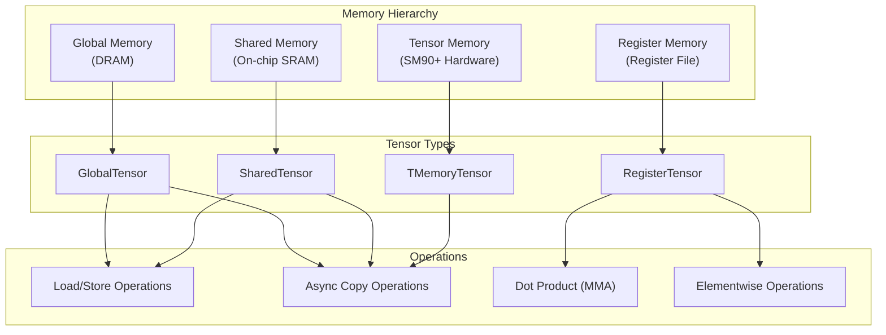
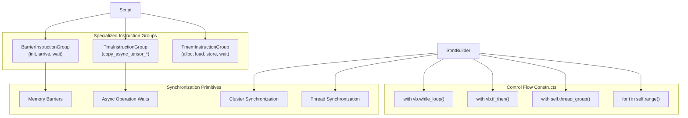
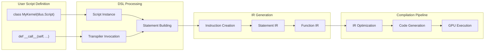

<!-- source: DeepWiki mcp.deepwiki.com · repo NVIDIA/tilus · page 3 Core Systems · fetched 2026-10-26 -->

# Core Systems

Relevant source files

The following files were used as context for generating this wiki page:

- [python/tilus/ir/builders/stmt_builder.py](python/tilus/ir/builders/stmt_builder.py)
- [python/tilus/lang/script.py](python/tilus/lang/script.py)

This page documents the fundamental systems that form the foundation of the Tilus GPU programming framework. These core systems provide the essential infrastructure for defining, compiling, and executing GPU kernels through a high-level Python DSL.

The core systems consist of the Script DSL interface, the statement building infrastructure, the memory and tensor model, and the compilation pipeline. For detailed information about specific aspects, see [Script System](#3.1), [JIT Compilation and Autotuning](#3.2), [Memory Model and Tensor Types](#3.3), and [Target System](#3.4).

## System Architecture Overview

The Tilus core systems form a layered architecture where user-defined scripts are processed through multiple abstraction levels to generate optimized GPU code.

**Core System Architecture**

**Sources:** [python/tilus/lang/script.py:599-649](), [python/tilus/ir/builders/stmt_builder.py:279-370]()

## Script DSL System

The `Script` class serves as the primary interface for users to define GPU kernels using a Python-based domain-specific language.

**Script System Components**

The `Script` class provides methods for tensor allocation, memory operations, mathematical computations, and control flow. Key components include:

| Component | Purpose | Key Methods |
|-----------|---------|-------------|
| Tensor Allocation | Create tensors in different memory spaces | `register_tensor()`, `shared_tensor()`, `global_tensor()` |
| Memory Operations | Transfer data between memory hierarchies | `load_global()`, `store_shared()`, `copy_async()` |
| Compute Operations | Mathematical operations on tensors | `dot()`, `add()`, `transpose()`, `cast()` |
| Control Flow | Program structure and synchronization | `range()`, `thread_group()`, `assume()` |

**Sources:** [python/tilus/lang/script.py:599-649](), [python/tilus/lang/script.py:903-955](), [python/tilus/lang/script.py:1358-1433]()

## Statement Builder Infrastructure

The `StmtBuilder` system translates high-level DSL calls into intermediate representation statements and instructions.

**Statement Builder Hierarchy**

The builder system uses a stack-based approach to manage nested contexts and generates structured IR. Context managers handle control flow constructs like loops and conditionals.

**Sources:** [python/tilus/ir/builders/stmt_builder.py:128-144](), [python/tilus/ir/builders/stmt_builder.py:146-179](), [python/tilus/ir/builders/stmt_builder.py:371-391]()

## Memory Hierarchy and Tensor System

Tilus provides explicit tensor types for each level of the GPU memory hierarchy, enabling fine-grained control over data placement and movement.

**Tensor Type Hierarchy**

Each tensor type supports specific operations optimized for its memory location:

| Tensor Type | Memory Space | Key Operations | Performance Characteristics |
|-------------|--------------|----------------|----------------------------|
| `GlobalTensor` | Global DRAM | Load, store, async copy | High capacity, high latency |
| `SharedTensor` | On-chip SRAM | Load, store, async copy | Medium capacity, low latency |
| `RegisterTensor` | Register file | Compute, elementwise ops | Low capacity, no latency |
| `TMemoryTensor` | Tensor cores | MMA operations | Specialized for matrix operations |

**Sources:** [python/tilus/lang/script.py:956-999](), [python/tilus/lang/script.py:1001-1027](), [python/tilus/lang/script.py:903-955]()

## Instruction and Control Flow System

The instruction system provides fine-grained control over GPU execution through specialized instruction groups and control flow constructs.

**Instruction Group Organization**

Control flow in Tilus is managed through context managers that generate structured IR. The system supports nested scoping and proper resource management.

**Sources:** [python/tilus/lang/script.py:110-156](), [python/tilus/lang/script.py:158-284](), [python/tilus/lang/script.py:491-597](), [python/tilus/ir/builders/stmt_builder.py:284-313]()

## Compilation Flow Integration

The core systems work together to transform user scripts into executable GPU code through a structured compilation pipeline.

**Core System Interaction Flow**

The core systems provide the foundation for Tilus's ability to express complex GPU computations in a high-level Python interface while maintaining fine-grained control over hardware resources.

**Sources:** [python/tilus/lang/script.py:617-624](), [python/tilus/ir/builders/stmt_builder.py:348-368]()

---

